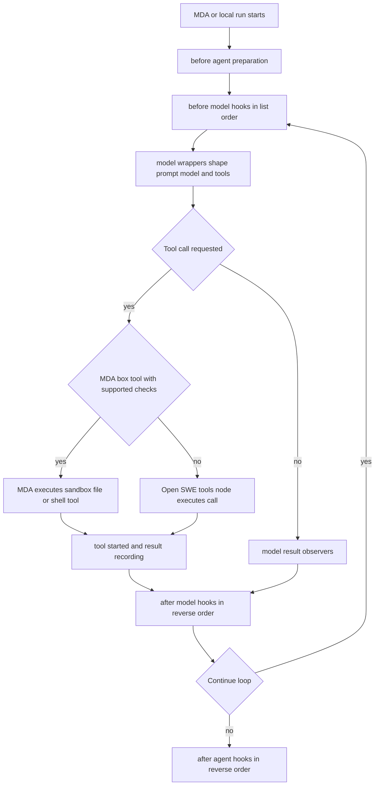

# Agent assembly, tool surfaces, and middleware

`openswe.server.get_agent()` is the main-agent factory and LangGraph entrypoint. For an executable, thread-scoped run it calls `build_agent()`, which constructs a new Deep Agents graph around that thread's sandbox, configuration, permissions, model choices, and tool surface. A request with no thread ID, or one not marked for execution, deliberately receives an empty, prompt-caching-only agent rather than a sandbox-backed operational agent.

The graph is assembled per run rather than being a global singleton. This matters because the selected model, credential scope, backend routes, accessible tools, task role, Slack/incident/review mode, and rendered prompt can all differ for a thread and invocation. Factory work is wrapped in shared thread reads; sandbox startup overlaps settings work where possible.

## Assembly inputs and model resolution

The factory derives `RunConfig` from `configurable`, then obtains the triggering identity for authorization and separately loads persisted thread settings. Workspace defaults seed a new thread; once stored, thread settings retain its main/subagent model, reasoning effort, routing configuration, and repository instructions. A dashboard switch from automatic routing resets the applicable model-selection state. Per-thread overrides are accepted only for supported models and efforts, and image input can temporarily select an image-capable model without changing the pinned text model.

When adaptive routing is active, the main default begins at the Fast tier and `ModelSelectionMiddleware` chooses Fast, Balanced, Performance, or Default before a model call. It honors an explicitly requested model first, then a persisted route, then fixed-fast mode, otherwise classifies the latest user task. The selected route is persisted in state and a UI event identifies the routed model. Route models, the subagent model, a capability fallback, and an optional vision fallback are all exported in the remote surface as model specifications.

The factory persists normalized thread settings before construction. This means later administrative workspace-default changes apply to newly created threads while existing threads continue with their stored selections; the title model is deliberately refreshed from current workspace defaults.

## Backend, skills, and agent construction

The default backend is a cached sandbox backend that can reconnect through `ensure_sandbox_for_thread`. `build_agent()` wraps it in a `CompositeBackend`:

- the sandbox remains the default filesystem/tool backend;
- `/bundled-skills/` is a read-only virtual filesystem, `/organization-skills/` is organization-scoped, and `/skills/` is included only when a verified credential login permits personal skills;
- binary/image blobs use a thread-scoped `StoreBackend`, allowing offloaded content to be read without the sandbox.

That composite backend is supplied both to `FilesystemMiddleware` and `create_deep_agent`. Consequently Deep Agents owns ordinary filesystem tools, file-result eviction/offloading, and its built-in repair of malformed tool-call history. Open SWE adds `ConversationOffloadingMiddleware` under the built-in summarization middleware name: it records offload progress and can perform a user-requested compaction before ending the turn. Automatic summarization is handled by Managed Deep Agents (MDA) in a remote run.

Skills are mounted from the allowed sources and inserted into the main and general-purpose subagent stacks. For a public thread with no personal credential scope, `WorkspaceSkillsMiddleware` replaces the normal skills middleware at the same stack position and filters checkpointed skill metadata to its configured sources. This prevents retained personal-skill context from leaking into a public run.

A general-purpose subagent is declared with the selected subagent model, filesystem tools, and the permitted subset of static tools. It receives skills, dynamic integrations, conversation offloading, and a pull-request guard, but excludes main-loop-only queue, event-delivery, and model-selection middleware. Where task coordination permits delegation, an MDA coordinator uses asynchronous workers rather than synchronous `task` subagents.

## Tool inventory is a policy-filtered surface

The static candidate set includes web/network, planning, thread/workspace, pull-request, review, sandbox, task, Slack, and administrative operations. It is not a promise that every run sees every one: `resolve_access` filters candidates first, then source-specific modes and deployment capabilities remove more. For example, Slack tools vary by Slack context, client-owned tool names remove the colliding server tool, CLI runs gain a required-result tool, admin tools require the appropriate private/admin surface, and incident or stop-summary modes impose smaller allowlists/exclusions.

MCP integrations are a second source of tools. The factory discovers authorized connections concurrently with other setup, but omits them if credential scope cannot be established. `load_mcp_tools()` resolves same-named connections in source precedence order, lists only enabled/allowed connections, and caches catalog discovery for ten minutes (with a 24-hour maximum age). Discovery failure makes that connection contribute no tools rather than exposing an older lower-precedence configuration. Each wrapped invocation re-authorizes its scope and verifies connection identity, enabled state, and the tool allowlist before making a 30-second-bounded remote call; errors are sanitized into `ToolException`s.

`DynamicToolMiddleware` keeps costly integration schemas out of the initial model request. It advertises `load_integration_tools` and the available names; after that tool is called, it builds the requested integration group once under a lock, stores the loaded names in graph state, and permits the actual tool on later calls. Calls made before loading receive an error tool message. Models that support provider-native incremental tool addition retain cache-friendly tool additions anchored to the loading result; other models receive loaded schemas in the ordinary tool list.

For remote use, `ToolSurface.prepare()` reads the compiled graph's `tools` node, resolves dynamic integration tools for code execution, excludes the loader itself and inappropriate model-only controls, and retains a name-to-tool map. The surface catalog includes JSON schemas and MCP provenance but not connection credentials. `ToolSurface.run()` rejects unavailable names and unexpected arguments before recreating a one-node graph execution, so injected state, runnable configuration, tool-call middleware, state updates, and streamed events behave as in the full graph.

## Middleware stack and loop phases

Middleware order in the factory is intentional. The list begins with filesystem support, prompt caching, conversation offloading, run preparation, optional review/client/incident hooks, skills, image validation, model-call limit, tool-error normalization, tool exclusions, subdirectory-agent reads, task retry, pull-request/workflow guards, optional task coordination, then per-turn queue/proxy/reply/CLI/usage/routing/fallback/dynamic-tool/error behavior. Before hooks execute in list order and after hooks in reverse order; model and tool wrappers nest with the first middleware outermost.

This shows the local graph phases and the routing decision used when the model loop runs in MDA.

### Preparation and model phases

`BasePrepareRunMiddleware` makes setup checkpoint-aware. It fingerprints the latest message plus preparation-relevant configuration, skips a matching completed invocation, and records `run_prepared`/`run_prepared_for` only after `_prepare` returns. Subclasses must therefore be idempotent: if a failure occurs before the checkpoint, preparation can run again. Preparation supplies the work directory, selected/requested model state, sender/context messages, and the fully rendered system prompt. Its model wrapper prepends that rendered prompt to the request system message.

Before-model hooks refresh transient context: task coordination can inject task context and owed messages, proxy refresh updates GitHub access, queue/event hooks deliver pending work, and model selection records a route. Model wrappers then apply the rendered prompt, task instructions, exclusions, fallback behavior, and dynamically loaded integrations. `ModelCallLimitMiddleware` terminates at the configured limit. Transcript and usage middleware observe model results, while reply and CLI-result middleware can force another loop iteration after a response. Completion hooks record usage/transcript effects, notify on a step limit, and settle review checks.

### Tool-call protections and failures

Tool middleware governs calls through the graph tools node. `ExcludeToolsMiddleware` hides unavailable tool schemas; image and subdirectory reads are validated; dynamic-tool middleware requires integration loading; the retry wrapper applies to `task`; and pull-request/workflow guards inspect potentially mutating Git operations. `ToolErrorMiddleware` turns ordinary tool exceptions into structured error `ToolMessage`s so the model can recover. A transient sandbox rejection is reported as an error explaining that no command started. An unreachable sandbox is different: it triggers a user notification and is re-raised to end the run, avoiding a sequence of doomed calls and duplicate notifications.

## Managed Deep Agents projection

MDA owns the model loop, checkpoints, automatic model-history shaping, code mode, and the thread sandbox it creates. `RemoteGraph` builds the same run-specific graph into a `ToolSurface`, caches the resulting `RunSession` by `(thread_id, run_id)` for six hours (up to 512 retained sessions), and exposes hooks for catalog, preparation, phases, model-result observation, remote-tool recording, tool calls, and sandbox replacement/unreachability.

State crossing the boundary is JSON encoded; messages receive IDs and are reconstructed on return. A session that lands on a different backend replica invokes `aresume_run()` on middleware that carries in-memory per-run state, then flushes it after each hook. The remote adapter runs before phases in order and after phases in reverse order, exactly as the in-process graph does. It applies graph model wrappers against a capture request to return the rendered prompt and any hidden tool names, while MDA itself performs caching, retries, automatic summarization, call deadlines, and vision-model swapping.

MDA can execute the standard filesystem/shell tools in its own sandbox only when every graph tool-call middleware is known to have an equivalent MDA-side check. The recognized mapping includes error handling and push guards; read/image/subdirectory/transcript/filesystem/dynamic/retry concerns need no additional box check. If an unknown graph tool wrapper appears, the catalog advertises no box tools, forcing every call through Open SWE's tools node so the new policy cannot be bypassed. Backend paths such as skills remain routed back to this deployment, and PR-opening or pushing commands likewise return for graph-side guards.

The catalog removes MDA's internal `task` and `eval` from Open SWE tools, marks excluded tools, distinguishes code-only operations from operations callable directly and from code, and suppresses synchronous subagents for a task coordinator. Calls MDA executes itself are reported through `tool_started` and `tool_result` so transcript middleware and Git work evidence remain complete; calls routed to Open SWE execute through `ToolSurface.run()` with namespace-aware transcript recording.

## Operational and change guidance

- Treat the middleware list as behavior, not an unordered registry. Reordering can change whether a prompt is rendered before selection, whether a guard sees a call, or whether an after hook observes state.
- Preserve `BasePrepareRunMiddleware` idempotence and its fingerprint/latch semantics. A remote callback may arrive at another replica after the preparation checkpoint.
- Add a tool-call middleware to the MDA compatibility map only when its box-side behavior is truly equivalent. Otherwise MDA must route calls back to the graph.
- Preserve authorization at both discovery and invocation for MCP tools. Catalog caching must not become permission caching.
- When adding dynamic integrations, reserve names against static and Deep Agent tools and ensure their loader failure remains recoverable as a tool result.

Focused coverage in `tests/agent/test_agent_assembly_context.py` captures `create_deep_agent()` arguments to verify sandbox-backed filesystem offloading, scope-dependent skills/MCPs/personal tools, task controls, model persistence/routing behavior, and privileged-tool exposure. `tests/reviewer/test_remote_runtime.py` exercises remote prompt/tool shaping, catalog secrecy and code-mode classification, model overrides, replica rejoin behavior, hook tracing, and the invariant that unknown tool middleware disables direct MDA box execution.
