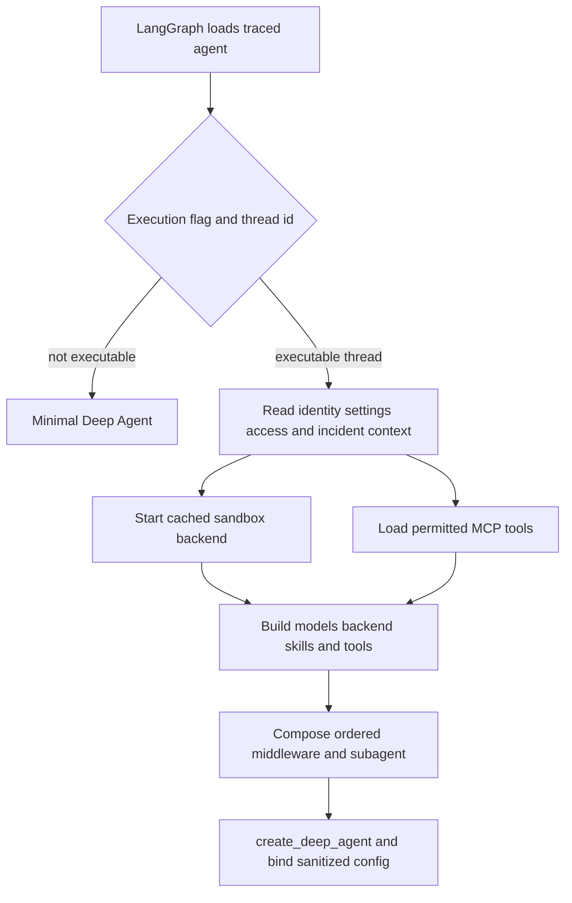

# Coding Agent Assembly

The deployed `agent` graph is `openswe.graphs.agent:traced_agent`; that module re-exports the factory in `openswe.server`, where `traced_agent` aliases `get_agent`. `get_agent` adds a factory-wide trace phase and shared thread-read scope, then delegates to `build_agent`. The graph object is stateless: durable state belongs to thread metadata, thread settings, checkpoints, and the sandbox.

## Graph construction



This is the construction path for a normal executable thread run.

`build_agent` first sets `DEFAULT_RECURSION_LIMIT`. Full construction requires both a string `thread_id` and `configurable.__is_for_execution__ is True`. Other graph loads receive a minimal `create_deep_agent` with no tools or sandbox, plus Anthropic prompt caching middleware. Before binding either graph, `bindable_config` removes `__pregel_*` runtime objects: LangGraph supplies them at invocation time, and binding the read-time runtime would make later state reads non-serializable.

`RunConfig` is intentionally a permissive cross-launcher boundary. Its declared fields are optional, extras survive parsing and dumping, and parsing removes only fields which fail validation. A malformed value therefore does not discard a usable `thread_id` or the rest of a launcher’s configuration.

For an executable thread, the factory resolves the sender identity used for authorization and private credentials, thread settings, workspace settings, access policy, optional review-guide or incident context, and task-coordination context. It starts a cached sandbox backend while other work proceeds. The reconnect callback calls `ensure_sandbox_for_thread`, which reuses the cached or recorded sandbox and refreshes its proxy. An existing unreachable sandbox fails by default rather than silently replacing uncommitted work; a deleted sandbox is recreated, and task workers attach only to a validated coordinator sandbox.

## Models, durable settings, and prompt policy

Workspace defaults seed the main and subagent model/effort pairs. Existing thread settings normally override those defaults, while a validated explicit `agent_model_id`/`agent_effort` can override both pairs. Adaptive routing can select configured route models, and image input can temporarily select a capable model. The factory persists resolved model, routing, subagent, and repository-instruction settings before applying the deployment-wide Fable gate, so the gate is evaluated on every run. Provider construction failures are represented by deferred error models rather than preventing graph compilation; a fallback is registered only when its model id differs from the primary model.

The static graph prompt is `common_prompt()`, which adds deployment guidance only in preview or staging. The thread-specific prompt is deliberately prepared at run time. `PrepareAgentRunMiddleware` resolves the current work directory, workspace, repository instructions, source and Slack context, accessibility options, and recent permitted thread context, then stores `construct_system_prompt(...)` in `rendered_system_prompt`. Its model-call wrapper prepends that rendered text as a `SystemMessage`.

`construct_system_prompt` renders the packaged `system/main` Jinja prompt with a working-environment section, dashboard/source context, optional organization repository scope, collaboration and untrusted-comment guidance, repository instructions, recent context, and workspace instructions. Prompt resource names are constrained to relative Markdown resources, and templates use `StrictUndefined`; missing substitutions fail rather than silently producing a partial prompt.

## Per-run preparation lifecycle

```mermaid
sequenceDiagram
    participant Graph as Agent graph
    participant Prep as Prepare run middleware
    participant Auth as Token and identity services
    participant Box as Sandbox backend
    participant Store as Thread and workspace stores
    Graph->>Prep: before agent
    Prep->>Prep: compare preparation fingerprint
    alt matching completed invocation
        Prep-->>Graph: skip setup
    else new invocation or retry before checkpoint
        Prep->>Auth: resolve GitHub token and sender
        Prep->>Box: await attach and resolve work directory
        Prep->>Store: load workspace participants and recent context
        Prep->>Prep: render prompt and deduplicate person blocks
        Prep-->>Graph: checkpoint preparation state
    end
    Graph->>Prep: each model request
    Prep-->>Graph: prepend rendered system prompt
```

This flow shows the checkpointed preparation performed before the model loop.

`BasePrepareRunMiddleware` fingerprints its class, latest message, and preparation configuration. A checkpointed matching fingerprint skips repeated setup for the same invocation, while a later message or configuration re-prepares fresh tokens, context, and prompt. Implementations must be idempotent because setup can run again if failure occurs before checkpoint persistence. On a replica that resumes an already prepared run, `aresume_run` calls `_rejoin`; the agent implementation reacquires the GitHub token that was held only in memory.

Preparation schedules title generation, resolves the triggering identity and sandbox concurrently, and turns sandbox connectivity failures into a user-facing notification before re-raising. It adds participant introductions only when the sender can be determined and their dynamic-context hash is not already visible in the retained history. It also records the selected model and invocation usage best-effort, so analytics failure does not fail the run.

## Workspace backend and skills

The graph gives Deep Agents a `CompositeBackend` whose default route is the thread sandbox. It overlays read-only bundled skills at `/bundled-skills/`, organization skills at `/organization-skills/`, and—only with private credentials—user skills at `/skills/`. The ordered skills list is passed to both the parent and general-purpose subagent. Without private credentials, `WorkspaceSkillsMiddleware` supplies workspace skill behavior instead of a user-skill route.

Binary offloads are routed to a thread-namespaced `StoreBackend` under the backend artifact root. For a bridged local machine, the artifact root is a thread-specific directory under `LOCAL_ARTIFACTS_DIR`; it is therefore not written into the user’s checkout. `FilesystemMiddleware` is configured with the composite backend and binary-content offloading.

## Tool surfaces and subagents

The static tool list is built from Open SWE tools and filtered through access policy. Slack tools require trusted source context; schedule runs without a Slack thread retain only channel listing and posting. Admin, incident, review-guide, task coordination, bridge, sandbox-download, and client-owned tool cases further alter the surface. Stop-summary mode reduces the static surface to Slack thread read and reply, while `ExcludeToolsMiddleware` removes the corresponding Deep Agent tools (including mutating filesystem and delegation tools in that mode). Client tools replace same-named server tools.

MCP integrations are loaded by precedence from instance, workspace, user, and managed sources, and are represented by `DynamicToolMiddleware`. It exposes `load_integration_tools` plus a catalog before tool construction; the middleware builds a selected group only when needed, serializes each group with a lock, turns loader failure into an unavailable result, and rejects duplicate or reserved names. When a thread prefers tools in the sandbox, the dynamic catalog is not model-visible and compatible MCP tools can be exposed through code mode instead.

The sole configured subagent is the forked Deep Agents general-purpose subagent. It is supplied the parent’s static list, but `_SubagentToolGuard` refuses Slack and other thread- or parent-sensitive calls, background execution, user settings, task delegation, and sandbox-only tools. It has its own prompt caching, transcript, exclusion, dynamic-tool, provider-sanitization, error, timeout, and workflow guard middleware because a subagent is independently compiled; parent middleware is not a security boundary for it.

## Ordered execution invariants

Middleware ordering is behavior: earlier entries wrap later ones. The parent includes filesystem and prompt-cache layers, conversation offloading, run preparation, optional guide/client/incident/workspace layers, image validation, call limits, error conversion, exclusions, task retry, PR/workflow guards, task coordination, GitHub-proxy refresh, message-queue delivery, reply obligations, selection and fallback, optional image and dynamic/code-mode layers, provider sanitizers, stable tool ordering, model errors, and finally `ModelCallTimeoutMiddleware`. The innermost timeout includes the provider call and propagates to the outer fallback middleware. Model-call limits end rather than recurse indefinitely, and task retries are constrained to the `task` tool.

`ToolSurface` reuses this assembled graph for remote sandbox tool execution without calling the model. It saves a validated subset of `RunConfig`, reloads checkpoint state, catalogs the graph’s static and dynamic tools, excludes coordinator-only calls, checks argument names against the tool schema, and runs an artificial one-node `ToolNode` graph so normal tool-call middleware and state updates still apply.

## Extension and test guidance

Change `build_agent` to alter composition, but preserve the executable-load gate, runtime-config stripping, durable thread-settings ownership, and the parent/subagent boundary. A new tool must be considered in access filtering, static-name reservation, stop-summary and client replacement behavior, code-mode eligibility, and subagent guarding. A new per-run lookup belongs in preparation only if it can be retried safely and rejoined after checkpoint resume.

Focused assembly tests exercise public/private skills, binary blob routing, task tool availability, credential-scope failure, sender draft preferences, concurrent sandbox startup, routing behavior, authorized tool surfaces, Slack surface retention, and subagent tool guards. Dynamic-tool tests exercise deferred loading and integration visibility; model tests cover workspace defaults and Fable gating. See also [Middleware and Failure Boundaries](middleware-stack.md), [Sandbox Lifecycle](sandbox-lifecycle.md), [Models, Profiles, and Instructions](../concepts/models-profiles-instructions.md), [Tools](../concepts/tools.md), and [Context Engineering](../workflows/context-engineering.md).
