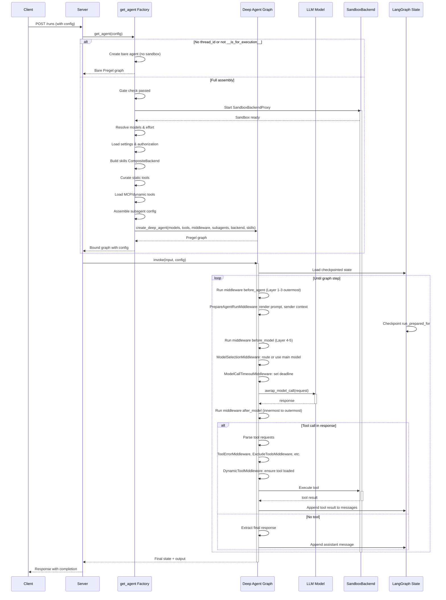

# Coding Agent Assembly and Execution

`get_agent(config)` and its internal `_get_agent` async factory in `openswe/server.py` compose the primary coding agent graph for an executable thread run. The factory is the customization seam for sandbox providers, model policy, tool surfaces, skills routes, subagents, and middleware.

## Entry and execution gate

The factory receives a `RunnableConfig` carrying thread metadata and launch context in its `configurable` dict. It gates full assembly on two conditions: a non-null `thread_id` and the `__is_for_execution__` flag being `True`. If either is missing, it returns a bare `create_deep_agent(system_prompt="", tools=[])` with only AnthropicPromptCachingMiddleware, avoiding expensive backend and settings initialization for graph discovery or non-execution invocations.

The factory then binds the graph using `bindable_config(config)`, which strips `__pregel_*` runtime internals to prevent serializing a read-time runtime into later invocations; LangGraph re-injects those keys on each call.

`RunConfig` is the tolerant configuration contract: all declared fields are optional, unknown keys survive round trips, and parsing drops only invalid fields rather than losing an otherwise usable run configuration. This flexibility matters because different launchers and graph types add distinct keys.

## Per-run context and sandbox backend

`profile_login` is the person who triggered the run; it controls authorization and credentialed integrations. In contrast, model choices and repository instructions are stored in thread settings—initially seeded from a profile but then retained by the thread—so a later participant does not silently replace durable decisions.

The factory creates a cached `SandboxBackendProxy` and starts its reconnect task immediately, before resolving the rest of the graph. For desktop runs, the reconnect callback returns a `LocalShellBackend`; for hosted runs, it calls `ensure_sandbox_for_thread` with the workspace slug, which resolves the sandbox environment from thread metadata, refreshes proxy credentials, or creates and binds a new sandbox. The lifecycle deliberately raises for an unreachable existing sandbox rather than replacing potentially uncommitted work; a deleted sandbox is replaced because retaining its stale id would permanently block the thread.

## Model and effort routing

Main-agent and subagent model/effort pairs resolve by precedence:

1. **Team defaults** from workspace settings (default_agent_model, default_agent_subagent_model).
2. **Profile overrides** from the dashboard, with separate subagent override when provided.
3. **Stored thread settings** (persisted after each run and refreshed across participants).
4. **Per-run agent_model_id and agent_effort**, only if both are canonical `SUPPORTED_MODEL_IDS` and pass `model_supports_effort` validation.

Resolved pairs are persisted to thread settings for hosted runs before Fable gating, so a deployment-wide enablement decision applies on every run rather than freezing into thread settings. Provider-specific keyword arguments are computed separately for main, subagent, and title models. Construction failures defer to an error model, allowing the graph to compile and reporting provider setup failure at model-call time. A fallback middleware is installed only if its model id differs from the primary model.

Desktop runs skip thread-settings lookup and use workspace defaults directly; Slack `/oswe` questions use the triggering user's default model and disable adaptive routing.

**Adaptive model routing** enables when the workspace enables it, the thread has not completed a handoff, the source is dashboard or Slack, and the run is not an incident sweep, background task, or continuation. When adaptive routing is active, the graph populates `requested_models` with available model options and installs `ModelSelectionMiddleware` to gate dynamic model selection during the run. Image-unsupported models trigger automatic fallback to a dedicated vision model.

## System prompt and preparation

The factory supplies `create_deep_agent` an empty static system prompt and relies on `PrepareAgentRunMiddleware` to render the per-thread prompt dynamically in its `abefore_agent` hook.

`construct_system_prompt` builds the main-agent system prompt in a fixed order: working environment, dashboard/source context, plan guidance, self-awareness, default repository, optional repository scope, repository setup and task execution, optional Corridor guidance, dependency and untrusted-comment guidance, commit/PR guidance, repository instructions, workspace instructions, optional admin-environment guidance, and shared-base guidance. Sender identity, attribution, standing user instructions, and participant context are intentionally excluded from this durable system prompt to avoid rewriting cached history.

For hosted runs, preparation resolves the GitHub token, sandbox work directory, sender identity, instruction context, and thread participants. It adds the resulting sender context as a separate generated message after a human input, allowing the model to distinguish between user input and infrastructure context. A sandbox-unreachable failure posts a user-facing notification before being re-raised.

Preparation is checkpointed: `run_prepared_for` fingerprints the middleware class, latest message, and configuration. A resumed attempt with the same fingerprint skips setup, while a later invocation re-prepares fresh tokens, prompt, and context. Preparation implementations must be idempotent because failure before checkpoint persistence permits a retry.

## Backend and skills

The primary backend is a `CompositeBackend` whose default route is the sandbox proxy. It overlays read-only skill routes:

- **Bundled skills** (`/bundled-skills/`) come from `FilesystemBackend(BUNDLED_SKILLS_DIR)`.
- **Hosted organization skills** (`/organization-skills/`) come from a `StoreBackend` namespaced in the LangGraph store scoped to the workspace.
- **Hosted user skills** (`/skills/`) come from a `StoreBackend` namespaced to `profile_login` when one exists; desktop user skills instead use a read-only `StateBackend` snapshot.
- **Blobs** (`/blobs/`) on hosted runs use a `StoreBackend` routed to PostgreSQL (`ThreadBlobs`) so offloaded images can be read without sandbox access.
- **Desktop artifact routes** (`/large_tool_results/`, `/conversation_history/`, `/blobs/`) on local runs are routed to a thread-specific artifact root outside the selected project, preventing agent scratch files from becoming repository changes.

The ordered `skill_sources` list is supplied to both the parent agent and the general-purpose subagent, ensuring consistent skill availability across delegation.

## Curated and dynamic tools

The parent static tool list is curated by context:

- **Slack tools** (manage_code_channel, slack_reply, etc.) require trusted Slack source context (a channel and thread timestamp) or schedule source.
- **Admin tools** (list_automations, publish_workspace, etc.) require the triggering sender to have workspace-admin access.
- **Sandbox download/service tools** (output_iframe, create_sandbox_file_download_url, expose_port) require LangSmith sandbox provider and are omitted for desktop and stop-summary runs.
- **Desktop runs** are restricted to http_request, fetch_url, and web_search.
- **Stop-summary runs** are restricted to slack_read_thread_messages and slack_reply.
- **Client-owned tools** replace server-side tools of the same name; their names are excluded from the server's tool surface.

`ExcludeToolsMiddleware` applies exclusions:

- In normal runs, it removes Deep Agents' `grep` tool (filesystem search).
- In stop-summary mode, it also removes mutating filesystem and delegation tools (delete, edit_file, execute, task, write_file).
- In `/oswe` question mode, it removes thread-specific tools that require a Slack thread_ts.

Integration tools (MCP/Corridor tools, Notion tools) are exposed through `DynamicToolMiddleware`, not appended directly to the static list. MCP tools are eagerly loaded during factory assembly with names available immediately (loader failures yield no tools). Tool schemas are loaded on demand after `load_integration_tools` is called. The middleware resets selected integration tools at run start, prevents tool calls before selection, serializes each group's construction, converts failures into unavailable-tool results, and reserves static and Deep Agent names to reject collisions.

## Deep Agents subagent configuration

The only configured subagent is the general-purpose Deep Agents subagent. It receives:

- **Model**: The subagent model and effort pair, constructed independently of the parent.
- **Tools**: Static tools filtered to exclude parent-only tools (save_user_settings, background_execute, Slack-specific tools, etc.) and subagent guards.
- **Skills**: The same ordered skill_sources as the parent.
- **Middleware**: Independently compiled so parent middleware never wraps it:
  - `_DisableInheritedMiddleware` disables RequireUserReplyMiddleware (subagents do not reply to users) and parent-specific routing middleware.
  - `_SubagentToolGuard` rejects parent-only tool calls with a user-friendly message.
  - AnthropicPromptCachingMiddleware for prompt caching.
  - TranscriptMiddleware for call logging.
  - Incident and workspace-skills middleware when applicable.
  - Full dynamic-tool middleware if parent has integration tools.
  - GuardMiddleware (PullRequestCreationGuardMiddleware for hosted runs, none for desktop).
  - ConversationOffloadingMiddleware for history summarization.
  - Model guards: SanitizeOpenAIResponsesMiddleware, ModelErrorMiddleware, ModelCallTimeoutMiddleware.

The subagent's `mode` is `fork`, meaning it branches and collects results back into the parent message thread. Its description includes a suffix requiring Slack communication to be relayed through the parent.

## Middleware assembly and ordering

The parent middleware list is ordered outermost to innermost, making order part of the runtime contract:

**Layer 1: Outermost context and offloading**
- FilesystemMiddleware (backend offload handling, binary content routing)
- AnthropicPromptCachingMiddleware (request caching for cost optimization)
- ConversationOffloadingMiddleware (summarization and history eviction)
- PrepareAgentRunMiddleware (sender identity, context, prompt rendering, per-run setup)
- ReviewGuideMiddleware (optional, walkthrough guidance if present)

**Layer 2: Run management and tool mediation**
- TranscriptMiddleware (call logging)
- ClientToolsMiddleware (optional, client-side tool overrides)
- IncidentMiddleware (optional, incident-specific session context)
- WorkspaceSkillsMiddleware (optional, workspace skill registration)
- ValidateImageReadsMiddleware (image input validation)
- ModelCallLimitMiddleware (enforce recursion limit, end run at MODEL_CALL_RECURSION_LIMIT)
- ToolErrorMiddleware (convert tool errors to structured results)
- ExcludeToolsMiddleware (filter unavailable or restricted tools)
- SubdirAgentsReadMiddleware (subdirectory agent boundary enforcement)
- ToolRetryMiddleware (retry task tool with backoff)

**Layer 3: Flow control and guards**
- PullRequestCreationGuardMiddleware (hosted only, no duplicates across runs)
- WorkflowPushGuardMiddleware (prevent workflow self-triggers)
- TaskCoordinationMiddleware (optional, worker coordination state)
- RefreshGitHubProxyMiddleware (refresh GitHub token before model calls)
- MessageQueueCheckMiddleware, DeliverEventMatchesMiddleware (skip in stop-summary mode)

**Layer 4: Result handling and routing**
- RequireUserReplyMiddleware (Slack reply required unless tool offered)
- RequireCliResultMiddleware (optional, CLI bridge mode requires result proof)
- NotifyStepLimitMiddleware (notify when approaching step limit)
- RecordRunUsageMiddleware (log telemetry and usage)
- ModelSelectionMiddleware (optional, adaptive model routing)
- ModelFallbackMiddleware (fallback model on primary timeout/failure)
- ImageModelFallbackMiddleware (optional, vision fallback for text-only models)
- DynamicToolMiddleware (optional, integration tools)
- MCP-specific tool middleware (optional)

**Layer 5: Innermost provider and model safety**
- SanitizeFireworksMessagesMiddleware (Fireworks response cleanup)
- SanitizeOpenAIResponsesMiddleware (OpenAI response cleanup)
- SanitizeThinkingBlocksMiddleware (thinking block removal)
- StableToolResultOrderMiddleware (deterministic tool-result ordering)
- ModelErrorMiddleware (handle model call errors)
- ModelCallTimeoutMiddleware (innermost: deadline covers provider call, escalates to fallback)

The innermost timeout measures the actual provider call and can escalate outward to the fallback model. The call limit ends the run at `MODEL_CALL_RECURSION_LIMIT`; task retry sits inside ToolErrorMiddleware.

## Execution flow

## Change guidance and extension points

Treat `_get_agent` and `build_agent` (internal aliases used historically) as the customization seam for:

- Sandbox providers and reconnect strategies
- Model policy, routing, and fallback configuration
- Parent tool surfaces and tool-access gates
- Skills routes and skill backends
- Subagent composition, middleware, and boundaries
- Middleware ordering and guard configuration

Preserve these contracts:

- **Execution gate**: Do not bypass the `__is_for_execution__` check; graph discovery must remain cheap.
- **Authority model**: `profile_login` drives authorization; thread settings freeze durable decisions. Do not silence model/settings changes between participants.
- **Subagent boundary**: Parent middleware does not wrap subagents. A parent-only guard (e.g., PullRequestCreationGuardMiddleware) does not secure a separately compiled subagent. Add subagent guards in `_subagent_guard_middleware`.
- **Middleware order**: Order is part of the contract, not an implementation detail. Timeouts must be innermost so fallback escalation works correctly.

## Focused tests

- `tests/agent/test_agent_assembly_context.py` checks backend/skills routing, desktop and stop-summary tool surfaces, parent-only tools, subagent guards, and middleware order.
- `tests/agent/test_factory_tool_loading.py` verifies concurrent eager loading of MCP tools and integration tool caching.
- `tests/models/test_agent_subagent_models.py` covers independent profile subagent overrides and Fable availability gating.

## Related architecture

- [Middleware Stack and Interceptors](middleware-stack.md) — detailed middleware reference, responsibilities, and ordering rationale.
- [Sandbox Lifecycle](sandbox-lifecycle.md) — backend creation, reconnection, and persistence.
- [Models & Profiles & Instructions](../concepts/models-profiles-instructions.md) — model selection, effort levels, and prompt layers.
- [Tools](../concepts/tools.md) — tool surfaces, authorization, and dynamic loading.
- [Context Engineering](../workflows/context-engineering.md) — how sender and thread context flow through preparation.
