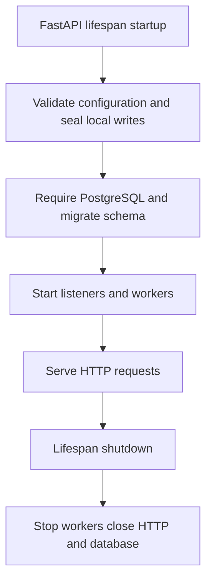
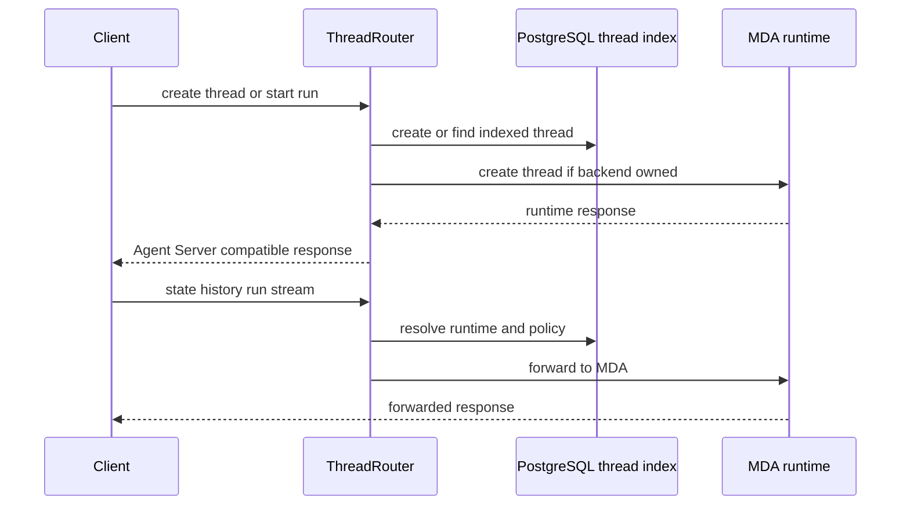

# Backend control plane, threads, and durable state

Open SWE’s backend control plane is the FastAPI application plus PostgreSQL-backed coordination around the agent runtime. It deliberately separates **control-plane records**—thread discovery, metadata, status, queues, jobs, and the transcript read model—from the **runtime execution state**—LangGraph/MDA runs, checkpoints, histories, command handling, and event streams. PostgreSQL makes the product’s cross-replica views durable; Managed Deep Agents (MDA) is where new threads execute.

## Composition and lifecycle

`openswe.api.app:create_app()` builds the HTTP application. It configures Datadog, credentialed CORS, audit logging, request IDs, GitHub error handling, compression, product/webhook routers, the Agent API POST route, optional MCP routes, and the dashboard UI. `ThreadRouter` is installed ahead of the core Agent Server `/threads` and `/runs` routes, allowing existing dashboard, CLI, and SDK calls to retain the Agent Server API shape while the backend answers or forwards them according to thread ownership.

CORS origins come from `DASHBOARD_ALLOWED_ORIGINS`; `*` is rejected because credentials are enabled. The desktop origin `open-swe://app` is added explicitly. Account and unknown-user errors become HTTP 409 responses.

At import time, and again during lifespan startup, the application pins one event loop before workers are constructed. Startup validates login, sandbox, model, MDA, and Slack configuration; seals local Agent Server write operations; requires and migrates PostgreSQL; then starts optional analytics, cross-process listeners, UI invalidation, notifications, and the job worker. A failed analytics/listener/UI/warmup initialization is logged rather than preventing service, with the documented degradation generally limited to cross-process freshness or cold-start latency. Shutdown stops workers and listeners, closes the shared HTTP pool, and disposes the database engine.

This shows the startup ordering: local thread/run creation is disabled before the application can serve traffic.

## PostgreSQL is the durable coordination store

`POSTGRES_URI` is mandatory outside local development fallback and is normalized to an `asyncpg` SQLAlchemy URL. The engine uses pre-ping, bounded pool settings, an `open-swe` application name, and slow-query logging controlled by `POSTGRES_SLOW_QUERY_MS`. Connections set the `open_swe` schema search path; transaction helpers provide normal, read-only, and repeatable-read snapshots. Migrations run under a PostgreSQL advisory transaction lock, so replicas cannot migrate concurrently.

The database is authoritative for the following backend-owned state:

| State | Durable owner | Role |
|---|---|---|
| Thread index | `thread_index` in PostgreSQL | Thread ID, runtime (`mda` or legacy `local`), metadata, index status, and timestamps used for search/listing. |
| Inbox and operational records | PostgreSQL queue/event/task tables | Follow-ups, task messages, and subscribed-event matches that a run has not acknowledged. |
| Job queue | `job` table | Due time, cron schedule, key-based replacement, lease/claim token, attempts, and payload. |
| Transcript | PostgreSQL transcript log, projections, attachments, and output tables | Product-facing transcript snapshot, history pages, tool-output lookup, and resumable SSE events. |

MDA is not a replica of all this state. It owns a thread’s executable run/checkpoint state, current graph state, run history, commands, and runtime stream. The index intentionally renders `values`, `interrupts`, and `config` as empty in its Agent Server-shaped response: readers should fetch runtime state through the routed runtime endpoints when that state is required.

## Thread index and runtime routing

The thread index is the durable catalog and compatibility facade. It supports Agent Server-shaped create/read/update/delete/search/count operations and records the last known status. Metadata updates merge top-level keys. Runtime observations use timestamp-guarded updates, and per-thread synchronization uses an advisory lock so an older Agent Server observation cannot land after a newer one. Searches filter indexed metadata and can rank matching titles and other repository/PR fields by recency.

New backend-owned threads are indexed as `mda`, stamped with runtime metadata, and created remotely on MDA. The index is written first, then the runtime is provisioned. Metadata writes answer from the index immediately; a per-thread background chain copies patches to the runtime in order. This means an unavailable runtime does not block an index write, but runtime trace metadata can lag; failed copies are logged. MDA channel-owned threads are an exception: their metadata stays in the index and is not copied by the backend into the channel’s runtime-owned conversation.

This is the normal MDA path; the index answers catalog operations while the runtime owns execution state.

### Router policy and status

`ThreadRouter` authenticates routed requests using the Agent Server authentication middleware, but only intercepts backend calls; other callers fall through to the core server. It handles `/threads`, search/count, per-thread mutation, run creation, commands, copy, and runtime subpaths. Unknown indexed threads can be discovered from the local Agent Server and indexed on first use, preserving access to historical threads.

For MDA threads, ordinary thread reads and writes forward to MDA. Reads use the MDA Studio-style read client; backend-owned writes use the owner-scoped client. Before a run response is returned, a successful start marks the index `busy`; completion webhooks and reconciliation later settle status. The router also handles the race in which a user stops a thread while MDA is still constructing a run: after MDA returns the run location, it interrupts the run if the index records a stop after the start began.

Channel-owned MDA threads have stricter boundaries. They are readable with the Studio-style client, but backend writes are either refused or performed through MDA trusted-backend ingress, naming the source conversation and, where resolvable, the initiating user principal. Only run start, interrupt response, and stop-related operations can act in that conversation; copy and cron creation are refused. This prevents the backend from silently taking ownership of Slack, Linear, or GitHub conversations.

### Legacy local threads are read-only

A `local` runtime means a thread predates the MDA migration. These are compatibility records, not an active execution target: the local Agent Server is sealed at startup to reject every thread, run, copy, and cron creation with HTTP 410. The router may serve local thread reads and logs a warning for each access, but refuses local run/cron creation, copying, and posting protocol commands with HTTP 410 and directs users to start a new thread. Read-only protocol commands can still pass through.

When activity targets a legacy ID, the index can derive an MDA successor ID. `current_thread_id` reads the successor once it exists; `live_thread_id` directs new activity to it. This allows old URLs/history to remain readable without reviving local execution.

## Inbox delivery is acknowledged, not consumed on read

`ThreadInbox` injects information owed to a running thread before model calls. It gathers three durable classes concurrently: queued follow-ups, task messages, and event matches. A snapshot read does **not** remove any item. The run returns the specific queue sequence numbers and event IDs it accepted, then calls `receive`; only that acknowledgement removes follow-ups and marks task/event records received. A run that ends before acknowledgement therefore leaves input for a later run, and a message queued while a batch is being transformed is not accidentally acknowledged.

Follow-ups are converted into structured run messages, including canonical sender identity and dashboard relay context. Dashboard input can switch the reply surface from Slack to web; the inbox emits a handoff notice only for that move. Image URLs are fetched only when appropriate for the resolved model, with an explicit warning path for models without vision support. Event/task lookup failures are logged and treated as empty for that read, avoiding failure of the model call while retaining the durable records for retry.

## Transcript: PostgreSQL event log and independent read model

The transcript is a separate durable PostgreSQL model, not a direct view of LangGraph checkpoints. `transcript.engine:append` is its only writer. For each thread it takes an advisory lock, assigns gapless per-thread versions, writes events/projections/receipts/attachments/full tool output, advances the head, and emits `pg_notify` in one transaction. Command receipts make retries idempotent: a repeated command returns its original version rather than duplicating an event.

The transcript API never calls LangGraph. It serves a consistent snapshot of projections, older turn pages, a tool-output endpoint, private attachments, and SSE events. Authorization uses a transcript copy of authorization-relevant thread metadata in the same repeatable-read transaction as the data read. Metadata mirroring is best effort and logged on failure; it mirrors the keys that affect authorization or served title, so callers changing those keys must use the normal thread update path rather than bypassing it.

SSE subscribes before replaying rows, preventing a replay-to-live gap. PostgreSQL `LISTEN/NOTIFY` carries only `thread_id:version`; each subscriber reads durable rows itself. In-process publishing is an optimization, not the source of truth. On listener reconnect the service republishes each subscribed thread’s durable head; a disconnected listener can therefore cost latency but not correctness. Streams re-authorize while live and end with `deleted` or `revoked` rather than continuing after deletion or access loss.

## Background work: leased, retrying PostgreSQL jobs

The job queue keeps background automation outside agent graphs. A job selects a registered `kind` handler and JSON payload, may be one-shot or cron-based, and may have a key. Scheduling the same key replaces the queued job by default; `replace=False` preserves the existing job and claim.

Every replica can poll. Claiming uses `FOR UPDATE SKIP LOCKED`, a random claim token, and a 30-minute lease, so only one worker takes a due job at a time and another replica can reclaim work after a worker dies or stalls. The worker limits concurrent work to 20 and renews leases every 10 seconds. On success it deletes a one-shot job or moves a cron job to its next timezone-aware fire time. One-shot failures back off exponentially from 30 seconds to one hour and are discarded after five attempts; cron failures advance to the next firing. Cancellation or replacement is detected when renewal no longer finds the worker’s claim.

On shutdown, handlers are cancelled and their leased jobs become claimable after lease expiry. This provides at-least-once execution rather than exactly-once handler effects: job handlers must tolerate a lease lapse and retry.

## Operations and focused verification

Operational prerequisites are a configured PostgreSQL service and reachable MDA runtime credentials; channel-thread actions additionally require `MDA_SERVICE_SECRET`. Monitor slow-query warnings, migration failures, metadata-copy warnings, transcript listener reconnections, job lease-lapse warnings, repeated job failures, and local-thread access warnings. PostgreSQL listener, bridge listener, and UI invalidation startup failures intentionally do not take the API down, but reduce cross-replica real-time updates until recovery.

Focused tests make the key boundaries concrete:

- `tests/threads/test_thread_index.py` verifies Agent Server-shaped index responses, metadata merge/search semantics, status timing, and serialized synchronization.
- `tests/threads/test_thread_router.py` exercises MDA forwarding, channel ownership/authentication, run-start races, and local compatibility behavior.
- `tests/threads/test_local_writes.py` confirms the startup seal covers thread, run, copy, and cron creation operations.
- `tests/threads/test_inbox.py` verifies acknowledgement semantics, dashboard handoff/relay behavior, snapshots against concurrent enqueueing, and prepared-run event receipt.
- `tests/threads/test_thread_status.py` verifies stale-busy reconciliation against runtime observations, including channel-thread grace behavior.

For the run protocol itself, see the runtime API contract; for the work scheduled through this queue, see background automation; and for the end-user run phases, see the run lifecycle.
