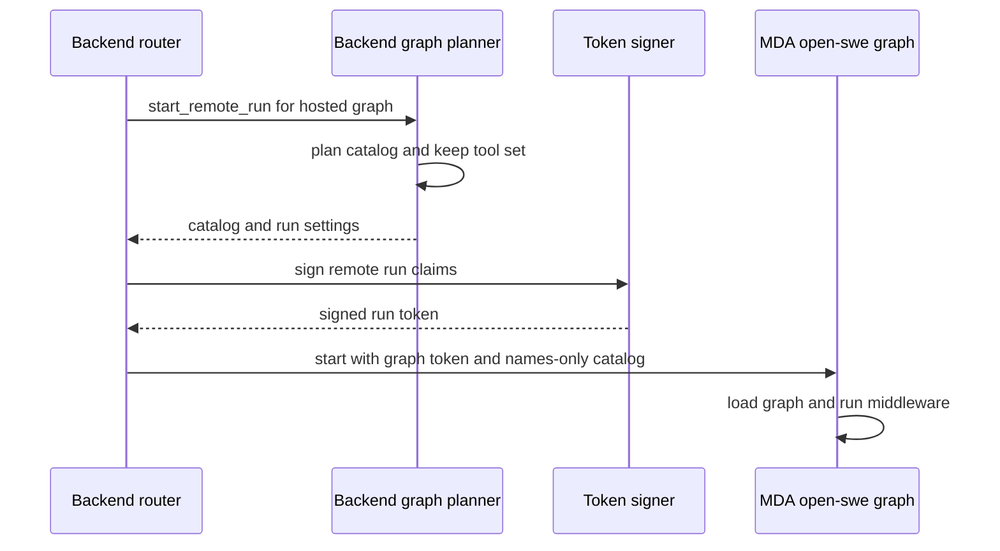
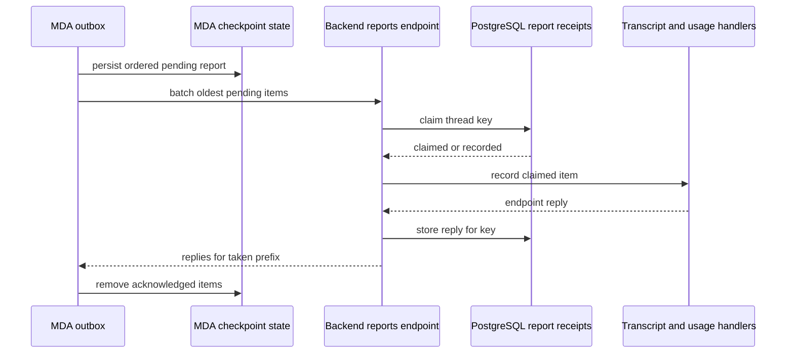

# Backend–Managed Deep Agents Runtime Contract

Open SWE runs its `agent`, `reviewer`, and `review-scout` workloads as the single MDA graph `open-swe`. This is a deliberately split runtime: **MDA owns execution**—the model loop, checkpoints, sandbox, tool invocation, and middleware—while the Open SWE backend plans a run before it starts and exposes the credentialed or database-backed work that execution needs. The backend is not a remote model-loop controller.

The contract is shared Python models in `packages/runtime-api/src/runtime_api`. An endpoint is a name plus Pydantic request/response models, timeout, and redelivery policy. MDA calls `POST /agent-api/{endpoint}` and the backend dispatches the same endpoint definition, making a mismatched change visible to the importing side rather than relying on an untyped payload.

## Ownership and stable boundary

| Concern | Owner | Contract consequence |
|---|---|---|
| Model calls, retries/fallback behavior, checkpointing, tool execution, sandbox lifecycle, and runtime middleware | MDA (`mda/`) | Backend code must not take over the model loop or add a backend tools node. |
| Planning a run, thread/product data, database writes, GitHub/Slack credentials, authorization, transcripts, usage, and notifications | Open SWE backend | Expose a named typed endpoint when runtime behavior needs backend data or credentials. |
| Wire schema | `runtime_api` | Both projects import exchanged models; MDA does not import `openswe`. |
| Durable cross-call state | MDA graph state or PostgreSQL | A backend endpoint must be answerable from its bearer token and request on any replica, rather than backend process memory. |

The graph factory is shared per process for compatible `GraphInputs`; it deliberately contains no per-run catalog, tool selection, skill set, or sandbox identity. Middleware resolves those from the current run context at call time. That avoids leaking one thread or user's capabilities into another run while retaining the compiled graph.

## Start: plan once, carry a signed identity

Before dispatching MDA, `start_remote_run` validates that the selected graph is hosted, creates a fresh operation grant id, has the backend graph plan the run, persists the complete tool set by digest, and receives `RunSettings` plus a `Catalog`. The backend then signs a JWT carrying the thread, assistant, configuration, metadata, settings, grant id, and expiry. The normal lifetime is 48 hours; verification requires issuer, audience, issued-at, expiry, and subject, and accepts configured signing keys to support rotation.

The run context sent to MDA contains `graph`, `__run_token`, and a JSON catalog. The catalog is reduced to tool names before it enters context because the service mirrors context into checkpoints; MDA fetches the named tool specifications later. Configuration and metadata are authoritative only in the verified token—not in model-controlled operation arguments or arbitrary request bodies. Backend startup refuses an absent/unsafe `MDA_RUNTIME_URL` or missing `REMOTE_RUNTIME_TOKEN_SECRET`.



This shows the one-time planning and signed-context handoff. A planning failure is returned to the caller and no MDA run starts.

`Catalog` is the run's declaration of operations, models, subagents, sandbox/file behavior, skills, and loop rules. It is a capability description, not an instruction for the backend to execute the loop. For operations, the backend keeps the full `ToolSet` keyed by its digest in the signed settings. MDA requests `tool_specs`, `search_tools`, or `resolve_tool`; each returned executable specification receives an HMAC-derived, operation-specific grant. The backend rejects `operation` when that grant is absent or invalid.

## Authenticated endpoint execution

MDA's `OpenSweBackend` finds the current run from LangGraph context and POSTs JSON with `Authorization: Bearer <token>`. It also propagates tracing headers. Backend routing verifies the token and reconstructs `RemoteRun`, then uses `TokenRun` and `RunParts` to build the endpoint's dependencies from the verified run. Consequently a call can land on any backend replica; a cached `RunSession` is only an optimization for legacy plan-backed endpoints, with a six-hour TTL and bounded cache.

```mermaid
sequenceDiagram
  participant Loop as MDA middleware
  participant Client as OpenSweBackend
  participant API as Backend agent-api
  participant Parts as TokenRun and RunParts
  participant Service as Credentialed backend service
  Loop->>Client: typed endpoint request
  Client->>API: POST agent-api endpoint with bearer token
  API->>API: verify JWT and validate request model
  API->>Parts: reconstruct run context from claims
  Parts->>Service: run authorized backend work
  Service-->>Parts: typed result
  Parts-->>API: response model
  API-->>Client: JSON response
  Client-->>Loop: validated response
```

This shows that the token determines identity and authority while the request supplies the endpoint-specific input. Typical loop reads/actions include `prepare`, `inbox`, `route_model`, `model_choice`, `task_context`, `refresh_github_proxy`, and `reply_on_behalf`; `skills`, browser reporting, and sandbox proxy configuration are also typed calls. `prepare` derives a turn from signed settings and conversation but does not connect to an MDA-owned sandbox. For normal operation-granted runs, file APIs, shell checks, and `operation` are token-backed endpoints; MDA performs the actual runtime tool call and turns a returned `OperationResult` into its tool result.

A deliberately limited compatibility path remains. A token without an operation grant, or a graph whose `RunParts.legacy` says so, uses a backend `RunSession` for `prepare`, phase hooks (`before_model`, `after_model`, `after_agent`), operations, and incident evidence. New functionality should use catalog-driven named endpoints or MDA middleware rather than expand this plan-backed surface.

### Delivery and failure semantics

Endpoint declarations make delivery behavior explicit:

- `once` retries a connection failure only; it does not assume a request that got a gateway response can safely repeat.
- `unprocessed` may retry a 503, which normally indicates no backend was ready.
- `idempotent` may also retry a 502. No endpoint retries a 504 because the backend might still be working.
- Calls have endpoint-specific budgets: quick reads, loop calls, and long tool calls use different declared timeouts. A client timeout is reported as `BackendTimeoutError`; transport/gateway failures become `BackendUnavailableError`; a 403 becomes `BackendRefusedError`.

The runtime retries eligible unavailable calls with bounded exponential waits. It never includes the bearer token in its raised error text. Endpoint response validation occurs after transport success, and backend request validation rejects malformed bodies before handlers run.

## Reports are ordered, durable, and idempotent

Reports separate *what MDA executed* from backend-owned transcript, usage, inbox, notification, and completion effects. MDA's outbox batches `run_started`, tool start/result, model result, inbox receipt, notices, and `run_ended` into `reports`, oldest first. Pending items are written into the checkpointed `open_swe_outbox` state alongside the model response, tool result, or hook update that created them. Thus a resumed process—or a later run on the thread—can take over unsent reports.



This shows report delivery rather than model control flow. The backend processes only a contiguous prefix: it stops before an item another delivery is recording or one it cannot record, so later reports cannot overtake earlier ones. PostgreSQL receipt rows are unique by thread and idempotency key. A duplicate receives the saved reply; an abandoned claim may be taken after a ten-minute lease. Saved receipts are retained seven days and purged in bounded batches. The runtime eventually leaves unacknowledged reports checkpointed after prolonged outage, while a phase can wait up to five minutes for earlier reports; a repeatedly refused item is dropped after three refusals so it cannot permanently block all later reports.

## Completion and observable effects

At the end of its own loop, MDA queues end-of-run backend work and `run_ended`. The backend records transcript/usage via reporters and removes the cached session in a `finally` block. MDA does not wait for every noncritical end hook, but its outbox makes the completion report durable until acknowledged.

```mermaid
sequenceDiagram
  participant Loop as MDA model loop
  participant Outbox as MDA outbox
  participant Backend as Backend reports endpoint
  participant Store as Backend transcript and usage
  Loop->>Outbox: queue run end and final notices
  Outbox->>Backend: reports including run_ended
  Backend->>Store: finalize turn and usage
  Store-->>Backend: recorded
  Backend-->>Outbox: acknowledged prefix
  Outbox-->>Loop: completion report settled
```

This shows completion as a report-delivery lifecycle: the backend observes and settles product state, while MDA decides when its agent execution ends.

## Operations, credentials, and extension rules

An operation endpoint invokes only a tool named by the signed catalog and protected by that operation's grant. It receives the declared state slice and returns content, status, artifact, message id, and state update. MDA retains control of tool invocation, including its local file/shell tools and sandbox. Backend work that needs credentials—GitHub refresh/proxy setup, repository operations, Slack reply, thread inbox, database-backed skills, or product state—belongs behind a narrow named endpoint.

Use these change rules:

1. Add request/response models and an `Endpoint` to `runtime_api`, including an honest timeout and delivery policy.
2. Implement and register the backend handler against the shared model; derive authorization and run identity from the verified token.
3. Call it from MDA middleware/tool infrastructure only when it is runtime-owned behavior. Do not add an `openswe` import to `mda/`, a generic phase endpoint, or backend in-memory run state.
4. Put control-flow decisions such as refreshing, stopping, and routing in `mda/rt`; put backend-data/credential work in the named endpoint.

Async workers are a special case: they initially carry a worker grant that authorizes reading their coordinator's catalog and exchanging it for their own token. After `adopt`, subsequent calls act as the worker's own run, not the coordinator's.

## Configuration and focused verification

The backend requires `MDA_RUNTIME_URL` and `REMOTE_RUNTIME_TOKEN_SECRET`; the URL must be absolute and non-loopback HTTP is rejected. MDA requires `OPEN_SWE_BACKEND_URL` to make callbacks. `MDA_RUNTIME_API_KEY` falls back to `LANGSMITH_API_KEY` for calling the deployment. Keep signing secrets and backend credentials out of the runtime deployment; the bearer token is the runtime's authority for backend API calls.

Test the two projects independently against their shared models. `mda/tests/test_backend_calls.py` exercises the runtime transport and endpoint behavior with synthetic answers, including retry boundaries and connection-credential behavior. Backend tests should exercise token verification, grants, report receipt idempotency, and handlers through `runtime_api` models. Run the MDA project's focused suite with `make mda-test` and type check with `make mda-typecheck`; do not make MDA tests import `openswe` or replace endpoint-model tests with cross-project imports.

See also [Runtime and Product Architecture](overview.md), [Thread Runtime](thread-runtime.md), [Run State and Transcript](../concepts/run-state-and-transcript.md), [Tools and Sandbox Access](../concepts/tools-and-sandbox-access.md), and [Testing Overview](../testing/overview.md).
