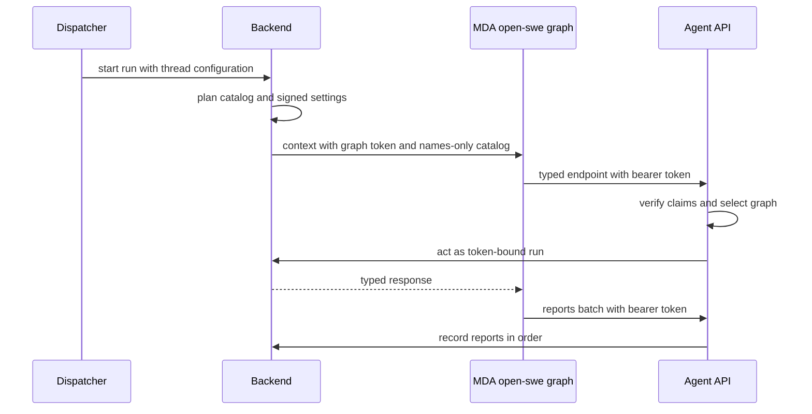
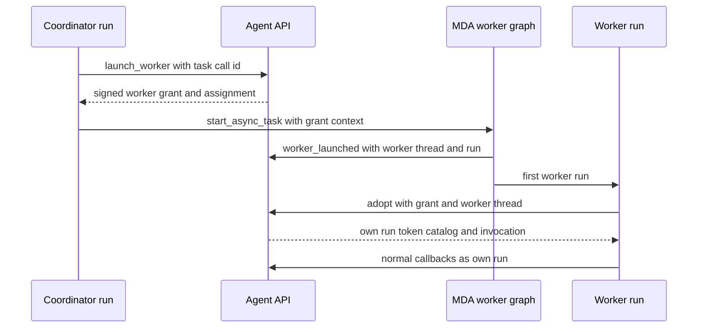

# Backend–Managed Deep Agents boundary

Open SWE runs `agent`, `reviewer`, and `review-scout` as contexts of one Managed Deep Agents (MDA) graph, `open-swe`. MDA owns the model loop, checkpoints, sandbox execution, tool-call execution, and runtime middleware. The Open SWE backend is the policy, data, credential, and product-integration side: it plans a run before MDA starts it, signs the authority under which it will call back, and exposes narrowly named typed endpoints under `/agent-api/{endpoint}`.

This is deliberately not a generic “call the backend for a phase” extension mechanism. New work requiring backend credentials or data belongs in a named endpoint in `packages/runtime-api`; loop control belongs in MDA middleware. Legacy planned phase endpoints remain only for compatibility.

## Ownership and authority

This shows the normal startup, callback, and reporting path. The token, rather than fields in a model-controlled request body, establishes the thread, graph, configuration, metadata, settings, and operation grant identity.

`start_remote_run` accepts backend-controlled configurable data and metadata, validates that the selected assistant is hosted, plans the graph once, retains the resulting tool set, and signs a `RemoteRun`. The JWT is HS256-signed with issuer, audience, issue and expiry times, and subject claims; it has a 48-hour lifetime with a 60-second verification leeway. Its claims reconstruct `RemoteRun`, including the thread ID, assistant ID, configuration, metadata, settings, grant ID, and expiry. A deployment refuses startup if `MDA_RUNTIME_URL` or `REMOTE_RUNTIME_TOKEN_SECRET` is absent; the URL must be absolute and non-local HTTP is rejected.

The context sent to MDA contains the hosted graph name, `__run_token`, an optional invocation ID, and `__catalog`. The catalog is intentionally names-only for operations: full tool schemas remain in backend-held tool sets and MDA retrieves the listed specs through `tool_specs` at startup. Other catalog content describes the permitted operational surface—models, sandbox/files behavior, subagents, skills, inbox and loop rules—not a substitute authority for backend callbacks. The backend computes a per-operation HMAC grant from the run's thread ID, grant ID, and operation name; `operation` rejects a request without the matching grant.

## One shared graph, per-run state

MDA builds a graph once for equivalent `GraphInputs`—graph kind, models, gateway setting, and worker completion webhook—and shares it across threads and runs. It must not retain run-specific data. `RunContext` lazily creates a `Run` for the active LangGraph runtime; per-run catalogs, bearer token or worker grant, invocation ID, resolved backend tools, outbox, and local caches live there instead. Middleware and tools obtain that current run at call time.

The carried catalog starts with only tool names. Before preparation, a token-bearing run calls `tool_specs` once when names are present and replaces those names with typed `ToolSpec` values. A worker awaiting adoption does not load tool specs; after adoption it uses its own returned catalog. This separation limits checkpoint context size while keeping the backend's grant-bearing specifications authoritative.

The runtime sends each callback as JSON over `POST /agent-api/{endpoint}` with `Authorization: Bearer <token>` and trace headers. `Endpoint` definitions specify request and response Pydantic models, timeout, and delivery semantics, and are imported by both sides. The server verifies the bearer token before parsing and dispatching the endpoint body, chooses the hosted graph from the token's `assistant_id`, and provides the verified principal to the handler. It returns 401 for missing or invalid credentials, 403 for a refused authorized call, 404 for an unknown endpoint, 422 for invalid endpoint input, and serializes backend exceptions as 500 errors. A disconnected caller cancels only `prepare`, whose work should not continue after its initiating MDA request is gone.

## Callback surface and turn flow

`BackendRunMiddleware` is the MDA-side bridge. At `before_agent`, it adopts a worker if necessary, takes checkpoint-carried reports, opens the MDA-owned sandbox in parallel with tool-spec retrieval, calls `prepare`, applies the returned state/messages/events, and queues a `run_started` report. Preparation binds an MDA-opened sandbox to the backend thread and initializes the thread inbox for carried events. It is the explicit startup boundary; it does not hand sandbox execution back to the backend.

Before a model call, the runtime reads the configured inbox and reports its receipt alongside the call that will answer it. Catalog loop rules normally drive MDA's `RunLoop`, including routing and final-answer behavior. Named callbacks supply backend-only facts or effects such as `route_model`, `model_choice`, `task_context`, `refresh_github_proxy`, `reply_on_behalf`, sandbox proxy configuration, and end-of-run actions. `TokenRun` recreates request configuration from the signed token and obtains credentials in the backend graph context before serving those operations. The backend's legacy `before_model`, `after_model`, and `after_agent` handlers are a compatibility path for runs whose catalog has no runtime loop rules or whose token predates operation grants; they are not a pattern for new behavior.

Operations, shell checks, files, skills, tool search and resolution are also named API responsibilities. The runtime may search backend-held integrations and resolve a selected tool, but `TokenRun.operation` independently checks the per-operation grant before resolving and invoking the backend tool. MDA's own filesystem and shell tools run in its thread sandbox; the backend services configured remote paths and validates shell behavior where the catalog requires it. For review graphs, sandbox GitHub access is narrowed to the reviewed repository with read-only permissions.

## Delivery, ordering, and recovery

MDA reports replies, tool starts/results, inbox receipts, and notifications through one `reports` endpoint. The outbox assigns an ordered item sequence, gathers a small batch, and retains each item until the response acknowledges it. It persists unacknowledged items in the `open_swe_outbox` checkpoint state alongside the message or tool result that produced them. Therefore, a restarted process—or a later run on the same thread—adopts and sends old reports first; retried steps reuse stable tool-report keys.

The backend processes report batches in supplied order and stops at the first unavailable or concurrently recording item. It records non-idempotent report keys through `ReportReceipts`, returning a stored reply if the same key is delivered again; idempotent notices can be executed without a claim. This gives ordered, effectively once recording despite lost replies. The runtime retries unavailable delivery with backoff, leaves reports checkpointed after an hour without progress, and normally drains before a phase that requires preceding reports or before ending the run. A report refused three times is dropped so an impossible record cannot block all later delivery. End-of-run completion waits for report draining because the backend closure of a transcript turn would otherwise make later reports unrecordable.

Transport retries respect each endpoint's delivery declaration: connection failures retry, a 503 retries except for `once`, and a 502 retries only for `idempotent`; a timeout raises `BackendTimeoutError` because the backend may still be working. A 403 becomes `BackendRefusedError`; gateway and transport failures become `BackendUnavailableError`. These distinctions are important when making endpoint work idempotent.

## Async task workers

This shows why a worker never inherits the coordinator's authority. `AsyncWorkerLaunchMiddleware` intercepts MDA's `start_async_task`: it obtains a grant keyed to the coordinator's tool-call ID, replaces the forwarded run token with that grant, and launches the `open-swe--general-purpose` graph. It also disables Deep Agents' own task tracking because Open SWE task services track workers and deliver their results.

A worker grant has a distinct JWT audience and identifies only the coordinator plus launch request ID. The Agent API accepts it only for `adopt`; all other endpoints are refused. Adoption registers the worker if registration has not already happened, derives the worker recipient configuration, plans and starts the worker's own remote run, and returns its token, catalog, and invocation ID. The worker adopts before preparation or any normal tool/model action, clears coordinator-resolved tool state, and then uses its own grants and catalog. A coordinator cannot delegate from a worker: authorization rejects that case.

Registration is safe under retries: a replay returns the worker already created; if competing launch attempts create two MDA threads, the task service retains the first registered worker and cancels the duplicate. Completion is delivered through the MDA completion webhook and settled by the task service; registration explicitly checks and settles a run that ended before it was registered.

## Operations and focused verification

Operate the boundary as two independently deployable sides. The backend must have a reachable HTTPS MDA runtime in non-local deployments and a token secret shared with callback verification. Rotate `REMOTE_RUNTIME_TOKEN_SECRET` as a comma-separated key set when necessary: signing uses the first live key and verification accepts each configured key. Do not log bearer tokens; runtime error classes and server token failures intentionally expose only endpoint/error categories.

The focused MDA tests exercise the boundary behaviors that are easy to regress: `mda/tests/test_shared_graph.py` proves a compiled graph serves distinct thread catalogs, operation grants, and sandbox configurations without retaining one run's surface for another; `mda/tests/test_backend_calls.py` covers callback error handling, checkpoint recovery of reports, and worker grant adoption; `mda/tests/test_loop.py` covers the loop and report-completion ordering. When evolving this boundary, extend the test that proves the relevant authorization, durable ordering, or cross-run isolation—not a mock-only assertion of endpoint invocation.

## Related pages

- [Runtime and Product Architecture](./overview.md)
- [Threads, runs, and persistence](./threads-runs-and-persistence.md)
- [Tool catalog and operations](./tool-catalog-and-operations.md)
- [Turn execution](../workflows/turn-execution.md)
