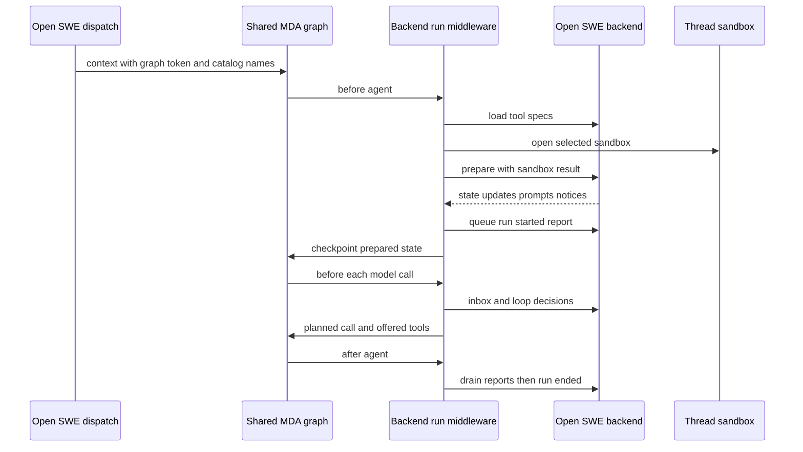
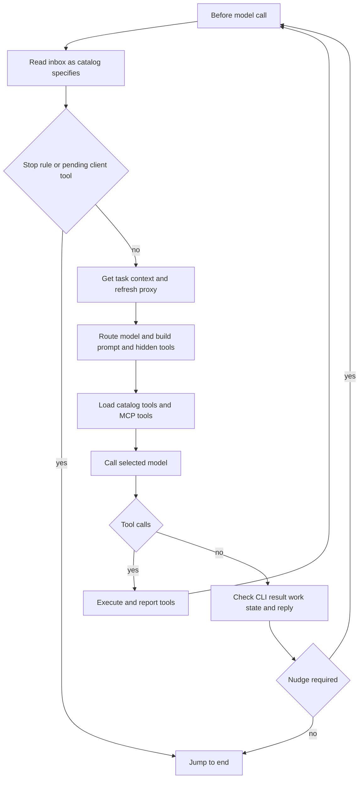
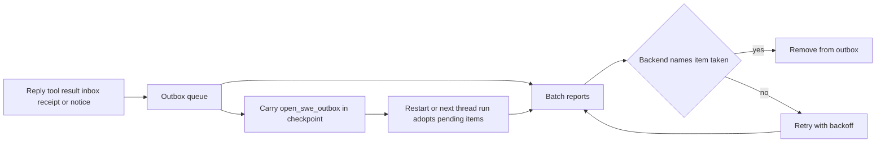

# Managed Deep Agents runtime

Open SWE packages its coding agent, pull-request reviewer, and review scout in the `open-swe` Managed Deep Agents (MDA) graph. A run context selects one of the `agent`, `reviewer`, or `review-scout` graph roles; the runtime executes the model loop, checkpoints, tool calls, and middleware, while the Open SWE backend plans the run and retains credentials. Backend calls use the run token, so this deployment does not need the backend's GitHub, Slack, or database credentials.

## The central boundary: shared graph vs. run-local plan

This boundary is intentional and is the most important constraint when changing the runtime:

| Shared graph inputs | Per-run catalog and token state |
|---|---|
| `GraphInputs` contains the graph role, worker webhook, agent and subagent model specifications, and gateway choice. A `shared_factory` builds a graph once per distinct input set in a process. | `RunContext` carries the run token and catalog. Before work begins the runtime loads the catalog's tool specifications; middleware then resolves the **current run** on every relevant call. |
| `_parts(graph)` supplies a common middleware shape, declared sandbox selector, file middleware, reporting middleware, and graph-declared subagent placeholders. | The catalog determines operations, MCP servers, subagents, tool visibility, code mode, skills, files, sandbox specification, model routing rules, loop rules, and tracing metadata. It can therefore differ by user, thread, run kind, or integration access without rebuilding the graph. |
| Graph construction must not capture a run's tools, credentials, sandbox, or prompt. Every graph has the same state shape so state can be read through any graph. | `RunLocal` caches values only within an active run, including toolsets, selected models, sandbox proxy writer, and guidance. A worker adopts its own token before it begins, so it receives its own catalog rather than its coordinator's identity. |

`agent.py` maps `agent` and `review-scout` to the `general-purpose` subagent and maps `reviewer` to `reviewer`. It also declares the asynchronous `general-purpose` worker. The worker does not notify its parent through Deep Agents: Open SWE registers and settles it through its own worker webhook and task messages.

## Construction and run lifecycle

The factory builds the long-lived graph definition from `GraphInputs`, but `BackendRunMiddleware` makes a concrete invocation usable. It adopts a worker grant if necessary, loads tool specifications, opens the selected sandbox concurrently with that loading, calls the backend's `prepare` endpoint, and preserves the resulting backend state in `open_swe_state`. Preparation is idempotence-aware for an invocation: a checkpoint already prepared for it reloads tool specifications rather than preparing again.

*Run preparation couples a shared graph to one token-authorized backend plan without embedding that plan in the graph.*

The middleware starts git evidence collection after preparation. When an MDA sandbox is not selected, it instead uses backend-served files. It can also offload a conversation before the first model call when the catalog's loop rules request it; the conversation is written only to the sandbox or the run artifact root, then the run ends.

## Per-model-call control loop

`RunLoop` interprets the run's `LoopRules`, rather than hard-coding behavior by graph role. Before a model call, it can stop on catalog state or an outstanding client-side tool result, reads the inbox, concurrently obtains task context and refreshes a due GitHub proxy token, restores dynamic guidance lost to summarization, selects a persisted or one-shot route, and selects a requested, routed, or default model. It composes the deployment prompt with cached workspace and thread prompt segments and supplies hidden tools, vision-model selection, fallback model, and gateway use to the call plan.

*The loop is catalog-driven; backend calls fill the parts requiring backend state or credentials.*

After a tool-free model response, the loop may nudge for a required CLI result, work-state declaration, or Slack reply. Bounded counters prevent an endless nudge cycle. If a Slack reply remains owed after its maximum nudges and there is textual output, the runtime asks the backend to reply on the model's behalf. At end of run it queues graph-specific finishing work such as review-check settlement or scout-plan completion, detects the model-call-limit marker, and queues `run_ended` with usage metadata.

The middleware applies a full model-call timeout. If the planned primary model fails and provides a fallback, it switches provider unless the failure is a graph interruption or malformed tool history. Independently, model retry middleware retries only transient provider failures up to five times with jittered or `Retry-After` backoff and a 60-second sleep budget. It retracts streamed chunks from failed attempts before retrying, so retries never replay tools or admit failed attempts into graph history.

## Tool, file, and sandbox ownership

`RunToolsMiddleware` builds `RunTools` from the current catalog after tool specifications are loaded. It offers normal operations and connected MCP tools to each model call; `code_only` tools remain callable from the QuickJS code interpreter, and hidden/excluded tools are withheld from the model request. A resumed run can resolve a missing MCP tool before a model call. When catalog search is enabled, a name not in the catalog can be resolved through the backend and then called through a backend tool wrapper.

The graph's own file and shell tools are selected per call:

- With an MDA-managed sandbox, `ls`, `read_file`, `write_file`, `edit_file`, `delete`, `glob`, `grep`, and `execute` run there. The catalog selects one sandbox per thread and creation options apply only when a sandbox is first created.
- Backend paths, skill-source paths, and threads without an MDA sandbox use remote-file or read-only skill tools instead. Large artifacts are rooted at the catalog-defined artifact location.
- Catalog-enabled checks reject image impostors, load applicable `AGENTS.md` instructions on reads, normalize tool errors into model-visible results, and send every file/shell call through transcript reporting. Code-mode wrappers deliberately route through the same checks.
- When shell guards are enabled, commands containing `push`, `gh`, or `pulls` are submitted to `check_shell` before execution. The backend can refuse or rewrite an approved command.

The declared sandbox is a selector, not a single graph-owned sandbox. MDA opens and boots the selected per-thread sandbox while the run prepares; the first dependent tool waits for boot. It retries transient sandbox-service failures during opening. If a bound workspace has been deleted, preparation adds explicit guidance that local and unpushed work is unavailable rather than claiming recovery. `recreate_sandbox` can yield a backend-directed replacement, which MDA replaces and reports back for backend reconnection.

Proxy ownership is exclusive. If the catalog does not name a GitHub proxy connection, MDA tells the sandbox layer not to manage proxy configuration and the backend owns it. If it does name a connection, MDA combines the connection-derived GitHub rules with backend-provided rules, writes them before preparation and commands, refreshes them periodically, and retries transient write failures. If the backend refuses the proxy-config request, it has taken ownership and MDA stops writing it for the remainder of the run.

## Reporting, checkpoint recovery, and completion

The runtime does not make normal progress wait for reporting. `ReportRepliesMiddleware` queues model replies; file middleware and `RuntimeToolsMiddleware` queue tool start/result reports; inbox receipts and backend notifications use the same mechanism. `Outbox` batches ordered items into `reports`, removes an item only after the backend acknowledges its key, and retries with backoff. Per-thread idempotency keys let the backend safely receive a resent report.

*Reports are at-least-once in transit and idempotent at the backend; checkpoint state makes unsent reports recoverable.*

A report is checkpointed with the reply, tool result, or hook update that produced it. On process restart or a later run of the same thread, `Outbox.adopt` sends inherited items first. Unreconstructable persisted tool-result references are logged and dropped so one corrupt item cannot block subsequent work. At end of an agent run, `BackendRunMiddleware` queues end-of-run notifications and drains reports before completion, because backend completion closes the transcript turn. Backend end-hook failure is logged rather than crashing final cleanup; trace and git-evidence finalization still occur.

## Operations and tests

Operational configuration belongs primarily to the backend URL and model/gateway credentials used by this deployment. `OPEN_SWE_BACKEND_URL` is the backend integration boundary; the backend needs the MDA runtime URL, service authentication, and run-token signing configuration. Run-token authentication and backend planning are security boundaries: do not move credentials or user-specific catalog data into factory inputs or module-global graph state.

Focused tests make the dynamic contract concrete. `mda/tests/test_shared_graph.py` uses distinct token/catalog contexts to verify graph sharing while operations, grants, sandbox selection, and preparation remain run-specific. `mda/tests/test_loop.py` verifies proxy-refresh retry timing, concurrent task-context/proxy preparation, incident context, dynamic-context restoration after summarization, model choice/routing, and reply/loop behavior. Changes to the runtime should add tests at the owning boundary: construction and catalog isolation in shared-graph tests, loop semantics in loop tests, and reporting recovery in outbox tests.
