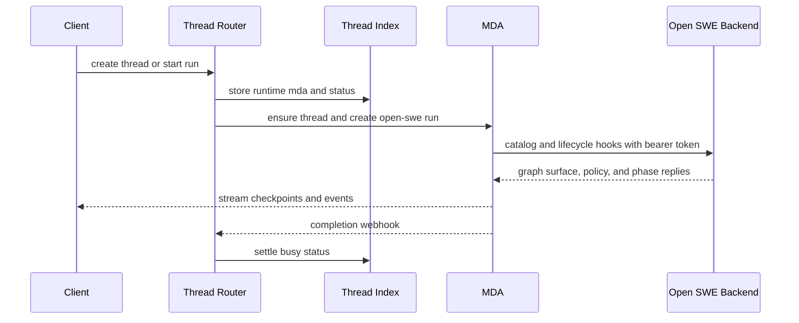
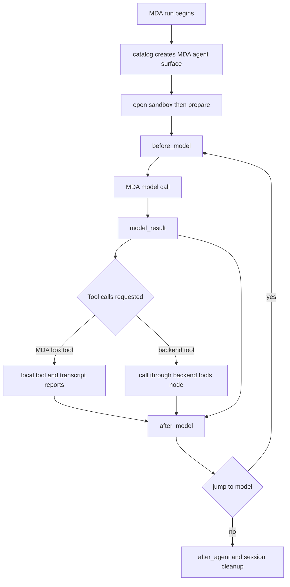

# Managed Deep Agents runtime protocol

Open SWE executes new `agent`, `reviewer`, and `review-scout` thread runs on one Managed Deep Agents (MDA) graph, `open-swe`. MDA owns the model loop, its checkpoints, and MDA-native facilities; the Open SWE backend remains the authority for the per-run graph surface, graph middleware, thread/run configuration, credentials, and policy. A run context selects the Open SWE graph role, while a signed token identifies the run for every callback.

This split is intentionally not a second implementation of the graph. The backend rebuilds an in-process `ToolSurface` for the token-authorized run and exposes a catalog plus phase and tool hooks. MDA projects that surface into its loop and sends graph-owned work back to the backend.

Related: [Agent assembly and middleware](agent-assembly-and-middleware.md), [Sandbox lifecycle](sandbox-lifecycle.md), [Thread runtime and transcript](thread-runtime-and-transcript.md), [Runs, inputs, and tools](../concepts/runs-inputs-and-tools.md), and [Testing overview](../testing/overview.md).

## Runtime boundary and thread routing

The PostgreSQL-backed thread index is the public source for thread reads and search. On creation, `ThreadRouter` indexes a thread with `runtime: "mda"`, copies metadata to both the local Agent Server and MDA, and uses MDA for runs. Before forwarding a run, it ensures the MDA-side thread exists, rewrites the requested assistant to the single `open-swe` graph, and moves the caller's configurable data into signed run context. It preserves the backend tracing project if the caller did not supply a tracer.



This sequence shows routing and execution ownership for an MDA thread.

A normal run context contains `graph`, `__run_token`, optional `invocation_id`, and serialized `models`; `__event_streaming_v2` is retained when required for protocol-v2 streaming. The backend only hosts `agent`, `reviewer`, and `review-scout`; any other requested assistant is rejected before a token is issued. MDA reads only context fields declared by `OpenSweRunContext`, then builds its one `open-swe` agent definition from the catalog.

Legacy `local` threads are deliberately compatible for reads: requests not adding activity still reach the local Agent Server and the router logs a warning. They are not migratable in place: starting a run or cron, posting `run.start`, `input.respond`, or `input.inject`, or copying the thread receives HTTP 410 instructing the caller to start a new thread. Thus new activity cannot silently split a pre-MDA transcript/checkpoint history between runtimes.

## Signed run identity

The backend creates an HS256 JWT with issuer `open-swe`, audience `open-swe-remote-runtime`, a 48-hour expiry, issued-at time, and required subject. Its substantive claims are the thread ID in `sub`, `assistant_id`, the whole run `configurable` as `cfg`, and permitted run metadata as `md`. Keys come from comma-separated `REMOTE_RUNTIME_TOKEN_SECRET`, allowing key rotation; verification tries every configured key, requires the registered claims, validates issuer/audience, and allows 60 seconds of clock leeway.

```json
{
  "iss": "open-swe",
  "aud": "open-swe-remote-runtime",
  "iat": 0,
  "exp": 0,
  "sub": "thread-id",
  "assistant_id": "agent",
  "cfg": {"...": "run configurable"},
  "md": {"event_match_ids": [], "ls_attribution_identifier": "..."}
}
```

The claim shape is illustrative; timestamps and configuration are run-specific.

Every MDA callback is `POST /remote-runtime/hooks/{hook}` with `Authorization: Bearer <token>` and a JSON-object body. `RunTokenMiddleware` verifies the bearer token once, places the resulting `RemoteRun` in request state, and the endpoint chooses the graph from the signed `assistant_id`. Hook bodies are not authorization inputs: the backend obtains thread identity, assistant, configuration, and metadata exclusively from verified claims. Missing/malformed bearer credentials produce 401; an unsupported graph is 403; invalid JSON objects are 422; unknown hooks are 404. A graph hook exception is logged and returned as `{ "error", "message" }` with HTTP 500, so MDA can fail with the backend cause without exposing the token.

### Worker grants are not coordinator credentials

An asynchronous task worker begins with a different JWT audience, `open-swe-worker-grant`. The grant contains the coordinator `RemoteRun` and a request ID (`rid`) for exactly one coordinator tool call. A grant may call `catalog` to learn its initial surface and `adopt` to exchange its worker thread ID, run ID, and assignment for that worker's own run token; every other grant hook is forbidden. MDA's worker-launch middleware substitutes the grant for the coordinator token, so a newly launched worker cannot operate as its coordinator. After adoption it refreshes its catalog under its own identity.

The coordinator invokes `start_async_task`; Open SWE authorizes/returns an existing worker for replay or returns a grant and rendered assignment. MDA starts `open-swe--general-purpose` on a new worker thread, registers it through `worker_launched`, and does not use MDA's parent notification/task tracking. The backend owns worker registration, task messages, cancellation, and completion-webhook settlement. Replayed launches converge on one registered worker; an extra launched worker is cancelled.

## Catalog ownership and tool execution

`catalog` is the compatibility contract between the backend's compiled graph and MDA. It supplies JSON tool specs, synchronous subagent specs, selected models, trace metadata, exclusions, code-only/direct-from-code sets, display descriptions, an optional worker webhook, and optional sandbox specification. The backend derives it after building and preparing the per-run `ToolSurface`; it excludes MDA's own `task`/`eval` mechanics and conveys only schemas and policy, never backend credentials.

```json
{
  "tools": [{"name": "tool_name", "description": "...", "parameters": {}}],
  "subagents": [{"name": "...", "description": "...", "system_prompt": "...", "tools": null}],
  "models": {"model": {"model_id": "provider:model", "kwargs": {}}, "subagent_model": {"model_id": "provider:model", "kwargs": {}}, "use_gateway": true},
  "excluded": ["hidden_tool"],
  "code_only": ["tool_from_code"],
  "also_from_code": ["direct_tool"],
  "sandbox": null
}
```

MDA converts catalog entries to backend-call tools. It offers only non-excluded, non-code-only schemas to the model, retains code-only tools for code mode, and applies the catalog's named subagent tool subsets. For ordinary remote tools, the `call` body includes the tool `name`, model-provided `arguments`, `tool_call_id`, plus a common envelope:

```json
{
  "run_id": "run-id-or-null",
  "messages": [{"type": "human", "data": {}}],
  "state": {"backend-owned-state": "..."},
  "namespace": ["enclosing-task-tool-call-id"],
  "name": "tool_name",
  "arguments": {},
  "tool_call_id": "call-id"
}
```

`open_swe_state` and MDA model-call counters are forwarded in `state`; LangChain messages are serialized. The namespace makes calls and replies from an MDA subagent appear under its enclosing `task` call in the backend transcript. Backend tool execution re-enters `ToolSurface.run`, retaining the in-process tool node's validation, middleware, updates, and custom events. It converts surviving exceptions to error tool messages; tool-error middleware normally converts tool failures before that point.

### MDA-owned box tools

When the catalog supplies a sandbox, MDA declares one sandbox per thread and locally runs the catalog-listed filesystem/shell tools—such as `ls`, `read_file`, `write_file`, `edit_file`, `delete`, `glob`, `grep`, and `execute`—there. The backend specifies the creation snapshot, capacity, vCPU/memory, idle and deletion TTLs, and extra creation fields, but those settings apply only if MDA creates a box. This avoids a refreshed backend snapshot displacing an existing thread's work.

The catalog also says which box tools are safe to run locally and which checks apply. MDA reproduces tool-error normalization and the coding agent's image/subdirectory `AGENTS.md` read checks, reports locally executed calls via `tool_started` and `tool_result`, and routes unsafe work back through `call`: backend-served paths such as skills/blobs and commands that may push or create pull requests. If the backend graph adds unknown tool-call middleware, it advertises no box tools, conservatively routing every tool call through the backend rather than bypassing policy.

MDA reports local tool calls in order but does not block their execution on reporting. It drains prior reports before a phase or model reply, maintaining transcript ordering. A tool that finds the box unreachable ends the run after calling `sandbox_unreachable`, allowing the backend to notify the user.

## Hook phases, state, and model ownership

The hook envelope above is shared by phase hooks. Backend phase replies carry a JSON-serializable state `update`, added `messages`, optional `jump_to`, and custom `events`; `before_model` additionally returns the system prompt, model/fallback/vision specifications, gateway choice, and names of tools to hide. MDA re-emits events, merges backend state under `open_swe_state`, and preserves MDA-owned summarization state separately.



This phase diagram distinguishes backend graph policy from MDA loop/checkpoint ownership.

* `prepare` maps to backend `before_agent`: preparation, transcript turn, skills, reply bookkeeping, and binding of the sandbox MDA opened before preparation.
* `before_model` runs backend before-model middleware, derives the prompt and per-call hidden tools, selects the model/fallback/vision model, and can end the run through `jump_to`.
* `model_result` lets backend transcript and usage observers process MDA's response.
* `after_model` runs backend after-model hooks, including reply nudges that may continue the loop.
* `after_agent` runs final usage/transcript/review work and always drops the backend's cached run session. Backend before hooks run in middleware order; after hooks run in reverse, matching local graph semantics.

Backend `RunSession` objects are keyed by thread and run ID, cache a rebuilt surface for six hours, and cap their in-memory cache by purging expired entries when it reaches 512 sessions. Any backend replica can reconstruct a session from the signed configuration and supplied state; middleware that declares resume/flush support is rejoined before a hook and flushed before replying. JSON-serializable state crosses the boundary with messages specially encoded; non-JSON backend state remains local.

MDA deliberately owns model-call mechanics: retries, automatic summarization, cache behavior, limits, provider-history normalization, and deadline guards. The backend chooses a model per call and may provide fallback and vision alternatives; MDA applies the selected prompt/model, moves image-containing requests to a supplied vision model, and tries the fallback after a main-model failure except malformed tool-pairing histories. A normal model-call timeout can therefore reach fallback, whereas a subagent timeout becomes that subagent's answer so its delegating `task` call can continue.

## Sandbox adoption and replacement

MDA opens or adopts the per-thread box before `prepare` and passes its ID in the hook body. The backend then binds the thread as `sandbox_owner: mda` and connects Git proxy credentials, identity, and its tool channel; MDA explicitly leaves proxy management to the backend. The backend never creates or replaces an MDA-owned box.

For `recreate_sandbox`, the backend tool returns replacement create parameters. `ReplaceSandboxMiddleware` recognizes that reply, asks MDA to replace the box under the thread definition, and calls the `sandbox` hook so the backend reconnects to the fresh box. The final tool result reports success plus old/new IDs and whether stopping the old sandbox failed. If replacement fails, it returns a structured failure in the tool result instead of pretending the backend completed it.

## Failure, retries, and operations

MDA calls the backend with a 300-second general hook deadline, a 30-minute preparation deadline, and a tool deadline long enough for a requested tool timeout plus cleanup slack. Calls carry the token only in the bearer header, and error messages avoid echoing it. A transport failure is retried with bounded backoff only when the backend was not reached; `catalog`, `prepare`, and `launch_worker` are repeatable, while `before_model` is also retried after HTTP 503. Tool calls are never replayed because they may have executed; no hook retries after 504. An unavailable backend fails active preparation/model phases, while a failed final `after_agent` hook is logged so cleanup can proceed.

The backend refuses startup unless `MDA_RUNTIME_URL` is an absolute HTTPS URL (loopback HTTP is allowed for development) and `REMOTE_RUNTIME_TOKEN_SECRET` is configured. MDA needs `OPEN_SWE_BACKEND_URL`; backend-to-MDA calls use `MDA_RUNTIME_API_KEY` or fall back to `LANGSMITH_API_KEY`. The MDA deployment itself needs LangSmith/model credentials, with `LANGSMITH_GATEWAY_API_KEY` preferred for gateway model calls. The projects are intentionally separate: `mda/` is not imported by the backend and is tested/typechecked in its own locked environment.

## Focused compatibility tests

`tests/threads/test_thread_router.py` verifies that new threads are indexed as MDA, mirrored into both runtimes, rewritten to `open-swe`, supplied a signed context rather than raw configurable data, marked busy, and settled through completion handling. It also verifies read-only local-thread rejection and worker graph selection.

`mda/tests/test_backend_calls.py` exercises the cross-project protocol: retry boundaries for hooks versus tool calls, backend exception propagation, local-box routing to backend policy paths/push guards, replayable model history and fallback behavior, ordered tool reporting, and worker launches that carry a grant—not the coordinator token—and adopt their own token before catalog or preparation. These tests are the primary safety net when changing either side of the contract.
