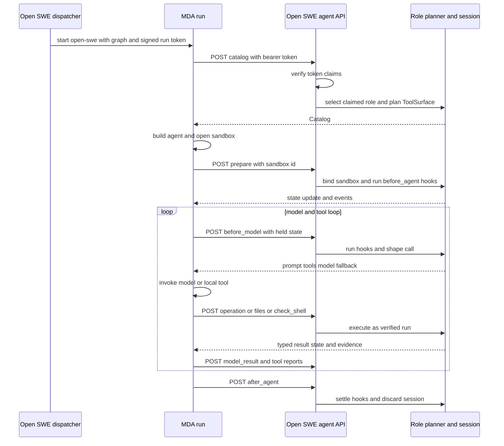

# Managed Agent Runtime and Typed Backend Contract

Open SWE separates **graph policy and privileged work** from **agent execution**. The backend plans the `agent`, `reviewer`, or `review-scout` role into a `ToolSurface`; Managed Deep Agents (MDA) runs the model loop, checkpoints, sandbox-backed file/shell calls, and subagents. The plan crosses the boundary as a per-run `Catalog`, rather than as a compiled backend graph. MDA is a separate project (`mda/`): it calls the backend over HTTP and has its own locked environment and tests; it does not import `openswe`.

## Ownership and planning boundary

`RemoteGraph` is the backend adapter for each hosted role. Its role-specific wrappers call `plan_agent`, `plan_reviewer`, or `plan_review_scout` to fill a fresh `ToolSurface`, prepare it, and cache that resulting `RunSession` by `(thread_id, run_id)` for six hours. A `prepare` call starts a fresh session; `after_agent` removes it. This preserves the role’s existing middleware, tools, model choice, sandbox policy, and state restoration without compiling or executing the graph in the backend request path.

The session turns the surface into `Catalog` data:

- Operations include their JSON-schema parameters and exactly the injected state keys they read (`reads`), or `reads_all` when they need the complete state/runtime. MDA turns each operation into a local tool but sends the work back to the backend as `operation`.
- The catalog conveys synchronous subagent definitions, model and subagent-model specifications, tools hidden from the model, code-mode-only tools, and tools callable both directly and from code. The reviewer’s plan can additionally restore its derived `diff_line_set` from transmitted `diff_text` because sets do not cross the JSON boundary.
- A catalog may describe an MDA-owned sandbox, backend-served file prefixes and artifact root, shell and read checks, skills, optional incident evidence, a worker-completion webhook, trace metadata, and a model-call limit. MDA creates the described sandbox before `prepare`; the backend then binds the thread to that box.

MDA’s `agent()` factory obtains the catalog before constructing `open-swe`. It registers backend operation tools, chooses local filesystem tools in an MDA-owned box or remote file tools otherwise, installs the catalog’s synchronous subagents, and enables the asynchronous `general-purpose` worker. It deliberately excludes code-only tool schemas from ordinary model calls while preserving their availability to code mode.

## The signed typed API

The shared Python package `packages/runtime-api/src/runtime_api` is the compatibility boundary, imported by the backend and MDA. Every `Endpoint` declares Pydantic request/response models, a timeout, and a delivery policy. Calls are JSON `POST`s to `/agent-api/{endpoint}`; endpoint dispatch validates both request and response shape rather than accepting an untyped model-controlled body. Delivery semantics distinguish a normal one-time attempt, a retry when a gateway probably did not process the call, and safe idempotent retry; a 504 is never retried because the backend may still be working.

Dispatch signs a `RemoteRun` into MDA’s run context. It contains the thread id, hosted assistant id, backend configurable values, and metadata; its JWT requires issuer, audience, issue/expiry, and subject, is HS256-signed with the first configured secret, and verification accepts each comma-separated secret to support rotation. The backend refuses startup without a valid `MDA_RUNTIME_URL` and `REMOTE_RUNTIME_TOKEN_SECRET`; non-loopback URLs must be HTTPS.

**Security invariant:** handlers select the graph and reconstruct run/thread configuration from verified `RemoteRun` claims, never from endpoint body fields or tool arguments controlled by the model. `RunTokenMiddleware` verifies the bearer credential on every request and stores only the verified principal in request state. Unknown or unauthorized endpoint/graph access is refused, malformed endpoint bodies return 422, and unexpected handler failures are logged and returned as a typed failure payload for the run to fail as it would in-process.

A worker initially holds a more limited worker-grant token, not its coordinator’s run token. It can read the coordinator catalog and call the worker adoption endpoint only; after adoption it receives a token for its own worker thread and subsequent calls act under that identity.

This sequence shows that the bearer token establishes identity before the backend chooses a role, configuration, or privileged handler; body fields only carry the typed inputs for that already-authorized run.

## Run lifecycle and phase/state bridge

The catalog is read once at startup, then `BackendRunMiddleware` forwards backend graph lifecycle behavior phase by phase:

1. `prepare` follows MDA opening the sandbox and runs backend `before_agent` hooks, including preparation and turn bookkeeping.
2. `before_model` runs backend before-model hooks, determines routing, system-prompt additions, model/vision/fallback choice, and any tools to hide. Only middleware implementing `ShapesModelCalls.ashape_model_call` contributes request shaping; the backend uses response wrappers only to observe MDA’s completed result.
3. `model_result` lets transcript and usage observers process the response; `after_model` performs post-response hooks and may direct the loop elsewhere; `after_agent` performs final hooks, reconciles git trace metadata, and ends the session.
4. `tool_started` and `tool_result` report MDA-local calls so transcript and git evidence remain consistent with an in-process run. A subagent supplies its `task` namespace, causing its replies and tool calls to nest under that task.

MDA carries backend-owned JSON state as `open_swe_state` with every phase call and applies returned updates, messages, jump targets, and custom stream events. The backend encodes messages for JSON and restores them on receipt; non-JSON backend state is intentionally retained only locally. Backend replicas can rejoin per-run middleware state before handling a phase and flush it afterwards, so a phase need not reach the process that began the run.

## Tool, file, shell, skill, and incident paths

An operation request includes a catalogued name, JSON arguments, a request id, and only the declared state/messages. The backend rejects unknown operation names and unexpected arguments, applies shell-guard decisions to operation inputs, invokes the original tool under graph context, and returns tool content/status, state changes, stream events, git evidence, or a normalized failure. The backend does not run a tools node or general tool-call middleware; the call chain and tool result belong to MDA.

MDA’s file middleware owns `ls`, `read_file`, `write_file`, `edit_file`, `delete`, `glob`, `grep`, and `execute`. It uses the MDA sandbox when one is catalogued, but routes backend paths (including offloaded artifacts) or threads without an MDA-owned box through typed `files.*` endpoints. Before a potentially guarded `execute` command—one mentioning `push`, `gh`, or `pulls`, or nesting at least three shells—it calls `check_shell`; a backend verdict can refuse the call or replace the command. File tools report even refused calls to the transcript, convert tool errors to model-visible results, apply configured image-read and ancestor-`AGENTS.md` checks, retry a sandbox rejection that occurred before start, and cap an unanswered command at its timeout plus 30 seconds.

The backend lists only authorized `SKILL.md` files through `skills`; MDA exposes them as read-only file content and lists them to the agent and subagents. When incident evidence is enabled in the catalog, MDA submits each tool result to `record_evidence`, whose reply replaces the result content with citeable evidence. Sandbox replacement and unreachability also have explicit endpoints: MDA reports replacement for backend reconnection, while an unreachable sandbox triggers notification and ends the run.

## Models, subagents, and failures

MDA owns the actual model-call mechanics: retries, caching, call limits, automatic summarization, provider request formation, and checkpointing. The backend names the primary, fallback, and optional vision model for a call; MDA switches to the supplied vision model when needed. Its guards normalize replay history for provider compatibility, preserve parallel tool-result order, and impose a 15-minute wall-clock deadline covering client retries. A primary-agent timeout/error can activate the backend-named fallback; a synchronous subagent has no fallback and receives a model-visible timeout answer so its parent `task` call can continue.

Synchronous subagents are built from catalog definitions and report through the same backend hooks. For asynchronous work, MDA’s `start_async_task` launches a worker on `open-swe--general-purpose`; it begins with the restricted grant, adopts a distinct run identity, and the backend uses the worker webhook to settle work and wake the coordinator rather than allowing the SDK to notify it directly.

## Operating and changing the boundary

The deployment needs `OPEN_SWE_BACKEND_URL`; it uses LangSmith and model credentials to execute model calls. The backend needs `MDA_RUNTIME_URL`, optional `MDA_RUNTIME_API_KEY` (falling back to `LANGSMITH_API_KEY`), and the token secret. Keep those deployment concerns separate: MDA holds no backend database, GitHub, or Slack credentials, and is not a backend import target.

To add behavior safely, decide its owner first:

- Add a backend graph concern as planner/middleware behavior; phase forwarding reaches MDA without modifying the runtime when it fits the existing phase contract. Add model-request shaping through `ashape_model_call`, not a backend model invocation wrapper.
- Add a local filesystem or shell cross-cutting check in `mda/rt/file_tools.py`; add a privileged backend capability as a new typed `Endpoint` and models in `runtime_api`, then implement both the MDA caller and backend handler. Do not add an ad hoc request body.
- Extend catalog data when the runtime must construct different tools, subagents, sandbox behavior, or policy. Keep untrusted tool arguments distinct from signed configuration.

Focused regression coverage belongs on each side of the contract rather than in a shared environment: backend agent-API tests validate planner/handler authorization, state, and endpoint outcomes; `mda/tests/test_backend_calls.py` covers HTTP call/retry and token transport, while the file-tool, model-call, task-retry, and read-validation tests cover the runtime-specific middleware behavior. Run the MDA suite in its own environment with `make mda-test` and `make mda-typecheck`; do not make MDA tests import `openswe`.
