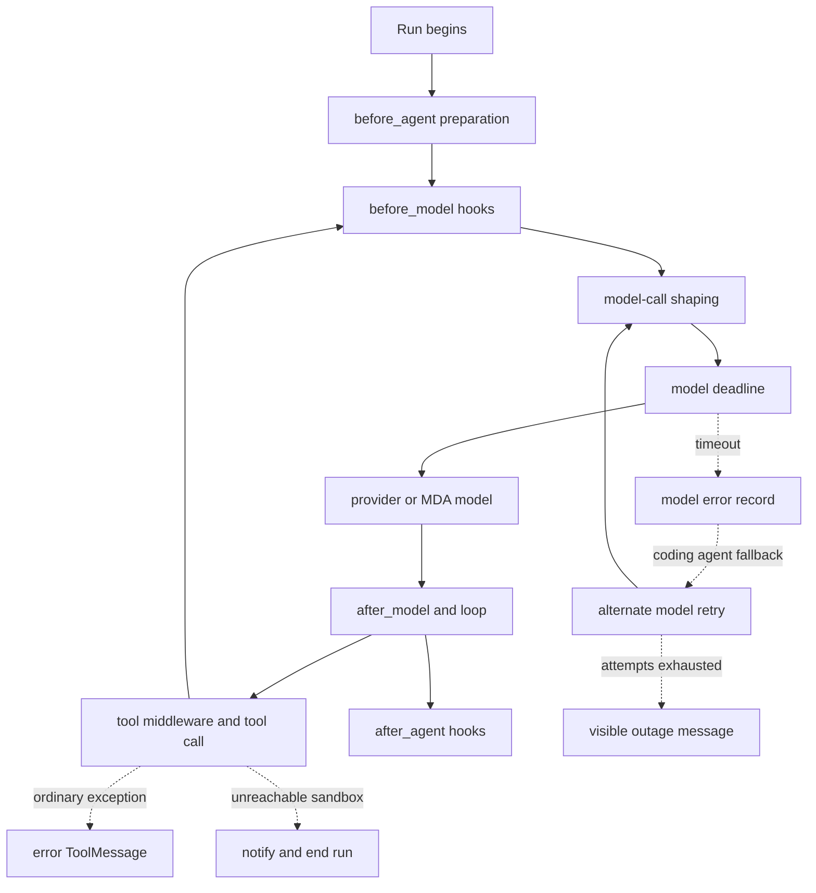

# Middleware and Failure Semantics

Open SWE supplies ordered middleware lists to `create_deep_agent`. The first item is outermost: it sees a model or tool call before later items, and it sees exceptions as they return. Consequently, order is a behavioral contract, especially at retry, timeout, and policy boundaries. The coding-agent and reviewer factories build their lists in [server.py](../../openswe/server.py) and [reviewer.py](../../openswe/reviewer.py); the remote runtime replays applicable hooks around a Managed Deep Agents (MDA) loop rather than moving the whole graph out of process.

## Phases, ownership, and exits

This shows the principal in-process failure paths. The remote runtime invokes the same phase hooks, while MDA owns the remote model loop and its built-in model retry, fallback, summarization, and call-limit behavior.

There are four hook categories:

- `before_agent` establishes per-run state before the loop.
- `before_model` updates state before each turn, such as delivering queued follow-ups.
- `awrap_model_call` and `awrap_tool_call` form nested wrappers around a call.
- `after_model` and `after_agent` perform completion work. Hooks in an after phase run in reverse middleware order, mirroring unwinding of the wrapper stack.

`BasePrepareRunMiddleware` is the common preparation boundary. It fingerprints the middleware class, current latest message, and preparation configuration. The checkpointed `run_prepared_for` latch avoids repeating completed setup for the same invocation, but a setup failure before the checkpoint can cause another attempt. Implementations of `_prepare` must therefore be idempotent. Its model wrapper installs `rendered_system_prompt` into the request.

## Coding-agent composition

The production coding-agent list is broader than just the failure middleware. In outer-to-inner order it starts with filesystem, Anthropic prompt-cache, conversation-offloading, run-preparation, optional review-guide, transcript, client, incident, workspace-skills, and image-read validation middleware. It then installs the call-limit, tool safety, task, queue/reply, usage/routing, model-shaping, and error layers below.

The core ordering is:

1. `ModelCallLimitMiddleware` ends the run at the configured model-call limit.
2. `ToolErrorMiddleware`, `ExcludeToolsMiddleware`, `SubdirAgentsReadMiddleware`, and a `ToolRetryMiddleware` scoped to `task` normalize tool failures, hide tools, add scoped instructions, and retry delegated tasks.
3. `PullRequestCreationGuardMiddleware` and `WorkflowPushGuardMiddleware` intercept unsafe tool calls. `TaskCoordinationMiddleware`, when configured, sits outside the per-turn hooks.
4. GitHub-proxy refresh normally runs before every model turn. Unless this is stop-summary mode, the queue hook and event-match delivery hook follow it. `RequireUserReplyMiddleware`, optionally `RequireCliResultMiddleware`, then govern reply/CLI completion requirements.
5. `notify_step_limit_reached`, `record_run_usage`, model selection, fallback, optional image fallback, dynamic tools, and optional MCP programmatic-tool-calling middleware surround the inner provider-compatibility layers.
6. Fireworks, OpenAI Responses, and thinking-block sanitizers, stable tool-result ordering, `ModelErrorMiddleware`, and innermost `ModelCallTimeoutMiddleware` complete the model path.

Several entries are conditional: client, incident, workspace skill, review-guide, image-fallback, dynamic-tool, and MCP middleware depend on the run configuration; proxy refresh is omitted for task-coordination workers; queue/event delivery is omitted in stop-summary mode. Do not infer a fixed list only from one run configuration.

### Model failure, retry, and visibility

`ModelCallTimeoutMiddleware` uses `asyncio.wait_for` to turn a stalled provider operation into `ModelCallTimeoutError`, a `TimeoutError`. Its default is 900 seconds; `OPEN_SWE_MODEL_CALL_TIMEOUT_SECONDS` is accepted only when positive. Because it is innermost, the deadline covers the provider call itself. `ModelErrorMiddleware` receives the exception next, logs and classifies it, records the error type and classification in thread metadata where a thread is available, then re-raises unchanged.

The coding agent's `ModelFallbackMiddleware` is outside those wrappers. If a fallback model is configured, it alternates primary and fallback model attempts. It retries connection, timeout, selected retryable `ModelError`, and listed provider status failures, using the `(0, 5, 15, 30, 45)` second schedule plus up to 25% positive jitter: six total attempts. Provider model-access errors are immediately turned into tailored `AIMessage` responses. For exhausted transient failures the default is also a terminal outage `AIMessage`, preserving a user-visible, retriggerable outcome; `surface_outage_message=False` instead re-raises the last exception.

This distinction matters operationally: a non-retryable provider error escapes fallback after being recorded, whereas an exhausted transient coding-agent failure normally ends as an AI response rather than a failed graph. The reviewer has a different retry policy described below.

### Tool errors and policy guards

`ToolErrorMiddleware` converts ordinary unhandled tool exceptions into `ToolMessage(status="error")` JSON with the error, error type, and available tool name. That leaves the model enough structured context to correct its next action without terminating the run. A `NodeCancelledError` is never converted.

Sandbox connection semantics are intentionally more selective. SDK-marked transient connection rejection is returned as a `sandbox_transient` tool error because the command did not start and no change occurred. A `SandboxConnectionError` other than `SandboxServerReloadError`, or a sandbox-specific `ResourceNotFoundError`, means the sandbox itself is unreachable. The middleware attempts a user notification and re-raises so the run ends instead of emitting repeated failures and notifications.

The PR guard only intercepts `execute` and `background_execute`. It blocks command forms that bypass the attributed PR tool, including `gh pr create`, qualifying GitHub API creation, direct `curl` creation, and overly deep shell expansion, returning a tool error rather than executing. The workflow-push guard separately detects GitHub Actions workflow changes in a push and returns an approval-required error containing the change fingerprint and approval URL until recorded human approval permits the rewritten safe push.

## Queueing and follow-up delivery

`check_message_queue_before_model` obtains a snapshot of `QueuedMessage` records for the current thread before every eligible model call. It builds queued content into structured input messages in the retrieved order, updates reply surface for a dashboard handoff when needed, and removes records only after all messages were successfully built. Thus a failure during construction leaves messages queued rather than losing them; after a successful build, the injected messages are visible on the next model request. Image URLs are skipped with a warning when image fallback is disabled and the resolved model lacks vision support.

This hook is the integration point that lets a follow-up arriving while the agent is busy influence a later turn. It is deliberately not a queue worker or a model retry mechanism.

## Reviewer differences

The reviewer is intentionally narrower. Its main graph installs, outer-to-inner: `PrepareReviewerRunMiddleware`, Anthropic prompt caching, `ModelCallLimitMiddleware`, `ToolErrorMiddleware`, `ExcludeToolsMiddleware`, proxy refresh, queue delivery, the three message sanitizers, `RepairOrphanedToolCallsMiddleware`, stable tool-result ordering, `ModelRetryMiddleware(retry_on=(TimeoutError,))`, `ModelErrorMiddleware`, `ModelCallTimeoutMiddleware`, and `settle_review_check_on_exit`.

It has no coding-agent model fallback, dynamic-tool layer, task retry, PR/workflow guards, usage recorder, or reply/CLI middleware. The reviewer excludes shell search tools and exposes review-specific tools instead. Its general-purpose reviewer subagent is separately compiled, so the parent reviewer middleware does not wrap its model calls; that subagent has prompt caching, tool exclusion, OpenAI response sanitization, timeout-only retry, error recording, and the same deadline.

`RepairOrphanedToolCallsMiddleware` repairs a persisted interrupted conversation before a model request. For every AI tool-call ID with no corresponding `ToolMessage`, it inserts an adjacent synthetic error result. This keeps a cancelled tool call from permanently violating provider tool-call/result pairing requirements and lets a later review retry it.

`settle_review_check_on_exit` is an after-agent safety net. When an unpublished tracked review check remains, it resolves it as `neutral` so reviewer infrastructure failure is not displayed as a code failure. If `publish_review` already produced a stored pending real conclusion but the completion PATCH failed, it retries that real conclusion instead. Errors in this settlement hook are logged and do not replace the completed agent result.

## Managed Deep Agents remote execution

`openswe.remote_runtime.graph` retains the graph-side responsibilities while MDA owns the durable remote model loop. A `RemoteGraph` builds a per-run `ToolSurface` and `RunSession`; state and messages cross the process boundary as JSON, with message objects encoded and reconstructed. A session can rejoin on another replica via `aresume_run`, and it flushes carried middleware state after each hook.

The remote protocol maps `prepare`, `before_model`, `after_model`, and `after_agent` to the matching graph hooks. It runs before hooks in list order and after hooks in reverse order. Before the remote model call it uses graph middleware wrappers only to determine the rendered system prompt and tools hidden for that call, then returns the selected primary and fallback model specifications to MDA. The remote module explicitly leaves model retries, fallback, summarization, and call limits to MDA; it omits middleware that is MDA-owned or only observes results from prompt shaping. Transcript and run-usage middleware observe MDA's `model_result` response.

For a non-MDA Open SWE tool call, the remote `call` handler delegates through the `ToolSurface`, so graph tool-error middleware remains the normal error boundary. If an exception remains—for example, the call did not reach a tool because of invalid arguments—the protocol returns an error `ToolMessage` to MDA rather than leaking an unstructured exception across the boundary. MDA-owned `task` and `eval` tools are recorded through `tool_started` and `tool_result` callbacks for middleware that tracks remote tools.

## Change guidance

When changing this area, preserve wrapper direction and distinguish a graph-owned phase from an MDA-owned model-loop feature. Keep a timeout inside the coding-agent fallback wrapper so a hang becomes retryable, and keep error recording inside that wrapper so each failed attempt can be classified. Preserve preparation idempotence, queue removal only after successful message construction, and the strict rule that only a pre-start sandbox rejection is safe to represent as transient. Add or update focused tests for the affected ordering edge, retry eligibility, queue durability, orphaned-tool repair, and user-visible terminal outcome.
