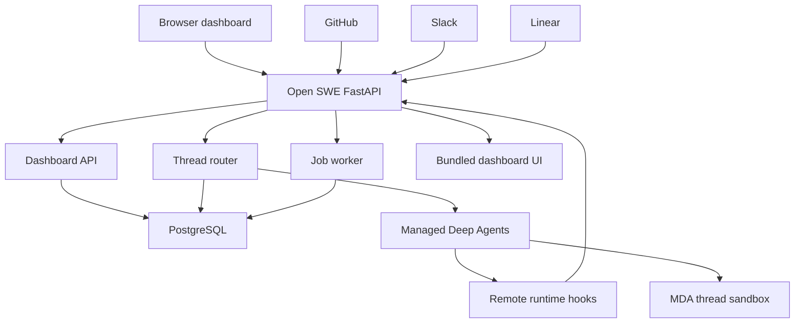
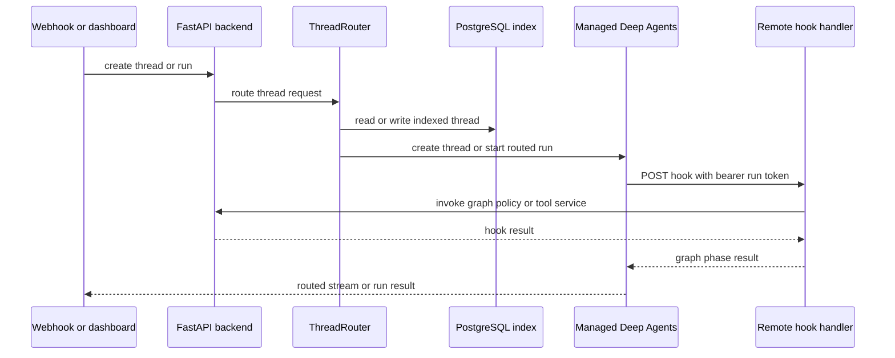

# System architecture and service composition

Open SWE is a software-factory backend built on LangGraph and Deep Agents. Its FastAPI application is the public composition point for the dashboard, webhooks, internal services, and Agent Server-compatible thread APIs. New agent work executes remotely on Managed Deep Agents (MDA), while this backend remains the control plane: it authenticates users and integrations, owns the PostgreSQL index and application records, signs run context, and serves remote-runtime hooks used during the model loop.

## Deployed components and ownership

`langgraph.json` is the backend deployment manifest. It registers three local LangGraph entrypoints—`agent`, `reviewer`, and `review-scout`—and mounts `openswe.webapp:app`. The entrypoint modules are deliberately thin re-exports, leaving factories in their owning feature modules. The manifest also loads `.env`, requires Python 3.14, configures deletion-based checkpoint TTL (60-minute sweep; 43,200-minute default), enables custom Agent Server auth, and best-effort builds the dashboard into the image.

| Component | Primary responsibility | Durable owner / boundary |
|---|---|---|
| Open SWE backend | Browser and webhook ingress, authorization, thread routing, application records, jobs, and remote hooks | FastAPI process plus PostgreSQL |
| Managed Deep Agents | Model loop, LangGraph checkpoints, MDA-owned sandbox lifecycle, MDA-native tools and subagents | Separate MDA deployment |
| Open SWE graph implementation | Domain prompts, tool policy, preparation, transcript and workflow behavior exposed through hooks | Backend code invoked by MDA |
| Dashboard | React browser UI; talks to the backend origin and Agent Server-compatible APIs | Bundled static assets or proxied Vite server |
| External services | GitHub, Slack, Linear, LangSmith/MDA, model providers, MCP services | Integration-specific credentials and protocols |

This is the principal deployment boundary: MDA owns execution and its thread sandbox, while the backend supplies policy and application services over authenticated hooks.

## FastAPI composition and lifecycle

`openswe.webapp` is only a compatibility import of the `app` assembled by `openswe.api.app`. Before queue workers can be built, the module pins a single event loop. `create_app()` configures Datadog tracing, credentialed CORS from `DASHBOARD_ALLOWED_ORIGINS` plus `open-swe://app`, audit logging, request IDs, GitHub error handling, gzip, and the `ThreadRouter`. It refuses `*` in the configured origins because credentials are enabled.

The application then mounts the dashboard API; planning and workflow-approval APIs; Slack, Linear, GitHub, and rollout webhooks; health; sandbox tool and OpenAI-compatible sandbox APIs; reviewer evaluation reports; MDA hook handling; and, when configured, an agent MCP server. Finally it mounts the dashboard UI. The UI catch-all deliberately declines API and Agent Server prefixes, so it cannot shadow `/threads`, `/runs`, `/dashboard/api`, or other server-owned routes. A build can be served from `DASHBOARD_STATIC_DIR` (or the repository output); development instead reverse-proxies `DASHBOARD_DEV_SERVER_URL` while retaining the backend origin.

The lifespan is operationally significant rather than a simple model-cache cleanup. Startup validates GitHub login policy, sandbox configuration, local development LLM configuration, and MDA configuration; requires PostgreSQL and runs migrations under a database advisory lock. It then performs best-effort cleanup of obsolete analyzer crons, synchronizes configured admins, starts analytics, transcript, sandbox-bridge, UI-invalidation, notification, and job workers, and attempts an agent-build warmup. Several listeners degrade to local/refetch behavior when they fail, rather than preventing service startup. Shutdown stops workers and listeners and closes the shared HTTP pool and database.

This sequence shows a new MDA-thread run. The browser and external triggers enter the same backend boundary; only MDA is allowed to execute the remote model loop.

## Thread routing and Managed Deep Agents

The `ThreadRouter` is ASGI middleware ahead of the core `/threads` and `/runs` routes. It preserves Agent Server-compatible client behavior while using PostgreSQL as the authoritative thread index. It answers thread CRUD, search, and counts from that index, copies metadata to runtime copies for runs and traces, and forwards state, history, commands, streams, cancellation, and run creation to the thread's runtime.

Every newly created thread is indexed as `runtime: mda`, created both locally and on MDA, and has its MDA copy rewritten to the single MDA graph ID `open-swe`. Legacy local threads can still be read and routed to the local Agent Server, but run creation, cron creation, posting commands, and copying are refused with `410`; users must create a new thread. Starting an MDA run marks the indexed thread busy, and completion/reconciliation settles it.

MDA hosts `agent`, `reviewer`, and `review-scout` as one graph. For a run, the backend converts the requested Open SWE assistant into MDA context, signs a token containing the thread ID, assistant ID, configurable values, and allowed metadata, and forwards the request to `open-swe`. The MDA deployment calls `POST /remote-runtime/hooks/{hook}` with that bearer token for catalog, phases, and tool calls. The hook middleware verifies the token, selects the graph from token-bound assistant identity, and reads configuration from the token rather than the request body. Missing, malformed, or unauthorized tokens fail before hooks run. MDA configuration is mandatory at backend startup: `MDA_RUNTIME_URL` must be absolute and HTTPS except for loopback development, and `REMOTE_RUNTIME_TOKEN_SECRET` must be present.

This separation is intentional: MDA owns the execution loop, checkpoints, sandbox lifecycle, and MDA-native file/shell tooling; the backend supplies the in-process graph behavior and uses the hook protocol to preserve Open SWE policy, transcript, and dashboard-visible behavior. See [Managed runtime](./managed-runtime.md) for the detailed hook and tool boundary, and [Thread runtime and transcript](./thread-runtime-and-transcript.md) for thread-facing behavior.

## Dashboard and integration boundary

The lazily loaded dashboard router is rooted at `/dashboard/api` and applies a same-origin dependency to mutations. It aggregates browser-facing routes for authentication, profiles and user settings, workspaces, repositories and pull requests, reviews, schedules, threads, transcript, analytics, audit logs, skills, MCP configuration, bridge access, and UI invalidations. Laziness matters: importing an individual dashboard submodule does not eagerly import the full FastAPI and jobs surface; only the web app mounting `router` pays that import cost. See [Dashboard UI](../integrations/dashboard-ui.md).

Slack, Linear, and GitHub are ingress adapters, not execution runtimes. Their routers enter the FastAPI composition alongside browser APIs and use the backend's authorization, records, thread routing, and job/run services. Likewise, the backend's MDA client and hook API are a controlled external-service boundary rather than a replacement for database ownership.

## PostgreSQL and durable background work

PostgreSQL is required in normal operation because application records and the thread index live there. The database layer normalizes PostgreSQL connection URLs to `asyncpg`, enforces the `open_swe` schema search path, uses pooled async SQLAlchemy connections, and runs migrations under an advisory transaction lock so concurrent replicas do not apply migrations at once. It also provides read-only and repeatable-read snapshot transactions for safe multi-statement reads.

The background queue is also PostgreSQL-backed; it is separate from LangGraph runs and crons because a queued job names a handler kind and payload rather than a graph. During lifespan startup, importing `openswe.jobs.kinds` has registered handlers and the worker starts its standing-work initialization. Registered work includes thread/run reconciliation, scheduled agent launches, sandbox-backed monitoring and background tasks, workspace refreshes, human-review deadlines, announcements, and cost refreshes.

Queue correctness is lease-based across replicas: due rows are claimed with `FOR UPDATE SKIP LOCKED` and a 30-minute claim TTL, running handlers renew every 10 seconds, and a shutdown leaves interrupted work claimable after lease expiry. A keyed schedule replaces an older queued job atomically. One-shot failures retry with exponential backoff up to five attempts; cron failures advance to the next firing. Scheduled agent launch also records a two-day event claim, so a fire replayed after a crash or deploy does not create the same run twice.

## Configuration and safe change boundaries

- Treat `MDA_RUNTIME_URL` and `REMOTE_RUNTIME_TOKEN_SECRET` as required production dependencies. The backend deliberately refuses startup without a safely addressable MDA runtime and signing secret.
- Register a local graph in `langgraph.json` only when it is meant to be discoverable by the local Agent Server. To make it run remotely, also extend the MDA hosted-graph contract and token validation; MDA currently permits only `agent`, `reviewer`, and `review-scout`.
- Keep thread-index updates and runtime forwarding aligned. PostgreSQL is the read authority, while runtime copies exist for execution and tracing.
- Add work through a named job handler when it is timer/background work rather than an agent graph. Preserve keyed replacement, claims, renewal, and idempotency semantics for any task that can be replayed.
- When adding browser routes or static delivery, preserve the dashboard router's same-origin mutation protection and the UI mount's reserved paths. Do not allow a catch-all UI route to capture Agent Server or API endpoints.
- Lifespan changes need focused startup/shutdown tests, especially migration/configuration failures and optional-worker degradation. Queue changes need claim, renewal, cancellation, retry, and duplicate-fire coverage; remote-runtime changes need token rejection and token-bound configuration coverage.

Related pages: [Agent assembly and middleware](./agent-assembly-and-middleware.md), [Managed runtime](./managed-runtime.md), [Thread runtime and transcript](./thread-runtime-and-transcript.md), [Dashboard UI](../integrations/dashboard-ui.md), and [Local development and deployment](../operations/local-development-and-deployment.md).
