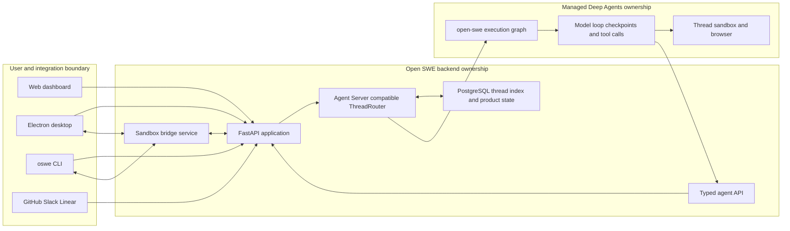

# System Architecture and Deployment Boundaries

Open SWE is a distributed system with two runtime domains. The Open SWE backend is the FastAPI, PostgreSQL, integration, authorization, and planning control plane. Managed Deep Agents (MDA), deployed from `mda/` as the single `open-swe` graph, is the execution plane for every new `agent`, `reviewer`, and `review-scout` thread. This is the active execution architecture: the backend does **not** run an in-process graph, model loop, or tools node for those threads.

## System context and ownership

This diagram distinguishes control-plane ownership from execution-plane ownership. The backend owns externally visible product behavior and policy; MDA owns execution mechanics. The typed agent API is the deliberate crossing point from an MDA run back to backend-owned behavior.

| Concern | Owner | Boundary and implication |
|---|---|---|
| Public HTTP, dashboard APIs, webhooks, OAuth, application lifecycle | Open SWE FastAPI | `openswe.webapp:app` is the deployment entrypoint and re-exports the application built in `openswe.api.app`. |
| Product and thread index state | PostgreSQL through the backend | Thread reads, search, counts, metadata, and status are served from the index; runtime copies exist so runs and traces can see them. |
| Agent Server `/threads` and `/runs` compatibility | `ThreadRouter` in the backend | Existing dashboard, CLI, and backend Agent Server clients use the usual API while the router decides where the thread executes. |
| Agent/reviewer/review-scout model loop, checkpoints, tool-call lifecycle | MDA deployment | The backend plans the run and observes phases but does not compile or execute an active in-process graph. |
| Sandboxes and MDA browser | MDA for MDA-owned boxes | MDA creates, adopts, restarts, and replaces its per-thread sandbox. The backend binds and reconnects to it, but never creates or replaces an MDA-owned box. |
| Credentials and policy decisions | Backend and its integrations | The MDA deployment holds no GitHub, Slack, or database credentials; run identity and configuration come from a signed token. |

## Startup composition and public ingress

`langgraph.json` registers the compatibility graphs `agent`, `reviewer`, and `review-scout`, mounts `openswe.webapp:app`, and configures Agent Server authentication and checkpoint retention. These registrations are compatibility and deployment entrypoints; new execution is routed to MDA's one `open-swe` graph rather than to a legacy in-process graph.

`create_app()` establishes the FastAPI composition. Before background workers are built, it pins a single event loop. Its lifespan validates GitHub-login, sandbox, local-development LLM, MDA, and database configuration; migrates the database; starts best-effort analytics, transcript, bridge, and UI-invalidation listeners; starts jobs; and closes services and the HTTP pool during shutdown. An MDA configuration failure is intentionally fatal: `MDA_RUNTIME_URL` must be an absolute permitted URL and `REMOTE_RUNTIME_TOKEN_SECRET` must be set.

The app enables credentialed CORS only for configured dashboard origins plus `open-swe://app`; it rejects `*` with credentials. It layers audit logging, the thread router, compression, tracing, request IDs, and GitHub error handling, then mounts dashboard, plan, workflow-approval, Linear, Slack, health, GitHub, rollout, sandbox, evaluation-report, agent API, and optional MCP routes. Static dashboard files are mounted last. The dashboard router remains lazily imported until the web application actually mounts it.

The web dashboard, Slack, GitHub, and Linear are normal public ingress surfaces. The Electron app proxies its dashboard API calls to its selected backend and uses the same signed dashboard session as the web UI. It does not expose a LangSmith API key or directly call raw LangGraph APIs.

## Thread routing: Agent Server API without execution ownership

`ThreadRouter` sits ahead of the core Agent Server `/threads` and `/runs` routes. For backend-authorized requests it provides an Agent Server-compatible facade backed by PostgreSQL:

1. A new thread is indexed with `runtime: "mda"`, copied to the local Agent Server and MDA, and uses MDA's `open-swe` graph ID in MDA metadata.
2. Reads, searches, counts, and thread metadata changes are answered from the index. Metadata updates are copied to the runtime copies; a failure to copy does not make indexed reads unavailable.
3. A run, stream, state/history request, cancellation, or command is forwarded to that thread's runtime. When a run is successfully started on MDA, the index is marked `busy`; completion handling and reconciliation settle that state.
4. An unknown historical thread is first read from the local Agent Server and indexed. Threads made before MDA remain `local`, are logged when used, and are read-only for new runs, crons, posting commands, and copying; these actions return `410` rather than silently continuing on the retired execution path.

This preserves client compatibility without treating the backend Agent Server as the normal executor. Raw Agent Server authorization is also distinct from dashboard authorization: the backend may mutate threads, while a signed-in user has read access limited to their own threads and must use dashboard APIs for changes.

## Managed execution and the typed runtime API

The backend translates the requested assistant identity (`agent`, `reviewer`, or `review-scout`) into an MDA run context. It signs a token containing the thread ID, assistant ID, configurable values, and metadata; it also supplies selected models. MDA receives the context and calls the backend with the token as a bearer credential. The backend verifies it once per `/agent-api/{endpoint}` request and derives configuration from verified claims, never from model-controlled request data. Tokens are HS256, audience- and issuer-checked, and valid for 48 hours; a comma-separated secret supports signing-key rotation.

`packages/runtime-api` is the shared Python contract, imported by both deployment domains. Each `Endpoint` declares Pydantic request and response models, timeout, and delivery semantics, so adding a backend callback means defining an endpoint rather than accepting an untyped JSON body. The contract includes:

- `catalog`, which tells MDA the run's operations, subagents, models, exposed or code-only tools, skills, files policy, and sandbox specification;
- loop-phase calls (`prepare`, `before_model`, `model_result`, `after_model`, and `after_agent`) through which the backend prepares the thread, queues follow-ups, selects models, shapes prompts/tool visibility, and records transcript and usage;
- operation, file, shell-guard, evidence, sandbox, browser, and worker calls needed by tools and execution reporting.

MDA constructs a deep agent from that catalog and runs its own model calls, retries, fallback behavior, summarization, call limits, checkpoints, tool calls, file/shell tools, subagents, and browser integration. Backend middleware participates through phase responses and observations. Tool work that needs backend policy or product state is executed through a typed operation; the backend does not run a tool node or tool-call middleware for an MDA run. Shell guards can refuse or rewrite guarded commands before they run, and a sandbox that becomes unreachable ends the run after the backend is notified.

A worker grant is narrower than a run token: an asynchronous subagent may read its coordinator catalog and exchange the grant for its own run identity, but cannot invoke arbitrary backend endpoints before adoption.

## Sandbox and local-machine boundary

For a standard cloud thread, MDA owns the per-thread LangSmith sandbox lifecycle and can replace an MDA-owned box under the same name. The backend receives lifecycle reports to bind the thread, reconnect through its proxy and git identity, and notify the user if the sandbox is unreachable. A refreshed workspace snapshot therefore affects creation choices without forcing a replacement that loses ongoing work.

Desktop and CLI execution use the same cloud thread, transcript, models, settings, skills, and MDA agent, but substitute a local-machine sandbox bridge for a hosted box. The bridge long-polls the backend for shell and file-transfer requests, performs them on the selected project, and posts results back. This is not sandbox isolation: local commands run as the person who started the client. The desktop bridge lasts only while its app is open; the CLI keeps its bridge open until the coordinating run and its workers have completed.

## Client surfaces

- **Dashboard:** The recommended browser UI consumes backend dashboard APIs and the compatible thread/run surface. It is the principal interactive view of transcripts, streams, configuration, and runtime status.
- **Desktop:** Electron packages the web UI at the `open-swe://app` origin. A user selects a compatible backend, authenticates through the dashboard GitHub flow, and can select **This Mac** for a local-project thread. Current-checkout and new-worktree modes prevent concurrent agents from sharing one working tree; deleting a local-worktree thread removes its worktree.
- **CLI:** `oswe run` registers a bridge for the current directory, creates a remote cloud thread, and follows it through the dashboard-compatible service. The remote MDA agent's shell, upload, and download requests execute locally through that bridge. CLI authentication can use a workspace API key, GitHub Actions OIDC, or a person session; machine credentials create system threads, while personal threads are private because a prompt can execute local commands.

## Operations, extension points, and focused verification

Deploy the backend and MDA together. The backend requires `MDA_RUNTIME_URL`, `MDA_RUNTIME_API_KEY` or a LangSmith key for MDA calls, and `REMOTE_RUNTIME_TOKEN_SECRET`; the MDA project requires the backend URL and model/tracing credentials. MDA is deployed separately from `mda/`; local development starts the backend and `mda dev` independently. The MDA project does not import `openswe`, which keeps the deployment boundary real.

When extending the system:

- Add execution behavior through the backend's run plan, middleware phases, or typed operations. Put a tool-time file or shell check in `mda/rt` when MDA owns the action; put it behind an agent API endpoint when it needs backend state or policy.
- Define new cross-boundary calls as `runtime_api.Endpoint` models and implement both sides. Preserve endpoint retry semantics, because a request may be retried after connection or gateway failure while a timed-out backend operation may still be executing.
- Do not add new backend uses of `langgraph_client` or LangGraph Store for this path. Persist product state in PostgreSQL and send agent/reviewer/review-scout runs to MDA.
- Exercise `tests/threads/test_thread_router.py` for indexing, forwarding, busy state, and historical-thread refusal. Exercise `mda/tests/test_backend_calls.py` in the MDA environment for typed callback, tool, model, and runtime failure behavior.

Related pages: [Managed Runtime](./managed-runtime.md), [State and Async Services](./state-and-async-services.md), [User Surfaces](../integrations/user-surfaces.md), [Local Development and Deployment](../operations/local-development-and-deployment.md), and [Invocation and Thread Routing](../workflows/invocation-and-thread-routing.md).
