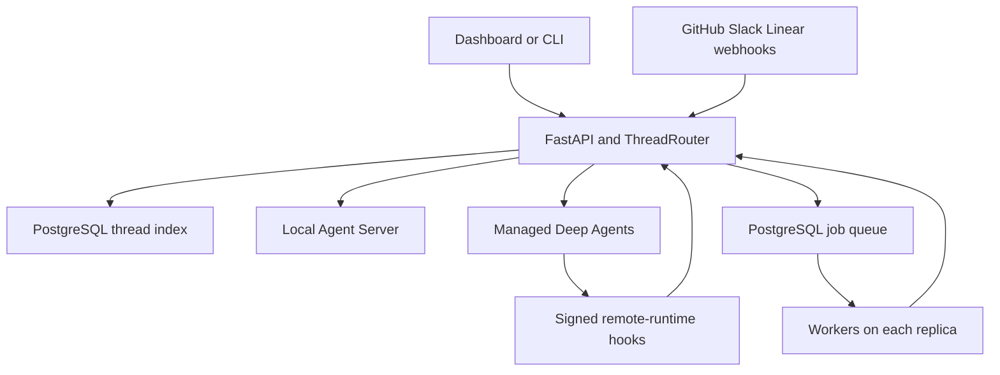

# System Architecture and Runtime Boundaries

Open SWE separates its control plane from graph execution. The FastAPI application is the ingress and product-service process: it serves the dashboard and integrations, owns the PostgreSQL-backed thread index and job queue, and routes compatible LangGraph thread APIs. New runs of the supported agent graphs execute in Managed Deep Agents (MDA); the local Agent Server remains the runtime for existing local-history threads and graphs MDA does not host. The boundary is deliberately transparent to LangGraph clients: thread metadata is indexed centrally while a thread's checkpoints, state, history, commands, and event streams stay with the runtime selected for that thread.

## Deployment composition

`langgraph.json` is the deployment manifest. It uses Python 3.14, declares three graph entrypoints, mounts `openswe.webapp:app`, and installs `openswe.api.agent_server_auth:auth` with Studio authentication disabled. `openswe/webapp.py` is only a compatibility re-export; `openswe.api.app:create_app` assembles the application.

| Registered graph | Entrypoint | Architectural role |
|---|---|---|
| `agent` | `openswe.graphs.agent:traced_agent` | General coding-agent graph. |
| `reviewer` | `openswe.graphs.reviewer:traced_reviewer_agent` | Pull-request review graph. |
| `review-scout` | `openswe.graphs.review_scout:traced_review_scout` | Background PR walkthrough planner that accounts for changed lines and records the human rationale behind a change. |

The manifest retains LangGraph checkpoints for 43,200 minutes by default and sweeps expired entries hourly using the `delete` strategy. Its image build attempts to bundle the dashboard into `/opt/open-swe-dashboard`, but intentionally continues with a backend-only deployment if the UI build fails.

This diagram distinguishes the local control plane and compatibility surface from the MDA graph-execution plane. The route selected for a run is stored per thread rather than chosen independently for every request.

## FastAPI service and startup lifecycle

`create_app` configures Datadog tracing, request IDs, GitHub error handling, audit logging, and credentialed CORS. Origins are read from `DASHBOARD_ALLOWED_ORIGINS`; `*` is rejected because credentials are enabled, while the desktop origin `open-swe://app` is added explicitly. `ThreadRouter` is installed as middleware before the platform's core `/threads` and `/runs` routes so it can preserve their public API while intercepting backend calls.

The app mounts the dashboard API, plans and workflow approvals, GitHub/Linear/Slack and rollout webhooks, health and run-completion endpoints, sandbox tool and OpenAI-compatible surfaces, review-evaluation reports, remote-runtime hooks, and—when configured—the agent MCP application. Static dashboard mounting occurs last.

Startup is operationally significant, not merely initialization:

- it pins one event loop before queue workers are constructed;
- validates GitHub login policy, sandbox and local-development model configuration, MDA URL/token configuration, and the required PostgreSQL configuration;
- migrates the `open_swe` schema under a PostgreSQL advisory transaction lock;
- begins optional analytics and cross-process listeners, starts notification handling and the job worker, and attempts an agent-build warmup without making a warmup failure fatal.

On shutdown it stops the worker and listeners, closes the HTTP pool, and disposes the database engine. Listener startup failures are deliberately degraded: local behavior remains available, but cross-replica transcript, bridge, or UI-invalidation notifications may become quiet until recovery.

The dashboard router is a lazily imported `/dashboard/api` router. It applies the same-origin mutation dependency and aggregates browser-facing product APIs including authentication, profiles, workspaces, repositories and pull requests, reviews, schedules, threads, transcripts, integrations, analytics, audit logs, and API keys. Lazy loading avoids importing its full FastAPI/job surface when middleware imports a small dashboard helper.

## Managed-versus-local graph execution

MDA hosts `agent`, `reviewer`, and `review-scout` under its single `open-swe` graph identifier. It is mandatory in normal service startup: `MDA_RUNTIME_URL` must be absolute HTTP(S), non-local HTTP is refused, and `REMOTE_RUNTIME_TOKEN_SECRET` is required. The service may use `MDA_RUNTIME_API_KEY` or `LANGSMITH_API_KEY` to reach MDA.

When a client creates a run or first writes state, `ThreadRouter` considers the requested graph and thread history:

1. A new thread is indexed as `local` and copied to the local Agent Server.
2. A fresh thread for an MDA-hosted graph moves to `mda`, is marked with `metadata.runtime = "mda"`, and receives metadata copies on both local and MDA runtimes.
3. A thread with existing local checkpoints/history stays local, preventing a silent split of its state. Graphs MDA does not host also remain local.
4. Thread reads, search, count, and metadata updates are served from PostgreSQL in LangGraph's thread shape. Run/state/history/stream/command requests are forwarded to the selected runtime. A previously unindexed local Agent Server thread is indexed on first access.

A successful non-cron run is marked `busy` before its response is returned, preventing an immediate completion from being overwritten by a late busy update. Completion handling and reconciliation settle it later. Deleting a thread removes runtime copies before removing the index record; metadata-copy failures are logged rather than making central reads unavailable.

For MDA, the router rewrites a run from the public assistant ID to `open-swe` and moves configurable data into signed context. The context contains the intended hosted graph, optional model choices and invocation ID, and a signed token containing the thread ID, assistant ID, and configurable values. MDA calls `POST /remote-runtime/hooks/{hook}` with that token as a bearer credential. The hook middleware validates issuer, audience, expiry, signature, and claims (accepting configured key rotation), then selects the graph and configuration from verified claims—not from model-controlled request data. Invalid or missing tokens receive 401; unknown hooks receive 404; hook exceptions are reported to MDA as 500 so the graph run fails visibly.

## Dispatch, threads, and run observability

`dispatch_agent_run` is the shared durable creation contract for Slack, Linear, GitHub, and dashboard triggers. It normalizes the source into an input identity, refuses ambiguous combinations of a prebuilt input and content/identity fields, and delegates to `create_durable_run`. The assistant ID selects the graph; `source` supplies input context, metadata, and logging rather than graph selection.

Durable creation uses `multitask_strategy="interrupt"`, asynchronous checkpoint durability, resumable streams, all v3 stream modes, subgraph streaming, and the event-stream compatibility marker. Thus a follow-up normally interrupts an active run and continues from checkpoints with history plus the new message; callers needing deferred work can choose another strategy. Async durability avoids blocking each model or tool step on a database write, at the cost that a crash can resume from up to one step earlier. These stream settings are required for the dashboard to attach to runs started by webhooks or automations and see tools and subagent namespaces.

Run-complete callbacks are optional by design. A webhook is attached only when `RUN_COMPLETE_WEBHOOK_SECRET` exists and `COMPLETION_WEBHOOK_URL` is absolute and non-loopback; otherwise dispatch logs the condition and still creates the run. The receiving route verifies its token before processing the completion.

For a deeper treatment of the routed public thread surface and state ownership, see [Remote Runtime and Threads](./remote-runtime-and-threads.md) and [Threads and State](../concepts/threads-and-state.md). Agent factory and graph details are in [Agent Graph](./agent-graph.md).

## PostgreSQL control-plane services

PostgreSQL is required outside the `local_dev` fallback and stores repository and pull-request records as well as the thread index, jobs, and other service data. `POSTGRES_URI` accepts PostgreSQL URI forms but is normalized to `postgresql+asyncpg`; non-PostgreSQL schemes and conflicting `ssl`/`sslmode` settings fail fast. The shared engine pre-pings connections, configures pool limits and timeouts from `ANALYTICS_POOL_*`, identifies itself as `open-swe`, and logs slow or failed queries at `POSTGRES_SLOW_QUERY_MS`.

All normal operations scope `search_path` to `open_swe, public`. The database module provides:

- connection and transaction contexts for SQL work;
- ORM sessions that flush before their enclosing transaction commits;
- a read-only transaction for trusted queries;
- an untrusted read-only transaction that invalidates its connection afterward, preventing arbitrary SQL from leaving session state such as advisory locks in the pool; and
- a repeatable-read snapshot transaction for multi-statement reads that must not double-apply live events written after their initial snapshot.

Migrations run at startup under a fixed advisory transaction lock, create the schema if necessary, and apply Alembic revisions transaction by transaction. Preview environments also discard superseded stamped revisions caused by rebased migration chains.

## Background infrastructure

The PostgreSQL job queue runs timers and background work outside LangGraph runs. A job has a kind, JSON payload and metadata, due time, optional cron/timezone, optional replacement key, retry count, and a lease claim. A keyed schedule upserts/replaces the outstanding job. Replicas claim due work through `FOR UPDATE SKIP LOCKED` and a 30-minute lease, so concurrent workers do not run the same claimed job. Running jobs renew their lease every ten seconds; cancellation makes the worker cancel the handler. If a worker stops, the lease eventually expires and another replica can claim the job.

One-shot failures use exponential backoff from 30 seconds up to one hour and are discarded after five attempts. Cron failures advance to the next scheduled fire rather than retrying the same tick. A completed one-shot is deleted; a completed cron job is advanced in its declared timezone. Claim tokens ensure a job replaced while its old handler runs is not deleted or rescheduled by that stale handler.

`openswe.jobs.kinds` registers handlers before the application starts the worker. The handlers cover scheduled agent runs, reconciliation, busy-thread reconciliation, sandbox-backed watches and background tasks, workspace refreshes, session and agent cost refreshes, announcements, human-review deadlines, and thread wakeups. Sandbox-backed handlers retry transient sandbox attach failures; wakeups intentionally do not retry because a server-side success that the caller did not observe could otherwise start duplicate work. Scheduled agent fires are additionally deduplicated with a two-day event claim keyed by job ID and fire time, protecting against a job being reclaimed after a crash.

## Safe changes and focused verification

- Registering a graph in `langgraph.json` is not enough to run it remotely: add it to the MDA hosted-graph contract and its remote implementation, or it remains local. Conversely, do not move an established local thread merely because its graph is now MDA-capable; local history is the migration guard.
- Preserve the signed-context boundary when changing MDA dispatch. The remote tool server must derive graph, thread, and configurable data from the verified token, not its request body.
- Keep `ThreadRouter` ahead of core thread/run routes and preserve the `x-openswe-local-runtime` escape header for its own calls. Removing either breaks the compatibility or causes routing recursion.
- Treat PostgreSQL migration and queue semantics as multi-replica behavior. Do not replace `SKIP LOCKED`, leases, claim tokens, or event claims with process-local coordination.
- Relevant focused tests are `tests/threads/test_thread_router.py` for indexing, routing, migration guards, busy state, and signed MDA rewrite; `tests/reviewer/test_remote_runtime.py` for token and hook authentication; `tests/jobs/test_jobs.py` for claims, replacement, retry, cron, cancellation, and automation deduplication; and `tests/database/test_postgres_read_only.py` for read-only and pool-safety behavior.

Related pages: [Agent Graph](./agent-graph.md), [Remote Runtime and Threads](./remote-runtime-and-threads.md), [Threads and State](../concepts/threads-and-state.md), [Dashboard UI](../integrations/dashboard-ui.md), and [Deployment](../operations/deployment.md).
