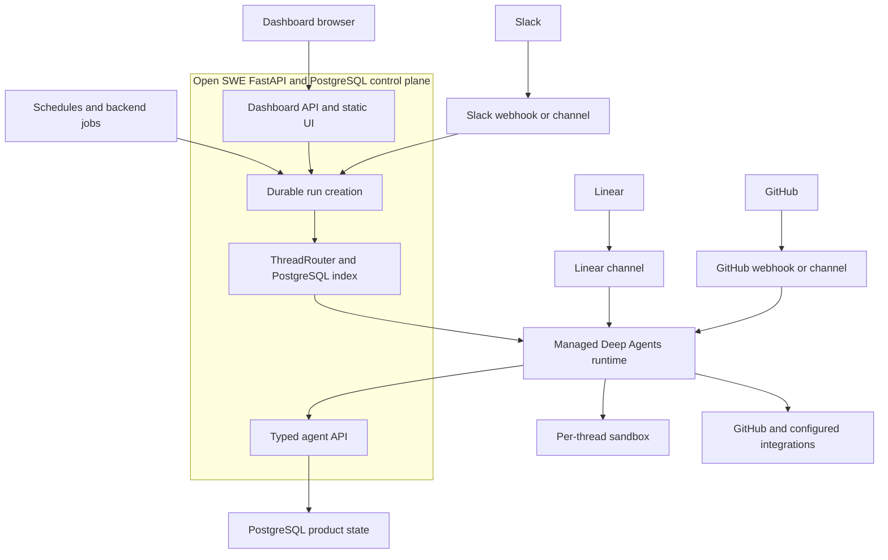
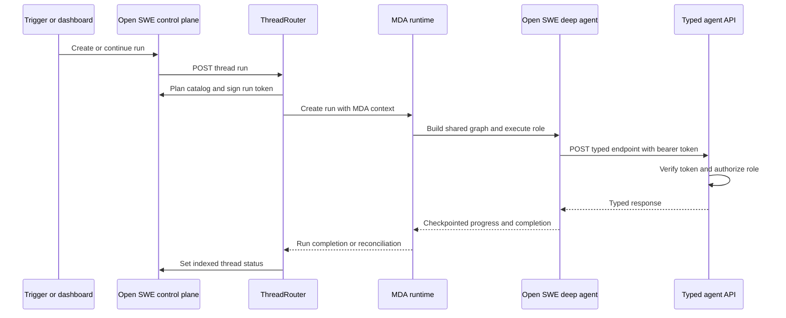

# System Topology and Entrypoints

Open SWE is a software-factory backend, not an in-process agent graph server. The `openswe/` application is the FastAPI/PostgreSQL control plane: it accepts dashboard and integration traffic, owns product data and credentials, plans a run, and exposes typed backend operations. The separate `mda/` project is the Managed Deep Agents (MDA) deployment that owns an executing run's model loop, checkpoints, sandbox, tool calls, and middleware.

Every current `agent`, `reviewer`, and `review-scout` thread executes on MDA. The LangGraph graph entries in this repository remain registered so the Agent Server can read legacy pre-MDA threads, but those entries deliberately reject execution. Do not treat the local read-only graphs as the normal execution path.

## Topology and public entrypoints

`langgraph.json` is the deployment manifest for the control-plane service. It registers three Agent Server graph names and mounts `openswe.webapp:app`; `openswe/webapp.py` is a compatibility re-export of the application constructed in `openswe/api/app.py`. The manifest also installs custom Agent Server authentication, configures checkpoint deletion TTL, loads `.env`, and best-effort builds the dashboard static bundle into the image.

| Entrypoint | Owner | Role |
|---|---|---|
| `openswe.webapp:app` | FastAPI control plane | Custom HTTP application: dashboard API/UI, webhooks and channels, thread routing, agent API, health, MCP, and product routers. |
| `agent` → `openswe.graphs.agent:traced_agent` | Agent Server compatibility layer | Reads state of pre-MDA agent threads; execution raises a read-only error. |
| `reviewer` → `openswe.graphs.reviewer:traced_reviewer_agent` | Agent Server compatibility layer | Reads state of pre-MDA reviewer threads; execution raises a read-only error. |
| `review-scout` → `openswe.graphs.review_scout:traced_review_scout` | Agent Server compatibility layer | Reads state of pre-MDA review-scout threads; execution raises a read-only error. |
| MDA graph `open-swe` | `mda/` runtime | The one actual deep-agent graph that plays the run role named in its signed context: `agent`, `reviewer`, or `review-scout`. |
| MDA graph `open-swe--general-purpose` | `mda/` runtime | Worker graph used for asynchronous task subagents. |

This topology distinguishes orchestration and product state from execution: MDA calls the backend for data or credentials, rather than the backend retaining an agent loop in memory.

## The MDA execution boundary

Before MDA starts a run, the backend validates the requested role, calculates its catalog and settings once, signs a run token, and places the role, token, and names-only catalog in the run context. Only `agent`, `reviewer`, and `review-scout` are hosted roles. The MDA factory uses that context to select per-graph inputs and builds each distinct graph configuration once per process; run-specific middleware obtains the current run, operations, tools, skills, model routing, and sandbox through the backend.

MDA's `open-swe` definition supplies Deep Agents primitives plus Open SWE middleware. Its normal agent has a `general-purpose` subagent, while the reviewer role has a reviewer subagent and review-specific code-mode tools. It declares the thread sandbox to MDA, and async worker tasks use `open-swe--general-purpose`; a worker receives a limited grant first and adopts its own run token. The backend plans capabilities, but MDA owns the loop and checkpointed execution.

The backend endpoint surface is intentionally typed and narrow. `packages/runtime-api` defines each `Endpoint`'s request and response schemas, timeout, and retry-delivery classification; both the MDA caller and backend handler import that definition. MDA sends JSON `POST` calls to `/agent-api/{endpoint}` with a bearer run token. The endpoint middleware verifies the token on every request, derives the role and run configuration from it rather than the request body, and rejects unknown, malformed, or unauthorized calls. A worker grant may only use the worker-adoption API.

This flow shows the trust boundary: the backend can make a run possible, but it does not receive arbitrary tool requests from an unauthenticated runtime caller.

## Threads, persistence, and lifecycle

`ThreadRouter` sits ahead of the Agent Server's `/threads` and `/runs` routes. It keeps the canonical thread index in PostgreSQL and preserves the Agent Server API shape for clients. A newly created backend-owned thread is indexed as runtime `mda`, copied to both the local Agent Server and MDA, and its actual runs, state, history, commands, and streams are routed to MDA. Updates are copied asynchronously to the runtimes that retain the thread.

The local Agent Server remains a compatibility store for legacy threads and copies; it is not the execution runtime for new work. A previously local thread can still be read, but ThreadRouter refuses new runs, crons, commands that mutate it, and copies with a read-only response. The registered `read_only_graph` applies the same invariant if an execution load reaches it. An unknown thread is first read from the Agent Server, indexed, and then served through the index.

MDA channel-owned conversations have an additional ownership rule. A thread marked with a channel is kept as that external conversation; backend writes that would alter it are refused unless sent through MDA's trusted backend channel ingress. This keeps Slack, Linear, and GitHub conversation continuity and prevents a generic thread operation from impersonating a channel. A newly started MDA run marks its indexed thread busy only after it has been accepted; completion callbacks and reconciliation settle the status.

## HTTP composition and ingress

`create_app()` installs CORS with credential support, audit logging, ThreadRouter, compression, request IDs, tracing, GitHub error handling, and the application lifespan. Credentialed CORS obtains origins from `DASHBOARD_ALLOWED_ORIGINS`, adds `open-swe://app`, and fails startup configuration when the configured origins include `*`.

The lifespan validates GitHub login policy, sandbox configuration, local-development LLM configuration, MDA configuration, Slack configuration, and database availability; then it migrates PostgreSQL and starts analytics, notification/listener, job, and UI-invalidation services. Several optional listeners degrade with logged warnings rather than taking down the web app: cross-replica transcript updates, sandbox bridge notifications, UI invalidations, analytics, and warm agent construction may be unavailable until recovery. Shutdown stops workers/listeners and closes the HTTP pool and database.

The dashboard aggregate router is mounted at `/dashboard/api` and applies a same-origin dependency to mutations. It brings together browser-facing authentication, profiles and preferences, workspace and repository configuration, review and pull-request views, schedules, threads, transcripts, skills, MCP, analytics, audit, and administration APIs. Its lazy `openswe.dashboard.router` import prevents ordinary dashboard submodule imports from loading the complete route and job surface.

Other mounted boundaries include Slack and GitHub webhooks and MDA channels, Linear channels, workflow and plan APIs, health, sandbox tool/OpenAI-compatible APIs, short links, rollout events, review-evaluation reports, and optional MCP routes. The custom Agent Server authentication permits backend-key callers to mutate or see all threads; a signed-in dashboard user may only read threads matching that user's owner login and must use dashboard APIs for changes.

## Durable dispatch and external triggers

For backend-owned Slack, Linear, GitHub, dashboard, and scheduled agent/reviewer starts, `dispatch_agent_run` is the shared durable creation contract. `assistant_id` selects the graph role and `source` supplies identity construction, metadata, and logging. It builds structured input unless the caller supplied one and rejects an ambiguous mix of prebuilt input and content or source identities.

Creation defaults to `multitask_strategy="interrupt"`: a follow-up interrupts a live run and continues from checkpointed history with the new message. Callers such as background monitoring can choose `enqueue`. Checkpoints use asynchronous durability, so a recycle can lose at most work since the last step's checkpoint write rather than all progress. Created runs request v3-compatible values, updates, messages, custom, task, and checkpoint streams including subgraphs, but do not retain resumable event streams; the dashboard relies on thread transcript data rather than replaying every event.

A completion webhook is added only when `RUN_COMPLETE_WEBHOOK_SECRET` is set and `COMPLETION_WEBHOOK_URL` is absolute and non-loopback. Invalid or absent completion configuration logs a warning and omits the webhook rather than making all run creation fail. Pull-request roles record PR metadata so related dashboard data can be invalidated when a run begins.

## Operations, configuration, and safe extension

The control plane refuses startup without an absolute MDA endpoint and `REMOTE_RUNTIME_TOKEN_SECRET`; a non-local plain-HTTP `MDA_RUNTIME_URL` is invalid. `MDA_RUNTIME_API_KEY` may fall back to `LANGSMITH_API_KEY`. Configure MDA separately and treat it as required production infrastructure, not an optional remote accelerator.

When adding a feature, place loop control, file/shell checks, and runtime-side behavior in `mda/rt`; add backend work requiring product data or credentials as a named typed runtime endpoint. Run-fixed data belongs in the catalog/context planned at run start; durable cross-call state belongs in MDA state or PostgreSQL, never backend process memory. Add product-facing HTTP endpoints to the feature router that owns them, then include that router through the app/dashboard composition as appropriate.

Focused tests reflect the important boundaries: `tests/threads/test_thread_router.py` exercises PostgreSQL-indexed routing, copying, MDA forwarding, and ownership protections, while `mda/tests/test_shared_graph.py` exercises shared graph construction, run context, sandbox behavior, and backend-call integration. For runtime changes, run the affected `mda/` tests in its own environment; it must not import `openswe` directly.

Related pages: [Backend and MDA Runtime](./backend-mda-runtime.md), [Thread Runtime](./thread-runtime.md), [Channels and Dashboard](../integrations/channels-dashboard.md), and [Configuration and Deployment](../operations/configuration-and-deployment.md).
