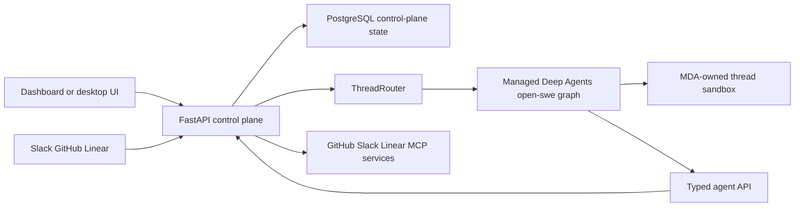
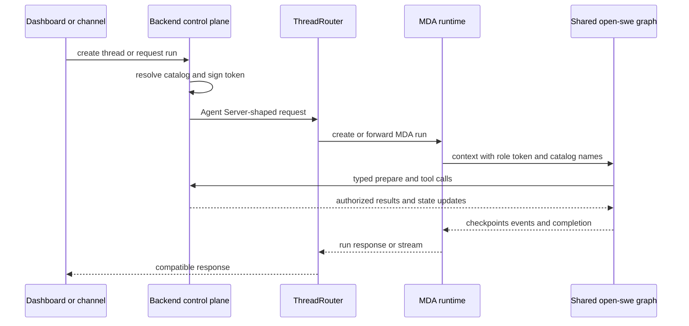

# System architecture and ownership boundaries

Open SWE is an asynchronous software factory: it can implement engineering work, review pull requests, and plan review work from the dashboard or connected channels. Its architecture is deliberately split into two deployable systems:

- The **Open SWE backend** is a FastAPI/PostgreSQL control plane. It owns product APIs, identities and credentials, durable product state, thread indexing, catalogs, integration policy, and user-facing surfaces.
- **Managed Deep Agents (MDA)** is a separate deployment that executes every new `agent`, `reviewer`, and `review-scout` run through one `open-swe` graph. It owns the model loop, LangGraph checkpoints, per-thread sandbox lifecycle, tool calls, and middleware around model calls.

This is an ownership boundary, not an optimization. The backend plans and authorizes a run before it starts; MDA executes that plan and calls the backend only through a typed, token-authorized API. The MDA deployment has no backend database, GitHub, or channel credentials.

## System map

*The backend is the control plane and credential holder; MDA executes the agent loop and reaches backend capabilities through the typed agent API.*

The browser, CLI, and backend clients retain an Agent Server-shaped thread and run interface. `ThreadRouter`, installed ahead of the core `/threads` and `/runs` routes, resolves the thread in PostgreSQL and forwards runtime operations to MDA. This lets user-facing clients work against one backend origin without treating the backend as the execution runtime.

## Ownership model

| Concern | Backend control plane | Managed Deep Agents runtime |
|---|---|---|
| HTTP and product integration | FastAPI dashboard, health, webhook, channel, MCP, tool, and Agent API routes; dashboard static UI | Receives routed run and thread-runtime requests |
| Durable data | PostgreSQL thread index, transcript/read model, inboxes, jobs, integrations, settings, tool-set records, and credential references | LangGraph run state, checkpoints, runtime history, streams, and commands |
| Planning and authorization | Resolves a run-specific catalog from thread/workspace settings, sender access, and integrations; signs the run token and per-operation grants | Builds and executes the selected run from the signed context and catalog |
| Credentials | Keeps GitHub, Slack, Linear, database, and backend-side integration credentials | Uses only explicitly granted MDA connections or credentials delivered to an individual call; does not hold backend secrets |
| Execution | Does not run a model loop or tool-call middleware | Owns model calls, retries, checkpoints, tool calls, sandbox lifecycle, file/shell middleware, and loop middleware |
| Sandboxes | Supplies the sandbox specification and handles backend-owned proxy/configuration operations | Creates, adopts, opens, boots, restarts, and replaces MDA-owned thread sandboxes |

A run catalog is the bridge between those responsibilities. The backend calculates it once at run start from data MDA must not own: thread settings, workspace defaults, sender authorization, reachable integrations, model choices, operations, subagents, sandbox specification, files, skills, and loop rules. The context carries tool names rather than full tool specifications because Agent Server copies context into checkpoints; MDA fetches the specifications from the backend as it initializes the run.

## Entrypoints and run roles

`langgraph.json` defines the backend deployment's three legacy-compatible graph entrypoints—`agent`, `reviewer`, and `review-scout`—and mounts `openswe.webapp:app`. `openswe.webapp` is only a compatibility re-export of the application built in `openswe.api.app`.

Those entrypoints identify supported run roles to the backend, not three independently executing backend graphs. `MDA_GRAPH_ID` is `open-swe`; `start_remote_run` rejects any other assistant ID, resolves its catalog, signs a token, and supplies a context containing the role, token, and names-only catalog. The MDA factory reads that context and plays the corresponding role with its shared graph. Its asynchronous general-purpose task worker is a separate worker graph and adopts a limited worker grant before it receives a run token of its own.

*Run planning happens in the backend before MDA execution; runtime work is forwarded through the thread router.*

## Thread lifecycle and durable state

New backend-owned threads are recorded in the PostgreSQL thread index with `runtime: mda`; their runs, state, history, commands, streams, and cancellation requests are routed to MDA. The index remains the durable discovery and status layer for all replicas. A successful remote run start marks the indexed thread `busy`; the completion webhook and reconciliation settle it later. This prevents the dashboard from depending on an individual runtime response to show execution state.

The index is not a shadow copy of execution state. PostgreSQL owns the product-facing thread catalog, inbox, job queue, and transcript read model; MDA owns checkpointed graph state and runtime stream/history. The backend starts only after it has sealed local Agent Server write operations, so local threads created before the migration remain readable compatibility records but cannot start runs, crons, copies, or mutating commands.

Channel-owned threads are stricter: a Slack, Linear, or GitHub MDA conversation stays owned by that channel. Reads can be routed, but backend actions requiring a write use MDA trusted-backend ingress with the owning conversation; unsupported writes, copies, and crons are refused. This preserves channel conversation identity rather than silently converting it into a backend-owned thread.

## Typed runtime API and trust boundary

MDA calls the backend at `POST /agent-api/{endpoint}` using shared models imported from `packages/runtime-api`. The endpoint protocol is named and typed: it covers catalog/tool specification lookup, loop preparation and decisions, operations, files, reports, and worker coordination rather than accepting an untyped phase callback.

Every request bears a signed runtime token. The backend verifies it once in `RunTokenMiddleware`, chooses the run kind from the token's `assistant_id`, and derives thread configuration and metadata from signed claims rather than model-controlled request arguments. Operation grants bind an operation to a thread and run-specific grant ID. A worker grant is narrower still: it can only adopt a worker token, not invoke ordinary run endpoints.

This statelessness is required for horizontal backend operation: a typed endpoint must be answerable from the request and verified token on whichever backend replica receives it. Durable data that spans calls belongs in MDA checkpoint state or PostgreSQL, never backend process memory.

## Execution and reporting flow

The MDA graph is shared per process for common graph inputs, but it must not capture run-specific data. At run time, middleware loads the active catalog and reads the current run per call, selecting the operations, model route, skills, sandbox, and loop behavior that that run was granted. Therefore user-, thread-, and integration-specific changes belong in the backend catalog or typed endpoint behavior, not in factory globals.

MDA opens the selected sandbox while it obtains tool specifications, calls `prepare`, and reports run start. Before model calls, runtime middleware reads the durable inbox and asks the backend only for decisions or facts that require backend state or credentials, such as task context, model routing, proxy refresh, or a protected operation. File and shell tools execute in the MDA-managed sandbox when one is selected; backend-served paths and non-MDA sandbox cases use the typed files boundary.

Reports of starts, model output, tool activity, inbox receipts, and run completion are queued in runtime state and delivered in order through the typed `reports` endpoint. Backend receipts are idempotent, and unacknowledged reports remain checkpointed, so a retry, restart, or later run can resend them without duplicating durable transcript effects.

## Backend HTTP composition and client surfaces

`create_app()` composes the control-plane API. It pins a single event loop before workers, configures credentialed CORS from `DASHBOARD_ALLOWED_ORIGINS` (rejecting `*`), admits the explicit `open-swe://app` desktop origin, and installs audit, routing, compression, tracing, request-ID, and GitHub error handling. It mounts the dashboard, plan and workflow-approval APIs; Slack, GitHub, Linear, and MDA-channel routes; health and operational routes; the exact agent API route; optional MCP; and the static dashboard.

Startup validates GitHub-login, sandbox, local-model, Slack, and MDA configuration; requires and migrates the database; starts workers/listeners; and seals local thread writes before traffic is served. `MDA_RUNTIME_URL` must be an absolute URL (HTTPS except for loopback development), and `REMOTE_RUNTIME_TOKEN_SECRET` must be configured; failure to satisfy either prevents the backend from starting. Some optional listeners and warmup steps log degradation rather than preventing service, preserving the API while cross-process freshness or cold-start performance recovers.

The React dashboard and external channels are ingress surfaces, not separate execution engines. They create or continue indexed threads and receive status/transcript updates through the backend; thread and run routing then delivers execution to MDA. For channel runs, MDA can call the backend to resolve a verified sender to an Open SWE user, keeping identity mapping and credential policy in the control plane.

## Operating and changing the boundary safely

- Deploy and configure both systems together. The backend needs `MDA_RUNTIME_URL`, a runtime API key as appropriate, and `REMOTE_RUNTIME_TOKEN_SECRET`; MDA needs `OPEN_SWE_BACKEND_URL`, model/tracing credentials, and the shared service secret for signed channel calls.
- Add behavior around model calls, sandbox/file tooling, retries, checkpoints, or loop control in `mda/rt`, not in the backend. The backend deliberately does not execute model-loop middleware.
- Add backend-dependent work as a named typed endpoint in `packages/runtime-api`, with a backend implementation under `/agent-api/{endpoint}`. Derive run facts from the verified token; do not trust model arguments for identity, thread configuration, or grants.
- Keep run-specific catalog data out of shared graph construction and out of MDA deployment secrets. The catalog and token are the intended extension boundary for models, operations, tools, skills, sandbox parameters, and loop rules.
- Preserve the PostgreSQL/MDA split when changing thread APIs: index and product state are backend-owned, while runtime state and checkpoints must be forwarded to MDA. Do not revive legacy local execution.

Focused tests follow those boundaries: backend thread-router tests cover routing, channel ownership, start races, and legacy read-only behavior; runtime API/token tests cover authentication and endpoint grants; MDA tests cover shared-graph isolation, lifecycle/loop behavior, reporting, tool checks, and model-call recovery. Run backend and MDA tests in their respective projects—`mda/` is intentionally not imported by the backend.

Related pages: [Backend control plane, threads, and durable state](./backend-control-plane.md), [Managed Deep Agents runtime](./managed-runtime.md), [Dashboard and channels](../integrations/dashboard-and-channels.md), and [Local development and deployment](../operations/local-development-and-deployment.md).
