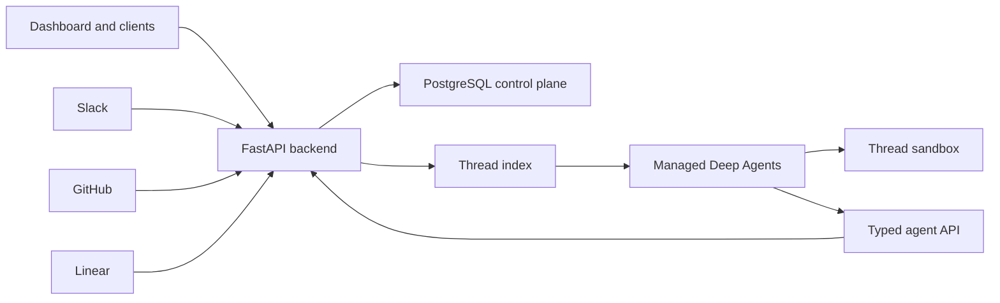
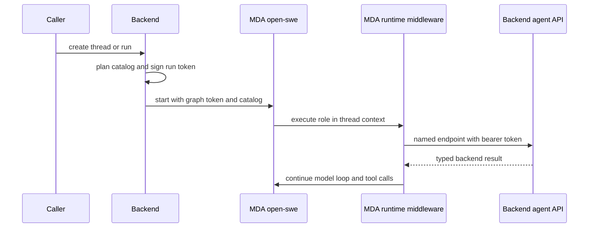

# System architecture

Open SWE is an asynchronous coding-agent product with two deliberately separate planes:

- The **Open SWE backend** is a stateless FastAPI application and PostgreSQL-backed control plane. It owns product APIs, authorization and credentials, run planning, durable application records, integration ingress, and the dashboard-facing thread index.
- **Managed Deep Agents (MDA)** is the execution runtime. It owns the model loop, LangGraph checkpoints, each thread's sandbox, file and shell execution, tool calls, and the middleware that controls a run around those calls.

This separation is an ownership boundary, not merely a remote deployment detail. Backend replicas must answer an authenticated request from its signed run context and durable data rather than process memory. Conversely, runtime control flow belongs in `mda/rt` middleware and runtime file/shell controls, rather than in a generic backend phase API.

## Components and request flow

This shows the active path: the backend starts and routes work to MDA, while MDA calls the backend only for named work that needs backend-owned data or credentials.

### Backend and product surfaces

`openswe.webapp:app` is the compatibility import used by `langgraph.json`; it re-exports the application constructed in `openswe.api.app`. The application applies credentialed CORS using `DASHBOARD_ALLOWED_ORIGINS` and rejects `*`, adds audit, request-ID, tracing, GitHub-error, gzip, and thread-routing middleware, then mounts dashboard, plan, approval, webhook/channel, health, sandbox, MCP, and other product routers. It also mounts the typed agent API exactly at `/agent-api/{endpoint}` and serves the dashboard bundle when present.

The lifespan validates the GitHub-login policy, sandbox and local-development model configuration, Slack, MDA configuration, and database configuration before migrating PostgreSQL. It then starts durable-support services such as jobs, listeners, invalidation, and optional analytics. Some real-time listeners degrade to a local fallback when startup fails; the backend logs that cross-replica updates may become quiet rather than preventing the application from serving.

The browser dashboard and external intake surfaces—Slack, GitHub, Linear, and API clients—therefore reach the same control plane. The dashboard, CLI, and internal clients retain the Agent Server thread API shape even though the backend now answers thread indexing and routes active runs remotely. See [Threads, runs, and persistence](./threads-runs-and-persistence.md) and [Channels and GitHub](../integrations/channels-and-github.md) for their respective lifecycle and ingress details.

## Active execution: one MDA graph, per-run context

Every active `agent`, `reviewer`, and `review-scout` run is hosted by MDA's single `open-swe` graph. A run context identifies which of those roles it plays and contains a signed run token plus a names-only catalog. Before MDA starts the run, `start_remote_run` validates the hosted graph, plans run settings and the catalog in the backend, grants the run, and signs its context. Planning failure prevents creation of the remote run.

MDA shares a graph definition for equivalent graph inputs, such as role and model choices, but does not use that shared graph as a store for thread-specific information. At run time it retrieves the active token and catalog, resolves the catalog's named tool specifications from the backend, and uses the run-specific models, subagents, skills, sandbox specification, and loop rules. Its `define_deep_agent` definition supplies the MDA sandbox and middleware stack; async task workers run as the `open-swe--general-purpose` subagent graph and can share the coordinator's sandbox as specified by their catalog.

This is the execution boundary: MDA owns continuation, checkpoints, sandbox work, model calls, and runtime middleware; the backend returns authorized typed results and persists product state.

### Typed callbacks and authority

`packages/runtime-api` is shared by the runtime and backend. Each `Endpoint` declares its name, Pydantic request and response models, timeout, and delivery/retry class. MDA makes JSON `POST` calls to `/agent-api/{endpoint}` with a bearer token. The backend verifies that token before dispatch, derives the selected graph, thread configuration, metadata, and settings from its claims—not the model-controlled body—and routes the call only to handlers permitted for that graph. Missing or invalid credentials receive 401, refused calls 403, unknown endpoints 404, invalid request models 422, and backend failures 500.

The signed `RemoteRun` also gives each operation a per-run HMAC grant. A catalog may describe what MDA can offer, but it is not independent authority: backend handlers validate the token and operation grant before invoking credentialed or data-owning behavior. This lets a stateless replica safely serve any callback. A worker initially carries a narrower worker grant that can only adopt a run token; it cannot call normal run endpoints until adoption.

The catalog is the principal extension boundary. It captures per-run tools, direct MDA-connected MCP servers, subagents, models, sandbox/files settings, skills, and loop rules. Add behavior requiring backend credentials or durable application records as a specifically typed endpoint; add model-loop decisions, nudges, routing, stopping, and runtime tool checks in MDA middleware. The legacy per-run `ToolSurface` plan should be reduced rather than expanded.

## Threads, PostgreSQL, and runtime routing

PostgreSQL is the durable application control plane, including the thread index. The index answers create, read, update, delete, search, and count operations in the Agent Server's expected shape and copies metadata changes to the runtime that holds execution state. Runs, checkpoints, state history, commands, and streams remain with the thread's assigned runtime.

`ThreadRouter` sits ahead of the core `/threads` and `/runs` routes. New backend-owned threads are indexed with runtime `mda`, copied to MDA and the local Agent Server representation, and their runs are rewritten and forwarded to MDA. When MDA accepts a non-cron run, the index changes the thread to `busy`; a completion webhook or reconciliation later settles status. Reads of MDA threads are forwarded with Studio read headers, while writes remain scoped to backend-owned threads.

Channel-owned conversations are a special case. Slack, Linear, or GitHub may create an MDA conversation thread first; the backend indexes it as channel-owned and uses MDA's trusted backend ingress when it needs to act in that conversation. Ordinary copying and cron creation are refused for those threads, and writes without the required channel authority return a conflict instead of treating the conversation as a general backend thread.

Threads predating the migration can remain `local`, but are a compatibility path only. The router logs their use and refuses run starts, crons, commands that mutate them, and copies with a read-only response. This prevents an old Agent Server graph from becoming an alternative active executor.

## Legacy Agent Server entrypoints

`langgraph.json` still registers `agent`, `reviewer`, and `review-scout` dotted entrypoints under `openswe.graphs.*`, and mounts the FastAPI app with Agent Server authentication. These graph exports are explicitly `read_only_graph` compatibility entrypoints for reads of threads created before MDA; they are not the graph factories for new agent work. The manifest's checkpointer TTL similarly belongs to the Agent Server compatibility deployment, while active run checkpoint ownership is MDA's.

Do not infer from the manifest that Open SWE locally executes current agent loops. The runtime startup configuration fails without `MDA_RUNTIME_URL` and `REMOTE_RUNTIME_TOKEN_SECRET`; it also requires an absolute MDA URL and permits plain HTTP only for loopback hosts. This is intentional: a working backend without a configured MDA runtime must not accept work it cannot execute.

## Operations and safe change boundaries

- Deploy and operate the backend with PostgreSQL and MDA as separate required services. The backend can scale statelessly only if new state is placed in PostgreSQL or MDA checkpoint/run state, not module globals or in-memory caches.
- Treat `MDA_RUNTIME_URL`, `REMOTE_RUNTIME_TOKEN_SECRET`, and MDA API credentials as execution-critical configuration. Use HTTPS for non-local runtime URLs.
- Preserve the Agent Server-shaped thread API and `ThreadRouter` when changing dashboard or CLI thread behavior; it is the compatibility façade and runtime-selection point.
- Do not add new backend use of the LangGraph SDK client or LangGraph Store for application state. Active run state belongs to MDA; durable product data belongs to PostgreSQL.
- Focus runtime tests on behavior at the boundary: shared graph isolation, token/grant authorization, callback request models and retry semantics, middleware loop behavior, sandbox setup, and worker adoption. Backend tests should exercise its endpoint models and handlers without importing `openswe` into the standalone `mda/` test project.

For deployment configuration and local development, see [Development and deployment](../operations/development-and-deployment.md). For the detailed authority and callback contract, see [Backend–Managed Deep Agents boundary](./backend-runtime-boundary.md).
