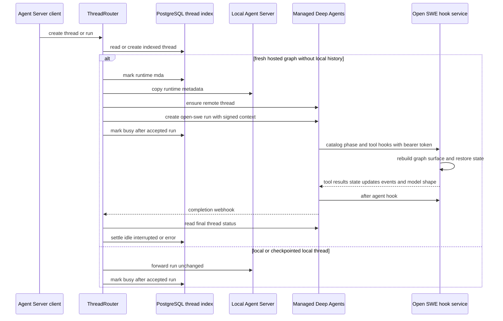

# Managed Runtime and Thread Routing

Open SWE exposes the usual Agent Server thread and run endpoints, but separates the public thread control plane from the runtime that owns a run's checkpoints and streams. PostgreSQL is the authoritative index for a thread's metadata, selected runtime, timestamps, and last known status. The local Agent Server or Managed Deep Agents (MDA) owns the runnable state: runs, checkpoints, history, commands, and streams. This lets existing dashboard, CLI, and SDK callers keep using `/threads` and `/runs` while fresh `agent`, `reviewer`, and `review-scout` work executes as the single MDA graph `open-swe`.

The separation is intentional: MDA owns the model loop and checkpoints, while the Open SWE backend still supplies the run-specific graph surface, including its sandbox-backed tools and middleware. A thread with prior local checkpoint history is deliberately not migrated, preserving continuity with its existing local execution state.

## Responsibilities and ownership

| Concern | Owner | Notes |
| --- | --- | --- |
| Thread lookup, search, metadata, runtime choice, and displayed status | PostgreSQL `thread_index` | Responses preserve the Agent Server thread shape but return empty `values`, `interrupts`, and `config`; graph state is not copied into the index. |
| Local runs and non-hosted graphs | Local Agent Server | A local-only header lets the router make direct local calls without recursively routing itself. |
| Hosted run model loop, checkpoints, streams, MDA-native tools | MDA | All hosted graph identities are played by MDA's `open-swe` graph. |
| Open SWE tools, sandbox integration, graph-specific middleware, and hook service | Open SWE backend | Reconstructed per remote run and invoked by MDA through authenticated hooks. |
| Thread metadata copies | Both runtimes for an MDA thread | The index remains the read authority; copies support runtime runs and traces. |

A thread begins as `local`. On its first run—or its first state write—`ThreadRouter` claims it for MDA only if the requested graph is one of `agent`, `reviewer`, or `review-scout` and the local runtime has no history. Claiming updates the index, records `metadata.runtime = "mda"`, updates the local metadata copy, and creates the remote thread. Threads for other graphs, or any thread with local values or a non-idle local state, stay local. Runtime selection is therefore sticky rather than an automatic checkpoint migration mechanism.

## Request and state flow

This sequence shows routing of the public API and the bidirectional state exchange for an MDA-hosted run.

### Thread API facade

`ThreadRouter` is installed ahead of the core Agent Server routes. It applies the same Agent Server authentication before handling a routed request, but uses the index only for backend calls; other callers fall through to Agent Server behavior. It handles thread create, read, patch, delete, search, count, copy, state writes, run creation, commands, and runtime-specific subpaths. If an indexed entry is absent, it reads the local Agent Server and indexes that known thread on first use.

Metadata patches are merged in the index and then copied to every runtime holding the thread. For an MDA copy, `graph_id` is rewritten to `open-swe`, because MDA hosts one graph; Open SWE retains the original hosted graph identity in the signed run context. Copy and delete also act on the selected runtime and maintain or remove the required copies. Metadata-copy failures are logged but do not make the index read path fail, because the index is authoritative for reads.

## Creating an MDA run

Dispatch uses durable LangGraph defaults regardless of where the thread will run: `interrupt` multitasking by default, asynchronous durability, resumable streaming, all v3 stream modes, and subgraph streaming. It also stamps an invocation id and associated metadata. The thread router is the last routing decision: it rewrites an MDA-bound request from its Open SWE `assistant_id` to `assistant_id = "open-swe"`, replaces `config.configurable` with MDA `context`, and preserves the stream-protocol marker in context. It adds a LangSmith project if the caller did not supply tracing.

The context contains the original hosted graph name, resolved model specifications, optional invocation id, and `__run_token`. `remote_run_context` validates that the assistant is hosted, starts the appropriate models, and signs the token over the thread id, original assistant id, and complete configurable data. Thus MDA does not receive a separately mutable configurable payload.

MDA access is configured with `MDA_RUNTIME_URL` and optionally `MDA_RUNTIME_API_KEY` (falling back to `LANGSMITH_API_KEY`). Startup refuses to proceed without an absolute MDA URL, HTTPS except for loopback, and `REMOTE_RUNTIME_TOKEN_SECRET`; this is a required execution dependency, not an optional acceleration.

## Authenticated remote hooks and state exchange

MDA calls `POST /remote-runtime/hooks/{hook}` for its catalog, model-loop phases, tool calls, and MDA-run tool notifications. `RunTokenMiddleware` requires a Bearer token on every request, validates its HS256 signature, issuer, audience, issue/expiry claims, and typed payload, then stores the verified `RemoteRun` in request state. The handler selects the graph solely from that verified assistant id and reads the thread/configuration from its verified claims—not from a model-controlled request body. Missing or invalid tokens receive `401`; malformed JSON receives `422`; an unknown hook receives `404`; other hook failures are logged and returned as `500` so the MDA run fails at the corresponding boundary.

Tokens last 48 hours to cover queued and long-running work and accept a comma-separated key set, allowing verification during secret rotation. Their claims include the thread id as subject, original assistant id, and configurable data. Treat `REMOTE_RUNTIME_TOKEN_SECRET` as a shared credential between dispatch and the hook service.

`RemoteGraph` creates a short-lived in-process `RunSession` keyed by `(thread_id, run_id)`. The session builds the normal tool surface, catalog, middleware, and models for the original graph. It serializes graph-written JSON state and messages over hook calls; message values are specially encoded and rebuilt as LangChain messages on return. Non-JSON state is not transferred and is debug-logged rather than silently coerced.

The important hook semantics are:

- `prepare` starts a fresh session and runs the graph's `before_agent` middleware.
- `before_model`, `after_model`, and `after_agent` run the corresponding graph middleware around MDA's model loop. Before hooks retain declared order; after hooks run in reverse. `before_model` also returns the selected model, fallback, gateway choice, system prompt, and tools hidden by graph middleware.
- `model_result` lets transcript and usage middleware observe MDA's response. `call` invokes an Open SWE tool and returns a tool message, messages, JSON-safe state update, and events. Tool calls that MDA owns (`task`, `eval`) are rejected at this boundary rather than being exposed as Open SWE tools.
- `tool_started` and `tool_result` record MDA-run tool activity for middleware such as transcript tracking. A namespace accompanies calls so subagent events are recorded under the relevant task namespace.

The session supports a replica change during one remote run. Before its first hook on a newly constructed session it calls `aresume_run` on middleware that declares cross-process state, and it flushes that state after hook work. Sessions expire after six hours and are bounded to 512 cached entries; `after_agent` removes its session. This provides rejoin behavior for hook requests reaching another backend replica, but it is not a replacement for MDA checkpoint recovery.

## Status settlement and failure recovery

The router marks a non-cron thread `busy` only after the runtime accepts run creation; its response recorder avoids a fast completion being overwritten by a later busy update. For both normal dispatched and protocol-v2 command runs, an absolute non-loopback completion webhook is attached only when `RUN_COMPLETE_WEBHOOK_SECRET` is configured. The webhook endpoint is fail-closed on its query token and invokes completion handling, which refreshes the indexed thread from the runtime that owns its run.

The index status vocabulary is `idle`, `busy`, `interrupted`, and `error`. Since a completion callback can be lost, the minute-scheduled reconciler finds threads that have remained busy for more than one minute, asks their selected runtime for current status, and updates the index. Individual runtime-query failures are logged and left for a later reconciliation. This is the recovery boundary: the index reports the last observed runtime status, while only the selected runtime can authoritatively report run failure and checkpoint state.

A completion webhook is deliberately best-effort for run creation. If its secret is absent, or its configured URL is relative or loopback, dispatch omits the webhook rather than allowing the platform to reject every run. Operators should configure an externally reachable HTTPS `COMPLETION_WEBHOOK_URL` ending in `/webhooks/run-complete` plus `RUN_COMPLETE_WEBHOOK_SECRET`; otherwise UI status can remain busy until reconciliation.

## Safe extension points and focused tests

Add a new remotely hosted graph by extending the hosted graph set and the remote graph registry, then ensure its graph factory can construct the same tool surface and middleware through `RemoteGraph`. Do not simply route an arbitrary assistant id to MDA: `remote_run_context` and the router deliberately reject non-hosted identifiers. New graph state intended to cross the hook boundary must be JSON-serializable or have explicit persistence outside the exchanged hook state.

The focused tests encode the main safety contracts:

- `tests/threads/test_thread_router.py` verifies index-backed CRUD/search, on-demand indexing of local threads, run routing, busy-after-acceptance semantics, the no-local-history migration gate, signed-context rewriting, copy/delete behavior, and command-run completion webhook attachment.
- `tests/reviewer/test_remote_runtime.py` verifies token round trips, key rotation and rejection, bearer enforcement, startup failure without MDA configuration, graph middleware model shaping, and replica-side run rejoin behavior.

For broader graph construction and durable invocation semantics, see [Coding Agent Assembly](agent-graph.md), [Architecture Overview](overview.md), [Threads, Durable Runs, and State](../concepts/threads-and-state.md), and [Inbound Invocation to Durable Run](../workflows/invocation.md).
