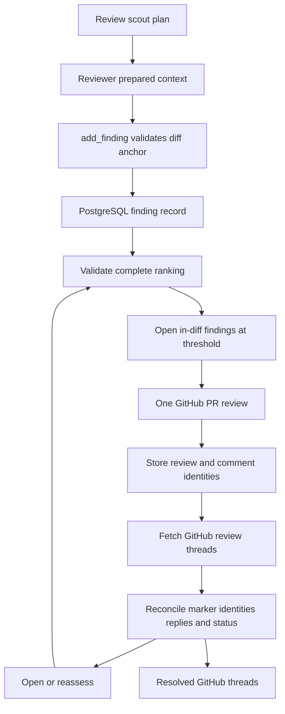

# Review and Review-Scout Graphs

Open SWE exposes two distinct LangGraph assistants: `reviewer` and `review-scout`. The scout builds a durable walkthrough of a pull request in a separate per-PR thread; the reviewer inspects a prepared checkout and diff, manages the PR's evolving finding set, and is the only role that publishes review feedback. `langgraph.json` registers them as separate `review-scout` and `reviewer` graph entrypoints, rather than variants of the main coding-agent graph.

This separation makes the scout an optional planning aid, not a publication dependency. The reviewer waits up to 600 seconds for a walkthrough for the exact head SHA, but continues without one if the database, SHAs, dispatch, or scout completion is unavailable. The scout can finish later and still improve the review page.

Related: [Pull Request Review Workflow](../workflows/pr-review.md), [Middleware Stack](middleware-stack.md), [Thread Sandbox Lifecycle](sandbox-lifecycle.md), and [Tools](../concepts/tools.md).

## Roles, threads, and safety boundary

### Review scout: shared change map

The scout has its own deterministic thread ID per PR and own sandbox. It prepares the base/head checkout, pins it, and builds a `PlanWorkspace`. Its planning tools can assign complete diff hunks to named walkthrough chunks, split hunks, or put remaining work in **Other**; it can summarize human steering only when such history exists. A final middleware settles all unplanned lines into Other, persists the optional human-input summary, and invalidates the PR UI record. Thus a completed walkthrough accounts for every changed line, including material the model did not classify into a named step.

On a later head, an active scout for that same SHA is reused. A newer head supersedes an older scout; a stale scout detects `PlanMovedError` and does not overwrite the newer plan. Carried-over walkthrough content means that if no lines remain to plan, the graph ends before a model call.

### Reviewer: evidence, findings, and feedback

The reviewer owns the durable reviewer thread and its finding lifecycle. It has review-specific tools: diff retrieval, add/update/list finding, publication, and review-thread reply/resolution, plus web retrieval tools. It does **not** expose the main agent's commit, push, or pull-request-opening tools. Its sandbox is intentionally replaceable because each run re-derives its checkout; its durable review data is stored outside the sandbox.

“Read-only” therefore means **no repository-authoring workflow**: the graph may inspect the checkout and GitHub data but is not designed to commit, push, or create PRs. It is not a claim that no external state can change: it writes findings to PostgreSQL, review metadata to the LangGraph thread, walkthrough records, and—only through explicit review tools—GitHub comments/review-thread resolutions, status comments, checks, and an optional review approval. The sandbox remains a general execution backend, so this boundary is enforced primarily by the supplied tool surface and reviewer protocol, not by a filesystem read-only mount.

## Deterministic preparation before reasoning

Both graphs mint and cache a repository-scoped GitHub App token, obtain a sandbox with `allow_replacement=True`, and call `prepare_review_repo` before the first model call. Preparation reuses a clone when possible, otherwise makes a blobless clone; it fetches the base, head SHA, and PR ref for fork compatibility, force-checks out the requested head, and verifies `HEAD` equals that SHA. Failure is best effort for the reviewer: it can still work from a fetched diff, but the rendered prompt says the checkout is not ready. The scout instead fails preparation because a pinned walkthrough must describe the requested checkout.

The reviewer concurrently gathers its context: checkout, materialized review range and changed-line set, PR title/body, existing GitHub review threads, walkthrough, organizational/repository guidance, base-reference `AGENTS.md`, and approval policy. First reviews use the PR range; re-reviews use the prior reviewed SHA. Existing PR text and thread bodies are treated as untrusted data: they are XML-delimited, closing tags are neutralized, logins are validated, and long bodies are truncated before entering the prompt.

Reviewer skills are also trust-separated. Repository skill directories are extracted from the PR **base SHA** into `.review-skills` outside the head checkout, so an author cannot alter the reviewer's instructions by changing a `SKILL.md` in the PR.

## Finding lifecycle and durable state

A `Finding` records severity and confidence, category, title and description, file/range/diff side, first-seen and last-confirmed SHAs, status (`open`, `resolved`, or `dismissed`), diff hunk and fingerprint, ranking, GitHub identities, surface state, and interaction history. Findings are keyed to the PR in PostgreSQL; `pull_request_finding_state` maps the PR to its reviewer thread. Old thread-metadata findings are copied once on first access. Benchmark/evaluation runs deliberately use bounded process-local, run-scoped findings instead, preventing repeated benchmark runs from contending for the PR's production record.

Mutation is serialized with a row lock and uses the freshest persisted list; no-op mutations do not write, and snapshot replacement merges by finding ID so it does not discard a concurrently added finding. New findings deduplicate against open findings by a SHA-256 fingerprint of location, side, and normalized description. A missing reviewer thread is translated to a structured `thread_not_found` / do-not-retry tool result rather than being mistaken for an absent finding.

`add_finding` validates severity, confidence, title, side, and line ordering, normalizes a one-ended range, and validates the range against the prepared per-file/per-side unified-diff line set. Out-of-diff anchors are rejected rather than silently re-anchored. Suggestions longer than four lines are dropped while retaining the description-only finding. Creation records the current head from live thread metadata when available, rather than blindly trusting a run configuration that can become stale during a queued push.

*Finding creation, publication identity capture, and later reconciliation with live GitHub threads.*

## Publication and reconciliation

`publish_review` must be the only tool call in its turn. It first requires a ranking that contains every eligible candidate exactly once, then persists ranks. It selects open, in-diff findings at or above the requested severity threshold (default `medium`), ordered by rank and then stable fallback fields. On a re-review, only unpublished findings first seen at the live head are candidates; previously surfaced findings are not reposted.

The tool posts one GitHub PR Review, with inline comments for line-anchored findings and a host-formatted summary. Each inline comment embeds a hidden marker containing the finding ID and anchor. That marker—not a fuzzy text/location match—is the durable correlation key used to record the review ID, comment IDs, and later GraphQL thread IDs. The publication write stamps review and comment identity together where available, reducing the crash window that could otherwise leave GitHub feedback without a resolvable local identity.

Publication is defensive:

- It resolves the current thread-metadata head before posting. An assessment whose SHA differs from that live head is rejected.
- A GitHub unresolved-anchor `422` triggers at most one retry, after recomputing the live diff and removing identifiable invalid anchors. If no safe reduced batch exists, it returns the affected IDs and asks the agent to correct or resolve them rather than retry blindly.
- An empty re-review suppresses duplicate “no issues” summaries only when prior review state is known, while still resolving fixed threads and advancing `last_reviewed_sha`.
- Evaluation mode never posts to GitHub; it saves a dry-run publication snapshot in reviewer metadata.

Reconciliation runs when reviewer preparation fetches existing threads and again around publication. It recognizes markers only on `open-swe`/`open-swe[bot]` comments, backfills comment and thread identities, records the newest human reply after the bot comment as a reassessment-needed interaction, and updates the finding only when something changed. A finding becomes `resolved` only when all matched threads are terminal and all are actually resolved; outdated threads are terminal but do not themselves count as resolved. Resolving or dismissing a surfaced finding requires an explanatory note and delegates to GitHub thread resolution; a failed GitHub resolution leaves the local finding open.

## Operations and focused verification

The graph factories have empty/no-tool fallbacks when loaded outside execution or without a thread ID. In normal execution, both use preparation, tool-error handling, model timeout/retry/error handling, message sanitization, stable tool-result ordering, and a model-call cap. The reviewer additionally refreshes its GitHub proxy, processes queued messages before model calls, and settles an outstanding review check on exit.

For failures, distinguish a missing reviewer thread (terminal for that run), unavailable sandbox (reviewer may continue only if checkout preparation degrades), and scout delay/failure (review continues without the walkthrough). Operators can inspect the reviewer thread’s head/review metadata and the scout's per-head run status/progress; a scout completion invalidates the PR UI so the walkthrough becomes visible.

Focused tests cover the important contracts: `tests/reviewer/test_reviewer_tools.py` checks changed-side anchoring, live-head provenance, suggestion limits, and resolution failure behavior; `tests/reviewer/test_reviewer_findings.py` covers one-time legacy migration, concurrency, deduplication, and merge-safe replacement; `tests/reviewer/test_reviewer_reconcile.py` covers trusted marker matching, replies, and multi-thread resolution semantics; `tests/reviewer/test_reviewer_publish.py` covers ranking, stale assessments, dry runs, duplicate suppression, and publication failure handling. `tests/walkthrough/test_walkthrough_plan.py` exercises complete hunk placement and carrying a plan forward across pushes.
