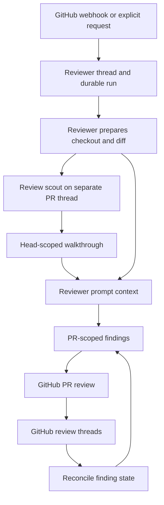
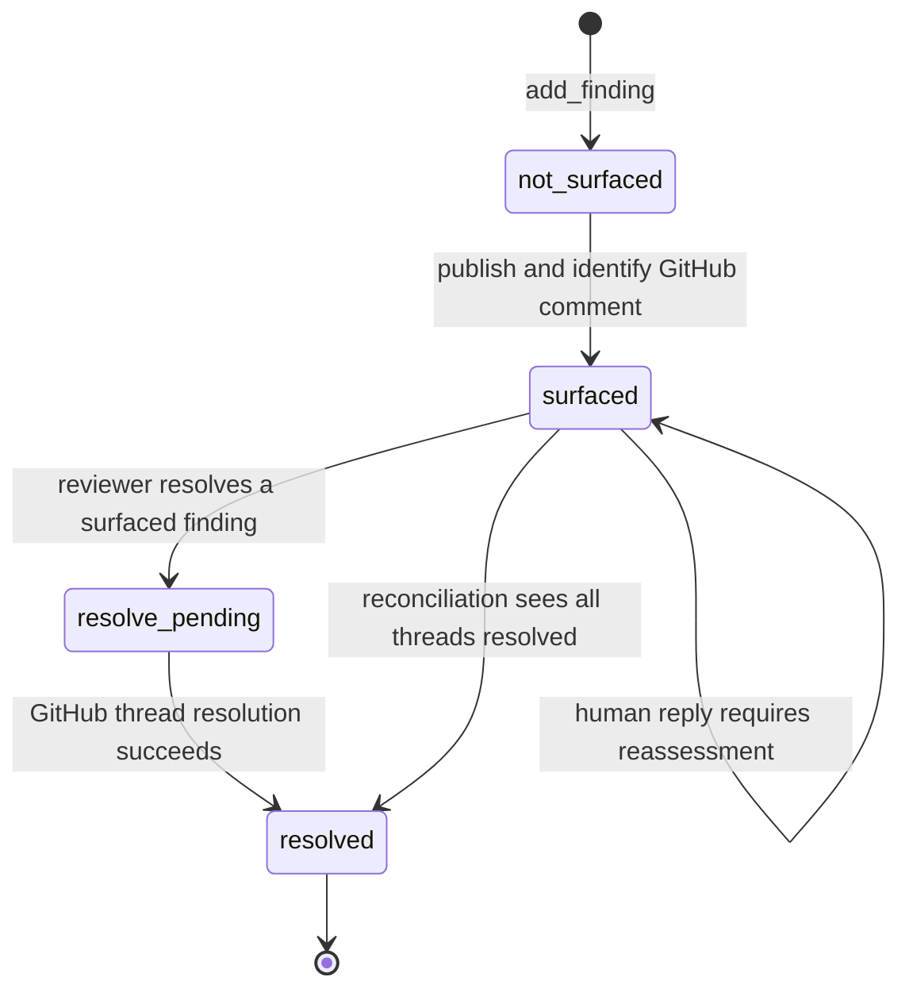

# Reviewer and review-scout architecture

Open SWE treats code review as a dedicated, read-oriented workflow rather than a normal coding-agent run. The **reviewer** is the graph that investigates a pull request, records durable findings, and publishes a GitHub PR review. The **review-scout** is a separate background graph that turns the same PR diff into a shared walkthrough. They have distinct threads, runs, tools, and output: the scout plans context; the reviewer makes and reconciles findings.

## Surfaces and ownership

| Surface | Owns | Does not own |
| --- | --- | --- |
| GitHub webhook and dispatch layer | Validating trigger metadata, selecting the canonical reviewer thread, watch state, check runs, and starting reviewer runs | Reasoning about the code or creating findings |
| Reviewer graph | A deterministic checkout/diff context, review reasoning, finding creation, review publication, and follow-up handling | Code-authoring workflows such as commits, pushes, or opening PRs |
| Findings store | PR-scoped finding records and their GitHub publication identities; reviewer thread metadata retains PR identity, live head, and watch state | The GitHub review thread as the source of current thread state |
| GitHub PR review threads | Inline comments, human replies, and resolved/outdated status | The canonical internal finding record |
| Review-scout graph | A head-scoped walkthrough: changed-line chunks (or `Other`) and an optional summary of the human input behind the change | Findings, GitHub publication, and reviewer decisions |

Findings are stored in PostgreSQL under the PR, addressed through the reviewer thread. That separation lets a single PR thread persist across runs and pushes while findings retain their own lifecycle and GitHub identifiers. Older thread-metadata findings are migrated on first access.

This diagram shows the two graph surfaces and the finding lifecycle. The walkthrough is input to review reasoning, not a review result.

## Entrypoints, threads, and watched re-reviews

A direct PR review request uses `trigger_pr_review_from_ref`: it fetches PR metadata, rejects draft PRs, re-scopes the installation token after determining repository privacy, advances the canonical `reviewer_thread_id`, stores PR metadata plus `watch=True` and the head SHA, posts a started comment, then dispatches the `reviewer` assistant. The input carries a system or human GitHub envelope with repository, PR number, URL, base SHA, and head SHA as structured data.

Webhook first-review dispatch similarly requires PR number, URL, base SHA, and head SHA. It creates/updates the canonical thread, records the live head and watch state, creates a GitHub check run when possible, and dispatches the graph. Draft auto-review is conditional on the PR author's effective draft-review setting. Close/reopen/draft transitions update watch state; a watched head update ignores closed PRs, disallowed drafts, unchanged heads, and disabled automatic review.

For a push to a watched PR, the dispatcher uses `last_reviewed_sha` to decide whether this is a re-review. If the diff has not changed and an approval policy does not require reconsideration, it advances `last_reviewed_sha`, carries the walkthrough forward when storage is available, and settles a success check instead of running the agent. Otherwise it launches a re-review. First review compares the base merge point to the head; re-review compares the last reviewed SHA directly to the new head, so the agent is asked to reconcile existing findings and identify only net-new ones.

## Deterministic preparation before model reasoning

`PrepareReviewerRunMiddleware` makes preparation checkpointed graph state. Before the model is called, it obtains a repository-scoped GitHub App token, creates or replaces a sandbox if needed, and gives its GitHub proxy only `READ_ONLY_REVIEW_PERMISSIONS` for the reviewed repository. The checkout is re-derived on every run; an unreachable sandbox after replacement produces a PR notification rather than silently leaving the PR apparently unreviewed.

Preparation runs checkout, diff retrieval/materialization, PR overview, existing-thread fetch, scout wait, policy/guidance lookup, and prompt inputs concurrently where dependencies permit. It supplies:

- a repository checkout pinned to the PR head;
- a deterministic patch file named from the resolved commit range, cached in the sandbox when available;
- `diff_text` and a `{file: {LEFT, RIGHT}}` line set in prepared state for validation;
- current PR title/body and existing review threads, plus existing findings for re-reviews or reply events;
- workspace guidance, repository style, base-ref `AGENTS.md`, scoped instructions for changed files, API standards, and trusted skills materialized from the base SHA;
- the scout walkthrough and optional human-input summary when it arrives in time.

The first-review range uses `base...head` (merge-base semantics matching GitHub's Files changed view); a re-review uses `last_reviewed_sha..head` to isolate newly added commits. Commit refs must be valid SHA strings. If sandbox diff materialization fails but a GitHub PR diff was fetched, that fetched diff remains usable; if neither is available, line validation has no set rather than inventing anchors.

PR titles, descriptions, review-comment bodies, and reply bodies are author-controlled. Reviewer prompt formatting puts them in explicitly untrusted XML-like data blocks, validates login syntax, neutralizes closing tags, and truncates individual existing comments. A failure to load existing GitHub threads logs and continues without that awareness context rather than aborting the review.

## Findings: create early, validate locally, persist per PR

A `Finding` records severity and confidence, category, headline, file/range/side, description and optional small suggestion, the SHA at which it was first seen and last confirmed, an in-diff flag and hunk, status, publication identities, interactions, and surface state. Its deduplication fingerprint derives from normalized description plus location and side. Surface state only progresses from `not_surfaced` through `surfaced` and resolution states.

`add_finding` normalizes one-sided ranges, requires a generated nonempty title, validates the severity, confidence, side, and range order, and resolves the current review head from thread metadata. It accepts a line-anchored finding only when **every** specified line is in the current diff on the declared side; `RIGHT` is post-change lines and `LEFT` permits deleted-line anchors. It returns a structured do-not-retry error for an out-of-diff anchor rather than encouraging an invented re-anchor. When diff state was unavailable, the tool can fetch the GitHub diff as a fallback. It also captures the relevant hunk when available.

Suggestions are intentionally constrained: a suggestion exceeding four lines is dropped while the description is retained. Missing reviewer-thread storage is returned as a structured do-not-retry tool result, preventing wasteful agent retries against an evicted or absent thread. Evaluation runs use run-scoped in-memory findings and simulate publication instead of posting to GitHub.

## Publication and reconciliation

The reviewer uses `list_findings`, `add_finding`, `update_finding`, `publish_review`, `resolve_finding_thread`, and `reply_to_finding_thread` alongside read/research tools (`fetch_review_diff`, web search, URL fetch, and HTTP request). This is a deliberately different tool surface from a coding agent: it contains no commit, push, or PR-opening tool. The sandbox is likewise repository-scoped and read-only. The graph additionally excludes configured shell-search tools and applies model-call limits, tool-error handling, retry/error middleware, queue checks, GitHub proxy refresh, and check settlement on exit.

`publish_review` may be the only tool call in its model turn. Its `ranking` must be a complete, duplicate-free ordering of every eligible finding; otherwise it records nothing and publishes nothing. It filters to open, in-diff findings at or above the requested severity threshold, renders valid inline payloads, posts the PR review, and records review/comment/thread identities so subsequent runs do not duplicate comments. On re-review it further limits publication to unpublished findings first seen at the current head. It resolves or advances prior findings as appropriate and moves the reviewed SHA forward. A mid-run push is handled defensively by resolving the live thread head rather than blindly publishing against the frozen run-config head; an approval assessment for a different head fails rather than posting stale approval.

Before context construction and during publication, the system fetches GitHub review threads and reconciles them with stored findings. Reconciliation identifies Open SWE bot comments using the embedded finding marker or known identifiers, backfills publication identity, imports human replies as interactions that require reassessment, and recognizes terminal threads. A finding is marked resolved only when all of its matching threads are resolved; an outdated thread is terminal for matching but does not by itself establish a resolved finding. Markers on non-bot comments are ignored, preventing a human from spoofing ownership.

This diagram shows the internal surface-state progression. A finding's `status` and GitHub thread state are reconciled rather than assumed to remain synchronized.

## Review-scout delegation

The scout is launched on its own successor-aware `review_scout_thread_id` for a PR. `ReviewScoutTarget` first reuses an active run for the same head; a newer head advances the thread so an old scout cannot write the latest plan. It records `kind: review-scout` and PR identity before it either reuses or creates a run. Its launch configuration includes repository, PR number/title, base SHA, head SHA, and workspace, and durable-run metadata includes the scout head SHA.

The reviewer normally waits up to `SCOUT_WAIT_SECONDS` (600 seconds) for a walkthrough, polling once per second. Missing database configuration, absent SHAs, launch errors, or timeout return `None`: the reviewer continues without a walkthrough while the scout may still finish and populate the review page later. The reviewer does not wait for a scout for evaluation or finding-reply events.

The scout has its own read-only sandbox preparation and pins its checkout. It plans all changed lines into chunks or `Other`, can split or move hunks, and can record a human-input summary only if steering history exists. On a new head, carried-forward coverage means it plans only uncovered lines; if the workspace is already complete, it exits before a model call. Its finishing middleware sends any remaining lines to `Other`, stores the human summary if present, and invalidates the PR UI. A stale plan ownership conflict is safely ignored in favor of the newer head. The scout's 150-call limit and restricted planning tool set make it a bounded contextual delegate, not a second reviewer.

## Safeguards and focused verification

The principal safety invariant is that review is observational and communicative: it can inspect a checkout, create durable finding records, publish/reply/resolve review comments, and optionally approve through a separately governed assessment path; it cannot mutate repository code or initiate a coding PR workflow. The system also avoids treating untrusted PR and comment text as instructions, validates GitHub anchors before publication, and refuses stale-head assessment publication.

Focused tests cover the behaviors most likely to regress:

- `tests/reviewer/test_reviewer.py` verifies read-only repository sandbox permissions, unavailable-token failure, and hostile review-thread/prompt data handling.
- `tests/reviewer/test_reviewer_diff.py` verifies old-side deletion anchors and three-dot first-review diffs.
- `tests/reviewer/test_reviewer_tools.py` verifies out-of-diff rejection, live-head provenance, suggestion caps, and resolution failure semantics.
- `tests/reviewer/test_reviewer_publish.py` verifies exclusive publish calls, total rankings, evaluation dry runs, and stale-assessment refusal.
- `tests/reviewer/test_reviewer_reconcile.py` verifies bot-marker backfill and the all-threads rule for resolution.
- `tests/reviewer/test_review_scout_launch.py` verifies scout PR identity is stored before either starting or reusing a run.
