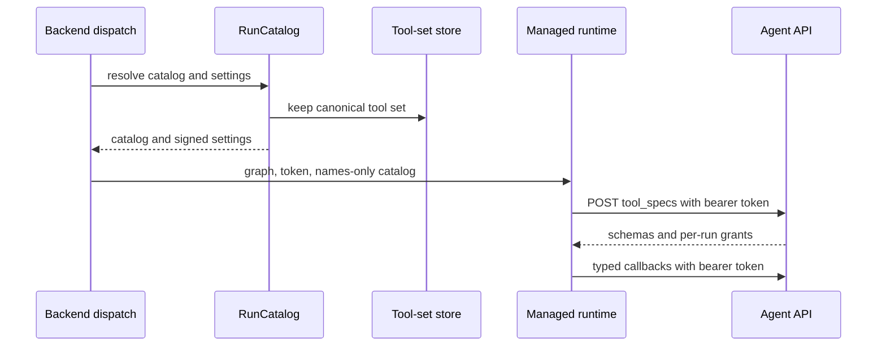

# Signed runtime API contract

The runtime API is the backend callback contract for a remotely hosted Open SWE run. It is not a free-form tool interface: both sides import the `runtime_api` package, whose named `Endpoint` definitions specify request and response models, timeouts, and retry-delivery semantics. Each call is a JSON `POST /agent-api/{endpoint}` authenticated as the run that made it.

The contract separates **planning**, which happens once before a remote run starts, from **serving**, where every callback is reconstructed from signed identity plus a typed request. This keeps thread identity, selected graph, resolved configuration, tool permissions, and catalog settings out of model-controlled request fields.

## Run start: resolve once, then carry a compact context

`start_remote_run()` admits only hosted graph kinds (`agent`, `reviewer`, and `review-scout`). It constructs a `RemoteRun` from the backend-provided thread ID, assistant ID, configuration, and metadata; asks `RunCatalog` to resolve the catalog and settings; incorporates those settings into the signed run; and returns a `StartedRun`.

The MDA context has four relevant fields:

- `graph` selects the hosted graph behavior.
- `__run_token` is the signed bearer credential.
- `__catalog` is the catalog encoded as JSON, but with operations reduced to `tool_names`.
- `invocation_id`, when available, maintains attribution for usage and reports.

The compact catalog is deliberate. Agent Server context is copied into checkpoints and run reads, so full operation schemas—including many integration schemas—remain backend-resident. At startup the runtime obtains schemas for the catalog's named tools using `tool_specs`; it discovers backend-held tools later with `search_tools` and confirms a specific callable name using `resolve_tool`.

This shows the start-time resolution and subsequent callback boundary. The full tool set stays in backend storage while the remote context holds only the names initially needed.

## Signed identity and authorization

A runtime token is an HS256 JWT issued by `open-swe` for audience `open-swe-remote-runtime`. It has required issued-at, expiry, issuer, audience, and subject claims. Its subject is the thread ID; claims also carry the assistant ID, configuration, metadata, resolved settings, and a per-run grant ID. Tokens normally last 48 hours, accept 60 seconds of decode leeway, and can be verified against a comma-separated current-and-previous key set from `REMOTE_RUNTIME_TOKEN_SECRET`, allowing key rotation without immediately invalidating queued runs.

The token is the authority boundary. The server's `RunTokenMiddleware` requires `Authorization: Bearer …`, verifies it once per request, stores the resulting `RemoteRun` in ASGI scope state, and handlers select the graph from the signed `assistant_id`. They derive configuration, thread, metadata, and start-time settings from that verified run—not from the callback body. Missing or invalid credentials produce `401`; an endpoint or action not allowed to that principal produces `403`.

For `auth_provider == "langsmith"`, a valid signed credential is also subject to a live `ThreadIdentity` authorization check for the token's `user_id`. This prevents a previously issued token from remaining usable after that access is revoked.

Operation grants add a narrower capability check. A catalog operation receives an HMAC-derived grant based on the thread ID, run-specific grant ID, and operation name. The runtime returns that grant in `RunOperation.grant`; the backend can validate it under any live signing key. Thus a token alone does not authorize arbitrary operation names, and rotating the signing secret preserves validation for grants issued with a previous configured key.

## Typed endpoint surface and failure behavior

`Endpoint[Request, Response]` is the shared protocol primitive. `call()` serializes the request model and validates the response model; backend `Handlers` validates the same request model before invoking its registered handler and serializes the declared response. A malformed JSON-object body or request model is a `422`; an unknown endpoint is a `404`; an application exception is logged and returned as a structured `500` error. Trace headers are accepted so backend work can nest under the runtime's trace.

The surface is grouped by intent rather than treated as an untyped RPC bucket:

| Endpoint group | Named endpoints | Responsibility |
| --- | --- | --- |
| Catalog and discovery | `tool_specs`, `search_tools`, `resolve_tool`, `skills` | Fetch initial schemas, search backend-held tools, resolve a callable tool, and list run skills. |
| Run callbacks | `prepare`, `inbox`, `inbox_received`, `route_model`, `model_choice`, `task_context`, `incident_context`, `refresh_github_proxy`, `reply_on_behalf` | Read or update backend-owned thread and run information required by the remote runtime. |
| Reports | `reports`, plus report item types such as `run_started`, `model_result`, `tool_started`, `tool_result`, and `run_ended` | Deliver ordered observations of run activity and notices. |
| Operations and guarded work | `operation`, `check_shell`, `record_evidence`; `files.*` endpoints | Execute a catalog-granted backend operation, obtain a shell verdict, record incident evidence, or access run files. |
| Worker lifecycle | `launch_worker`, `worker_launched`, `adopt` | Authorize and register task workers, then exchange constrained worker credentials for an independent run token. |

Each endpoint declares one of three retry modes. A connection refusal is retried for any call because it did not reach the backend. A `503` is retried for calls marked `unprocessed` or `idempotent`; a `502` only for `idempotent`; `504` is never automatically retried because the backend may still be executing. The runtime client uses bounded exponential waits and maps a `403` to `BackendRefusedError`; a timeout signals that started work may still be running.

`prepare` receives special server handling: the server watches for caller disconnect and cancels preparation if the caller disconnects first, while shielding cleanup. Other calls await normally. This avoids continuing that preparation after its caller has gone away without confusing an application failure with a malformed request.

## Catalog, grants, and tool-set persistence

`RunCatalog.of()` applies the graph kind to a backend-owned `ToolSurface`, prepares it, and at `start()` concurrently persists the full `ToolSet` and produces a granted catalog. The catalog contains models, sandbox and files specifications, middleware rules, tool descriptions, MCP servers, skill sources, and the operations the run is initially offered. Each included operation receives a grant derived for the specific `RemoteRun`.

A `ToolSet` canonicalizes tools by removing grants, sorting tools and exclusions, and hashing its JSON representation with SHA-256. It is stored in `run_tool_sets` keyed by this digest; the digest is recorded in `RunSettings.tools` and thereby signed into the token. The database keeps a full set once per distinct digest, refreshes its usage mark at most hourly, and retains sets for three days—longer than the maximum token lifetime. This makes a token's named tool set reproducible during its lifetime without copying secret-bearing or large schemas into remote context.

Excluded tools are neither searchable nor resolvable. Searchable tools are ranked by a bounded BM25 search over name, description, and parameter names; `resolve()` accepts the ordinary name or the code-mode name. These rules are an extension boundary: adding an operation requires the catalog to offer it and issue its grant, while adding a dynamically discoverable integration requires it to be retained in the tool set and exposed through the discovery endpoints.

## Worker grants are intentionally weaker than run tokens

An async worker begins with a separately audience-scoped worker grant rather than the coordinator's runtime token. The grant embeds the coordinator identity and one launch request ID, and the server dispatches it only to the grant API. The worker already carries the coordinator catalog in its launch context; over `/agent-api`, its grant can call only `adopt`, while all normal run endpoints are refused.

`adopt` registers the worker thread if necessary, prepares configuration for that worker, runs normal start-time catalog resolution for the worker thread, and returns a new runtime token and its own catalog. The runtime replaces the grant with that token and clears any tool resolutions made under coordinator authority. From then on, calls act as the worker's own thread, not as its coordinator.

## Ordered, replica-safe report delivery

The remote runtime batches reports in oldest-first order to the idempotent `reports` endpoint. Every item has a key unique within its thread, a typed underlying endpoint, and trace headers. The backend processes the batch sequentially and stops at the first item it cannot take, preserving observation order: later events are never recorded ahead of an earlier blocked or failed event. The response returns replies only for items taken, so the runtime retains and resends the remainder.

For report types that are not intrinsically idempotent, `ReportReceipts` coordinates replicas through the `(thread_id, idempotency_key)` record in `agent_report_receipt`:

1. A delivery atomically claims an unrecorded key.
2. It executes the report handler and stores that handler reply against the claim.
3. A duplicate delivery receives the stored reply rather than executing again; a concurrent in-progress delivery stops the batch at that item.
4. If handling fails, the claim is released. If a replica dies after claiming, a ten-minute lease permits takeover.

Receipt replies are retained for seven days and purged in batches with `SKIP LOCKED`, avoiding long purge transactions. Without a configured database, the implementation treats each caller as claimed, which is appropriate only where replica-wide persistence is unavailable; production replica safety depends on PostgreSQL.

## Operations and tests that protect the contract

Configure `MDA_RUNTIME_URL` as an absolute URL (HTTPS except localhost) and configure `REMOTE_RUNTIME_TOKEN_SECRET`; startup fails otherwise. The remote runtime needs `OPEN_SWE_BACKEND_URL` to construct callback URLs. Keep both the runtime and backend on compatible `runtime_api` definitions: endpoint names and request/response model changes are contract changes, not local implementation details.

Focused coverage in `tests/reviewer/test_agent_api.py` verifies token round trips, expired/foreign/malformed-token refusal, signing-key rotation, middleware propagation of the verified run, live LangSmith reauthorization, worker-grant endpoint restriction, catalog withholding and later lookup of integration tools, BM25 ranking, and typed request-versus-handler failure status behavior. When changing this boundary, also exercise retry classification, grant validation, and report receipt concurrency or recovery semantics where the change can affect them.

See [Backend control plane](backend-control-plane.md) for dispatch and backend ownership, [Managed runtime](managed-runtime.md) for remote hosting, [Security and configuration](../concepts/security-and-configuration.md) for deployment credentials, [Tools and catalogs](../concepts/tools-and-catalogs.md) for tool concepts, and [Testing strategy](../testing/strategy.md) for test guidance.
