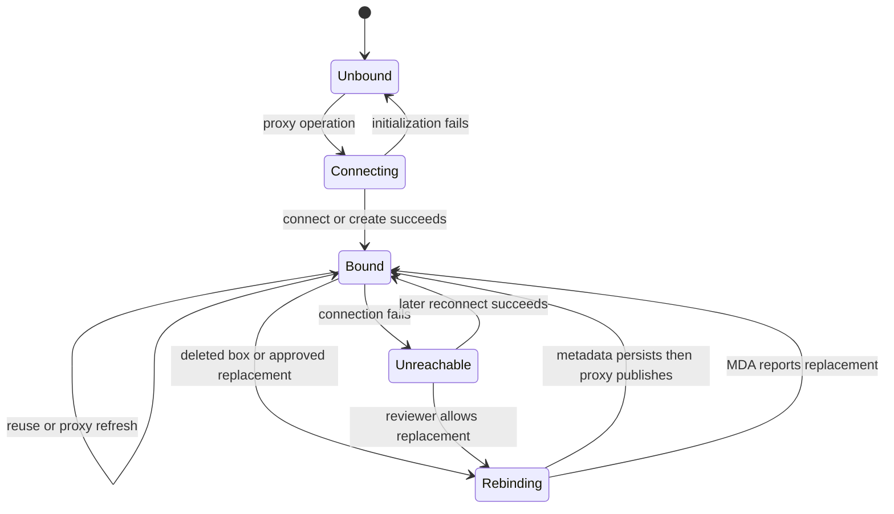
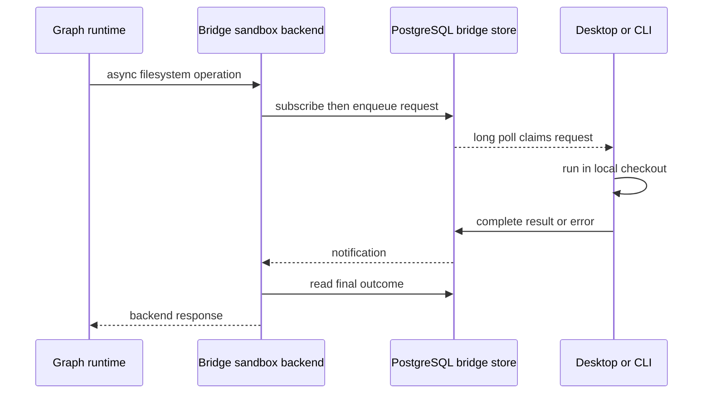

# Sandbox, bridge, and workspace lifecycle

A thread has one durable sandbox binding, normally `thread.metadata["sandbox_id"]`. It identifies the filesystem holding the checkout and any uncommitted work; it is not merely a disposable execution target. The binding can name a hosted provider sandbox or a local-machine bridge. Worker memory holds only connections and stable proxy handles, so a later run can reconnect from durable thread metadata.

The three ownership modes are deliberately distinct:

- **Backend-managed hosted sandbox.** Open SWE provisions and binds a provider sandbox, initializes its Git identity and, for LangSmith, GitHub proxy credentials.
- **MDA-managed hosted sandbox.** Managed Deep Agents (MDA) creates, names, restarts, and replaces the LangSmith box. The backend records that MDA owns it and connects to configure the parts MDA leaves to Open SWE.
- **Bridge-backed local sandbox.** A `bridge:<id>`-style sandbox ID represents the caller's checkout on a CLI or desktop client. The backend queues filesystem requests for that client; it never boots a cloud replacement.

Related: [Managed runtime](managed-runtime.md), [Workspaces and routing](../concepts/workspaces-and-routing.md), [Dashboard UI](../integrations/dashboard-ui.md), [Sandbox providers](../integrations/sandbox-providers.md), and [Implementation and PR delivery](../workflows/implementation-and-pr-delivery.md).

## Durable binding and worker-local handles

`SANDBOX_BACKENDS` maps a thread to a stable `SandboxBackendProxy`; `SANDBOX_CONNECTIONS` maps a provider sandbox ID to a live connection. Both are worker-local caches. Publishing a replacement swaps the target of the existing proxy, allowing tools and middleware that already hold the handle to use the new backend. Metadata is always read from the live thread, rather than stale queued-run configuration: a failure to read metadata propagates rather than being treated as unbound, which prevents overwriting a real binding.

The proxy is async-only. Its `a*` methods resolve and delegate to the current backend; synchronous methods deliberately fail. When it has no target, it uses its registered reconnect callback, or reconnects from the durable ID. A lock plus a shared startup task coalesces concurrent first calls, and shielding means cancellation by one caller does not cancel initialization for other callers. It subclasses `BaseSandbox` so filesystem middleware can retain capture-at-source/offload behavior; if the target has no offload method, the proxy returns an ordinary-execution result instead.

*The durable binding survives workers while a proxy moves through connection, recovery, and rebinding states.*

## Hosted provisioning and workspace snapshots

`ensure_sandbox_for_thread` is the standard hosted lifecycle entrypoint. It first validates task-worker attachment (described below), then recognizes bridge IDs, otherwise obtains or reconnects the persisted hosted ID, or creates a sandbox when no ID exists. Normal dispatch uses `multitask_strategy="interrupt"`; that serialization is relied on to avoid simultaneous provisioning for one thread rather than maintaining a cross-process creation sentinel.

`SandboxCreateConfig.resolve` loads the routed workspace unless explicitly sourcing the base. It uses a workspace's immutable ready snapshot ID when available, otherwise the provider's base snapshot, and passes workspace resource sizing and validated create parameters into provisioning. A new sandbox is initialized before its ID is persisted: proxy configuration and bot Git identity complete first, then metadata receives `sandbox_id` (and proxy base configuration), then the backend is published through the stable proxy. Consequently an initialization or metadata failure cannot expose a half-built new box to callers.

The registry selects a lazily imported factory through `SANDBOX_TYPE`: `langsmith`, `daytona`, `modal`, `runloop`, `e2b`, or `local`. Optional third-party providers produce an actionable missing-extra error at startup. LangSmith accepts snapshot, resources, and creation fields; asynchronous factories are awaited and synchronous wrapper factories run in a thread. The local provider has no hosted isolation, so it is appropriate for development rather than a substitute for hosted sandbox security.

A workspace definition includes setup/update scripts, repository associations, resource overrides, and creation parameters. Create parameters are JSON-limited and reject credential-like keys and sensitive header names: GitHub authentication belongs in the proxy, not a snapshot definition. Snapshots are immutable IDs on workspace records; the `:latest` tag may move without changing the image from which an already-created sandbox booted.

Workspace refresh uses a throwaway LangSmith builder. A nightly or on-demand **full** refresh boots from the base snapshot and runs setup then update scripts; a lazy **update** refresh boots from the current snapshot and runs only the update script. A stale workspace snapshot does not delay the requesting thread: the thread starts from the last ready snapshot and triggers the update in the background. A snapshot is captured only after all scripts succeed, so a failure preserves the previously ready snapshot. Builder sandboxes are stopped after capture rather than deleted by ID.

## MDA ownership and task sharing

When running against LangSmith, a new ordinary thread can declare a `ManagedSandbox` to MDA. MDA opens the box before preparation and returns its ID; `bind_mda_sandbox` writes `sandbox_owner: "mda"` and the ID. Open SWE subsequently connects to that box to apply Git identity, credentials, tool URL provisioning, and handoff behavior. It does **not** create or replace a missing MDA-owned box: MDA remains responsible for its lifecycle. If MDA replaces its same-name box, it records replacement context, clears the worker-local connection, and reconnects so the replacement receives the correct workspace proxy configuration.

Task workers do not own independent sandboxes. A worker validates that it belongs to the named coordinator task, matches task, owner, workspace, visibility, and admin status, and may not receive broader repository scope than the coordinator. It then attaches to the coordinator's existing sandbox and writes that ID to its own metadata. `require_existing` prevents an early worker from accidentally creating or recovering the coordinator's box.

## GitHub access and repository preparation

Git identity is reapplied on hosted reconnects because a reused box can lose global Git configuration. Identity writing also creates and checks a declared work directory when a provider declares one. LangSmith access is configured through its sandbox proxy: a workspace/installation token is minted while the sandbox boots, then the proxy—not the filesystem—receives the credential. Token expiry, repository scope, permission scope, workspace, and base proxy configuration are retained per thread for rotation. Refresh occurs within five minutes of known expiry, or after 50 minutes when expiry is unavailable, and remints at no broader scope. A caller's requested repository set is narrowed by the thread's recorded scope; reviewer and review-scout threads are forcibly narrowed to their reviewed repository with read-only permissions.

A reviewer prepares its checkout before the first model call. It uses a blobless clone or refreshes an existing repository, fetches requested base/head references, force-checks out the requested PR head, and verifies `HEAD`. Preparation is best-effort: a failure returns `False` so a review can still use its fetched diff. Prompt skills are not trusted from PR head: `.agents/skills` and `.claude/skills` are archived from a trusted base reference into `.review-skills` outside the checkout.

## Local bridge clients and desktop

Desktop **This Mac** and `oswe run` use the shared bridge-client protocol. Their thread is still a cloud thread, but its `sandbox_id` names a registered bridge and the local checkout is the sandbox. The client long-polls for `execute`, `upload_files`, and `download_files`, performs them locally, and returns results. Desktop runs login-shell environment values after filtering secret-shaped variables other than `GITHUB_TOKEN` and `GH_TOKEN`; local Git and GitHub CLI therefore use the person's own identity and credentials.

A desktop thread may operate in the current checkout or a dedicated worktree. A new worktree starts from the selected base branch on an `open-swe/local-<id>` placeholder branch, isolating concurrent local threads; only one agent may use a given tree. The desktop change view compares against a Git snapshot taken when its session began. Closing the app closes the bridge, so remote viewing remains possible but another machine cannot continue the local run until its owning client reconnects.

*Bridge requests are persisted before execution and results return through the same durable queue.*

The bridge store is the cross-process authority. Requests transition only from `pending` to `claimed` to `done` or `failed`; claims use `FOR UPDATE SKIP LOCKED` and completion only updates unfinished requests, yielding exclusive execution and at-most-once settlement. A reconnect may reopen only an owner’s closed or stale bridge; it requeues unanswered claims, while an active bridge is refused to prevent two local clients from serving one queue. Waiters subscribe before enqueueing and repeatedly reread durable rows, so lost notifications cost latency rather than correctness. Heartbeats establish liveness; a periodic prune closes stale bridges and fails outstanding requests.

For a bridge binding, `ensure_sandbox_for_thread` connects and authorizes the run against the bridge owner, completes any checkout handoff, and publishes it. It does not rewrite local Git configuration, configure a hosted proxy, boot a provider box, or replace a disconnected bridge.

## Recovery, handoff, and deliberate recreation

Hosted recovery distinguishes confirmed deletion from temporary unreachability:

- `SandboxGoneError` means the provider confirms the bound backend no longer exists. Backend-managed threads create and bind a replacement because the stale ID would otherwise make every run fail. MDA-owned threads instead surface unreachable and wait for MDA.
- `SandboxUnreachableError` does not mean the filesystem is gone. The default is to fail the run and retain the ID, protecting the only uncommitted working tree. A reviewer may opt into replacement because it reconstructs its checkout on every run. If an approved replacement cannot be created, the failure remains typed as unreachable.
- A bridge disconnection is likewise unreachable, never a request to provision a cloud box. A remote tool failure after the box was connected is not automatically a lifecycle failure: transient pre-command connection errors can be retried, while command error frames remain tool errors.

`recreate_sandbox_for_thread` is the explicit hosted replacement operation. It refuses task-worker, bridge, and MDA-owned threads, attempts to stop the old provider sandbox, creates a distinct initialized box, persists the new ID and proxy configuration, then replaces the stable proxy target and provisions its tool URL. The old sandbox is not deleted; a stop failure is reported after a successful rebind as `SandboxRecreationStopError` so the new active binding is not rolled back.

A thread can also move between a hosted box and a bridge-backed worktree. Handoff completes before publishing the destination backend. It transfers the source repository's branch, unpushed commits, and uncommitted changes, then clears the handoff marker only after successful transfer.

## Focused verification and operational checks

The sandbox tests cover provider routing and optional dependencies, creation configuration, workspace-scoped GitHub access, proxy refresh, retry safety, publish ordering, recovery/recreation, task worker attachment, Git identity overlap, paths, handoff, reviewer preparation, and local/third-party integrations. The important invariants to retain when changing this area are: persist binding before publishing it, never interpret unavailable metadata as permission to replace, never broaden a recorded token scope, and never replace a bridge or merely unreachable working tree by default.
