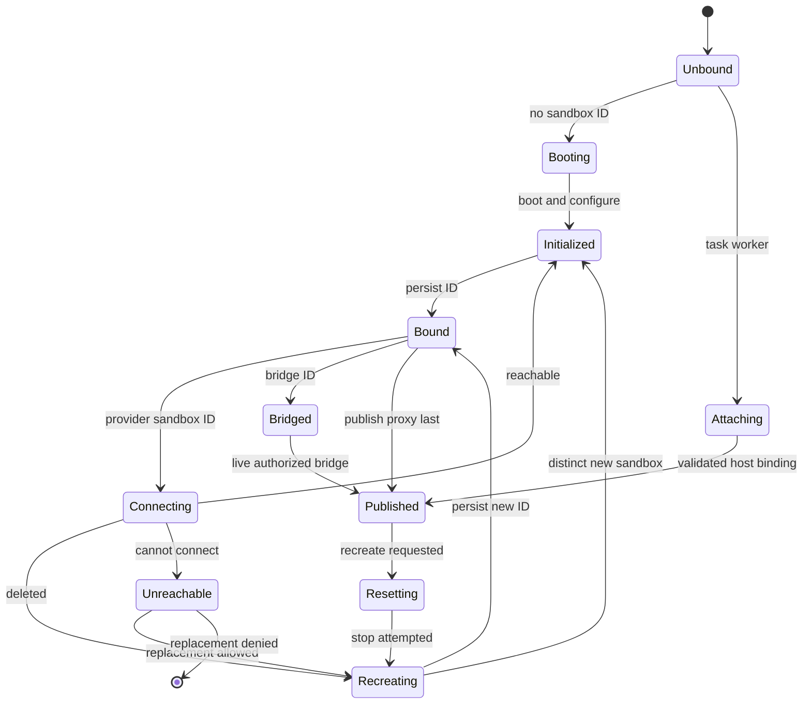

# Thread Sandbox Lifecycle

A thread normally owns a durable sandbox binding. Its `sandbox_id` in live thread metadata identifies the hosted sandbox across workers and runs; the sandbox is where a checkout and uncommitted work can survive. Process-local caches make that binding usable during a run, but are not the source of truth.

The lifecycle also supports two deliberate exceptions:

- A task worker attaches to its task coordinator's sandbox after validating task membership, owner, workspace, visibility, and repository scope. It does not create, replace, or recreate the shared sandbox.
- A `bridge:<id>` binding identifies the owner's connected CLI machine rather than a provider sandbox. It is reached through the bridge queue, not provisioned or credential-configured as cloud infrastructure.

Related: [Agent graph](agent-graph.md), [Workspaces and access](../concepts/workspaces-and-access.md), [Sandbox providers](../integrations/sandbox-providers.md), [Testing overview](../testing/overview.md), and [PR creation](../workflows/pr-creation.md).

## Ownership, durable state, and handles

`get_sandbox_metadata` reads the **live** LangGraph thread rather than run configuration: a queued run may still carry the ID from before a recreate or move. `SANDBOX_BACKENDS` maps a thread to a stable in-process `SandboxBackendProxy`, while `SANDBOX_CONNECTIONS` maps a sandbox ID to a live connection. Publishing a new backend retains the thread proxy and replaces its target, so tools and middleware with the proxy do not retain a stale backend.

The proxy is async-only. Its `a*` filesystem and execution methods resolve the target before delegation; synchronous methods fail. If no target is cached, it uses the run's reconnect callback or loads the durable ID and calls `connect_sandbox`, which recognizes both provider IDs and bridge IDs. A lock and one shared startup task collapse concurrent resolution to one connection attempt; shielding lets cancellation of one waiter leave startup available to other callers. It subclasses `BaseSandbox` so filesystem middleware can use capture-at-source execution; when a backend does not implement offload execution, it explicitly returns the ordinary-execution fallback.

## Provisioning and normal connection

`ensure_sandbox_for_thread` is the hosted lifecycle entry point. The server creates a proxy early, installs this entry point as its reconnect callback, and starts it before the model uses tools. Normal thread dispatch interrupts competing work for the same thread, so the lifecycle relies on that serialization rather than a separate cross-process creation sentinel.

`SandboxCreateConfig.resolve` loads the requested workspace unless `source="base"` was selected. A workspace that inherits defaults resolves to the default workspace. A new hosted sandbox uses the workspace's ready snapshot when present, otherwise the provider's base behavior; it also receives workspace resource sizing and create parameters, plus `preserve_memory_on_stop=True`. Boot overlaps GitHub-token minting with provider creation, then writes bot Git identity while configuring the proxy. When the workspace snapshot was stale, the boot is recorded for the caller and a workspace update is triggered in the background.

*Thread sandbox creation, attachment, connection failure, recreate/reset handoff, and publication. “Resetting” is the `recreate_sandbox` rebind operation; it is not a separate reset API.*

For an existing hosted ID, the lifecycle reuses `SANDBOX_CONNECTIONS` when possible or calls the configured provider factory to reconnect. It reapplies Git identity on every connection because global configuration can be lost. Proxy refresh is also the reachability operation; no separate ping is needed. Creation is bound atomically from the thread's perspective: it finishes boot and initialization, persists `sandbox_id` and any base proxy configuration, completes any pending checkout handoff, provisions the in-sandbox tool URL, and only then publishes the backend. If any earlier step fails, a proxy never exposes the partially initialized sandbox.

## Providers, workspace snapshots, and paths

`create_sandbox` selects a lazily imported factory using `SANDBOX_TYPE`. Supported providers are `langsmith`, `daytona`, `modal`, `runloop`, `e2b`, and `local`. LangSmith alone receives snapshot, resource, and create-body options; coroutine factories are awaited and synchronous wrappers run in `asyncio.to_thread`. Optional third-party provider SDKs are checked at startup with an actionable dependency-group error. LangSmith startup validation also checks its numeric sizing and retention settings and parses extra create JSON before the first request.

LangSmith retries configured transient creation failures. Command retries are narrower: `SandboxRetryableConnectionError` means a gateway rejected the WebSocket upgrade before the command frame was sent, so retry cannot double-execute the command. The generic retry helper performs at most four attempts unless a caller uses its elapsed-time mode, with capped exponential jittered backoff.

Repository code must not assume a provider filesystem root. `resolve_sandbox_work_dir` tries provider-reported work directories, shell `pwd`, provider home/root paths, then `$HOME`, requiring an existing writable directory and caching the winning path. Bridged backends are different: their work directory is already the user's checkout, so repository and checkout resolvers do not append the repository name.

## GitHub proxy and least privilege

Cloud credential injection is LangSmith-specific. At boot and reconnect, the lifecycle mints a workspace GitHub access token scoped no wider than the thread's recorded repository scope, then configures the provider proxy. The proxy sends `Authorization: Bearer` to `api.github.com` and Basic `x-access-token` authentication to `github.com` and its subdomains. The sandbox receives only the placeholder `GH_TOKEN`, satisfying `gh` without placing the real token in its environment or checkout.

The workspace's base proxy configuration is retained in thread metadata and in the worker-local token record. Configuring the proxy replaces Open SWE-managed rules, adds the per-thread tools rule when available, and preserves unrelated custom rules. Retryable transport and HTTP failures are retried; a not-ready response causes a best-effort provider start before a final retry, because a stopped sandbox retains its filesystem.

GitHub App tokens expire. The worker-local record holds expiry, record time, workspace, repository scope, permission scope, and base configuration. Refresh occurs within five minutes of a known expiry, or after 50 minutes when expiry is unavailable. A refresh intersects any requested repositories with the recorded scope and retains recorded permissions unless explicitly supplied, preventing routine rotation from broadening access.

## Failure policy and deliberate recreation

`SandboxGoneError` and `SandboxUnreachableError` have intentionally different meanings:

- **Gone** means the provider confirmed deletion. The stale ID would otherwise permanently reconnect to nothing, so the lifecycle creates and binds a replacement.
- **Unreachable** means this run could not reach or reconfigure an existing sandbox. It is not replaced by default: the box may recover, and a replacement would silently lose the only uncommitted working tree. A failed attempt to make an allowed replacement is normalized to `SandboxUnreachableError`.
- The reviewer passes `allow_replacement=True`. Its checkout is re-derived for each review and reviewer threads outlive individual runs and PR pushes, so refusing replacement could permanently block a PR review. `prepare_review_repo` clone-or-fetches, force-checks out, and verifies the requested head; trusted skills are extracted from the base ref outside the attacker-controlled PR checkout.

At tool execution time, a retryable pre-command gateway failure is returned to the model as a retryable condition. A command-level sandbox operation error remains a normal tool error. A non-transient connectivity failure notifies the user and ends the run rather than repeatedly operating against a dead backend.

`recreate_sandbox` is the explicit rebind tool. It rejects task-worker and bridge bindings, identifies the old sandbox, and attempts to stop it for up to ten seconds when using LangSmith. It then creates a **distinct** new sandbox, persists the new ID and proxy base configuration, swaps the stable proxy target, and provisions the tool URL. A metadata-write failure leaves the old proxy target intact. If the old stop failed, the recreation still succeeds and reports both IDs with a stop-warning result; the old provider resource is not deleted by this flow.

## Bridge moves and checkout handoff

A bridge is a durable registration for one CLI machine. The backend verifies that the bridge is live and that the current run belongs to its owner, then queues execute and file-transfer requests for the CLI. It subscribes before enqueueing, checks liveness while waiting, and translates a closed or unavailable bridge to `SandboxUnreachableError`; it never replaces the user's machine with a cloud sandbox.

Moving a thread between cloud and bridge changes its metadata binding only while the thread is not busy. `handoff_from` records the sandbox being left. On the next `ensure_sandbox_for_thread`, `complete_handoff` connects to that source, packs the branch, unpushed commits, and uncommitted index/worktree changes into a Git bundle, uploads it to the target, and restores the branch and changes. Both sides fetch `origin` first, so already-pushed commits are not copied. The marker is cleared only after successful handoff; a failed move restores the previous metadata binding.

## Focused verification

Focused tests cover proxy lazy reconnect and cancellation, live metadata after a rebind, publish-last failure behavior, provider and path resolution, safe gone/unreachable policy, reviewer recovery, shared-task authorization, recreation ordering, and retry semantics. Bridge tests exercise queued command round trips, close behavior, and owner-only execution. Handoff tests verify that unpushed commits plus modified, deleted, and untracked files arrive on the target while the source working tree remains intact.
