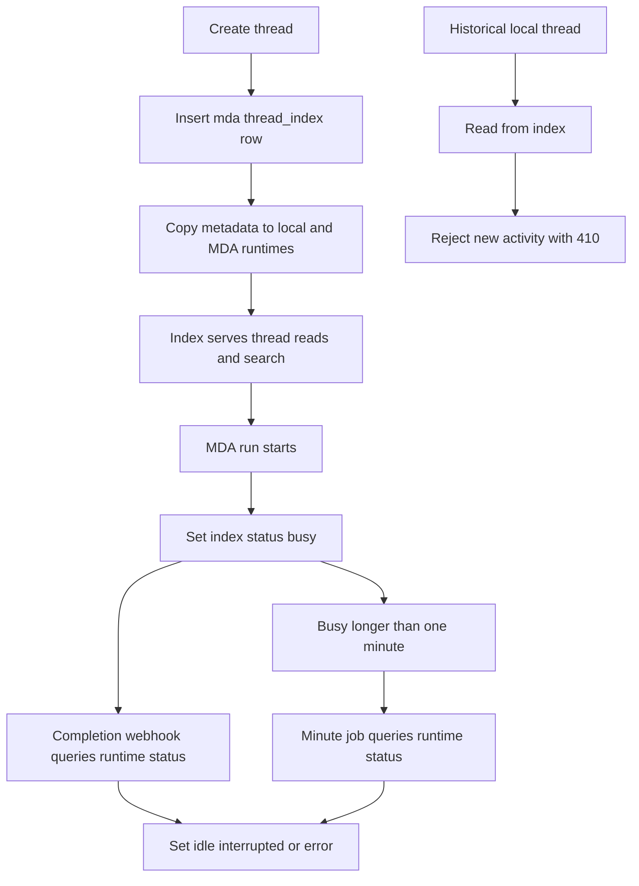
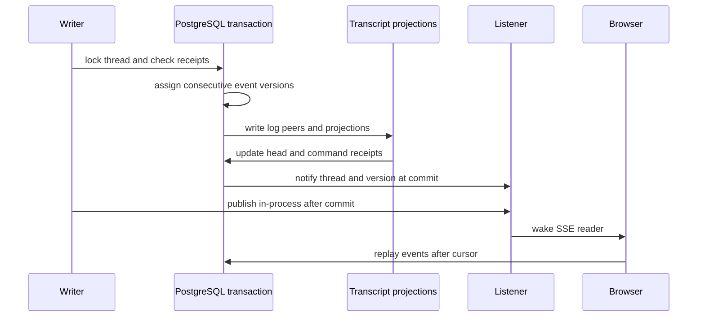
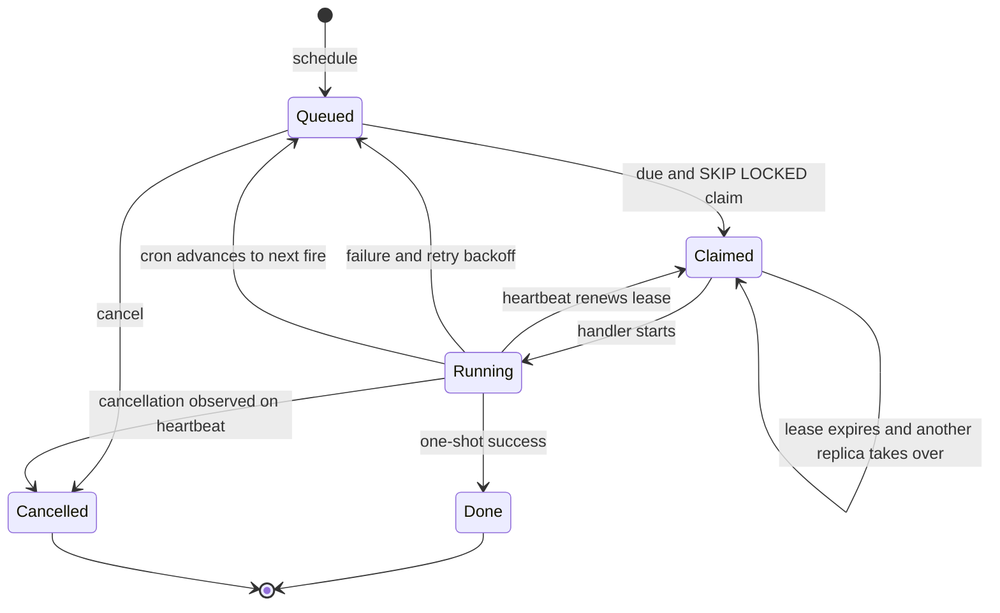

# Persistent State, Transcripts, and Background Processing

PostgreSQL is the durable control-plane store for product records, the Agent Server-compatible thread index, transcript logs and read projections, durable work, analytics, and notification recovery records. Execution state remains with a thread's runtime: Managed Deep Agents (MDA) owns normal runs, checkpoints, sandboxes, and tool calls; a legacy local Agent Server owns only historical local threads. The database index and runtime copies deliberately have different roles.

## Database contract and lifecycle

`POSTGRES_URI` is required at application startup. The database layer accepts PostgreSQL URIs (normalizing `postgres://` and selecting the asyncpg driver), uses the `open_swe` schema before `public`, and exposes async connection, transaction, ORM-session, and read-only helpers. Pool pre-ping and slow-query logging are enabled; the pool sizes and timeout use analytics pool environment settings.

Migrations, **not ORM mappings**, are the schema source of truth. `openswe.database.orm.Base` is only the shared declarative/dataclass base; every mapping must match the migration column-for-column. Startup takes a PostgreSQL advisory migration lock, creates `open_swe` if necessary, and upgrades migrations before listeners or workers begin. This serializes concurrent replicas during deployment. In preview, stale Alembic revision stamps may be pruned only when there is still a known migration chain; an entirely unknown history fails rather than replaying migrations over an existing schema.

Create a schema change with:

```bash
make migration m="Short description"
```

New application tables must follow the repository shape: a Python-assigned `uuid7()` `id uuid` primary key; `created_at` and `updated_at` as `timestamptz NOT NULL DEFAULT clock_timestamp()` with `updated_at` written on every update; and nullable `created_by`/`updated_by` foreign keys to `users(id)` with `ON DELETE SET NULL`. Natural keys use unique indexes rather than primary keys. JSON columns name their actual contents, foreign keys represent database-held references, and a lazily filled referenced row is created first. `thread_index` and `job` were brought into this shape by migration; older transcript and analytics tables predate this convention and should be changed only through considered migrations.

Use `transaction()` for changes and `session()` when ORM persistence is needed. Read paths can use `read_only_transaction()`; it rolls back after the read. SQL supplied by an untrusted caller must use `untrusted_read_only_transaction()`, which also invalidates the connection so session state such as advisory locks cannot leak back into the pool. Multi-query snapshot-plus-live-stream reads use a repeatable-read `snapshot_transaction()` to avoid mixing projections from one point in time with a later event head.

## Thread index and runtime copies

`thread_index` is the PostgreSQL facade for thread listing, search, metadata, and last-known status in Agent Server shape. It has a UUID surrogate primary key and unique `thread_id`; `runtime` is `local` or `mda`, metadata is JSONB, and status is `idle`, `busy`, `interrupted`, or `error`. JSON containment supports metadata filters, while time and partial busy indexes support sidebar ordering and stale-run reconciliation. Its search also derives a title and ranks title matches ahead of other metadata matches, with a bounded recency preference.

The index does not replace the runtime. It stores enough metadata and status to serve thread reads, but runtime services retain runs, checkpoints, streams, state/history, and a metadata copy used by their runs and traces. A new thread is indexed as `mda`, then copied to both the local Agent Server and MDA. Index reads remain available if a best-effort metadata-copy operation fails. A legacy `local` index entry is readable but has no new activity path: its successor MDA ID is selected for activity, and the router rejects attempts to start a run, cron, posting command, or copy the original local thread.



This is the durable thread lifecycle: PostgreSQL serves the compatibility view while the selected runtime remains authoritative for execution state.

Thread writes use ordering safeguards appropriate to a replicated facade. Importing runtime threads accepts a runtime row only when it is newer than the index entry. Synchronizing one thread obtains a transaction advisory lock before reading its runtime copy, so a stale reader cannot write after a newer one. Status is marked busy when a run starts; the completion webhook asks the owning runtime for the terminal status. A standing once-per-minute job queries threads busy for more than one minute, recovering from an absent completion webhook without overwriting a just-started run. Startup also imports Agent Server threads once: a claim prevents concurrent imports, and the index-current claim is written only after all pages finish, so an interrupted import is retried on the next start.

## Transcript log, projections, and streaming

The transcript is a separate durable model keyed by `thread_id`. Its `thread_event` append-only log is the source of truth; `thread` holds the per-thread head version and mirrored runtime metadata, while turns, messages, tool calls, and checkpoints are disposable projections for efficient UI reads. The mirror lets transcript authorization and snapshots avoid calling LangGraph. Events are typed, discriminated payloads with a schema version and user, agent, or system actor; wire events never embed attachment bytes.

`append()` is the only log writer. It acquires a per-thread advisory lock, checks command receipts, assigns consecutive versions to new commands, writes events plus attachments/full tool output, applies projections, records receipts, advances the thread head, and executes `pg_notify` in one transaction. Thus committed versions are gapless per thread; a subscriber notified of version *n* can read it, and replay from `version > after` is well defined. The first non-replayed event must be `thread.created`. A repeated command ID returns its original version rather than duplicating a side effect, including duplicates in a single batch.



This sequence shows the commit ordering behind transcript SSE: notifications carry only an ID and version, while clients read durable rows themselves.

Attachments and complete tool output are peers of the event log, written in the same append transaction but fetched separately. The event carries attachment metadata and a bounded tool-output preview; the full output table is retained on projection rebuild. Message fragments append to a projected message, then a `message.completed` event replaces that accumulation with canonical content, which repairs missed fragments.

Snapshots read projections rather than folding the log and use one repeatable-read transaction, producing a consistent head, turns, messages, tool calls, and notices. The newest-turn window is keyset paginated; if a requested replay exceeds 1,000 events or 8 MiB, callers should receive a fresh snapshot instead. Rebuilding a thread takes the same per-thread lock as append, deletes projection rows, restores the thread row from `thread.created`, and replays events in version order. It does not move the log head, publish a change, or delete attachments/tool-output peers.

Transcript listeners share the process-wide PostgreSQL LISTEN connection. Local publication after commit avoids a round trip for same-process readers; cross-replica changes arrive through `open_swe_thread_events`. If the connection is unavailable, local readers still receive in-process events but changes from another replica become quiet. On reconnect, the listener reads each subscribed thread head and publishes it (or a deleted marker), allowing version-based readers to catch up. Subscriber queues preferentially retain the newest notification because versions are reread from storage.

## UI invalidations and notification recovery

UI invalidations are deliberately hints, not state replication. A changed database transaction calls `invalidate()` last, inserting one `ui_invalidation` row per distinct topic and issuing `pg_notify` on `open_swe_ui_invalidations`; notification delivery therefore occurs only after commit. The hub routes a topic to local open streams, which refetch the affected resource. For a write outside PostgreSQL, `invalidate_standalone()` is fail-soft: the primary write is already complete, so a missed invalidation costs refresh latency rather than failing it.

The invalidation outbox retains rows for one day and is pruned hourly by the hub. When the shared listener reconnects, the hub asks which subscribed topics changed during its outage plus a 30-second margin; if the gap reaches retention, it treats the topic as invalidated because it cannot prove no change occurred. This makes cross-replica freshness recoverable without attempting to replay arbitrary data through notification payloads. The common listener reconnect loop backs off from 0.5 seconds up to 30 seconds, isolates malformed channel handlers and failed catch-up handlers, and preserves other channels when one fails.

## Durable jobs and leases

The `job` table holds one-shot and cron work outside Agent Server runs. A job contains a kind, JSON payload, due time, optional cron/timezone, optional unique replacement key, JSON metadata, attempts, a lease deadline, and a claim token. A keyed `schedule()` is an upsert: by default it replaces payload, schedule, and active claim; `replace=False` leaves the existing job untouched. Callers should make handler effects idempotent because an expired lease can allow another replica to run the same work.



This is the durable job lifecycle. Claiming uses `FOR UPDATE SKIP LOCKED`, a 30-minute lease, and a new claim token, so replicas can poll concurrently without normally sharing a job. Completion, retry, stop, and renewal predicate their write on that token: a run replaced under the same key cannot delete, reschedule, or renew the replacement. The worker has at most 20 in-flight handlers, polls every 0.25 seconds after finding work and every five seconds when idle, and renews active claims every ten seconds.

A missing kind, handler exception, or failed one-shot handler retries with exponential backoff from 30 seconds up to one hour; it is dropped after five attempts. Cron failures advance to the next scheduled fire rather than retrying the same fire. On shutdown a handler is cancelled and its durable job is not finalized; another worker can claim it after the lease expires. A lease-renewal database failure is logged and treated as temporarily held, so the current worker can continue until the existing lease lapses; consequently handlers must tolerate possible takeover. Job startup imports legacy crons and threads, starts the merge queue, and ensures the thread-status reconcile cron exists; each startup step is independently logged rather than preventing the worker from polling.

Handlers are registered centrally in `openswe.jobs.kinds`. This is the extension boundary for durable work: define a kind, validate the expected payload, and register an async handler. The scheduled-agent handler additionally uses a two-day event claim keyed by job and due time to avoid duplicate launches after a crash or deploy. The wake-thread handler intentionally does not retry, because a run could have been started before its caller observed an error.

## Analytics pipeline

Analytics capture is intentionally non-blocking for product flows. Emitter helpers derive opaque identifiers, build versioned event envelopes, and enqueue each event idempotently into PostgreSQL `outbox`; most product-facing emitters are `fail_soft`. The analytics worker claims up to 50 due records using `SKIP LOCKED`, marks them delivering with a five-minute stale-lock takeover rule, ingests the envelope, and acknowledges it. Failed delivery is returned to pending with jittered exponential delay, or becomes `dead_letter` after `ANALYTICS_OUTBOX_MAX_ATTEMPTS` (default 10). Delivery is therefore at-least-once and ingestion must retain its own idempotency behavior.

The event store is partitioned by occurrence time, retains immutable event rows, and drives projections and dirty daily summary partitions. The analytics worker also recomputes up to 20 dirty partitions per iteration and runs retention hourly. Startup loads workspace reporting configuration, activates reporting, and starts that worker as a best-effort unit: failure logs a warning rather than preventing the API from serving.

## Application startup, degradation, and safe changes

The FastAPI lifespan validates critical GitHub-login, sandbox, local-model, MDA, and database configuration, runs migrations, removes obsolete analyzer crons, and syncs configured admins. It then starts analytics, transcript listening, sandbox bridge listening, and the UI invalidation hub independently and fail-soft; it starts the shared database listener and job worker, then attempts an agent-build warmup. Shutdown stops jobs, hubs/listeners, analytics, HTTP clients, and finally disposes the database engine.

Operationally, distinguish fatal persistence prerequisites from degraded notification services:

- No configured PostgreSQL is fatal at app startup; schema migrations occur before consumers start.
- Analytics failure loses or delays observability, not user operations; its outbox preserves accepted events for later delivery.
- A failed transcript listener affects only changes made by another replica until it reconnects; same-process publishes continue and reconnection resyncs subscribed heads.
- A failed bridge or invalidation listener similarly leaves local activity and direct page actions working, but cross-replica updates stop arriving until recovery. Invalidations are refetch hints, so the UI may be stale rather than incorrect.
- Job shutdown, process death, and lease expiry can re-execute work. Persist the business-level idempotency claim before irreversible effects, and do not assume a handler ran exactly once.

Focused real-schema tests protect these boundaries: `tests/database/test_postgres_read_only.py` verifies read-only and untrusted-session cleanup; `tests/threads/test_thread_index.py` covers index shape, filtering, ordering, synchronisation ordering, and stale-busy detection; `tests/threads/test_thread_status.py` covers runtime reconciliation and reviewer invalidation; and transcript engine/rebuild tests exercise gapless/idempotent append, first-event validation, projection repair, and preservation of sidecar tool output. See also [System Architecture and Deployment Boundaries](./overview.md), [User Surfaces](../integrations/user-surfaces.md), [Testing Strategy](../testing/strategy.md), [Background Automation](../workflows/background-automation.md), and [Invocation and Thread Routing](../workflows/invocation-and-thread-routing.md).
