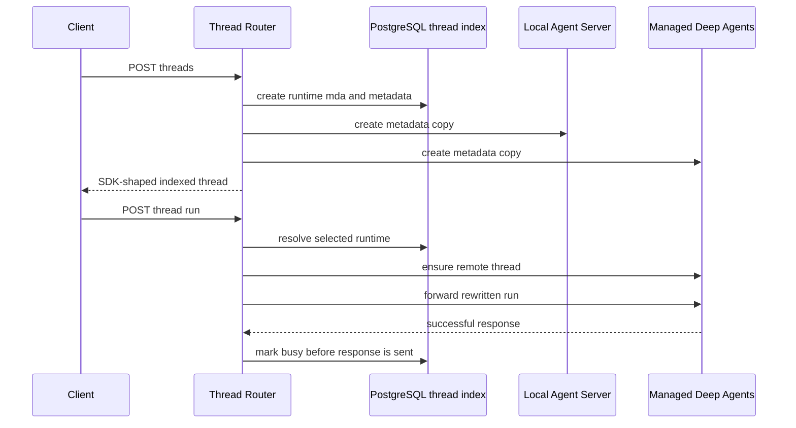
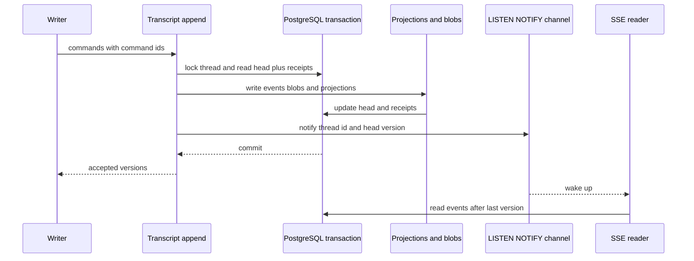

# Thread routing, run state, and transcripts

Open SWE deliberately has **two PostgreSQL views of a thread**, with different jobs:

- The **thread index** (`thread_index`) is the system-facing directory: metadata, selected runtime, timestamps, and the last known run status. It serves the compatible LangGraph `/threads` API for backend calls, including search and count.
- The **transcript** (`thread`, `thread_event`, and projections) is an event-sourced dashboard conversation view. Its immutable, ordered events and derived tables make a conversation cheap to render and stream without reading LangGraph.

Neither store replaces execution ownership. The runtime—Managed Deep Agents (MDA) for new threads, or the local Agent Server for legacy threads—owns runs, checkpoints, streams, history, and graph state. Metadata is copied to runtimes for run traces, but the index is the public read/search directory. The transcript mirrors the subset of thread metadata needed for dashboard authorization and presentation; it is not a LangGraph checkpoint store.

Related: [Managed Deep Agents runtime protocol](managed-runtime.md), [Threads, Durable Runs, and State](../concepts/threads-and-state.md), and [Dashboard and Desktop Clients](../integrations/dashboard-ui.md).

## Ownership at a glance

| Concern | Owner / durable location | What it is for |
| --- | --- | --- |
| Discovery, metadata filters, sidebar search, selected runtime, last known status | PostgreSQL `thread_index` | Compatible `/threads` reads, writes, search, and count |
| Thread metadata copies | Local Agent Server and, for MDA threads, MDA | Context for runs and traces; not the public directory |
| Runs, checkpoints, commands, runtime history, and native event streams | The selected LangGraph runtime | Execution and graph state |
| Dashboard transcript, turns, messages, tool-call presentation | PostgreSQL event log plus projections | Snapshot, paging, live transcript stream, and authorization without LangGraph |
| Large attachment bytes and full tool output | PostgreSQL side tables written with the event | Keeps replay payloads small while preserving durable content |

The two PostgreSQL models even use different status vocabularies. Index status is `idle`, `busy`, `interrupted`, or `error` and tracks runtime activity. Transcript status is projection state for the rendered conversation (`idle`, `running`, or `error` in the transcript schema). Do not infer one from the other or use a transcript row to decide whether a LangGraph run may start.

## Thread index and runtime routing

`ThreadRouter` is ASGI middleware placed ahead of the core Agent Server `/threads` and `/runs` routes. It authenticates and intercepts backend calls, preserving the SDK-shaped API while answering thread CRUD, search, and count from PostgreSQL. Requests marked with `x-openswe-local-runtime`, non-routed requests, and calls that are not backend calls pass through to the Agent Server, whose normal authorization rules then apply.

A created thread is indexed as `runtime: "mda"`, stamped with the MDA runtime metadata, and copied to both the local Agent Server and MDA. The copies let either service associate metadata with its traces; index reads do not depend on their availability. A metadata patch merges keys into the index first, then is best-effort copied to all relevant runtime copies. Failure to copy is logged rather than failing the directory read/write.

Diagram: new threads are indexed and copied, while their run is routed to MDA.

### Runtime selection, compatibility, and state boundaries

For an indexed MDA thread, runtime-specific endpoints are forwarded to MDA after `ensure_remote_thread`. Run requests are rewritten for the MDA graph: the configured graph is selected from thread metadata, the external assistant becomes MDA's `open-swe` graph, configurable data becomes signed context, and the local tracing project is supplied when the caller did not give a tracer. This is the routing boundary described in the managed-runtime page, not a second graph-state implementation.

A previously local thread remains readable. Its runtime-specific non-posting calls continue to reach the local Agent Server and are logged as legacy usage. It is intentionally **read-only for new activity**: creating a run or cron, starting/posting commands (`run.start`, `input.respond`, `input.inject`, `state.fork`), and copying it return HTTP 410. Starting a new thread avoids splitting an old conversation's runtime history across local and MDA runtimes.

An index miss is not automatically a 404: the router first asks the local Agent Server for the thread, indexes a valid result, and serves it. `sync()` additionally serializes syncs of the same ID with a transaction advisory lock so an older runtime read cannot overwrite a newer one; it preserves index status because MDA run status is not necessarily visible to the local Agent Server. `import_newer()` similarly refuses to replace a newer index record with an older runtime copy.

The index's `as_langgraph()` response intentionally supplies empty `values`, `interrupts`, and `config`. Those fields are present for client compatibility, not replicas of the runtime's state. Code needing values, history, streams, checkpoints, commands, or a run error must use the selected runtime rather than extending `thread_index`.

### Search and operational shape

The index schema stores JSONB metadata with a GIN index plus created/updated and busy-status indexes. Search supports metadata containment, IDs, status, pagination, selected SDK fields, and an Open SWE text parameter. Text matching covers title and repository/PR-related metadata; title matches rank above other metadata, with recency decay. Search results are therefore a dashboard/discovery index, not a query over message or checkpoint content.

PostgreSQL must be configured for the index and transcript features. The shared database layer normalizes PostgreSQL URI schemes, uses `asyncpg`, sets the `open_swe` schema search path, configures pool health checks and limits from `ANALYTICS_POOL_SIZE`, `ANALYTICS_POOL_OVERFLOW`, and `ANALYTICS_POOL_TIMEOUT_SECONDS`, and logs queries exceeding `POSTGRES_SLOW_QUERY_MS`. Startup migration obtains an advisory transaction lock before creating/upgrading the schema.

## Busy state is optimistic and reconciled

A successful MDA run creation marks the indexed thread `busy` before the success response reaches the caller. The ordering closes a race in which a very fast completion webhook would settle the thread and a late router write would incorrectly return it to busy. A successful protocol-v2 `run.start` command follows the same rule. Cron creation does not mark a thread busy at request time.

The index is a last-known status cache, not the authority on completion. The completion handler calls `refresh_thread_status()`, which asks the indexed thread's selected runtime and writes its reported status back to the index. If that call fails, completion continues and logs a warning; recovery is delegated to the scheduled reconciliation job. Once a minute, `thread_status_reconcile` selects threads that have remained busy for more than one minute, asks each owning runtime again, logs individual failures, and counts threads settled away from busy.

This means a transiently stale `busy` indicator is an expected failure mode, not evidence that the graph is still executing. The runtime is the authoritative source for the terminal state and latest run error.

## Transcript: an event log for dashboard reads

Transcript recording is opt-in per thread through `metadata["transcript"] == "v2"` and only occurs when PostgreSQL is configured. Dashboard thread creation first creates the ordinary LangGraph thread, then appends the initial `thread.created` event with a mirror of that thread's metadata. Without PostgreSQL, the thread is not stamped and callers continue on the LangGraph read path.

`thread_event` is the transcript source of truth. The `thread` head row holds its last version and mirrored metadata; `thread_turn`, `thread_message`, `thread_tool_call`, and checkpoint-related tables are projections optimized for rendering rather than alternative authorities. Attachment bytes and complete tool output are durable peers of the log, written transactionally but kept out of replay payloads; events carry attachment references and tool-output preview metadata.

The transcript is intentionally not a universal copy of all LangGraph state. It provides the dashboard's conversation/turn presentation and independent access check. LangGraph/MDA still own graph values, checkpointer state, native streams, command execution, run history, and runtime lifecycle.

### Append invariants

`transcript.engine.append()` is the only writer. It takes a per-thread PostgreSQL advisory transaction lock, looks up accepted command receipts and the current head, and assigns increasing versions only to new commands. A thread without a transcript accepts no first event other than `thread.created`.

Diagram: events, projections, receipts, the head, and the wake-up notification commit as one unit; the reader treats notification as a prompt to query durable rows.

The resulting guarantees are:

- **Gapless per-thread ordering:** newly accepted commands receive `head + 1 ...`; `(thread_id, version)` is the event primary key, and readers resume with `version > after` in ascending order.
- **Idempotency:** a `(thread_id, command_id)` receipt returns the version previously produced, so replaying a command produces no duplicate event. Duplicate IDs within one batch append only the first occurrence and report that same version for each occurrence.
- **Atomic presentation:** the event, projections, attachments/tool output, receipt, updated head, and `pg_notify` call occur in one transaction. A notification-driven reader cannot observe a notified version before it is committed.
- **Deletion resets deduplication:** deletion takes the same lock, deletes the transcript (with cascaded event/projection/blob rows), explicitly removes receipts, and emits a deletion notification. Removing receipts matters if a transcript is recreated under the same thread ID.

The focused integration tests use a real migrated schema to verify consecutive versions, replayed-command receipt behavior, duplicate command IDs in one batch, and the rejection of non-creation writes to an untranscribed thread.

## Dashboard read and live-stream path

The dashboard mounts transcript endpoints under `/dashboard/api`. They never call LangGraph. A request opens a repeatable-read, read-only PostgreSQL snapshot; it loads the transcript metadata mirror and applies the same thread-readability predicate used by LangGraph-backed endpoints. Authorization and the guarded snapshot/page read therefore see one database instant. A missing transcript returns `404 transcript_unavailable`, allowing a client to fall back to its legacy read path.

The principal endpoints are:

- `GET /threads/{thread_id}/transcript` returns a newest-turn window, associated messages/tool calls/notices, head version, and an `older_cursor`.
- `GET /threads/{thread_id}/transcript/turns?before=...` keyset-pages immutable older turns. A cursor that is invalid or names another thread is rejected rather than silently duplicating a page.
- `GET /threads/{thread_id}/transcript/events?after=N` is the replay-then-live SSE feed.
- Tool output and attachment endpoints authorize in the same way; attachments are served with private immutable caching, `nosniff`, a restrictive CSP, and a sanitized inline filename.

For live SSE, the server registers its subscription **before** it replays durable events, eliminating a subscribe/replay gap. It sends events after the requested version, then `synchronized`, and on each wake-up drains pages until caught up. When the gap is too large, it sends a current windowed `snapshot` frame instead of an expensive full replay; older completed turns remain immutable and can stay in the client cache. Heartbeats keep idle connections alive. Each live page re-checks access, ending with `revoked` if visibility changed or `deleted` if the transcript disappeared rather than leaking subsequent events.

`pg_notify` contains only `thread_id:version`, never event content. The shared listener distributes it to process-local subscriber queues; an in-process publish reduces common-case latency. Lost notifications cannot lose data because readers fetch by version. On a listener reconnect, the service re-reads the durable head of each subscribed thread and publishes that head (or the deletion sentinel), which causes clients to catch up from PostgreSQL.

## Change and operations guidance

- Keep routing changes separate from transcript changes. Adding a field needed for search/status belongs in `thread_index`; adding a durable dashboard event belongs in the event schema and projection pipeline. Neither is a substitute for runtime state.
- Do not route stateful work based on a metadata copy alone. Use the index's runtime selection, then call that runtime for execution-state reads or mutations.
- Preserve command IDs when retrying transcript-producing work. Generating a new ID changes an idempotent retry into a new event.
- Treat notifications as lossy wake-ups, not delivery. Correct consumers always read `version > after` from the database.
- When deleting a dashboard thread, delete both the LangGraph thread and its transcript. The transcript's metadata mirror otherwise remains an independently authorizable record.
- Investigate persistent busy threads through the owning runtime and completion webhook delivery, then check the per-minute reconciliation job and database connectivity. Do not manually settle status from transcript state.

## Focused test coverage

`tests/threads/test_thread_router.py` exercises the externally important router behavior: index-served CRUD/search/count, first-read import from the local Agent Server, MDA run forwarding and busy marking, local-thread HTTP 410 refusals, graph selection/context rewriting, copying/deleting runtime copies, and backend-only index handling under custom authentication.

`tests/transcript/test_engine.py` exercises actual SQL append invariants rather than an in-memory substitute. The broader transcript test suite covers projections, windowing, isolation, and rebuild behavior. Together these tests are the safest starting point for changes to ordering, idempotency, snapshot/stream consistency, or transcript schema evolution.
