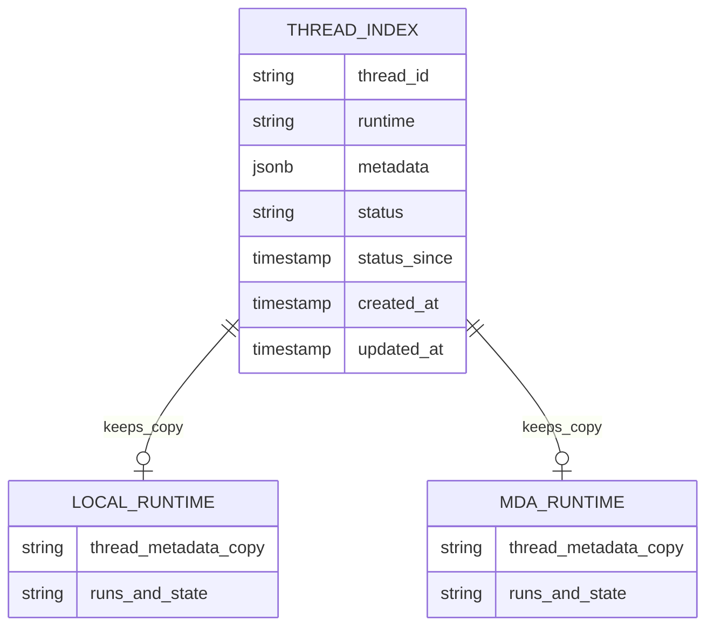
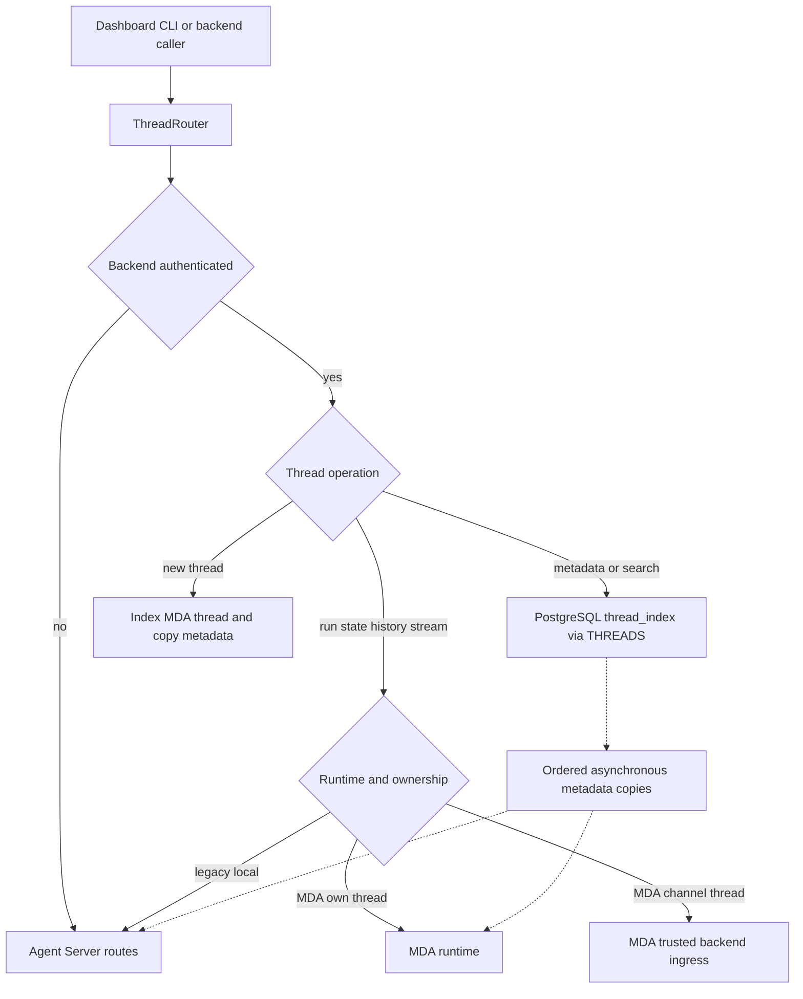
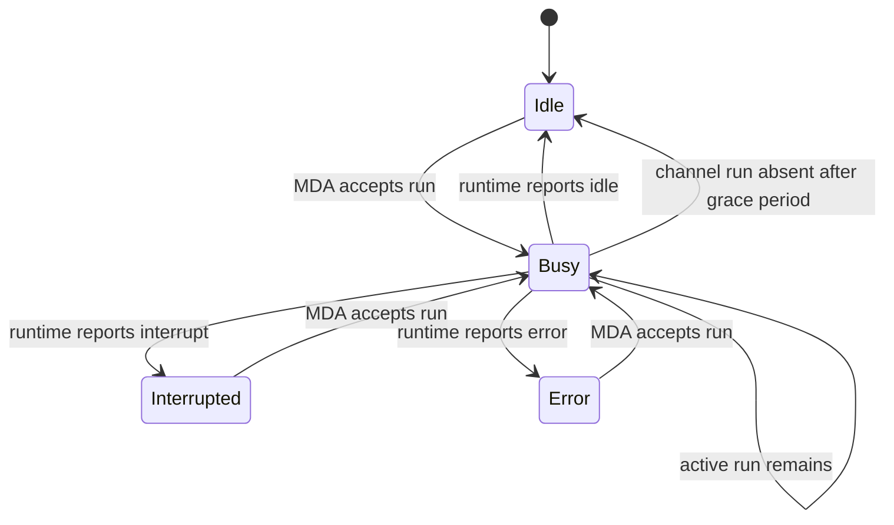

# Thread Indexing, Routing, and Runtime Ownership

A thread has two deliberately separate concerns:

- **PostgreSQL `thread_index` is the backend authority for thread discovery and product metadata.** It supplies the Agent Server-shaped thread API: identity, metadata, timestamps, and last known status.
- **The selected runtime owns execution data.** MDA owns runs, checkpoints, conversation state, commands, and streams for current threads. The deployment-local Agent Server retains those things only for pre-MDA (`local`) compatibility threads.

This split gives the dashboard, CLI, and backend callers one thread API without treating an Agent Server or LangGraph Store as the backend's system of record. Read or mutate thread metadata and state through `THREADS` (`openswe/threads/store.py`) and the PostgreSQL index; do not add backend uses of a LangGraph SDK client or `client.store` as a new persistence path.

## Data ownership and index behavior

`thread_index` records `thread_id`, runtime (`mda` or `local`), JSONB metadata, a status (`idle`, `busy`, `interrupted`, or `error`), `status_since`, and creation/update times. Its metadata GIN index supports containment filters, while the busy partial index supports repair of threads that remain busy. The index intentionally returns empty `values`, `interrupts`, and `config` in its Agent Server-compatible representation: those are runtime state, not indexed thread state.

This diagram distinguishes indexed product data from runtime-owned execution data. An MDA thread normally has metadata copies in both runtimes; a channel-owned MDA thread has only the local trace copy because its remote conversation remains channel-owned.

### Index invariants

- New backend-created threads are always indexed as `mda` and receive `runtime: "mda"` metadata. They are created in PostgreSQL first and copied to the local and MDA runtimes. If the thread belongs to a channel, the backend does **not** create it at MDA; the channel creates its own remote conversation.
- Metadata patches merge top-level keys in PostgreSQL and advance `updated_at`. Runtime metadata copies are asynchronous and serialized per thread, so an older copy task cannot overtake a newer one. A failed copy is logged rather than changing the successful index response.
- Deletion waits for already-started metadata copies, deletes runtime copies in reverse order, then deletes the index row. A thread known only to the local Agent Server is imported on first `THREADS.get`, preserving its timestamps and runtime classification.
- Search and count execute against PostgreSQL. They support metadata containment, ids, status, sorting, pagination, selectable fields, and dashboard text search. Text search covers the derived title and relevant repository, branch, PR, and nested metadata; title matches rank ahead of other matches and recency breaks otherwise similar matches.
- Synchronization from an Agent Server is guarded by a per-thread PostgreSQL advisory transaction lock and retains the index status. This prevents a slow old read from overwriting a newer synchronization and avoids letting an Agent Server status replace MDA-run status.

## Agent Server compatibility router

`ThreadRouter` is authenticated ASGI middleware in front of the core `/threads` and relevant `/runs` routes. Backend-authenticated callers receive index-backed create, get, patch, delete, search, and count semantics; unhandled or non-backend traffic reaches the normal Agent Server. The router identifies its own local-runtime calls with `x-openswe-local-runtime` so they do not recurse through itself.

This routing flow shows that the index answers thread records, while runtime endpoints answer execution data. A `local` route is compatibility-only, not an alternate backend persistence design.

When forwarding an MDA run creation, the router rewrites the payload for graph `open-swe`: it turns `config.configurable` into signed remote context, retains allowed run metadata, and adds the MDA graph id. For a known indexed thread, it permits MDA to create a missing remote copy in the same run request. The successful response is recorded as `busy` before it is returned; if a stop occurred while MDA was still assembling the run, the router cancels the returned run id. This closes the start/stop race.

### Read and write scopes on MDA

MDA has distinct clients for the backend:

| Action | Scope and path | Reason |
|---|---|---|
| Read a thread, state, history, runs, or stream | MDA read client with `x-auth-scheme: langsmith` | The backend can inspect its own threads and conversations owned by an MDA channel, as Studio can. |
| Create/update/delete backend-owned threads and start ordinary runs | backend-scoped MDA write client | Backend writes stay limited to threads it owns. |
| Start, answer an interrupt, or cancel in a channel conversation | MDA trusted-backend ingress headers | The write remains in the channel's existing conversation and may name the sender's resolved principal. |

A channel write requires `MDA_SERVICE_SECRET` and a remote owner shaped as `mda:source-thread:<provider>:<conversation key>`. The runtime caches this resolved conversation identity with a bounded LRU cache and sends the ingress secret, source provider/key, and either the person's Agent Auth principal or the channel service identity. Failure to obtain those credentials or ownership information refuses the write rather than silently creating a differently owned thread.

## Thread classes and write rules

### MDA threads

All new threads are MDA-backed. Their metadata has an MDA runtime marker; their execution is on MDA's `open-swe` graph. The local Agent Server may retain a metadata copy for traces, but it is not the source of thread reads or MDA execution state.

### Legacy `local` threads

A `local` entry represents a thread made before the MDA transition. It remains readable so historical conversations work, and accesses log a warning for operational visibility. It is otherwise read-only: starting a run or cron, copying it, and posting commands that add activity return `410 Gone` with a message to start a new thread. `live_thread_id` derives an MDA successor id for new activity, while `current_thread_id` reads that successor once it exists; this supports a non-destructive continuation path instead of reviving local execution.

### Channel-owned conversations

Thread metadata with a nonempty `channel` identifies an MDA channel-owned conversation (for example Slack, Linear, or GitHub). The channel is the conversation owner and normally starts its own runs. The backend therefore refuses general writes, copies, and crons with `409 Conflict` and directs the user to continue in that channel.

There are narrow intentional exceptions: a run, interrupt answer, or cancellation can be forwarded through trusted-backend ingress so a dashboard action continues the same channel conversation. Read-only commands use the Studio-style MDA reader. Metadata changes to a channel thread are copied to the local trace runtime only, never patched into MDA's channel-owned copy. Channel run metadata is filtered to MDA-accepted, non-reserved keys; sender identity and authority come from the run token and ingress principal rather than caller-controlled metadata.

## Busy status and settlement lifecycle

The index records a useful, durable **last known** status; it is not an attempt to duplicate the runtime scheduler. `status_since` changes only when the status changes, making the age of a busy mark meaningful. A start marks the thread busy only once MDA has accepted the run (or when a channel's run is ready), and terminal settlement asks the runtime what state the thread actually ended in—idle, interrupted, or error.

This is the indexed-status lifecycle. MDA is authoritative for the final runtime status; the index is refreshed at completion and by reconciliation.

1. A routed MDA run response marks its index row `busy`. Command-protocol `run.start` does the same after a successful MDA response. A channel starter calls `channel_run_starting` only after the run is ready, so a failed assembly does not leave a false busy marker.
2. Durable dispatch attaches a completion webhook only when `RUN_COMPLETE_WEBHOOK_SECRET` is set and `COMPLETION_WEBHOOK_URL` is an absolute, non-loopback URL. The webhook bearer token is checked with constant-time comparison and fails closed if the secret is absent.
3. On completion, the handler refreshes the index status from the thread runtime before it performs best-effort downstream work. It also settles the transcript turn as completed, interrupted, or failed; duplicate middleware and webhook settlements share receipt-based idempotence.
4. The once-per-minute `thread_status_reconcile` job rechecks entries busy for more than one minute. It leaves threads busy when MDA cannot yet report a channel conversation, but after ten minutes treats a missing channel run as idle. Individual refresh failures are logged and do not abort the sweep. A separate stale-run reconciliation sweep cancels `pending` runs older than its configured age on busy threads when a completion signal was lost.

Completion is deliberately resilient: if status refresh fails, the completion handler continues with telemetry, transcript, worker, notification, and follow-up handling; the status job repairs it later. Conversely, a status refresh does not claim that all downstream completion effects succeeded.

## Operations and safe extension points

**For product thread changes**, use `THREADS.get/create/update/delete/state/command` rather than direct SDK thread calls. `ThreadStore` centralizes index-first reads and metadata-copy behavior, including runtime-specific graph metadata. Use `index` only for lower-level index operations that genuinely need its transactional primitives, such as atomic metadata queue entries.

**For a new router-visible operation**, classify it before forwarding:

- Is it an index operation, a runtime read, a runtime write, a run start, a cancel, or a command?
- Does it add activity to a legacy local thread? Refuse it.
- Can a channel-owned thread allow it? Read-only access is safe; starts, interrupt answers, and cancels require trusted ingress; other writes must be refused.
- Does it require the MDA run token? Route it through `MdaRuntime.run_payload` or command-run handling so context is signed and graph/configuration rules stay consistent.

Do not introduce a backend LangGraph Store state path or new backend LangGraph SDK-client usage. MDA owns its own run/checkpoint state, while PostgreSQL owns backend thread metadata/status and other durable backend state.

## Configuration and operational diagnosis

The runtime boundary requires `MDA_RUNTIME_URL` and `REMOTE_RUNTIME_TOKEN_SECRET` at backend startup. MDA API access uses the configured runtime key. Channel continuation additionally depends on `MDA_SERVICE_SECRET`; without it, writes to channel-owned conversations are intentionally refused. Completion effects require both `RUN_COMPLETE_WEBHOOK_SECRET` and a public absolute HTTPS `COMPLETION_WEBHOOK_URL`; unsafe relative or loopback URLs disable webhook attachment rather than breaking run creation.

Useful symptoms and their likely owner:

| Symptom | Check |
|---|---|
| Thread missing from dashboard search or metadata patch appears lost | PostgreSQL `thread_index` and `THREADS` path, not MDA checkpoint state. |
| Thread is permanently busy | Completion webhook configuration/delivery, then the `thread_status_reconcile` job and MDA runtime status. |
| Channel thread rejects a dashboard action | Whether it is an allowed run/answer/cancel and whether ingress secret/remote channel owner can be resolved. |
| Local historical thread cannot continue | Expected `410` compatibility behavior; create or follow the MDA successor instead. |
| MDA has a run but index did not become busy | Inspect router/command busy-update logging; completion and reconciliation are the backstops. |

## Focused verification

The most valuable focused tests are under `tests/threads`:

- `test_thread_index.py` verifies Agent Server-shaped index records, JSONB metadata merge, filters/sort/pagination, text ranking, status clock behavior, and serialization of concurrent syncs.
- `test_thread_router.py` exercises index-first routing, MDA creation and busy marking, local-thread refusal, channel adoption, trusted ingress, scope separation, refusal modes, metadata-copy rules, and cancellation races.
- `test_thread_status.py` covers stale-busy runtime settlement, channel grace behavior, and reviewer UI invalidation; `test_mda_runtime_auth.py` asserts Studio-style reads versus backend-scoped writes.

These tests protect the ownership boundaries and failure recovery paths, not merely individual HTTP handlers.
