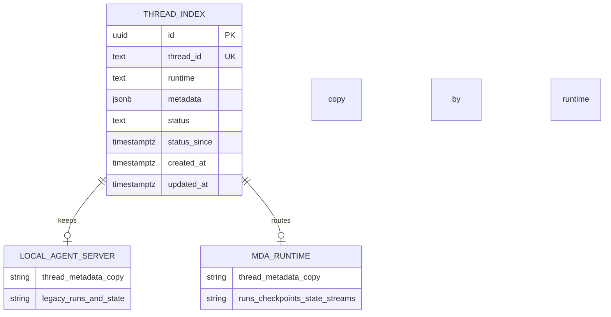
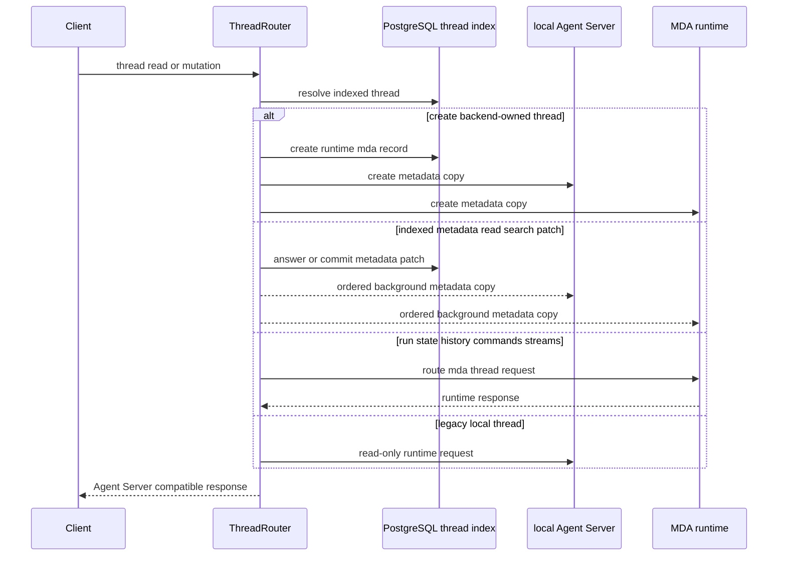
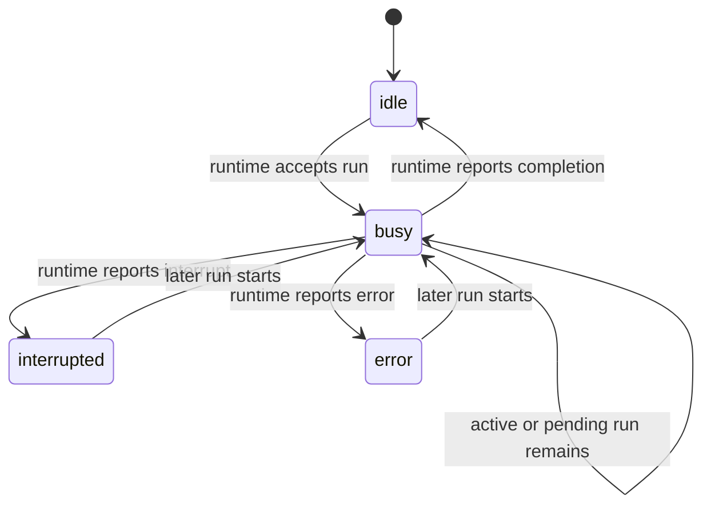

# Threads, runs, and durable state

Open SWE separates the **directory of a conversation** from the system that executes it. PostgreSQL is the durable, backend-owned thread index used for thread reads, listing, search, metadata updates, and last-known status. The selected runtime owns mutable execution data: runs, checkpoints, state, history, commands, streams, and the sandbox. New agent, reviewer, and review-scout threads run on Managed Deep Agents (MDA); `local` is a compatibility classification for pre-MDA Agent Server threads.

This split makes the backend horizontally safe. New state that must survive or be shared across calls belongs in MDA run state or PostgreSQL—**never in backend process memory**. In-process structures may coordinate a request or cache an optimization, but cannot be the source of durable cross-call behavior.

## Ownership and durable representations

`thread_index` is the PostgreSQL control-plane record. It has an internal UUID primary key and a unique Agent Server `thread_id`, plus:

- `runtime`: `mda` or `local`;
- JSONB `metadata`, the durable searchable/displayable thread description;
- a derived/indexed status: `idle`, `busy`, `interrupted`, or `error`, with `status_since`;
- creation and update timestamps.

The schema has a JSONB GIN index for metadata queries, timestamp indexes, and a partial busy-status index. The index deliberately serves an Agent Server-shaped thread object, but returns empty `values`, `interrupts`, and `config`: those are runtime state, not an index copy.

The index identifies and describes a thread; its runtime retains the execution conversation and state.

### Metadata copies are asynchronous, ordered, and non-authoritative

`THREADS` is the backend-facing `ThreadStore`. It updates PostgreSQL first and then schedules metadata replication to the runtime copies. This lets read and update calls respond from the index without waiting on a remote runtime. Per-thread copy tasks wait for the preceding task, preserving patch order; replication failures are logged rather than undoing the committed index write.

For normal MDA-owned threads, metadata is copied to both the local Agent Server and MDA, with the MDA graph identifier normalized to `open-swe`. The local copy supports local traces and compatibility. Before deletion, the store waits for pending copies, deletes runtime copies in reverse order, then removes the index row.

A channel-owned MDA thread is different: MDA created and owns its conversation. The backend maintains an index entry and a local metadata/tracing copy, but does **not** create or update a competing MDA thread copy. This is an ownership boundary, not merely an optimization.

## Request entrypoint and routing

`ThreadRouter` is ASGI middleware installed before the core Agent Server `/threads` and `/runs` routes. For authenticated backend calls it implements Agent Server-compatible create, get, patch, delete, search, count, run, copy, command, and cancellation paths using the index and a selected runtime. Non-backend calls fall through so the Agent Server applies its own authorization rules.

The routing rule is intentionally narrow: index data answers thread directory operations, while stateful thread subresources go to the thread runtime. For an MDA thread, the router ensures a backend-owned remote thread exists before a normal run/stateful operation; MDA can recreate a missing copy in the same run-start request. MDA run payloads replace client `configurable` data with signed runtime context, choose the allowed MDA graph, preserve only selected run metadata in that context, and optionally place tracing in the deployment project.

### Creation, discovery, and legacy continuation

New threads are indexed as `mda`, marked with the MDA runtime metadata, and created on both metadata-copy runtimes. If a thread is not indexed, `THREADS.get` checks the local Agent Server and imports its indexed fields on first use. Startup also has an idempotence-claimed, paginated import that brings older local Agent Server threads into the index once; an interrupted import is retried at a later worker startup.

`local` means a thread predates the MDA transition. It remains readable, searchable, and visible but is **read-only for new activity**: run creation, cron creation, posting run/input/fork commands, and copying return `410 Gone` with guidance to start a new thread. The index supplies deterministic successor/current-ID helpers so callers can direct new activity to the MDA successor while retaining old data for reading. Do not weaken this restriction by treating a legacy local runtime as a fallback executor.

## MDA-owned and channel-owned threads

There are two MDA cases with different authority.

| Thread kind | Who creates/owns the MDA conversation | Reads | Allowed backend writes | Prohibited backend writes |
|---|---|---|---|---|
| Backend-owned MDA thread | Open SWE backend | MDA Studio-style read client | Normal owner-scoped MDA thread/run writes | None beyond normal runtime/API rules |
| Channel-owned MDA thread | MDA channel integration such as Slack, Linear, or GitHub | Studio-style read client, including channel threads | Start a run, answer an interrupt, or stop a run only through trusted-backend ingress for that same conversation | Copying, crons, state mutation, input injection/fork, arbitrary commands, and other writes return `409` |
| Legacy `local` thread | Earlier local Agent Server | Local runtime reads | No new activity | Runs, crons, posting commands, copies return `410` |

Channel adoption indexes an imminent channel run as `mda` with channel metadata and creates only the local metadata copy. The actual MDA thread is left for the channel to create as its conversation owner.

For an allowed channel action, MDA first reads the remote thread owner, validates its `mda:source-thread:` conversation identity, and requires `MDA_SERVICE_SECRET`. It then sends MDA ingress headers containing the secret, source provider, source-thread key, and either the resolved sender principal or the channel service principal. This preserves the original channel conversation and prevents an arbitrary backend write from impersonating it. If the secret, owner, or MDA connection is unavailable, the action is refused as a channel write rather than falling back to backend ownership.

A dashboard-originated action on a channel thread can act as the recognized sender only when the associated Agent Auth principal resolves; otherwise it is deliberately channel-owned and its run token does not claim that user's connections. Channel endpoint run metadata is filtered to MDA-accepted names and excludes reserved MDA, LangGraph, LangSmith, prototype, identity, and acting-user keys.

## Status lifecycle and reconciliation

Status is intentionally an index projection, not a claim that PostgreSQL owns run truth. Once MDA accepts a run start, the index is marked `busy` before the successful response reaches the caller, avoiding a fast completion being overwritten by a late busy write. A stop racing with remote run construction is covered by recording `stopped_at_ms`; when MDA returns the run ID, the router interrupts it if the thread was stopped after start began.

The completion webhook calls `refresh_thread_status`, which reads the responsible runtime and writes its reported status to the index. Completion processing continues if that refresh fails, because the scheduled reconciler provides recovery. The webhook is fail-closed unless `RUN_COMPLETE_WEBHOOK_SECRET` is configured and matches its bearer query token; it also settles transcript turns and performs downstream completion/failure handling independently of status refresh.

Every minute, the `thread_status_reconcile` job examines threads busy for more than one minute and asks the owning runtime again. It handles missed webhooks and stale busy indicators; the same job invokes stalled-run handling. A channel thread invisible to MDA is left busy initially because MDA may not have created it yet, but is considered idle after ten minutes when its run demonstrably never started. Reviewer status transitions additionally invalidate the relevant pull-request UI topic.

## PostgreSQL, listeners, and job operations

PostgreSQL access is through async SQLAlchemy transactions with the `open_swe` schema selected per transaction. Database initialization uses a transaction advisory lock, creates the schema, and applies Alembic migrations. The engine pre-pings pooled connections and logs queries at or above `POSTGRES_SLOW_QUERY_MS` (default 1000 ms), useful when index list/search or status operations are slow.

A process-wide `PostgresListener` shares one asyncpg LISTEN connection across registered notification channels. It reconnects with exponential backoff, dispatches payloads without letting a bad handler kill other channels, and calls each channel's optional catch-up callback after every reconnect because PostgreSQL notifications emitted while disconnected are lost. The listener is for distributed wakeups and UI/transcript/bridge coherence; durable state must still be recoverable by querying PostgreSQL.

At application startup the listener starts and the job worker executes `start_jobs`. Startup imports legacy Agent Server threads, then schedules the thread-status reconcile job with a stable key and `* * * * *` cron. This design combines best-effort notification latency with durable periodic repair rather than assuming a single process saw every event.

## Safe extension points and failure rules

- Use `THREADS` for backend code that reads or changes threads. It preserves index authority, runtime replication, runtime routing, and channel restrictions. New direct LangGraph SDK thread-state patterns are legacy, not a model for new work.
- Put metadata that drives listing/search/display in the index and treat it as a top-level JSONB merge patch. Use atomic index helpers for concurrent ephemeral metadata entries rather than read-modify-write in a process.
- Put conversation/model-loop state, checkpoints, tool activity, and sandbox state in MDA. Put backend-owned durable records, coordination, idempotency, and cross-replica state in PostgreSQL. Never add backend-memory state that changes correctness across HTTP calls or replicas.
- When adding a thread mutation, classify it against channel ownership. Reads may use Studio access; only run start, interrupt response, and cancellation may use trusted ingress. Copy, cron, and arbitrary writes must remain refused for channel-owned threads.
- When a remote metadata copy or status refresh fails, log it and rely on the durable index, completion webhook, and reconcile job; do not silently substitute a different owner/runtime.

## Focused verification

The thread tests use a migrated isolated PostgreSQL schema when `TEST_ANALYTICS_POSTGRES_URI` is available; otherwise database-specific regressions skip. They verify Agent Server response shape, JSONB merge/search/ranking/pagination, status clocks, and advisory-lock serialization that prevents an older sync from overwriting a newer read. Router coverage exercises new MDA thread creation, runtime metadata copies, local-thread `410` behavior, MDA payload/context rewriting, stopping a run during startup, channel trusted-ingress behavior, `409` write refusal, Studio reads, and deletion/copy semantics. Status tests cover stale-busy repair, the channel grace period, and reviewer UI invalidation. A separate metadata test keeps the backend's channel-run metadata filter aligned with MDA's accepted schema.
