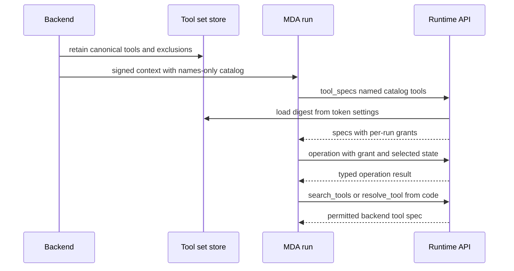

# Run catalog and operation boundary

A `Catalog` is the backend's per-run declaration of the operational surface that a shared Managed Deep Agents (MDA) graph must use. It selects models and subagents; operations and their grants; MCP servers; sandbox and file-tool policy; skills; inbox behavior; tool visibility; and `LoopRules`. It is configuration, not a second agent graph: MDA owns the model loop, checkpoints, sandbox, native file/shell calls, and middleware execution; the backend supplies typed, credentialed, or data-owning work through named endpoints.

This division is intentional. Do **not** grow the legacy `ToolSurface`/planned-phase mechanism. Put control flow such as stopping, routing, reply recovery, and refresh behavior in `mda/rt` middleware and express backend work as a narrow typed operation or endpoint—never as a generic phase call or untyped request body.

## What a run catalog controls

The backend derives the catalog when it plans a run. Its `operations` are typed `ToolSpec` values with an argument schema, selectively forwarded state (`reads` or `reads_all`), optional code-mode name and timeout, connection references, and a run-specific grant. A catalog also carries the following meaningful choices:

| Area | Catalog fields and runtime effect |
| --- | --- |
| Models and delegation | `models` sets primary, subagent, route, vision, and fallback models; `subagents` supplies descriptions, prompts, and optionally restricted tool lists. `model_call_limit` bounds calls. |
| Tool exposure | `excluded` hides tools; `code_only` makes tools available only to the interpreter; `also_from_code` exposes selected tools both directly and from code. `search_tools` lets code discover backend-held tools omitted from the initial schema list. |
| Integrations | `mcp_servers` names MDA-connected servers, their connection references, transport, and tool-name mapping. Backend-held integrations remain searchable/resolvable operations rather than being copied into context. |
| Sandbox and files | `sandbox` tells MDA which thread sandbox to create/use. `files` identifies backend-owned path prefixes, artifact root, optional shell guard, and image/`AGENTS.md` checks. |
| Skills and input | `skill_sources` defines ordered sources (a later same-named skill wins); `inbox` configures event intake and reply surface. |
| Loop behavior | `loop` sets prompt additions, conditional hiding, stop-state keys, model routing, Slack/CLI completion rules, task coordination, client tools, GitHub proxy refresh, and end actions. |

Before context is handed to MDA, `Catalog.names_only()` removes operation schemas and retains their names. The Agent Server copies context into checkpoints, so full schemas are retained in the backend's `run_tool_sets` store instead. The store canonicalizes a set without its grants, hashes it, retains it for three days, and the signed run settings identify the digest. At runtime, `tool_specs` returns only the named specifications and adds the current run's grants; `search_tools` ranks the remaining searchable backend tools with BM25, while `resolve_tool` supplies a named tool for code mode. This keeps a large integration catalog out of each checkpoint without granting MDA authority to invoke arbitrary backend work.

This shows schema retrieval and backend-operation authorization; MDA-native filesystem tools do not traverse the `operation` endpoint.

## Native tools versus backend operations

`RunToolsMiddleware` builds one `RunTools` instance for the active run after tool specs load. It turns catalog operations into callable tools, loads MDA-connected MCP tools once under a lock, and offers the resulting tools on every model call subject to the catalog's visibility rules. The code interpreter sees code-only tools, selected direct tools, and selected file tools through the same policies. A resumed run can load MCP tools before dispatching a remembered tool call. A name absent from the current set is resolved only when `search_tools` is enabled; an unknown name is left to the normal tool-node failure behavior.

This is distinct from MDA-native `ls`, `read_file`, `write_file`, `edit_file`, `delete`, `glob`, `grep`, and `execute`. `FileToolsMiddleware` decides per call where the native tool executes:

1. A path under `skill_sources` is served by the runtime's read-only skill tools; an unavailable skill yields a tool error.
2. A path under `files.backend_paths` is handled through the backend files API.
3. Otherwise the call runs in the MDA-owned sandbox when one exists, or remotely through the files API when no MDA sandbox is configured.

Every native file/shell call is reported, and code-mode calls are wrapped through the same middleware. For a sandbox-changing operation, the middleware waits for setup, captures Git evidence, and records the change; it retries a pre-start retryable sandbox rejection with bounded backoff. An `execute` call gets a deadline based on its requested timeout plus 30 seconds and becomes an error result rather than hanging if the sandbox never answers. If both `glob` and `grep` are excluded, the `execute` tool description is adjusted so search happens in the shell instead.

The file policy also composes checks in a fixed effective order: image-read validation outermost, tool-error conversion next, and `AGENTS.md` discovery innermost. The `agents_md` and `image_reads` checks are catalog opt-ins; tool-error conversion is always present. When `shell_commands` is configured and an `execute` command looks capable of pushing or opening a pull request, MDA calls the named `check_shell` endpoint before execution. A refusal is returned as an error `ToolMessage`; an allowed replacement command is executed instead. The broad prefilter recognizes `push`, `gh`, `pulls`, or deeply nested shells because the backend guard performs the authoritative inspection and may require human approval.

## Operation invocation and credential boundary

A backend operation is one narrowly named piece of backend-owned work, surfaced to MDA as a tool. `operation_tool` sends `RunOperation`: tool name, JSON arguments, stable request ID, exactly the state fields declared by the tool spec (and conversation only if required), grant, and per-call credentials. It receives an `OperationResult` containing model-visible content, status, optional artifact, state update, pull-request targets, stream events, and a sandbox-unreachable signal. MDA owns the surrounding tool call, result message, transcript, and middleware; the backend does not run a generic tool node for it.

The token-side handler rejects a missing or incorrect per-operation grant before resolving a tool. It validates arguments, applies backend shell guards to command-bearing operations, restores only carried state, and invokes the tool with declared state/runtime injection. Tool exceptions are converted at this API/tool boundary. This is why an operation grant is not merely a UI visibility flag: it is the backend authorization check for the named operation.

Connection references belong in `ToolSpec.connections`. MDA reads each referenced connection as the run and sends its credential only for that operation call; `RunOperation` suppresses credentials from representation and validation error input, and the backend installs them in a scoped context that resets when invocation returns. Agent-owned connections can be offered generally, but user-owned connections are listed only when run metadata establishes an acting user. The current mapping includes `web_search` with the agent Exa connection and `open_pull_request` with a user GitHub connection. New credentialed or data-owning behavior should follow this pattern: a named typed endpoint/operation with explicit schema, state reads, grant, and connection declaration.

## Loop rules are MDA middleware policy

A catalog runs the MDA `RunLoop` when both `loop` and `models` are present. Before a model call, the loop ends immediately if a configured stop-state key is set or a client-side call is still pending; otherwise it concurrently asks for task context and, if due, refreshes the GitHub proxy. It adds task/run guidance not currently visible after summarization, derives a route and model, builds prompt sections, and applies static plus state-conditional hidden tools. Route/model and task context are named backend callbacks because they need backend data or policy; control flow stays in MDA.

After a no-tool model answer, CLI-result and Slack-reply rules can nudge the model up to their configured limit. For Slack, exhaustion posts the last text through `reply_on_behalf` so silence is not irrecoverable. At end of run, the loop queues—not blocks on—step-limit notification, configured review/scout work, and `run_ended`; report ordering ensures those notices follow accumulated tool and reply reports. A GitHub refresh failure does not stop the run: its retry becomes due in one minute.

A catalog with no loop rules remains on the legacy backend phase path for compatibility, including older tokens and specific legacy run shapes. It is not an extension point. Add new loop behavior in `mda/rt/loop.py` and add only the named backend callback required for backend-owned facts or effects.

## Configuration and focused verification

When changing the catalog, maintain these invariants:

- Keep the shared MDA graph free of run-specific tool objects and policy. Load specifications, MCP tools, caches, and grants against the active run.
- Do not put a credential in catalog context or a persistent backend cache. Declare the connection in the operation spec and pass its value only with the call.
- Do not bypass `FileToolsMiddleware` from code mode: it is the common enforcement point for path routing, checks, transcript reporting, shell guards, timeouts, retries, and Git evidence.
- Keep integrations that would inflate context backend-held and reachable through `search_tools`/`resolve_tool`; use `mcp_servers` only for connections MDA itself owns.
- Treat `ToolSurface`, `RunSession` phase handling, and legacy plans as migration compatibility. New behavior belongs in named APIs and MDA middleware.

Focused MDA tests cover the risky boundaries: `mda/tests/test_shared_graph.py` verifies cross-run isolation of catalogs, grants, and sandbox settings; `mda/tests/test_backend_calls.py` exercises tool loading, operation calls, grants, and callback failures; `mda/tests/test_loop.py` covers route, completion, refresh, and end behavior; `mda/tests/test_mcp.py`, `mda/tests/test_subdir_agents.py`, and `mda/tests/test_validate_image_reads.py` cover integration loading and file-tool checks. Extend the behavioral test nearest to the authorization, isolation, or failure property being changed rather than adding a catalog-shape-only test.

## Related pages

- [Backend–Managed Deep Agents boundary](./backend-runtime-boundary.md)
- [Runtime and Product Architecture](./overview.md)
- [Threads, runs, and persistence](./threads-runs-and-persistence.md)
