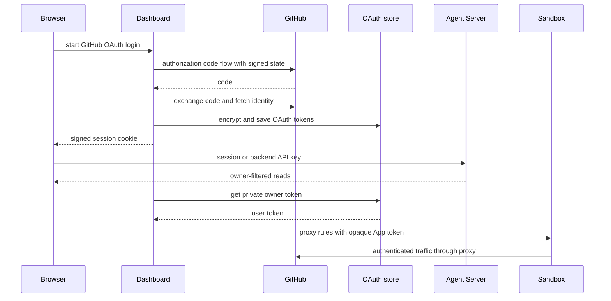

# Authentication, Credentials, and Safety Boundaries

Open SWE separates browser identity, backend authority, user GitHub authority, GitHub App authority, and untrusted sandbox execution. A credential is not interchangeable with authorization: a dashboard session identifies a user, thread metadata determines whether that user's personal credential may be used, and privileged API or tool actions have their own gates. Related guidance: [workspaces and access](./workspaces-and-access.md), [sandbox lifecycle](../architecture/sandbox-lifecycle.md), [dashboard UI](../integrations/dashboard-ui.md), [configuration](../operations/configuration.md), and [invocation](../workflows/invocation.md).

## Identity and credential paths

This shows the distinct browser/session, stored-user-token, and sandbox-token paths. The dashboard and backend mediate credentials rather than treating a sandbox or browser as a trusted authority.

## Dashboard login and browser sessions

The dashboard's normal entrypoint is `GET /dashboard/api/auth/login`. It uses the GitHub App OAuth code flow, creates a random browser-bound nonce, stores only its HMAC in a signed state JWT, and places the raw nonce in a short-lived state cookie. The callback requires a constant-time nonce comparison before it exchanges the code, resolves the GitHub identity, applies the authorization gate, creates/signs in the local user, and persists the OAuth result. It then issues an HS256 `osw_session` JWT signed by `DASHBOARD_JWT_SECRET`, with a seven-day lifetime.

`require_session` rejects absent or invalid cookies and binds the session identity to audit context. `optional_session` deliberately treats an unreadable cookie as absent so routes that support another explicit credential can continue to evaluate that credential. `/me` is designed to answer from the signed session when the database is temporarily unavailable; when a database is configured and conclusively has no account, it requires a new login. It also repairs a session whose stored user ID has become stale.

The OAuth redirect target is not caller-controlled. `sanitize_redirect_to` accepts a same-origin relative path (but not `//...`) or an absolute URL on `DASHBOARD_BASE_URL` or `DASHBOARD_ALLOWED_ORIGINS`; it rejects the login and API callback routes as redirect targets. Session cookies are `HttpOnly`. Split-origin HTTPS deployments use `Secure; SameSite=None`; same-origin and local HTTP use `SameSite=Lax`. The state cookie is `HttpOnly`, `SameSite=Lax`, path-scoped to `/dashboard/api/auth`, and expires with the ten-minute state window.

### Login authorization, CSRF, and desktop handoff

Dashboard login is allowlisted rather than open by default: startup validation requires `ALLOWED_GITHUB_USERS` or `ALLOWED_GITHUB_ORGS`. A login is authorized if it constant-time matches an allowed user or is an active member of an allowed organization; organization membership is resolved through the GitHub App and failures do not grant access.

Unsafe cookie-authenticated HTTP requests require an allowed `Origin` or `Referer` when dashboard origins are configured. Safe methods are exempt; so is a request with an explicit GitHub bearer token and no session cookie, because that credential is not ambient browser state. With no configured origins the check is a deliberate local-development no-op. The desktop app origin is added to the allowed set for its handoff exchange.

Desktop login does not leave a session on the loopback redirect. The state carries an S256 PKCE challenge and an allowed port; after GitHub login the callback redirects only to fixed `http://127.0.0.1:<port>/callback` with a 120-second signed handoff code containing identity claims, not a session. `/auth/desktop/exchange` issues the session only after a constant-time verifier/challenge match. Separately, cloud-terminal tickets are signed for 60 seconds, require the terminal audience, and are bound to one `thread_id`.

Slack linking is a second identity-linking flow, not an assertion supplied by the user. Slack OIDC requests `openid email profile`, obtains Slack's user and workspace claims from `userinfo`, and can restrict linking to `SLACK_TEAM_ID`; identities from another workspace, including Slack Connect cases, are rejected.

## Agent Server API boundary

The Agent Server accepts exactly two caller classes. An `x-api-key` matching a configured LangGraph, LangSmith, or LangChain backend key receives the `openswe:backend` permission. Otherwise, a valid dashboard session supplies its GitHub login as the identity with no backend permission; missing or invalid credentials receive 401.

A backend identity can read/search all threads and perform mutations. A dashboard identity can read and search only records whose `owner_login` is its identity; every other Agent Server operation is denied with 403 and must go through the dashboard API, which applies its thread rules first. In-process Agent Server transport under `/noauth` is the narrowly defined bypass for backend calls, not a client-selectable credential.

## Selecting GitHub authority

Personal GitHub access is intentionally limited to the saved private-thread owner. `private_credential_login` reads the persisted thread metadata, rejects unknown visibility/owner types, disallows private credentials for system threads, and returns a login only when a private thread's configured GitHub login matches its recorded owner. Public and system threads therefore use App authority; they cannot borrow an individual's token.

`resolve_github_token` first clears cached credentials for the thread, then applies that scope: it reads a valid dashboard OAuth token for the verified private owner or raises `GitHubUserAuthRequired` when none is usable. If no private credential is allowed, it mints a GitHub App installation token. This is a current boundary: bot-token-only deployment detection exists, but private user work still fails closed rather than falling back to the bot token.

OAuth access and refresh tokens are encrypted before storage. `TOKEN_ENCRYPTION_KEY` supports a single Fernet key or a newest-first comma/newline-separated list; `MultiFernet` encrypts with the first and attempts all configured keys on decrypt, enabling key rotation. Invalid ciphertext or a missing key becomes an unusable empty value rather than leaking an exception. Near-expiry OAuth tokens refresh under a per-login guard. On GitHub's permanent `bad_refresh_token` or `unauthorized_client` responses, the record is deleted—unless a concurrent OAuth callback has replaced its refresh token—so the user is prompted to reauthorize.

The per-thread GitHub token cache is process memory only, keyed by `(thread_id, principal)`. User principals normalize to `login:` or `email:`; installation credentials use an isolated `bot` principal; an unbound user token is refused. User cache entries expire at their token expiry with a 60-second skew or after 24 hours. Bot entries retain their repository scope so a remint cannot silently widen it; invalidation removes all entries for a thread.

GitHub App installation tokens are minted through the App authentication strategy and cached only in memory. The cache key includes installation ID, sorted repository IDs or names, and normalized permissions, separating differently scoped authorities. A token is reused only until ten minutes before its parsed GitHub expiry. When App configuration is absent, local `langgraph dev` may use the local `gh` credential; otherwise token acquisition returns no token.

## Sandbox credential boundary

A LangSmith sandbox does not receive the GitHub App secret as an environment variable. Its proxy configuration injects opaque `Authorization` headers: `Bearer` for `api.github.com`, and Basic `x-access-token` for `github.com` and subdomains. `GH_TOKEN` inside the sandbox is only a placeholder needed by `gh` to run. The GitHub rules are omitted altogether when no token is supplied.

Proxy-token state is in memory per thread and records expiry, workspace, repositories, permissions, and base proxy configuration. Refresh begins within five minutes of expiry (or after a 50-minute fallback when expiry is unknown), obtains workspace access with the recorded scope, and reconfigures the existing sandbox. A caller can request a narrower repository set, but refresh intersects it with the recorded set; it does not broaden authority. Failure to refresh a reused sandbox fails that run rather than replacing the sandbox and losing its filesystem.

## Inbound authenticity and untrusted content

Webhook routes verify raw request bodies before processing payloads. GitHub requires `sha256=` HMAC-SHA256 in `X-Hub-Signature-256`; Slack signs `v0:timestamp:body` and rejects timestamps more than 300 seconds old; Linear verifies raw-body HMAC-SHA256 and additionally rejects a `webhookTimestamp` over 60 seconds away. All three reject absent secrets or invalid signatures with 401. This authentication is distinct from delivery deduplication and workspace/repository routing that happen after verification.

External GitHub comment text is not trusted merely because it arrived in a valid webhook. Comments from non-registered authors are wrapped in the reserved `<dangerous-external-untrusted-users-comment>` delimiters before prompt inclusion. Raw comment bodies have those same delimiters replaced first, preventing an author from spoofing the trusted wrapper.

## Authorization gates and safe changes

`CONFIGURED_ADMINS` is a case-insensitive list of GitHub logins and emails. Dashboard admin dependencies recompute membership from the session values and reject non-admins. Tool-level `require_admin` should remain a separate gate for actions launched from an agent run: it resolves the current run's identity rather than trusting mutable thread metadata.

When changing this area, preserve these invariants:

- Verify signatures and OAuth state before parsing, persistence, or side effects.
- Keep personal credentials tied to the stored private-thread owner; do not add a bot fallback for missing personal authorization.
- Treat proxy refresh scope as monotonic: retain or narrow repository and permission scope, never widen it.
- Do not put a session or a real GitHub token in a sandbox environment, browser-visible handoff payload, or shared Slack link.
- Keep Agent Server mutations backend-only; add user-facing mutations through the dashboard authorization layer.

## Focused verification

`tests/auth/test_agent_server_auth.py` verifies the backend-key/session distinction, owner-filtered reads, and backend-only writes. `tests/auth/test_auth_sources.py` covers private-owner token selection, refusal when a personal token is absent even in bot-only mode, and stale-cache replacement. `tests/dashboard/test_dashboard_oauth_redirect.py` exercises redirect allowlisting, state binding, session identity, and desktop PKCE handoff behavior. `tests/sandbox/test_proxy_auth.py` verifies proxy rule construction, preservation of non-GitHub proxy configuration, retry behavior, and failure rather than sandbox replacement on a failed refresh.
