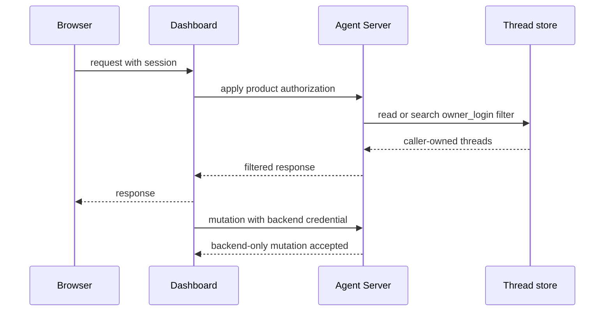
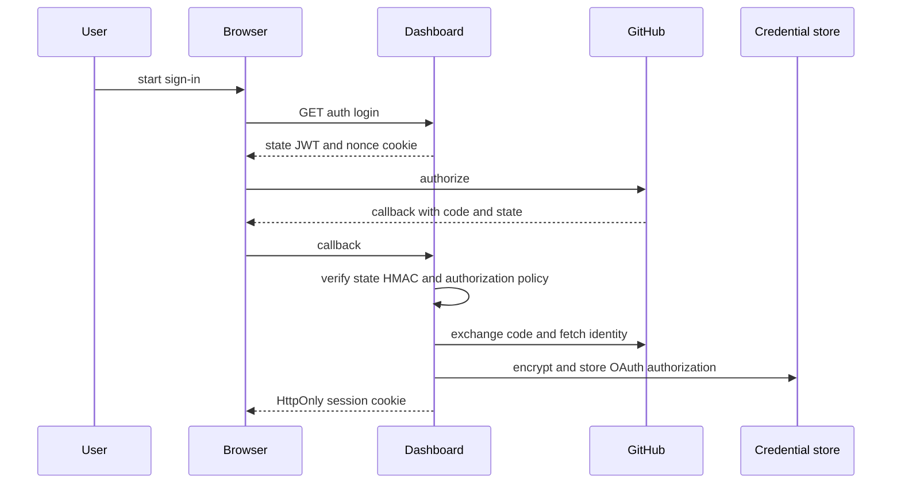
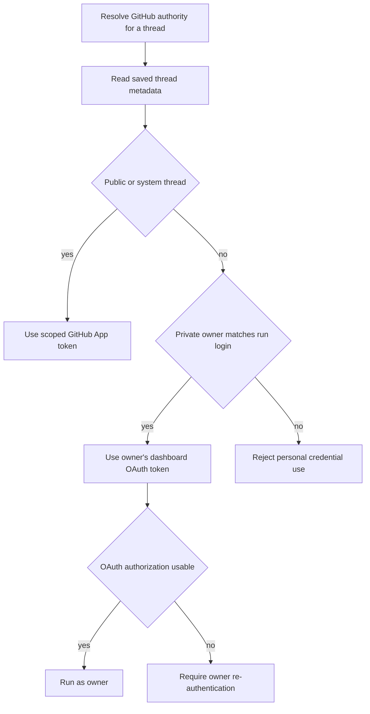

# Authentication, authorization, and credential boundaries

Open SWE has several deliberately separate trust boundaries. A dashboard session identifies a person; a workspace API key or GitHub Actions OIDC token identifies automation; a GitHub App token grants workspace repository authority; and a private thread may use only its owner's personal integration credential. Neither a browser session nor an inbound webhook is by itself permission to disclose a credential to an agent or sandbox.

The important operational consequence is that a deployment must configure its login policy, encryption keys, webhook secrets, and repository/workspace grants together. Do not put actual key, token, or client-secret values in configuration documentation, logs, prompts, or thread metadata. See [configuration](../operations/configuration.md), [threads and state](./threads-and-state.md), [sandbox lifecycle](../architecture/sandbox-lifecycle.md), [dashboard UI](../integrations/dashboard-ui.md), and [observability and MCP](../integrations/observability-and-mcp.md).

## Identity planes and Agent Server boundary

The dashboard API applies Open SWE's thread and workspace rules before it calls Agent Server. Agent Server itself accepts either the deployment's LangGraph/LangSmith/LangChain API key in `x-api-key`, granting the internal `openswe:backend` permission, or a valid `osw_session` cookie. A session holder can read and search only threads whose `owner_login` matches their identity; all mutations are backend-only. The in-process `/noauth` transport is a server implementation boundary, not a client-selectable bypass.

The dashboard owns product-level authorization; Agent Server constrains direct access to the identity's own threads and reserves writes for the backend.

## Dashboard sign-in and browser defenses

The dashboard uses the GitHub App OAuth code flow to obtain the GitHub identity and OAuth authorization, then issues a seven-day HS256 `osw_session` JWT signed with `DASHBOARD_JWT_SECRET`. `/me` can repair a session's user ID from the database and reports the current admin decision. A configured GitHub login policy is mandatory: a login is authorized only when it is in `ALLOWED_GITHUB_USERS` or is an active member of an `ALLOWED_GITHUB_ORGS` organization. Organization membership is checked through the GitHub App, so a missing or failing check does not authorize the login.

The login route generates a random nonce, puts only its HMAC in a signed, ten-minute `state` JWT, and sets the raw nonce in an HttpOnly state cookie. The callback constant-time compares the recomputed value before exchanging the GitHub code, checks the login policy, persists the OAuth result, and issues a session. Post-login destinations are limited to a safe relative path or to `DASHBOARD_BASE_URL` / `DASHBOARD_ALLOWED_ORIGINS`; login/API paths and unlisted origins are rejected.

Sessions are HttpOnly. HTTPS split-origin deployments use `Secure; SameSite=None`; same-origin or local HTTP uses `SameSite=Lax`. The state cookie is HttpOnly, `SameSite=Lax`, limited to the auth path, and expires with the OAuth state. Unsafe cookie-authenticated requests require an allowed `Origin` or `Referer` when dashboard origins are configured. Safe methods are exempt, as are bearer-only GitHub-token requests with no session cookie; no configured origin is intentionally a local-development fail-open. Credentialed CORS is restricted to configured origins rather than `*`.

Desktop and CLI login never deposits a browser session at a loopback URL. Instead, the browser redirects a short-lived, inert identity handoff to fixed `127.0.0.1`; the desktop or CLI redeems it only by proving the PKCE S256 verifier. Cloud terminal tickets are separately signed, expire after 60 seconds, and are bound to both their audience and thread ID.

Slack account connection is also bound to the current dashboard session: the service reads the Slack member ID and verified email from Slack OIDC claims rather than accepting self-asserted identifiers. A shared Slack auth failure message links only to the token-free settings page.

## Human, machine, and federated callers

Workspace API keys are automation credentials, not user sessions. An admin authenticated as a real user creates a key for one workspace, with a future expiry capped at 365 days. The plaintext `osk_` secret is returned only in the creation response; PostgreSQL retains a SHA-256 digest and a short suffix. Authentication accepts only active, non-revoked, unexpired keys, updates last-use asynchronously, and intentionally does not reveal whether a rejected key was unknown, expired, or revoked. API-key routes require PostgreSQL.

GitHub Actions can avoid a stored Open SWE secret: a workflow with `id-token: write` requests an OIDC JWT for the backend audience. Verification uses GitHub's JWKS, RS256, issuer, expiry, and audience checks, then extracts the repository/workflow claims. Verification establishes the workflow identity, not its authorization; the workspace policy must separately grant that repository permission to start threads. The CLI chooses credentials in this order: `OPEN_SWE_API_KEY`, GitHub Actions OIDC, then a person's `OPEN_SWE_SESSION`/stored session. API-key and Actions runs create system threads, while personal CLI runs create private threads.

## GitHub authority and thread credential scope

GitHub App installation tokens supply workspace authority for public and system work. They are minted from the App credentials, scoped by installation, optional repository IDs/names, and requested permissions, then cached only in process memory by that complete scope. A cached token is reused only until ten minutes before its GitHub expiry. The dashboard's user OAuth authorization is distinct: access and refresh tokens are encrypted before storage, proactively refreshed near expiry under a per-login guard, and dropped when GitHub reports a permanently invalid refresh token. Decryption failure is treated as no credential rather than an exception that leaks token material.

Credential choice is driven by *saved thread scope*, not merely by the source of the latest request:

- A public thread never resolves a personal GitHub credential and uses the workspace GitHub App token.
- A private thread may resolve the dashboard OAuth token only when the run's GitHub login matches its saved owner. It never falls back to the bot when that owner has no usable authorization.
- A system thread cannot be private and uses the App, not a triggering user's credential.
- For PR authorship in a shared user-owned thread, a requested author must be a recorded participant. Private threads remain pinned to their owner and system threads to the App. Background completion refuses to infer a user author when it cannot safely identify one.

The per-thread GitHub token cache is process-local and keyed by `(thread_id, principal)`, using normalized `login:`/`email:` principals and a separate `bot` principal. It refuses unbound user tokens, observes the token expiry with a 60-second skew, and has a 24-hour cap. An expired bot entry preserves its repository scope so reminting does not broaden access; user tokens are never silently replaced with bot tokens. A 401 can invalidate the cache and cause a safe re-resolution.

For LangSmith sandboxes, the proxy configuration tracks expiry, workspace, repository scope, permission scope, and base proxy configuration per thread. It refreshes within five minutes of known expiry, or after 50 minutes if expiry is unknown, and intersects a later requested repository set with the recorded set. This preserves least privilege during refresh rather than replacing a narrow token with installation-wide authority.

## Stored credentials and MCP clients

`TOKEN_ENCRYPTION_KEY` supports a newest-first single Fernet key or comma/newline-separated key list. `MultiFernet` encrypts with the first key and tries all configured keys when decrypting, allowing staged key rotation. Invalid ciphertext or a missing key decrypts to an empty value; callers must handle that as unavailable credentials.

MCP connection records keep headers and OAuth client secrets encrypted and do not expose them in the dashboard's public connection representation. Connections require HTTPS URLs with no embedded credentials, fragments, or secret-like query parameters; dangerous transport headers are blocked. An OAuth connection supports only the client-credentials grant. At runtime the server decrypts the client secret, requests a bearer token using either client-secret-basic or client-secret-post, caches it by connection namespace/settings/secret, refreshes before expiry, and retries once on a 401. Errors presented to administrators are generic rather than token-bearing.

## Verifying inbound requests and untrusted content

Public ingress is authenticated before interpreting its payload:

- GitHub recomputes `sha256=HMAC(GITHUB_WEBHOOK_SECRET, raw body)` and constant-time compares `X-Hub-Signature-256`; an unset secret rejects all requests.
- Slack constant-time compares the signature over `v0:timestamp:body`, rejects missing secrets, and rejects timestamps more than 300 seconds away to limit replay.
- Linear constant-time compares the raw-body HMAC-SHA256 from `Linear-Signature`, rejects absent secrets, and its route rejects stale deliveries.
- `/webhooks/run-complete` constant-time compares its shared secret and fails closed when unset, disabling completion failure replies rather than accepting unauthenticated calls.

GitHub comment text is input, not authority. Content from an unregistered author is wrapped in reserved untrusted-comment tags; raw content is sanitized first so it cannot forge those tags.

## Hosted versus local execution

Hosted execution can hold deployment credentials server-side and use a sandbox proxy or remote sandbox boundary. That boundary does **not** make local execution safe by itself. `oswe` connects a remote cloud agent to a bridge on the user's machine: the agent's shell commands, uploads, and downloads execute locally, unsandboxed, as the OS user in the directory where the CLI started. Anyone who can prompt a personal CLI thread can therefore cause commands with that user's local permissions.

The CLI deliberately does not auto-load a repository `.env`, and its child shell removes environment variables ending in `_API_KEY`, `_TOKEN`, `_SECRET`, or `PASSWORD`, except `GITHUB_TOKEN` and `GH_TOKEN` so GitHub tooling works. This is a mitigation, not a guarantee that a local run cannot access sensitive files or credentials available to that user. Use a dedicated account/directory and prefer API-key or OIDC system threads for automation; do not use a personal private thread as shared infrastructure.

## Focused verification

Authentication tests cover Agent Server backend/session separation and per-owner thread filtering, GitHub OAuth refresh and encryption-key rotation, thread credential-scope invariants, GitHub token TTL/revocation behavior, Slack OIDC, and private webhook ingress. These tests are particularly important when changing identity propagation, thread metadata, credential refresh, or fallback behavior: a seemingly convenient fallback can turn a user-scoped action into a workspace-bot action or disclose a personal credential in a shared context.
