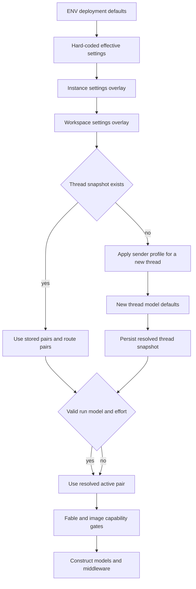

# Configuration, profiles, prompts, and model selection

Open SWE has two deliberately separate mechanisms that can both be described as “fallback.” **Configuration resolution** selects a valid model, effort, prompt material, and feature settings before an agent graph is assembled; persisted thread settings make those choices stable. **Model-call fallback** happens later, only after a constructed model raises a transient provider error. Do not use a retry/failover policy to explain precedence, or expect changing a workspace default to rewrite existing threads.

This page follows the agent path. For graph composition, see [Agent assembly and middleware](../architecture/agent-assembly-and-middleware.md); for workspace ownership and routing, see [Workspaces and routing](workspaces-and-routing.md); for deployment variables, see [Configuration](../operations/configuration.md).

## Configuration planes and value semantics

`openswe.config.ENV` is the deployment configuration registry. It is intentionally lazy: consumers read `ENV.NAME` at use time, so secret hydration, key rotation, and test monkeypatching are observable. Blank and whitespace-only values are unset; a canonical variable wins over an alias. The registry is also the authoritative catalog for secrets, defaults, aliases, and deprecated-variable reporting—application code should not read `os.environ` directly.

Model-relevant deployment inputs include provider credentials, `LLM_MODEL_ID`, `LLM_REASONING_EFFORT`, `LLM_FALLBACK_MODEL_ID`, prompt deployment environment, and LangSmith gateway controls. `default_model_pair()` accepts only a supported default-eligible model and compatible effort. Its built-in model is Anthropic when only an Anthropic key is present; otherwise it is OpenAI. An invalid configured default or effort raises rather than silently building an arbitrary client.

Persisted settings are not secret storage:

- The **instance** settings record overlays hard-coded defaults for every workspace; a **workspace** record overlays only its non-null values on the instance record. Reads fail soft to hard-coded defaults so a settings-store outage does not stop all runs.
- A **profile** is user-editable state such as default repositories and PR behavior. Profile reads on the run path fail soft; a saved profile invalidates its short-lived cache. GitHub OAuth tokens live in a separate encrypted record, so a token refresh and a profile edit cannot overwrite one another.
- A **thread** holds an `agent_settings` snapshot in thread metadata: main and subagent pairs, adaptive-routing state and route pairs, requested handoff model, and repository instructions. The factory reads it through a five-minute cache; malformed data becomes an empty snapshot and store failures are non-fatal.

`RunConfig` carries the per-run `configurable` contract across dashboard, webhook, and graph boundaries. It allows unknown keys and serializes only set fields, preserving configuration supplied by a newer writer. Parsing is intentionally lossy only at the bad-field level: invalid fields are dropped while usable identifiers and other values survive.

## Resolution precedence and the thread boundary

The exact precedence is purpose-specific, but model construction follows this lifecycle. Workspace settings themselves resolve **hard-coded deployment-derived defaults → instance record → workspace override**. On a new thread, the workspace agent and subagent defaults seed the choice; the sending user’s profile is consulted only while the thread has no stored model. The thread snapshot then wins on later runs. A valid run `agent_model_id` plus `agent_effort` can replace the active pair; dashboard `explicit` selection disables adaptive routing. In contrast, per-message identity, authorization, draft-PR preference, and personal context remain tied to the current sender.

*Caption: pre-assembly precedence selects and persists configuration; it is not the later provider retry path.*

There are targeted exceptions. A dashboard request that changes back to `auto` resets the stored route/requested-model state and can re-seed from current workspace/profile defaults. Incident runs disable adaptive routing and, absent an explicit model, use the performance pair. A Slack `/oswe` question also disables adaptive routing. The service assigns an `auto` or fixed-`fast` routing mode deterministically from the thread-id hash, enabling a controlled rollout without a random mode per turn.

The persisted snapshot is written before the Fable gate, so disabling Fable remains effective for existing threads. It also preserves repository instructions for an established thread; new threads resolve those instructions before storing the snapshot. This is why an administrator changing a workspace model or prompt source normally affects new threads rather than mutating a conversation already in progress.

### Validity, stale data, and Fable

The model registry defines supported provider-prefixed IDs, their allowed effort values, default effort, and image support. Workspace writes reject an effort without a model, unsupported models, and incompatible pairs. A deprecated persisted default is cleared; an unsupported but non-deprecated historical ID first recovers to a supported model from the same provider (and the same Claude family where available), preserving effort where possible, before using the global default. This avoids an unnecessary cross-provider jump after a catalog version change.

Fable is a workspace-wide kill switch. Fable models cannot be normal saved defaults; when Fable is disabled, writes transform Fable defaults to a supported non-Fable Anthropic pair and model-construction entrypoints apply the same runtime gate. Thus a stale thread snapshot or route cannot construct a disabled Fable model.

## Prompt resources and prompt authority

Prompt material is packaged under `openswe/resources/prompts/`. `prompt()` accepts only package-relative `.md` or `.md.jinja` names, rejects absolute and traversal paths, loads static Markdown without substitutions, and renders Jinja templates with `StrictUndefined`. Consequently a missing template variable is an error rather than silently producing an incomplete instruction. Static prompt files reject supplied substitutions. Tool descriptions use the same mechanism and cache inferred tool schemas to avoid repeating model-facing schema work per graph assembly.

`common_prompt()` prepends deployment context only for `preview` and `staging`. It derives that context from `OPENSWE_ENV` (with `prod` normalized to `production`) or the local runtime marker, so deployment context does not pollute ordinary production prompts.

Adaptive routing’s classifier is also prompt-driven. The `model-selection` resources define the fast, balanced, and performance criteria: respectively mechanical/local work, ordinary bounded work, and ambiguous, cross-component, or high-stakes work. The classifier is instructed to choose one fixed route for the whole turn and to base difficulty on ambiguity, verification, scope, and consequence—not prompt length or expected duration.

Repository custom instructions are part of the thread snapshot, whereas current-sender material is prepared per run. Keep this distinction when adding a prompt source: durable repository/workspace policy belongs in a thread-stable source; identity-specific or personal input must not accidentally become shared conversation policy.

## Gateway construction and provider effort

`WorkspaceSettings.gateway_enabled` is tri-state. A workspace or inherited instance `true`/`false` is authoritative; `None` defers to `LANGSMITH_GATEWAY_ENABLED`, or, when that is absent, the presence of `LANGSMITH_GATEWAY_API_KEY`. Gateway authentication prefers that dedicated key and then `LANGSMITH_API_KEY`. It routes OpenAI, Anthropic, Baseten, Fireworks, and Google GenAI through provider-specific gateway paths; an unsupported provider or absent LangSmith credential is logged and called directly rather than making the run fail. Gateway-routed OpenAI uses the Responses API by default, configurable with `LANGSMITH_GATEWAY_OPENAI_USE_RESPONSES`.

The chosen generic effort is translated only at the provider boundary: OpenAI gets `reasoning`, Anthropic gets `thinking` and `effort`, supporting Google models get `thinking_level`, Fireworks gets `model_kwargs.reasoning_effort`, and eligible Baseten models get `reasoning_effort`. This translation follows pair validation; callers should not assume that an effort label has identical provider semantics.

## Adaptive route selection, requests, and vision

When routing is active, `ModelSelectionMiddleware` owns the per-turn route. It honors a requested model first, then a persisted route (including legacy `fast_alt` normalized to `fast`), then fixed-fast mode, and only then calls the Jev classifier. It extracts the actual human request rather than injected dynamic-context envelopes and truncates classifier input to the final 8,000 characters. If classification fails or is unsuitable, it returns the `default` route. The resulting `model_route` is saved in agent state, so subsequent model calls in that turn use the same model; the middleware emits a best-effort `model_routed` stream event for the UI.

A handoff/requested model is constructed lazily, cached by `(model_id, effort)`, becomes the default model for that turn, and receives its own registered call fallback. The graph records `resolved_agent_model_id` and `resolved_agent_effort` in `configurable` and run metadata; before run recording it adjusts that attribution to the selected route where applicable.

Image input is a capability override, not a general precedence tier. The dashboard/run enrichment marks it with `model_override_reason="image_input"` and supplies a compatible `(agent_model_id, agent_effort)`. During assembly, a pinned text-only selection can be temporarily replaced by `default_vision_model_pair()`; routing/request options that include text-only models cause a vision fallback model to be prepared. This permits the image-bearing run without permanently discarding a saved text-model choice.

## Runtime fallback is after selection

After the factory has resolved and constructed the primary model, it creates `ModelFallbackMiddleware`. The fallback ID is `LLM_FALLBACK_MODEL_ID` when set, otherwise the built-in cross-provider choice for eligible primary providers; no model is installed when the result is missing or identical to the primary. This policy is unrelated to workspace/profile/thread precedence.

For a retryable timeout, transport error, retryable `ModelError`, or selected provider status (`408`, `409`, `425`, `429`, `5xx`, or `529`), the middleware alternates primary and fallback models. The default schedule has six total attempts: initial call, then delays of 0, 5, 15, 30, and 45 seconds with positive-delay jitter. Alternation matters because both providers may share the gateway: a one-way immediate failover cannot survive a shared short outage. Each retry is traced and logged with sanitized operational metadata.

Provider access errors such as a selected model not being available are returned as actionable user-facing messages and are not retried as transient failures. Other non-transient exceptions propagate. If all transient attempts fail, the default behavior returns a terminal outage `AIMessage` explaining that progress was saved and the run can be retriggered; callers can opt out and re-raise the final exception with `surface_outage_message=False`.

## Focused change and test guide

When modifying resolution, start with `tests/models/test_model_fallback_resolution.py` for credential-sensitive defaults, provider-preserving stale recovery, invalid effort rejection, and Fable fallback. `tests/middleware/test_model_selection.py` exercises route persistence, fixed-fast behavior, human-message extraction, classifier degradation, and requested-model precedence. `tests/middleware/test_model_fallback_middleware.py` covers retry classification, alternating retries, no fallback registration, access/non-transient errors, and terminal behavior. Add dashboard image tests when changing capability routing, and test both new-thread persistence and later-thread behavior for any precedence change.
