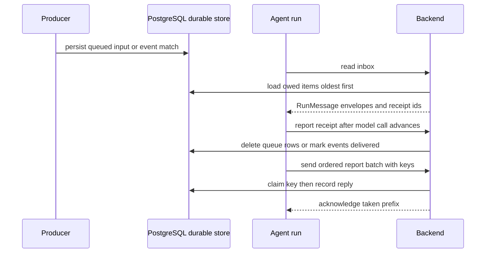
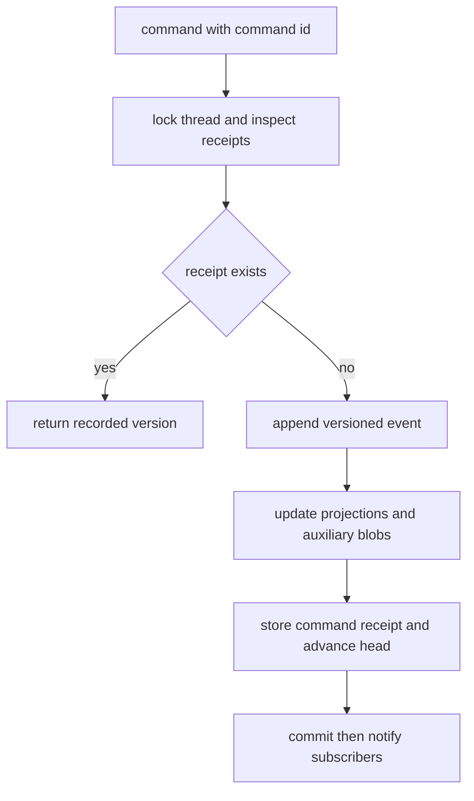

# Durable state, messages, and events

Open SWE treats network delivery and process lifetime as unreliable. The durable boundary is PostgreSQL-backed state: a sender may retry, a run may resume on another process, and a listener may reconnect without changing the logical outcome. This page distinguishes the records that preserve **work**, **history**, and **freshness**.

- **Thread index** is the searchable operational view of a thread's metadata, runtime, and status; runtime checkpoints and streams remain with the selected runtime.
- **Thread inbox** holds inputs owed to an agent until a run has durably accepted them.
- **Transcript** is an append-only, versioned event history with materialized read projections.
- **Report receipts** make a remote-run report effectively once-only despite at-least-once delivery.
- **Webhook claims and event matches** deduplicate inbound deliveries, then hold subscribed work until a thread run receives it.
- **UI invalidations** are deliberately payload-free signals: clients refetch authoritative data rather than treating a notification as state.

PostgreSQL is optional for selected runtime features, but it is the persistence and coordination substrate for these mechanisms when configured; `POSTGRES_URI` is required to create the database engine.

## Delivery model and the durable handoff

A run must distinguish *read* from *accepted*. In particular, inbox reads are snapshots: inputs remain owed until the model call that read them proceeds, or until the next inbox read identifies them as received. This prevents a crash after reading from silently losing a follow-up or event. Conversely, output reports remain in the runtime outbox until the backend says it took their keys.

*Inputs are acknowledged after acceptance, while run reports are retried until their durable receipt is available.*

### Preserve structured inputs

The cross-surface input contract is `RunMessage` / `RunInput`, not feature-specific prose. An input message carries a `user` or `system` role, text or multimodal content, optional message ID and metadata; `RunInput` additionally carries optional files. `build_input_messages` serializes authored text into an `<input-message>` envelope that preserves sender, surface, kind, optional channel, and structured data. System inputs also carry notification metadata.

Queue writers may store an already-structured `RunMessage`; the inbox passes it through unchanged. Other queue payloads are converted into structured messages before the model call. Each envelope must remain a separate message because transcript parsing expects one envelope per message. Dynamic person/channel/system introductions are content-hash deduplicated within a batch, without flattening the message that actually arrived.

## Thread state, queue, and inbox

`thread_index` is Open SWE's PostgreSQL index for thread metadata, runtime (`local` or `mda`), status (`idle`, `busy`, `interrupted`, or `error`), and timestamps. It presents Agent Server-shaped thread reads and searches, while the runtime retains conversation values, checkpoints, and streams. Per-thread advisory locking prevents an older sync from overwriting a newer one. When a local thread must receive new activity, `live_thread_id` redirects it to its MDA successor.

`thread_queued_message` is the durable follow-up queue. Writers insert individual rows and a run deletes only the sequence numbers it accepted, avoiding read-modify-write overwrite races. Rows are ordered by identity `seq`; dashboard-originated rows can use a per-thread `queue_id` uniqueness constraint to make a retried submission enqueue once. The queue retains at most 100 rows per thread, drops the oldest overflow with a warning, and invalidates that thread's `thread-queues/<thread-id>` UI topic on mutation.

`ThreadInbox.read` concurrently collects queued follow-ups, event matches, and task messages according to the run's `InboxSpec`. It preserves their receipt identifiers in `Taken`: queued sequence numbers and event UUIDs. `ThreadInbox.receive` later removes the named queue rows and marks named task/event rows delivered. This is called both when the next inbox read supplies prior receipts and when an explicit `InboxReceipt` report arrives. A run prepared specifically for event matches marks those carried matches received as it begins.

### Event matches are work, not runtime queue entries

Event subscriptions turn a matching webhook or monitor result into an `event_match` row before starting a run. A unique `(thread_id, source, delivery_id)` constraint suppresses duplicate nonempty delivery IDs; owed matches are read oldest-first and remain owed until received. The dispatcher uses a per-thread advisory lock, increments delivery attempts before creating a durable run, and stops automatically starting a match after three unsuccessful delivery attempts. This avoids relying on LangGraph's queue: an interrupt can cancel queued runs, whereas the durable match will be offered to whichever run comes next.

When an event is delivered to a model, it is constructed as a system `RunMessage` envelope with `event_match` data and a stable `event-match:<UUID>` ID. That retains source and receipt identity across handoff rather than converting the event into an unstructured feature message.

## Remote run report outbox and receipts

The MDA runtime keeps unsent reports in `open_swe_outbox` graph state alongside the step that produced them. It batches items in creation order and retries a `reports` call with backoff; a restarted process—or a later run on the same thread—adopts and sends carried items first. Reports leave the outbox only when the backend acknowledges their keys. The sender gives up active sending after an hour, leaving items checkpointed for a later run; a phase drain waits up to five minutes and warns before continuing. A report rejected three times is dropped so one permanently invalid item cannot block later items.

The backend processes report batches in order and stops at the first currently-recording or failing item. For non-idempotent endpoints it uses `agent_report_receipt`, scoped by thread and idempotency key: a delivery claims the key, records the response JSON, and later duplicates return that same response without replaying the side effect. A claim without a reply can be taken over after a ten-minute lease; a failed recording releases its claim. Stored receipts are retained for seven days and purged in short, lock-skipping batches by the scheduled receipt-purge job. Endpoints declared idempotent are invoked without this receipt layer.

This is **at-least-once transport with durable deduplication**, not an assertion that the transport itself is exactly once. A failure between a side effect and receipt persistence can require endpoint-level idempotency as well; the receipt mechanism preserves the backend's known reply once it was committed.

## Transcript: durable history plus read model

The transcript is the canonical event history for a transcribed thread. `append` is its sole writer: it takes a per-thread advisory lock, assigns gapless increasing versions, writes events, command receipts, projections, attachments/tool output, updates the head, and emits the notification in one transaction. Replaying the same `(thread_id, command_id)` returns its original version without appending another event; duplicate command IDs inside one batch are also appended once. A transcript must begin with `thread.created`.

Events are typed, schema-versioned payloads for thread/turn lifecycle, messages, tools, and run notices. The same event body is stored and streamed to the browser. Attachment bytes and full tool output do not travel in those payloads: the event contains metadata or a preview, while the bytes/output are stored beside the log transactionally and fetched on demand.

*Transcript append atomically couples history, its projections, the idempotency receipt, and the wake-up signal.*

Snapshots read projections in one repeatable-read transaction, so thread status, turns, messages, and tool calls agree with the returned head version. Older settled turns are keyset-paged; clients resume live history by version, but are directed to fetch a fresh snapshot when replay exceeds 1,000 events or 8 MiB. LISTEN/NOTIFY carries only `<thread_id>:<version>`; subscribers read rows by version. Local in-process publish only improves latency, and reconnect resynchronizes subscribers from each thread's current head (or a deletion sentinel), so lost notifications do not lose history.

Turn settlement helpers are a safety net for completion webhooks and cancellation. They append a deterministic command ID only for an open turn, so they race safely with the graph middleware that normally completes the turn.

## Webhook event log and deduplication

`EventLog` records verified GitHub, Slack, Linear, deployment, workspace, and internal events as append-only JSON payloads, with endpoint, event type, delivery ID, receipt time, and resolved user/workspace/repository/pull-request references. Event type incorporates an `action` suffix when present. The event-log table is daily partitioned: rotation keeps the 14-day window and tomorrow's partition.

`record_once` handles providers that retry deliveries. It first claims `(event_log:<source>, delivery_id)` through `event_claim` for 24 hours. A competing or retried delivery returns successfully without logging or waking subscriptions again. If persistence fails after the claim, the claim is released so a retry may record it; if claiming itself fails, recording proceeds unclaimed rather than losing the event. Claims expire and opportunistically sweep expired entries. Event logging and subscription delivery occur after the event row commits; the matching layer then creates the durable `event_match` work described above.

Slack logging additionally consults the stored channel directory: an unknown channel is not recorded, and a known channel configured not to publish events is treated as handled without recording. This prevents event-log publication from bypassing channel policy.

## UI invalidations are hints, with replay and authorization

A UI invalidation means only “refetch this topic”; it never contains changed business data. `Topic` invalidates a whole resource class and `KeyedTopic` additionally invalidates `<topic>/<key>`. Topic authorization is applied to subscriptions, including per-thread readability for thread-owned topics, so a private key cannot be disclosed merely by its invalidation.

For a database write, invalidation inserts one `ui_invalidation` row per unique topic and calls `pg_notify` in the same transaction. PostgreSQL delivers that notification only on commit. The persisted rows are retained for one day and allow a reconnecting SSE client—or a replica whose LISTEN connection was down—to replay relevant changes. If a requested replay window reaches beyond retention, the topic is conservatively reported stale; if replay fails, the SSE route marks every subscribed topic stale. Standalone invalidation is best-effort for writes that occurred outside PostgreSQL and logs rather than raises on failure.

The hub fans each notification to local streams subscribed to those exact topics, coalesces changes briefly, and sends heartbeats. On reconnect it queries the durable invalidation rows for all subscribed topics with a margin for notification lag. The browser therefore refetches from the authoritative API whether it heard a live notification or recovered from a disconnect.

## Operations and focused verification

- Run migrations and configure PostgreSQL for transcript, durable inbox/event delivery, report receipts, webhook logging, and UI invalidation behavior. Monitor warnings for queue overflow, report refusal/retry exhaustion, receipt persistence failure, event-log write failure, and listener reconnects.
- Do not remove receipt keys, event-match IDs, queue sequence receipts, or transcript command IDs when adding a delivery path. They are the identity that makes retries safe.
- When adding an inbox producer, persist a `RunMessage`/`RunInput`-compatible envelope or convert at the inbox boundary; do not make a new prose-only transport contract.
- When adding UI freshness signaling, invalidate the authorized topic in the transaction that changes its durable data; use standalone invalidation only after an external write.

The focused tests exercise the invariants rather than only serialized shapes: transcript engine tests use the migrated database to verify gapless versions and receipt replay; windowing tests verify cursor paging covers every turn once; UI tests verify rollback does not invalidate, reconnect windows replay committed changes, and private thread queues are authorized; webhook tests verify an unstored delivery releases its claim and repeated delivery logs/wakes once.

## Related pages

- [Threads, runs, and persistence](/openwiki/architecture/threads-runs-and-persistence.md)
- [Turn execution](/openwiki/workflows/turn-execution.md)
- [Background automation](/openwiki/workflows/background-automation.md)
- [Dashboard, desktop, and CLI](/openwiki/integrations/dashboard-desktop-and-cli.md)
