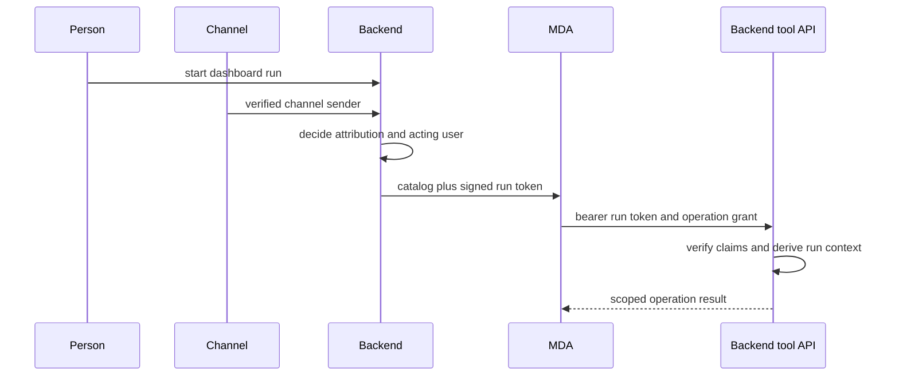

Open SWE separates **who is recorded**, **who may act**, and **which credential is used**. This is essential because an agent run can originate in the dashboard, a channel, or background automation, while the model and remote runtime must not be able to select a more privileged identity through tool arguments.

## Identity vocabulary and boundaries

- **Attribution** (`user_id`, and optionally `ls_attribution_identifier`) records the person associated with a run for tracing. Attribution alone does not authorize use of that person's connections.
- **Acting user** (`acting_user_id`) is the Open SWE user whose personal MDA connections a run may read. Dispatch adds it only when the person started the run (`as_sender`) or for a channel run whose sender was verified. Wakeups, event matches, and other background work can remain attributed to someone while acting as nobody.
- **Channel principal** is distinct from both: backend writes on a channel thread either carry MDA's trusted channel ingress identity for a verified person, or use the `mda:channel` service principal. The service principal intentionally owns no user connections.
- **Backend/deployment credentials** are not user credentials. The backend uses configured LangGraph/LangSmith API keys to administer Agent Server resources, and MDA uses a separately configured runtime-token secret to call the backend's run APIs.

*The backend establishes authority before MDA starts; later tool calls derive it from the verified token rather than model-controlled arguments.*

This distinction is a least-privilege invariant: an operation that names a user-owned connection is included only when `acting_user_id` is present. Agent-owned connections, such as the configured Exa connection, may be named regardless. The runtime reads only catalog-declared connections and supplies their values for the individual operation call; the backend exposes them through a context-local carrier rather than retaining them.

## Run tokens and operation grants

Before starting a hosted graph, the backend plans the run’s catalog and settings, creates a `RemoteRun`, assigns it a random grant ID, and signs the result into `__run_token`. The context given to MDA contains names-only catalog data plus this token, not backend session state. This supports stateless backend replicas: every callback supplies the bearer token and is resolved from verified claims and the request.

Runtime tokens are HS256 JWTs issued by `open-swe` for the `open-swe-remote-runtime` audience. They require issuer, audience, subject/thread ID, issued-at, and expiry claims; verification accepts configured signing keys (supporting key rotation) and a small clock leeway. Their expiry is fixed when first signed—re-signing a run does not extend it. Missing configuration, malformed claims, invalid audience/issuer/expiry, or an invalid signature prevents use. A separate audience is used for a worker grant: it permits a subagent to obtain its own run token from a coordinator’s catalog, not to reuse the coordinator’s authority directly.

A catalog-granted operation also carries an HMAC-derived, per-run/per-operation grant. The backend checks it against every currently configured signing key. Thus possession of a valid runtime token alone does not make every backend operation callable; the operation must have been granted when the catalog was planned.

## Dashboard, Agent Server, and GitHub credentials

The dashboard authenticates people through GitHub OAuth and creates a seven-day HS256 session cookie with the GitHub login (`sub`), optional profile fields, and Open SWE user ID. Login is gated by the configured permitted GitHub users or organizations. OAuth state is short-lived, tied to a random browser-cookie nonce by HMAC comparison, and redirects are restricted to same-origin relative paths or configured dashboard origins. Desktop handoff codes are short-lived and PKCE-bound; they carry inert identity claims rather than a session token.

GitHub OAuth access and refresh tokens are kept in a dedicated `github_oauth_token` user record, separate from editable profile data to avoid competing writes. They are Fernet-encrypted using `TOKEN_ENCRYPTION_KEY`: the first configured key encrypts and all configured keys can decrypt, allowing a most-recent-first key-rotation window. A token close to expiry is refreshed; an unrecoverable refresh failure removes the token record, while a transient failure retains the usable stored token.

GitHub access is selected from saved thread scope, not merely a requested login:

- A private thread may use personal GitHub OAuth only when its saved owner starts the run; system threads cannot be private-credential threads.
- A public thread resolves to the workspace GitHub App installation token, rather than a personal OAuth credential.
- PR authorship is a related but separate decision. In a shared user-owned thread, a named author must be a thread participant; private threads stay pinned to their owner and system threads use the App. Background completion must name a participant where it cannot identify the requester.

The Agent Server is another boundary: the deployment key authenticates as `openswe:backend` and is the only identity permitted to mutate its API. Dashboard sessions may authenticate as people but Agent Server read/search filters them to threads whose `owner_login` matches, and all non-backend mutations receive a forbidden response. Open SWE’s dashboard API is therefore the policy-enforcing path for user-initiated changes.

## MDA connections and external MCP servers

Connection references have an owner (`agent` or `user`) and a slug configured on the backend. The catalog attaches the references only to operations that need them—for example `web_search` reads the agent-owned Exa connection and `open_pull_request` can read the user-owned GitHub connection. MDA reads the connection value as the run immediately before use. This makes an unconnected user connection an availability/authorization problem for that server or operation, rather than a reason to expose a credential to the model or unrelated tools.

For an MCP server backed by an MDA connection, MDA loads its permitted tools once per run but reads the credential again for each invocation. A missing connection or authorization grant leaves that server out during discovery; a later call returns a safe error rather than revealing a secret. The MCP transport is deliberately constrained: it requires HTTPS, verifies that DNS results are global/public addresses, pins the actual connection to a checked address with the original host for SNI, rejects redirect/origin changes, and sends the credential only in the server’s configured header. Tool exposure is also an allowlist: only catalog-named server tools are retained, and duplicate/reserved `runtime` argument cases are excluded.

## Sandboxes: capability configuration stays outside model input

A sandbox is a per-thread runtime resource that MDA owns. The catalog selects its creation specification; MDA opens it as a run begins, retries transient service failures, and reports an unavailable sandbox or replaces a disappeared binding. This thread association is lifecycle state, **not an independent workspace-repository credential boundary**. Repository and permission narrowing belongs to the GitHub capability minted for the operation/proxy configuration.

The sandbox’s proxy configuration is capability-bearing and is never placed in model input. In the MDA-managed mode, MDA combines GitHub proxy rules—which read a designated MDA connection at write time—with a backend-produced configuration that names the opened sandbox. It writes the resulting configuration before preparation and periodically before model or tool work, so renewable credentials do not become stale. If the backend refuses to provide its portion, it writes the proxy configuration itself; if MDA is responsible and cannot complete the initial write after retries, the run ends rather than proceeding without the intended egress rules. On sandbox replacement, MDA discards the old backend portion, obtains configuration for the new sandbox, and never reuses the old sandbox’s workspace rules.

The backend’s `sandbox_proxy` operation itself derives the run configuration from the verified token and refuses unless the planned sandbox explicitly uses an MDA GitHub proxy connection. This preserves the separation between model-visible tool descriptions and the credentials/configuration that make network access possible.

## Operational guidance and focused coverage

Configure `REMOTE_RUNTIME_TOKEN_SECRET` on both sides of the backend–MDA boundary; comma-separated active values support verification during signing-key rotation, while the first key signs new tokens. Configure `DASHBOARD_JWT_SECRET` for browser/session and short-lived dashboard tickets, and `TOKEN_ENCRYPTION_KEY` for stored OAuth tokens. Missing runtime signing configuration prevents token issuance and verification; missing encryption configuration makes decryption safely return no token.

When changing identity behavior, preserve these checks rather than collapsing identities into a single “user” field:

1. Test token verification and operation grants when changing remote callback authority.
2. Test attribution-without-acting-user so background work cannot inherit personal MDA connections.
3. Test private/public/system thread credential selection and PR authorship separately.
4. Test Agent Server backend-only mutations and owner-filtered reads.
5. Test credential rotation and OAuth refresh failure behavior, plus MCP origin restrictions when altering external integration transport.

Focused examples include `tests/auth/test_agent_server_auth.py` for the Agent Server boundary, `tests/auth/test_thread_credential_scope.py` for thread/actor credential rules, `tests/auth/test_encryption.py` for key rotation, and `tests/auth/test_github_oauth_refresh.py` for refresh outcomes.

## Related pages

<!-- openwiki: broken internal link [/openwiki/architecture/backend-runtime-boundary] file "/openwiki/architecture/backend-runtime-boundary" does not exist. Fix the href or restore the target, then delete this comment. -->
- [Backend/runtime boundary](/openwiki/architecture/backend-runtime-boundary)
<!-- openwiki: broken internal link [/openwiki/architecture/tool-catalog-and-operations] file "/openwiki/architecture/tool-catalog-and-operations" does not exist. Fix the href or restore the target, then delete this comment. -->
- [Tool catalog and operations](/openwiki/architecture/tool-catalog-and-operations)
<!-- openwiki: broken internal link [/openwiki/integrations/channels-and-github] file "/openwiki/integrations/channels-and-github" does not exist. Fix the href or restore the target, then delete this comment. -->
- [Channels and GitHub](/openwiki/integrations/channels-and-github)
<!-- openwiki: broken internal link [/openwiki/integrations/sandboxes-and-mcp] file "/openwiki/integrations/sandboxes-and-mcp" does not exist. Fix the href or restore the target, then delete this comment. -->
- [Sandboxes and MCP](/openwiki/integrations/sandboxes-and-mcp)
