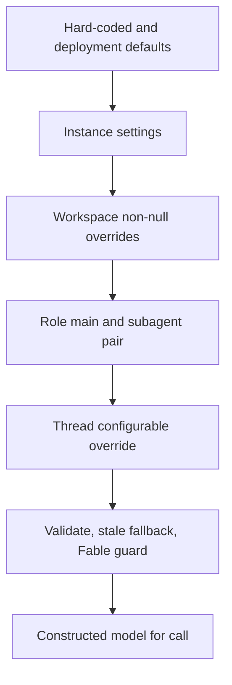

## Scope and ownership

A run's `configurable` mapping is the cross-boundary contract between launchers and graphs. `RunConfig` reads it from LangGraph's `RunnableConfig`; it carries identity and source, repository and source references, review data, model selections, behavioral flags, and background-job information. It deliberately accepts unknown keys, omits unset fields when it is serialized, and parses defensively: invalid fields are dropped one at a time rather than making a malformed optional value lose the rest of the run configuration.

Source provenance has a parallel durable representation. `SourceContext` is stored in thread metadata and watch records, identifies Slack, Linear, GitHub, and PR origins, preserves unknown fields, and falls back to an empty context on an unparseable value. Dashboard launches project that context into `configurable` without overwriting already chosen configuration values. This is provenance for routing and integrations, not a substitute for the conversation messages the model sees.

## Resolution and persistence

Model choice is resolved by role and scope rather than by an old per-user model preference. Effective workspace settings merge, in order, hard-coded defaults, the instance settings record, and non-null workspace overrides. A caller can then place a per-thread `configurable` choice above that result. The lookup is deliberately fail-soft: unavailable settings storage produces hard-coded defaults so an outage does not stop all agent, reviewer, and webhook runs.

Each configurable model/effort pair is validated against the supported catalogue. A configured unsupported or stale pair resolves first to a supported model from the same provider (and, for Claude, preferably its family), preserving effort only when that model supports it; only then does it use the deployment default. Deprecated ids are cleared on settings writes. Fable is a workspace-controlled ZDR guard: when disabled, stored Fable defaults are converted to a safe non-Fable fallback and construction entrypoints gate any residual Fable selection. An invalid deployment `LLM_MODEL_ID` or incompatible `LLM_REASONING_EFFORT`, in contrast, is an operator configuration error and raises.

The catalogue is also the UI and runtime capability authority: it records supported effort levels and image support, optionally enriches model options with input-context windows from provider profiles, and uses explicit overrides/fallbacks where profile metadata is unavailable. Do not infer context-window or image behavior from a model name.

This shows the settings resolution path before a model is constructed.

## Call-time model selection

The graph can shape a model call independently of static graph assembly. `CallShape` accumulates a system prompt and a set of hidden tool names; middleware is applied in graph order, allowing a component to prepend or append a prompt section or remove tools for a particular call. Prepared runs publish their rendered prompt into checkpointed state, and the base prepare middleware prepends it at call time.

Preparation is checkpoint-aware. It fingerprints the latest message plus relevant middleware configuration; the same invocation skips already checkpointed preparation, while a later invocation on the same thread refreshes ephemeral material such as prompts, tokens, and diff context. Preparation must therefore be idempotent, and `_rejoin` restores in-memory resources when a resumed managed run executes on another replica. Forked deep-agent contexts skip this root preparation.

When adaptive routing is enabled, the model-selection middleware first honors an accepted user-requested model, then a stored route, then a forced fast route, or classifies the latest authored human request into `fast`, `balanced`, or `performance`. It explicitly ignores XML dynamic-context envelopes while extracting that task and limits classification input to 8,000 characters. The selected route is persisted in state and the selected model replaces the call model. User model-request inference is separately constrained to the original human input and the current available model/effort options; classification failures or unavailable/incompatible requests can be represented without blindly constructing an arbitrary model.

## Prompt resources and input context

**Model-facing prompt text belongs in `openswe/resources/prompts` and must be rendered through `prompt()`, not newly inlined in Python.** Static Markdown resources load without substitutions; `.md.jinja` resources render under `StrictUndefined`, so missing template inputs fail rather than silently emitting an incomplete prompt. The same mechanism owns tool descriptions and special deployment context. Keep orchestration and data collection in Python, but put instructions, classifier criteria, and tool-facing prose in these resources.

Incoming content is serialized as XML-like `<input-message>` envelopes with validated namespaced sender/channel identifiers, surface, kind, and optional structured fields. Channel and system introductions are separate `<dynamic-context>` messages, deduplicated by a hash of canonical content. The hash is recorded so introductions are not repeated unchanged; after summarization, only context blocks after the summary cutoff count as visible, allowing a no-longer-visible identity block to be reintroduced. This preserves model context while avoiding both repeated boilerplate and a false assumption that summarized-away data remains available.

Repository conventions are an additional, bounded context source for review: the reviewer loads root `AGENTS.md`, falling back to `CLAUDE.md` only on a 404, at the relevant ref, and skips a file larger than 64 KiB or any non-404 fetch failure. For changed paths, directory-scoped documents are discovered shallowest-to-deepest and loaded from the trusted base tree; deeper instructions consequently appear later and can take precedence.

## Skills and visibility boundaries

Skills are stored as virtual `/<name>/SKILL.md` files with generated YAML frontmatter and instructions. Names are lowercase hyphenated identifiers; descriptions and instructions are bounded. Personal skills belong to a user record, organization skills have no user owner, and CRUD is exposed through authenticated personal routes while organization mutations require an administrator. The agent's skill backend is read-only and lazily loads the appropriate skill set on its first access.

The assembled agent backend mounts three read-only skill sources: bundled filesystem skills, organization skills, and—only when a private credential owner is resolved—personal skills. This makes personal skill availability follow the same private-owner boundary as personal integrations: public threads do not resolve a personal credential login, and a private run must be started by its recorded owner. A collaborative transcript can be copied to a newly owned private continuation, but the continuation is marked and excluded from requested-model handoff; its copied messages retain their collaborative origin annotation. Treat that copied history as conversation context, not authority to expose the original participants' personal tools or skills.

## Changing and testing safely

* Add or retire a model in the supported catalogue with its valid efforts and image capability; test default validation, stale-provider fallback, and Fable gating. Keep model-profile overrides narrowly scoped to verified provider metadata gaps.
* Add a setting as an optional tiered field, validate it at the write boundary, and preserve the fail-soft read behavior. Do not put model defaults back into `ProfileUpdate`: those keys are explicitly retired.
* Add prompt text or a tool description under `openswe/resources/prompts`, then call `prompt()` or `apply_tool_descriptions()`. Test static/template loading and template variables rather than duplicating prose in Python.
* Exercise XML envelope escaping and validation, dynamic-context deduplication and summarization visibility, and selection against real human envelopes. Representative tests cover input-message visibility, requested-model classification, middleware route precedence, workspace settings tiers, and read-only skill downloads.
* For private/public changes, test both credentials and mounted backends. Authorization must be derived from persisted thread visibility and owner metadata, not merely the sender name in a copied message.
