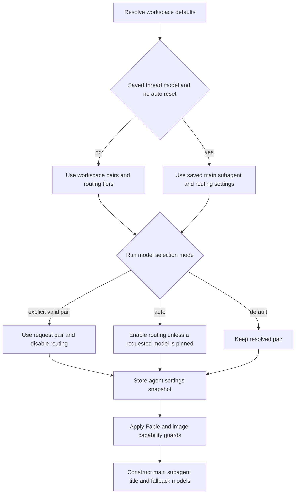

# Models, Profiles, and Instructions

Open SWE deliberately separates **workspace policy**, a **thread snapshot**, and the **current sender's context**. Workspace settings choose operational defaults for every run in a workspace. A thread records the choices under which it opened so that a long-lived, multi-party conversation does not silently change behavior when an administrator or participant later changes a setting. Per-message identity, personal preferences, and standing instructions are instead refreshed for the sender of that turn.

This page describes the agent path. Review-specific defaults use the same workspace settings object; see [Workspaces and access](workspaces-and-access.md), [Agent graph](../architecture/agent-graph.md), and [Context engineering](../workflows/context-engineering.md) for their wider roles.

## Configuration layers and ownership

### Deployment, instance, and workspace

`SUPPORTED_MODELS` in `openswe/dashboard/options.py` is the curated catalog, not a provider discovery mechanism. Each option declares its provider-prefixed id, label, valid reasoning efforts, default effort, image capability, and optionally whether it may become a saved default. Treat effort as model-specific: Kimi K3, for example, accepts only `low`, `high`, and `max`. Code accepting a selection must validate both membership and the pair with `model_supports_effort`.

`default_model_pair()` is the last-resort deployment default. It derives its model from `LLM_MODEL_ID` (or a credential-sensitive built-in default) and effort from `LLM_REASONING_EFFORT`, then rejects unsupported, non-default-eligible, or incompatible selections with `ValueError`. This makes an invalid deployment configuration fail explicitly rather than constructing an arbitrary provider client.

Workspace settings are stored in PostgreSQL as two tiers:

* The **instance** record sets organization-wide overrides.
* A **workspace** record stores only its own non-null overrides. Effective settings merge hardcoded defaults, then instance fields, then workspace fields.

Reads are fail-soft: if the settings store cannot be read, agent and webhook paths receive hardcoded defaults. Writes validate every configured main, subagent, routing, reviewer, and title model/effort pair. The `WorkspaceSettings` resolver always returns a constructible default pair: valid saved choice, otherwise a same-provider fallback, otherwise the deployment default. A stale Claude id preferentially stays in its Claude family; an explicitly deprecated id is not migrated by `canonical_model_pair` and instead defers to defaults.

Workspace settings also own three independent agent model concerns:

* Main and subagent defaults for `agent` and `reviewer`, plus a separate title model.
* The `fast`, `balanced`, and `performance` agent-routing tiers, enabled only when `model_routing_enabled` resolves to `True`.
* Gateway and Fable policy. `gateway_enabled` is tri-state: `True`/`False` wins, while `None` inherits `LANGSMITH_GATEWAY_ENABLED` (or the dedicated gateway-key signal). Fable is disabled by default; when disabled, Fable defaults are rewritten to a supported non-Fable Anthropic fallback and runtime construction gates stale Fable selections again.

The dashboard `GET /options?workspace=…` resolves that workspace before returning choices. It removes disabled Fable models, gates its advertised defaults, and returns copied model records enriched with a context-window value obtained from an explicit Codex override, a LangChain provider profile, or a fallback table. It does not mutate the catalog.

### Profiles are sender preferences, not model defaults

A user profile is a `UserRecords("profile")` record keyed by GitHub login. It holds editable repository/branch, PR, review, UI, and feature preferences; `draft_prs` and `recent_thread_context_enabled` are examples used on the run path. Historical profile model fields are explicitly retired and stripped on reads and writes. Model selection is therefore no longer a profile override layer.

OAuth data is intentionally separate: encrypted GitHub tokens live in `UserRecords("github_oauth_token")`. Profile updates touch only the profile record and token refreshes touch only the token record, preventing their independent read-modify-write flows from clobbering each other. Agent startup loads profiles fail-soft, so an unreadable profile costs a run its user preferences rather than the run itself; dashboard reads use the direct accessor and may surface the failure.

## Resolution and persistence for an agent run

The factory entrypoint is `openswe.server.get_agent`, which calls `build_agent` for an executable thread. It loads normalized `agent_settings` from thread metadata and workspace settings for the run's workspace. Thread settings are cached for five minutes, type-checked against a narrow schema, and read fail-soft. Invalid or obsolete metadata normalizes to an empty snapshot. Normal writes log and continue on failure; the model-handoff path can request a strict write because persistence is essential to that handoff.

*Caption: model selection begins with workspace defaults, but a thread snapshot preserves its operational model choice until an explicit reset or replacement path changes it.*

The important precedence and lifecycle rules are:

1. The factory starts with the workspace agent main/subagent defaults, routing tiers, and title model. On a first run—or after a deliberate dashboard auto reset—it may load the initiating sender's profile for non-model preferences. Once a thread has `model_id`, its model snapshot wins over changing workspace defaults.
2. `configurable.agent_model_id` and `agent_effort` replace both the main and subagent pair only when they name a supported model and a valid effort. Explicit selection disables adaptive routing. For an image-capability replacement of an otherwise pinned model, the temporary image pair is applied after the snapshot is persisted rather than replacing the saved preference.
3. Dashboard `model_selection="auto"` can deliberately reset a previous requested model and turn routing back on. In automatic routing, the initial main model is the `fast` tier; an uncertain router stays within those tiers rather than falling outside the configured choices. A Slack ask is not adaptively routed. Incident runs default to the performance tier when no explicit model is supplied.
4. When request-model handoff is enabled for an opening dashboard or Slack turn, the prepare middleware validates a recognized requested model, effort, and image support. It then strictly persists `requested_model`, its pair, and `model_handoff_complete`. Later turns reuse that pinned request rather than classifying the conversation again.
5. The resolved snapshot includes main/subagent pair, routing state and tiers, handoff state, requested model, and repository instructions. It is written before the runtime Fable guard so toggling Fable off remains effective on every later run.

Image input has two safeguards. The factory installs `ImageModelFallbackMiddleware` whenever the main, requestable, or routing candidates include text-only models; text-only calls switch to `default_vision_model_pair()`. During request-model handoff, explicitly asking for a text-only model with image content is rejected instead of silently accepting an incompatible request.

## Provider construction and runtime recovery

After selection, `provider_model_kwargs` translates the selected effort at the provider boundary. OpenAI receives a `reasoning` object (with `summary: "auto"` except at `none`); Anthropic receives adaptive summarized thinking plus `effort`; Gemini models receive a normalized `thinking_level`; Fireworks receives `model_kwargs.reasoning_effort`; and Baseten uses `reasoning_effort` only for its supported values.

`make_model` is the sole construction boundary around `init_chat_model`. Shipped provider prefixes receive six retries and a 600-second request timeout (Gemini 4 Argon has its own 900-second default). OpenAI uses the Responses API with `store=False`, `output_version="responses/v1"`, and encrypted reasoning content included; a gateway may switch it to Chat Completions. Baseten is constructed as OpenAI-compatible and requires `BASETEN_API_KEY` plus its service URL when gateway routing is not applied. Configured Codex variants receive a profile override that carries their context-window correction.

When gateway routing is effective, `gateway_overrides` replaces direct provider base URL and API key, and controls OpenAI Responses use. Only OpenAI, Anthropic, Baseten, Fireworks, and Google GenAI have gateway paths. A missing LangSmith key or unroutable provider is logged and falls back to direct provider construction rather than failing the run.

This is separate from failure fallback. `ModelFallbackMiddleware` receives a fallback model chosen by the configured fallback policy: Anthropic primaries can fall back to OpenAI and vice versa, while Google and other non-listed providers return no cross-provider fallback. Model setup failures are deferred into an error model so the failure can be delivered through the run instead of crashing graph construction.

## Instructions and prompt assembly

Instruction sources have different scope and persistence.

| Source | Owner and storage | When resolved | Scope |
| --- | --- | --- | --- |
| Default prompt | `DEFAULT_PROMPT_PATH` or packaged `openswe.resources/default_prompt.md` | Prompt rendering | System prompt baseline |
| Workspace instructions | Workspace record | Every prepare-run | Shared system prompt for its workspace |
| Repository custom instructions | PostgreSQL `agent_instructions`, one row per normalized repository | First thread snapshot | Shared system prompt for the thread |
| User custom instructions | `UserRecords("instructions")`, keyed by GitHub login | Every turn for every participant | That person's sender context |
| `AGENTS.md` | Repository checkout | Agent follows repository setup instructions | Repository-local authority |

Repository instructions are edited through the dashboard API after repository-access checks. Their store is case-insensitive through the repository key, and deletion cascades with the repository row. On a new thread, the factory resolves instructions for the effective default repository and saves them in `agent_settings.repo_instructions`; later runs use that snapshot. A failed lookup merely omits the section. `construct_system_prompt` renders the saved text using the **Repository-specific Custom Instructions** section alongside the default prompt, source guidance, organization repository scope, collaboration guidance, workspace instructions, and other runtime context.

Personal instructions are capped at 20,000 characters and are intentionally outside profiles because both the dashboard and the `save_user_instructions` tool can write them. For each turn, the factory resolves each thread participant's current record and includes it as that participant's `standing_instructions` in a person-context message. This makes instructions follow the message sender, not the user who opened the thread. If the tool changes instructions during a run, it returns a system reminder with the new text: the prompt copy is deliberately not rewritten mid-thread, preserving prompt-prefix caching.

Authority is stated in the prompt resources: workspace instructions yield to repository-specific instructions and `AGENTS.md`; repository instructions yield to `AGENTS.md`; personal standing instructions yield to repository instructions and `AGENTS.md`. Custom instructions cannot override fixed system constraints such as the delivery-link rule. Do not treat personal instructions as a thread-wide policy or transfer them between participants.

## Safe changes and focused tests

When adding a model, update the registry and its effort/image declarations first, then verify workspace validation, stale fallback, Fable gating, provider kwargs, gateway behavior, and image fallback. Adding a routing tier or thread field requires updating the typed `ThreadSettings` schema and its normalization rules; otherwise old metadata is discarded as invalid.

Focused coverage includes:

* `tests/models/test_model_fallback_resolution.py` for provider-preserving recovery, deprecated choices, credential-sensitive defaults, Fable fallback, and workspace-pair validation.
* `tests/agent/test_thread_settings.py` for rejecting malformed thread snapshots.
* `tests/agent/test_agent_instructions.py` for case-insensitive/idempotent repository records and access-filtered APIs.
* `tests/agent/test_user_instructions.py` for login-required, bounded tool writes and the mid-run reminder behavior.
* `tests/agent/test_model_handoff_prepare.py`, `tests/agent/test_model_handoff_resume.py`, and `tests/middleware/test_model_selection.py` for request handoff, persistence/resume, and routing behavior.
