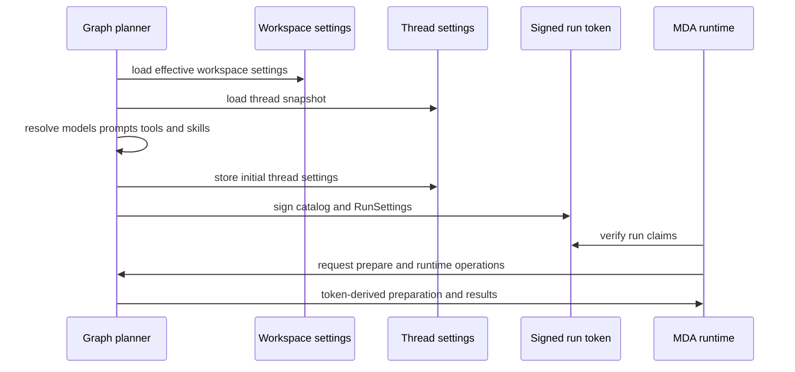

# Models, Prompts, Skills, and Settings Resolution

Open SWE separates **configuration resolution** from **run execution**. Workspace and user records are inputs to planning; the resulting run decisions are captured in the thread snapshot where appropriate and in a signed runtime token for MDA. This prevents a later settings edit—or untrusted model-controlled tool argument—from changing what an already-started run is authorized to do.

## Scope and ownership

| Scope | Owner and lifetime | Examples | How it is applied |
| --- | --- | --- | --- |
| Deployment | environment and packaged resources | default model, default prompt file, allowed GitHub organizations | supplies hard defaults and shared prompt content |
| Instance and workspace | PostgreSQL settings records | model defaults, routing tiers, gateway and Fable flags, review guidance | workspace overrides inherit instance values, which inherit hard defaults |
| User | profile, preferences, and instruction records | default repository and PR preference; standing instructions; personal skills | read for the participant or private credential owner; not a replacement for workspace settings |
| Repository | repository instruction record | custom coding instructions for a repository | captured in the thread settings snapshot and rendered into the thread prompt |
| Thread | thread metadata and checkpoint state | selected model, routing defaults, repository instructions, rendered prompt | preserves stable behavior across a multi-party thread |
| Run | `RunConfig`, catalog, and `RunSettings` | resolved model/effort, source, draft-PR choice, turn preparation settings | planning emits these; MDA receives them through the signed run token |

A `RunConfig` is the permissive transport contract carried in LangGraph `configurable`: unknown keys round-trip, malformed fields are dropped individually, and fields are optional because triggers differ. It is not the authority for remote calls. `RunSettings` is the planning result copied into the signed `RemoteRun`; later MDA calls use token claims rather than model-controlled arguments for run configuration and metadata.

## Settings hierarchy and failure behavior

Workspace settings resolve in this order:

1. hardcoded defaults (including the deployment's valid default model pair);
2. non-null fields from the instance record;
3. non-null fields from the selected workspace record.

A workspace record contains only its overrides: clearing a field restores inheritance. Workspace names are slugified; a runtime lookup without a usable workspace falls back to the default workspace. Reads intentionally fail soft to defaults, so an unavailable settings store does not stop all runs. Cached reads use a workspace-qualified, generation-keyed shared cache; every settings save changes the generation, and a failed read's fallback is not cached for other replicas.

The model registry defines supported IDs, accepted effort values, image capability, and context window. Settings writes reject invalid model/effort pairs, discard explicitly deprecated pairs, and enforce the Fable policy. At resolution time a no-longer-supported non-deprecated model first falls back to a supported model from the same provider (and Claude family where possible), preserving effort when supported; only then does it use the deployment default. Fable is gated again at model construction, so disabling it cannot leave a previously resolved Fable model reachable.

User profiles no longer select the agent model or routing mode: those retired fields are removed on reads and writes. Profiles still provide personal behavior such as draft-PR preference and workspace-specific default repositories. Repository instructions are stored per canonical repository and are limited to 32 KiB; user standing instructions are separate user records limited to 20,000 characters.

## Planning: from settings to a fixed run

The agent graph factory loads the workspace settings (explicitly by the run's workspace slug), the thread snapshot, sender profile, access scope, and other resources. It resolves the main and subagent models, routing tier pairs, title model, gateway use, and Fable policy. The initial result is stored in `agent_settings` on the thread: main/subagent pair, routing enabled state and tier pairs, model-handoff state, requested model, and repository instructions. Thus changing workspace defaults generally affects **newly initialized threads**, while a later message in an existing thread reuses its stored snapshot. An explicit per-run model override is the documented path that can rewrite it.

*Planning snapshots thread-level choices, then MDA uses the signed run token to call the backend during execution.*

`RunSettings` contains the resolved source, draft-PR flag, main model and effort, plus `AgentTurnSettings` for an agent run. The latter includes the initiating and credential logins, title model, routing rules and route pairs, whether requested models are offered, Fable/gateway state, bridge and review state, and tool-discovery failures. The catalog separately declares models, routes, tool grants, skill source names, sandbox, and loop rules. This distinction matters: user/workspace/run state is resolved before the token is signed; it is not data “signed into” the token merely because it was present in a prompt or transcript.

## Model selection, routing, and fallback

For a fresh eligible dashboard or Slack thread, the opening task can be classified for an explicit model and reasoning effort. The classifier only considers the supported models currently offered, including the performance tier as a request category. An unavailable model or effort, an effort without an available model, an unsupported pairing, or a text-only requested model with image input fails preparation rather than silently choosing something else. A valid request is saved to thread settings, disables adaptive routing, and is reused on later turns.

Without a saved explicit request, adaptive routing uses the workspace's `fast`, `balanced`, and `performance` pairs. It starts from Fast; per-turn route selection uses the latest human request, ignoring injected dynamic context. A route already in checkpoint state is reused, a split can force Fast, and an uncertain classifier result does not persist a route. Dashboard `Auto` reset clears the checkpoint route and requested-model state. Slack `/oswe` questions do not route adaptively and use the asker's default. Image input may temporarily substitute an image-capable model for a pinned text-only selection.

The primary model is wrapped with `ModelFallbackMiddleware`, using the configured fallback model if one is available. Model construction failures are deferred into an error model rather than failing planning immediately. MDA receives the main, subagent, route, and optional vision model specifications in the catalog; its model-choice path selects the planned route. The resolved main model and effort are also recorded in run configuration and later run-start metadata for attribution.

## Prompt composition and lifecycle

Model-facing prompt resources live under `openswe/resources/prompts`. Use `openswe.prompts.prompt()` to load static Markdown or render `.md.jinja` templates. The loader rejects absolute and parent-traversal paths; it uses Jinja `StrictUndefined`, so a template with missing substitutions fails instead of producing a partial prompt. Tool descriptions are also sourced from `tools/<name>` resources. Do not add inline Python prompt text when a model-facing prompt belongs in these resources.

The first preparation of a thread renders a `SystemPrompt` into three stable layers:

1. **shared** deployment/agent content: dashboard context, configured default prompt, collaboration instructions, and external-comment treatment;
2. **workspace** content: workspace instructions, repository list, and optionally workspace memory;
3. **thread** content: artifact and default-repository information, repository custom instructions, and thread-specific mode flags.

The result and its separate workspace/thread portions are saved in checkpoint state with `system_prompt_fixed`. Later turns do not regenerate it, both to preserve the thread's original context and to retain provider prompt-cache prefixes. Changing workspace instructions or repository instructions therefore takes effect when a relevant new thread renders its prompt, not by mutating a fixed prompt in an existing checkpoint.

Per-user standing instructions are deliberately different: preparation resolves them for each known participant and injects them in that participant's dynamic person-context message. They are sender/participant scoped, can change during a long-lived thread, and are sent again only when their context hash changes. Turn context—working directory, source guidance, recent threads, and tool-catalog notes—is likewise injected as deduplicated dynamic user messages rather than appended to the fixed system prompt.

At MDA call time, middleware applies the stable prompt in cache-oriented order: graph instructions and common tool/browser content, then run shared prompt and workspace prompt, then the listed skills, then the thread prompt. Anthropic calls mark the shared and workspace blocks as ephemeral cache breakpoints; the prompt cache middleware uses the remaining system/conversation breakpoints without exceeding the provider limit. Other providers receive the same text without Anthropic cache controls.

## Skills: sources, precedence, and isolation

Skills are virtual read-only `SKILL.md` files. Dashboard APIs allow users to create, update, list, and delete personal skills; organization skill APIs require admin access. Skill names are constrained to lowercase words joined by single hyphens, and each stored file includes YAML frontmatter with its name and description.

A run exposes bundled, organization, and—only when private credential scope resolves—a user's personal skill store. The source order is user, organization, bundled, and a later source replaces an earlier source with the same skill name. If credential resolution fails, personal skills are omitted rather than guessed. MDA lists the run's skills through the backend, presents them to the main agent and subagents with the skills middleware, and serves subsequent reads from an in-memory listing for that run. Writes, edits, deletes, and uploads through the skill backend are denied.

A shared graph must not retain one actor's skill list in a thread checkpoint. Accordingly, the runtime lists skills afresh for every run; the listing is cached only within that run and is pre-fetched when skill sources exist. This ensures a public/shared thread does not inherit a prior actor's personal skills.

## Operations and safe extension points

- **Add or revise a prompt:** add Markdown or Jinja resources below `openswe/resources/prompts`, render them through `prompt()`, and supply explicit template values. Keep stable versus turn-varying content in the appropriate prompt layer.
- **Add a model:** update the supported model registry with its efforts, image capability, and context window; ensure default and fallback rules accept it; then cover validation and fallback behavior in tests. Model/effort validation is a safety boundary, not merely dashboard validation.
- **Add a setting:** decide its scope first. Add a tiered workspace field only when it is an organization/workspace policy; keep personal preferences in profile/user records; put per-thread continuity choices in `agent_settings`; and put only planning decisions needed by remote calls in `RunSettings`/`AgentTurnSettings`.
- **Change MDA middleware order cautiously:** prompt order is a cache and correctness contract. `RunPromptMiddleware` must remain outside skills and `ThreadPromptMiddleware`, while skills remain available to subagents.
- **Add a skill source:** preserve read-only semantics, deliberate source precedence, and private credential checks. Do not cache a user-specific listing across runs.

## Focused verification

The focused settings tests demonstrate instance-to-workspace inheritance, clearing overrides, workspace-qualified cache isolation, immediate generation invalidation, and fail-soft reads that are not cached. Model tests cover provider-preserving fallback, invalid effort rejection, credential-sensitive deployment defaults, and the Fable fallback. The MDA model-call test verifies the prompt layer order, Anthropic cache breakpoints, and fallback calls without cache controls; preparation tests verify that opening requests are validated and persisted before work starts and are reused later.

See also: [Run State and Transcript](/openwiki/concepts/run-state-and-transcript.md), [Tools and Sandbox Access](/openwiki/concepts/tools-and-sandbox-access.md), [Dashboard Channel](/openwiki/integrations/channels-dashboard.md), and [Configuration and Deployment](/openwiki/operations/configuration-and-deployment.md).
