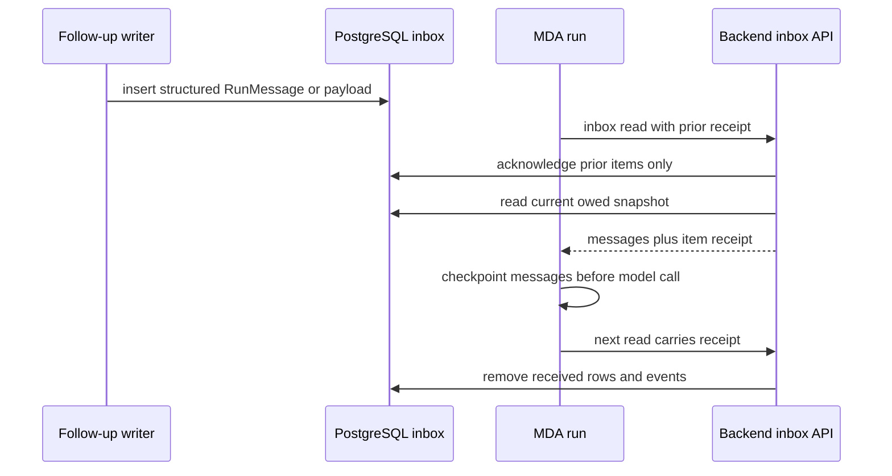
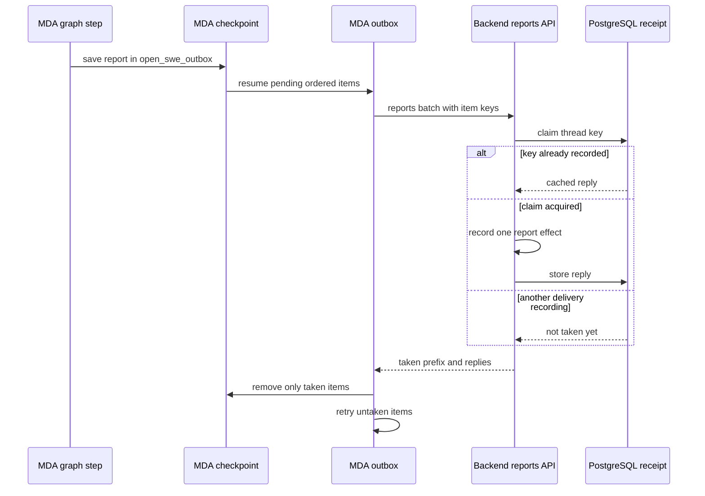

# Run State, Messages, Transcript, and Delivery Guarantees

Open SWE runs remotely on Managed Deep Agents (MDA), while the backend is intentionally stateless between calls. Durable execution state belongs either to the MDA checkpoint—model-loop state, tool results, sandbox state, and middleware state—or to PostgreSQL—thread-owned records, inbox work, report receipts, and the transcript. A backend request may land on any replica; it must be answerable from the signed run token, its typed request, and durable state, never from a Python process's memory.

This split is not a duplication of one database. The checkpoint is the authoritative continuation of the agent computation. PostgreSQL is the authoritative record for backend-owned thread work and the user-facing audit trail. The signed token fixes decisions made when the run was launched, while thread metadata supplies durable thread-level integration and presentation context.

## State ownership at a glance

| State | Owner | Purpose and lifetime |
| --- | --- | --- |
| Agent messages, model loop, tool-call results, sandbox, and `open_swe_outbox` | MDA checkpoint | Resume the computation after a process restart or an interrupted run. Checkpointed state advances with graph steps. |
| `RemoteRun` identity, `RunSettings`, operation grant ID, configurable values, and metadata | signed runtime token | Carries the immutable authority and planning result used by backend callbacks for one run. |
| Thread index and metadata | PostgreSQL / thread store | Durable thread identity, access/presentation metadata, and state shared across invocations. It is mirrored into the transcript where transcript readers need it. |
| Follow-ups | `thread_queued_message` in PostgreSQL | Per-thread, ordered durable inbox rows until a run acknowledges consumption. |
| Event matches and task messages | PostgreSQL | Backend-owned work owed to a thread until received. |
| Report receipts | `agent_report_receipt` in PostgreSQL | Per-thread idempotency and cached replies for backend report delivery. |
| Transcript events, projections, attachments, and tool output | PostgreSQL | Append-only, reader-facing history and derived snapshot of turns, messages, tools, notices, and usage. |
| In-process sessions and middleware registries | process-local cache only | Reconstructable coordination/efficiency aids; they cannot be required to preserve a run across replicas or restart. |

`RunConfig` is a permissive transport shape for LangGraph `configurable`: its fields are optional, unknown keys round-trip, and parsing drops only malformed fields. It is useful at local graph boundaries, but it is **not** the authorization source for remote calls. The backend plans the catalog and settings once, puts them into `RemoteRun`, signs the token, and later reconstructs configuration from verified claims. The token is HS256 signed with `REMOTE_RUNTIME_TOKEN_SECRET`, has issuer/audience/subject and expiration validation, and normally expires after 48 hours (with 60 seconds of verification leeway). It contains the thread ID as subject, assistant ID, configurable and metadata mappings, resolved settings, and—when applicable—an operation-grant ID. Per-operation grants are HMAC-derived from the thread, grant ID, and operation, so a model cannot authorize a tool by supplying a different argument.

## Starting a run: fix decisions before execution

The dispatcher builds a `RemoteRun` from trusted thread/configuration inputs, gives it a fresh grant ID, asks the hosted graph to plan its catalog and settings, then signs the resulting run. The catalog names capabilities MDA may use; `RunSettings` captures resolved decisions such as source, model, effort, draft-PR behavior, agent-turn routing and credential context, and the digest of the retained tool set. A backend callback uses verified claims rather than model-controlled tool arguments to determine thread identity, configuration, or authority.

`run_config()` reconstructs a `RunnableConfig` from the token for backend work, adding the run's resolved settings after planning and the thread ID. A report left by an earlier run can name its original invocation, so the backend can attribute transcript and usage recording to that invocation even when a later run delivers the report.

## Structured input is the delivery contract

Agent-facing notifications and human inputs are `RunMessage` values, built with `human_input`, `system_input`, `build_input_messages`, or `build_run_input`. Their text is serialized as an XML-like `<input-message>` envelope with a validated namespaced sender ID, surface, kind (`human` or `system`), optional channel, and structured data elements. Text and attributes are escaped; multimodal non-text blocks retain their order and are not converted to text.

Use these builders rather than raw prose or feature-specific queue payloads. A `system_input` is represented as a user-role message with notification metadata, allowing the model to distinguish a system notification from an ordinary person follow-up. Dynamic person/channel/system introductions are separate, content-hashed messages: a batch injects each only when it is not already visible to the model. Summarization can remove earlier context from the model's visible prompt, so deduplication uses the visible suffix rather than all checkpointed messages.

Most importantly, a queued value that is already a valid `RunMessage` is delivered unchanged. The inbox must not wrap its envelope again: one structured envelope must remain one message for transcript parsing and sender attribution. Model-only context should use a structured system sender so it can be excluded from pending previews and transcript display; normal human follow-ups and user-facing events must remain visible.

## Inbox: read first, acknowledge later

A running agent reads the thread inbox before each model call. `ThreadInbox.read()` takes a snapshot of three independent sources in parallel:

- queued follow-ups, ordered by the database-generated `seq`;
- task messages owed to the thread; and
- event matches owed to the thread.

Reading does **not** consume anything. The returned `Inbox` includes delivered messages, a list of queued sequence numbers and event IDs, and state updates such as a reply-surface change. On the next inbox call, MDA sends the prior receipt; `ThreadInbox.receive()` deletes only those queue rows and marks only those events received. Consequently, a run that crashes before acknowledgement leaves work for the next run, and a message inserted after the read snapshot cannot be deleted by that receipt.

`QueuedMessage.put()` is insert-only, caps a thread at 100 retained follow-ups by dropping the oldest rows, and can deduplicate dashboard retries by `(thread_id, queue_id)`. Event work is similarly held until acknowledged. A run launched specifically to carry event IDs receives those IDs during preparation, rather than waiting until its first normal inbox read.

*Inbox delivery is at-least-once until the subsequent receipt; only the snapshot a run actually read is acknowledged.*

## Outbox and reports: ordered, retrying, effectively-once recording

MDA emits model-result reports, tool-start/tool-result reports, inbox receipts, and asynchronous backend notices through its `Outbox`. Pending items are stored under the checkpoint state key `open_swe_outbox` in the same graph step that produced them. They are ordered, batched (up to 64 items or 4 MiB), briefly gathered so related reports travel together, and submitted to the typed `reports` endpoint. The outbox does not discard an item until the response explicitly says it was taken.

Transient call failure causes retry with exponential backoff from 1 to 30 seconds. After an hour with no successful take, remaining items are deliberately left checkpointed for a resumed or later run on that thread. A draining phase waits up to five minutes, logs and continues if reports remain. Backend refusals stop the ordered prefix; an item refused three times is dropped so an unrecordable report cannot block everything behind it. Tool results may be carried by reference to a checkpointed `ToolMessage`, avoiding duplication while retaining the ability to restore the report after restart; if that result was summarized away and cannot be rebuilt, the outbox logs and drops that item rather than permanently blocking the thread.

The backend preserves report order by processing the batch prefix only. For non-idempotent report endpoints it first claims `(thread_id, idempotency_key)` in `agent_report_receipt`. A committed receipt caches the reply, so a replay returns the same reply without re-recording the effect. A concurrent delivery that is still recording blocks the later batch prefix; a lease older than 10 minutes can be taken over. If recording fails, the claim is released for retry. Recorded receipts are retained for seven days and purged in short, skip-locked batches. This gives retrying transport with effectively-once backend effects within the receipt-retention horizon, not a claim that the network delivers exactly once.

*The checkpointed outbox retries until acknowledged; PostgreSQL receipts make duplicate report submissions safe and preserve ordered-prefix processing.*

## Transcript: durable reader-facing history

The transcript is an append-only PostgreSQL event log, not the MDA checkpoint. `TranscriptMiddleware` observes model calls, tool calls, human inputs, notices, and terminal turn outcomes. It creates and starts a turn, records streamed assistant fragments and then a canonical completed message, records tool starts/completions, persists usage reported with AI messages, and finishes the turn as completed, failed, or interrupted. Full tool output and attachment bytes are stored beside the event log; tool events contain display-safe metadata and a preview.

`append()` is the only transcript writer. Under a per-thread PostgreSQL advisory transaction lock, it reads the head, assigns gapless versions, writes events plus projections/attachments/tool output and command receipts, updates the head, and sends a database notification in the same transaction. Replaying a `command_id` returns its original version rather than adding a second event. A transcript must begin with `thread.created`; later commands cannot accidentally create a partial transcript. Readers can therefore resume with `version > after` and see only committed versions.

The middleware treats transcript recording as observability: failures are logged rather than failing agent work. Its process-local queue/writer is flushed before a callback returns so another backend replica can rejoin using PostgreSQL; on rejoin it looks up the run's turn and recorded message IDs rather than trusting memory. A newly transcribed thread is stamped with transcript metadata only after its `thread.created` event commits, preventing the UI from switching to an empty transcript reader.

Turn settlement has two layers. Normal `run_ended` reports invoke the middleware's `after_agent` hook. Cancellation and platform completion are safety nets: `settle_run_turn()` only settles an open turn that belongs to the named run, falling back to an unstarted turn only when appropriate. This prevents a late completion from an old run from closing the next requested turn. The run-complete webhook is authenticated by `RUN_COMPLETE_WEBHOOK_SECRET` and fails closed when absent; terminal platform outcomes also finalize usage telemetry and can issue an idempotent failure response on supported surfaces. The webhook and reconciliation paths thus ensure a terminal signal even when in-run middleware did not execute.

## Usage and operations

`RecordRunUsageMiddleware` tags model responses with the invocation ID and selected route, records terminal model-call failures immediately, and finalizes invocation usage after the agent completes. The completion webhook repeats terminal finalization using the platform payload, which covers runs that end outside the normal agent hook. Invocation IDs, rather than an arbitrary tracer run ID, are the correlation key for usage.

Operationally, ensure both `MDA_RUNTIME_URL` and `REMOTE_RUNTIME_TOKEN_SECRET` are configured before starting the backend. Set `RUN_COMPLETE_WEBHOOK_SECRET` and a non-loopback HTTPS completion URL to enable authenticated completion callbacks; without the secret the endpoint rejects all calls and failure replies are disabled. Do not use backend memory to add durable queue, report, transcript, or turn state: add a checkpoint field when MDA must resume computation, or a PostgreSQL record when the backend/thread must own it.

## Safe extension points and focused coverage

- **New agent notification:** construct a `RunMessage` with `system_input` or `build_input_messages`; keep the resulting envelope intact through queue and inbox delivery.
- **New backend side effect requested by MDA:** make it a typed endpoint/report with explicit delivery semantics. If retried delivery would be unsafe, use a stable key and receipt-backed idempotency.
- **New user-visible activity:** append a typed transcript event via `Command`, with a stable `command_id`; do not update transcript projections directly.
- **New per-run fact:** resolve it during planning into signed `RunSettings` or derive it from verified token claims. Do not trust a tool argument or a process cache.

Focused tests validate envelope escaping and multimodal preservation, notification metadata, and visibility-aware dynamic-context reinjection in `tests/agent/test_input_messages.py`; permissive, field-level `RunConfig` parsing in `tests/agent/test_run_config.py`; inbox snapshot/receipt and structured-message behavior in `tests/threads/test_inbox.py`; and real-schema transcript gaplessness, command deduplication, projections, tool-output truncation, thread isolation, and late-turn settlement in `tests/transcript/`.
