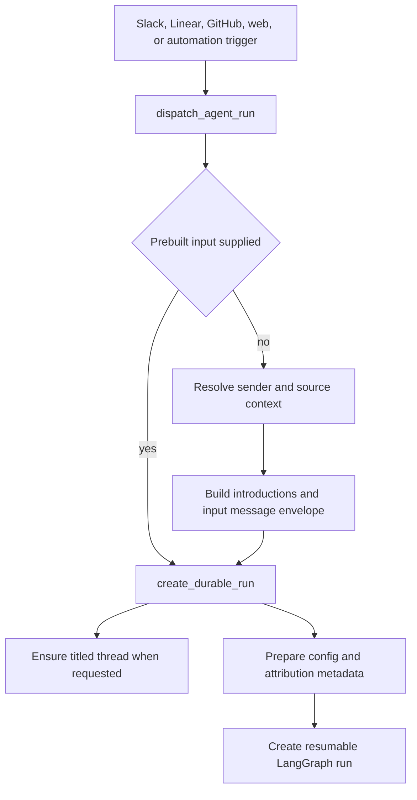
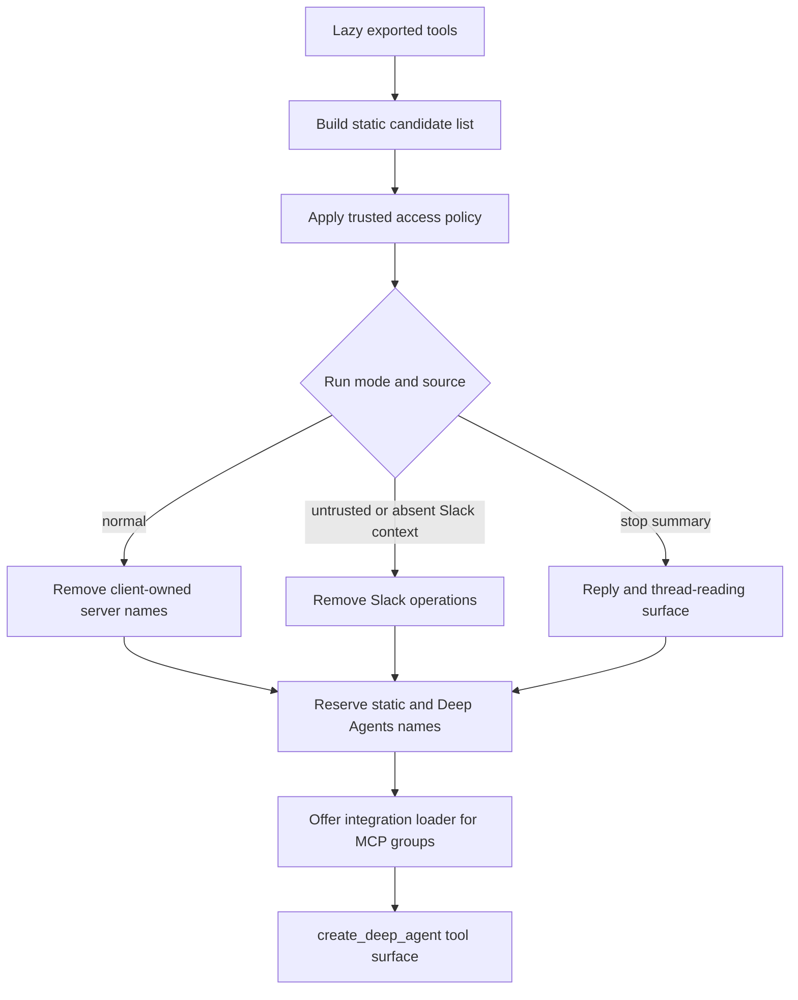

# Run inputs, tool policy, and agent capabilities

Open SWE separates *what arrived* from *what an agent may do*. Every product trigger is converted to a structured run input, then dispatched with durable LangGraph defaults. At graph construction, the agent receives a deliberately assembled tool surface rather than the entire `openswe.tools` catalog. Middleware can further shape a model request, handle recoverable failures, and inject run-specific capabilities and context.

This division is important for safe changes: an exported tool is not automatically available; client-provided source data is not authority; and a tool failure ordinarily becomes information the model can act on rather than a failed run.

## From source event to durable run

`dispatch_agent_run` is the common dispatch boundary for Slack, Linear, GitHub, dashboard, and other callers. It accepts either a fully built `RunInput` **or** authored content plus source identities—not both—and turns the latter into input messages before calling `create_durable_run`.

This diagram shows the single input/dispatch path and the point at which a normalized turn becomes a durable run.

The default multitask strategy is `interrupt`: a new turn interrupts active work on the same thread so the next execution sees the checkpointed history plus the new input. Callers that intentionally want background follow-up behavior can choose another strategy such as `enqueue`. Dispatch uses asynchronous durability, requests all v3 stream modes plus subgraphs, and makes streams resumable. It creates or titles a system-owned thread when given a title, attaches a completion webhook only when its secret and a non-loopback absolute URL are configured, and refreshes PR UI state for reviewer-related runs.

Before creation, `prepare_run_config` removes stale per-turn attribution fields, merges caller metadata, generates or preserves an invocation ID and start time, enables the v3 streaming compatibility marker, and writes the identifier to both metadata and configurable values. Follow-up configuration carries the original workspace (including legacy `environment`) and a `SourceContext` reconstructed from thread metadata, rather than inventing a new source route.

## Normalized message envelopes and source context

A `RunInput` is a `messages` list, optionally with `files`. Authored human or system content is wrapped in an XML-like `<input-message>` envelope whose required attributes identify a namespaced sender, source surface, and `human` or `system` kind. Slack can also contribute a namespaced channel identity and channel name, topic, purpose, and thread identifier. Sender resolution prefers a Slack triggering user, then GitHub login, then a Linear email; otherwise dispatch identifies an Open SWE system sender. Canonicalizing a person identity ensures that equivalent identities do not create divergent sender IDs.

The input builder precedes the actual message with deduplicated `<dynamic-context>` introductions for channels and systems. It hashes canonical context content and only adds an introduction whose hash is not already recorded. This makes durable, thread-constant context visible without repeating it on every turn. It also accounts for conversation summarization: only hashes still visible after a summary cutoff count as introduced, so context that was summarized away can be reintroduced.

`SourceContext` is a separate, durable description of where the thread originated: Slack references, a one-off Slack response route, Linear or GitHub issue references, and PR number. Its models preserve unknown fields and dump only fields that were actually set, allowing integrations to enrich and round-trip metadata without erasing newer fields. Parsing malformed historical metadata deliberately returns an empty context and logs a warning instead of failing a run.

## Dispatch settings are operational policy

The dispatch boundary is also where operational consistency is enforced:

- Runs have a common thread/assistant/input/config/metadata contract and can target the `agent` or `reviewer` graph.
- Attributed user metadata is resolved best-effort. Failed identity lookup is logged but does not prevent a run from starting.
- The optional completion webhook is fail-safe: a missing secret or relative/loopback URL disables the webhook rather than making every run invalid.
- The agent dispatcher resumes Slack background status for non-ask Slack agent runs after successful creation.

Thread checkpointing and state ownership are covered in [Threads and state](threads-and-state.md); this page focuses on the inbound-turn and capability boundaries.

## Tool registration and availability decisions

`openswe.tools` is a lazy public-export facade. `_TOOL_MODULES` maps stable public names to implementation modules and caches an export on first access. This avoids eagerly importing every integration, but does **not** grant a capability: `build_agent` chooses a static subset, applies access policy, and passes that subset to `create_deep_agent`.

The normal agent begins with coding, web, thread, PR, user-setting/skill, task, Slack, and selected operational tools. The factory then filters that list according to trusted run conditions: access policy, whether the run has valid Slack context, Slack bot configuration, workspace feature settings, incident mode, review-guide mode, stop-summary mode, and client-owned tool names. Deep Agents adds built-ins; `ExcludeToolsMiddleware` runs after those injecting layers so a per-request exclusion can hide named built-ins as well as registered tools.

This diagram distinguishes catalog membership from the final model-visible capability surface.

MCP tools are loaded by precedence across instance, workspace, user, and (when available) managed gateway sources; a later same-named connection replaces an earlier one. If private credential scope cannot be determined, the factory logs the failure and omits MCP tools. `DynamicToolMiddleware` advertises only the names of these integration tools through `load_integration_tools`. It validates requested names, lazily resolves each group once under a per-group lock, records successfully loaded names in `loaded_integration_tools` state, and exposes resolved schemas on later model calls. Unknown, unrequested, or unavailable calls return error `ToolMessage`s that tell the model to load or continue without the tool. Registered static and Deep Agents names are reserved to prevent collisions.

For models that support provider-native mid-conversation tool additions, the middleware anchors a loaded schema after its loader result to preserve the provider's prompt cache. Other models receive the loaded tools in the ordinary request tool list.

## Planning, read-only, reviewer, and subagent constraints

The current graph does not install a separate `plan_mode.py` middleware. Planning is represented by the registered `save_plan` capability and related review-guide behavior; it must not be described as a universal write-prevention boundary. Capability restriction instead comes from graph assembly, access policy, tool filtering, and backend routes.

Skills demonstrate a true read-only route boundary. Organization and bundled skills are exposed under `/organization-skills/` and `/bundled-skills/`; verified private runs additionally receive `/skills/`. `skills_backend` lazily materializes database-backed skills as `SKILL.md` files and wraps the backend in `ReadOnlyBackend`, which delegates listing, reading, grep, glob, and download but provides no mutations. A public thread uses `WorkspaceSkillsMiddleware`, which strips retained personal-skill metadata and errors before each agent/model phase so a public checkpoint cannot leak personal context. Skills have validated lowercase-hyphen names, bounded content, and separate user versus organization ownership.

The general-purpose subagent is a forked graph, not a transparent continuation of parent middleware. It receives selected parent tools, an explicit subagent guard, its own middleware stack, and the dynamic-tool middleware when present. The guard rejects parent-only operations such as background work, thread/incident management, user settings, managed-tool connection, `task`, and most Slack tools. Its tool middleware also hides shell-search tools. This explicit wiring matters because parent middleware does not wrap independently compiled subagent graphs.

Task coordination is a different multi-agent mechanism. It is enabled only when thread metadata says delegation is supported (a bridged sandbox must still be connected). A worker cannot delegate further; a cancelled worker is rejected before use. Before each model call, task middleware refreshes coordinator proxy credentials for workers, supplies deduplicated task context, and delivers owed task messages. The main agent conditionally receives worker-control/status tools; task workers omit message-queue refresh middleware.

The reviewer graph is separately assembled with a narrow review tool set: diff fetch, finding lifecycle and publication operations, plus web/fetch/HTTP helpers. Its middleware excludes shell-search tools and includes review preparation, proxy refresh, queued-message checks, retry/error handling, and review-settlement checks. Do not assume it inherits the main agent's MCP, skills, task, or planning surface.

## Where execution failures become agent-visible

`ToolErrorMiddleware` wraps tool execution in every main and reviewer graph and is also represented in the remote Managed Deep Agents tool-runtime checks. It preserves `NodeCancelledError`, but converts ordinary exceptions to a JSON `ToolMessage` with `status: "error"`, error text/type, and tool name when known. The model can then change approach without the entire run failing.

Transient sandbox rejections become a more specific error result stating that the command never started and nothing changed. An unreachable sandbox is intentionally different: the middleware attempts one user notification and re-raises, ending the run because subsequent sandbox calls would predictably fail and repeatedly notify the user. Tool calls slower than five seconds are logged with their name, call ID, and duration.

## Focused change checks

The assembly-context tests are a useful contract suite when changing capabilities: they verify that public agents omit personal skill routes and user-skill tools, that remote runs discover personal skills, that binary content is offloaded to a thread-scoped store, that task controls require a served bridge sandbox, that task members retain controls without delegation, and that unknown credential scope omits workspace/personal MCPs. Add or update similarly focused tests when changing a dispatch default, a source identity rule, a tool filter, a skill route, or a recoverable-failure path.

## Related pages

- [Agent assembly and middleware](../architecture/agent-assembly-and-middleware.md)
- [Threads and state](threads-and-state.md)
- [Observability and MCP](../integrations/observability-and-mcp.md)
- [Context and agent preparation](../workflows/context-and-agent-preparation.md)
- [Implementation and PR delivery](../workflows/implementation-and-pr-delivery.md)
