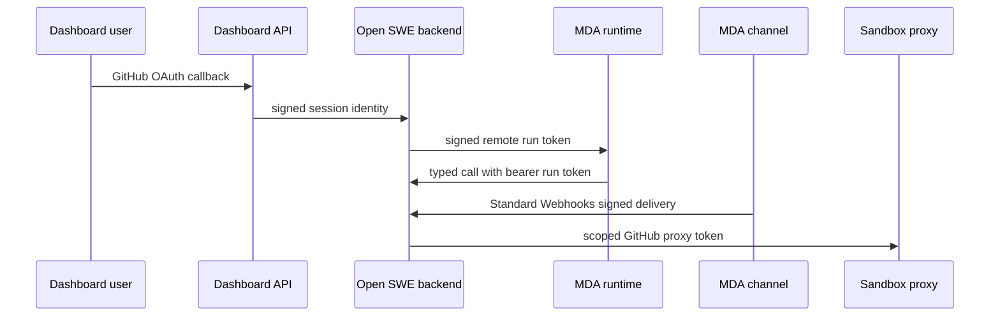
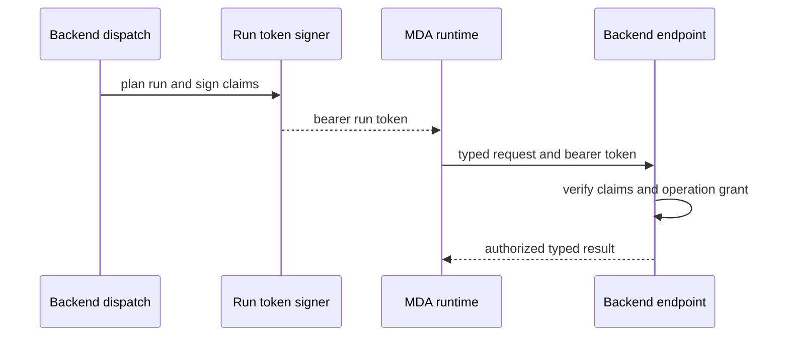

# Authentication, Authorization, and Credential Boundaries

Open SWE deliberately separates **who made a request**, **which run may call backend capabilities**, and **which credential may reach an external service**. This is a least-privilege design, not a single shared login:

- The backend holds deployment credentials, GitHub App authority, encryption keys, and the secrets used to validate sessions and service calls.
- A remote MDA run receives a signed, time-bounded **run token** and, for operations, a narrower operation-specific grant. It does not receive backend signing secrets.
- A person’s MDA connection is a per-user credential that MDA reads only when the run explicitly acts as that person and only carries to the one operation that declared it.
- A sandbox receives a GitHub-capable **proxy configuration**, rather than arbitrary backend credentials. Its App installation token can be repository- and permission-scoped and is refreshed without widening that original scope.

These distinctions matter when adding an endpoint, a tool, a channel, or GitHub behavior: derive authority from a verified boundary object, request the smallest capability necessary, and do not treat model input, run attribution, or a cached token as authority.

## Trust boundaries at a glance

This shows separate credentials on each hop: a browser session is not a run token, an MDA channel signature is not a provider webhook signature, and a sandbox proxy token is not an unconstrained backend credential.

## Remote-run identity and backend capability gates

When the backend starts a hosted MDA graph, `start_remote_run` creates a `RemoteRun`, assigns a fresh grant id, plans the run, places the resulting settings in the run, and signs a token before MDA starts. The JWT contains the thread as its subject plus assistant id, configuration, metadata, resolved settings, expiry, and optional grant id. The remote runtime returns it as a bearer token on backend tool-server calls; handlers reconstruct context from verified claims rather than from model-controlled tool arguments.

`REMOTE_RUNTIME_TOKEN_SECRET` can contain multiple comma-separated keys. New tokens use the first key; verification tries every configured key, allowing key rotation. Tokens use HS256, require issuer, audience, issued-at, expiry, and subject, accept a small verification leeway, and normally expire after 48 hours. Re-signing a run preserves its recorded expiry rather than extending its lifetime. An absent signing secret refuses signing and verification.

Authorization is narrower than token validity for catalog operations. A run that has a `grant_id` derives an HMAC value from its thread id, grant id, and operation name. A call must present the matching grant for that exact operation; a grant cannot be used for another operation. Worker processes initially receive a separate worker grant, which only identifies the coordinator run and the launch request so the worker can obtain its own run token—it grants no general backend authority.

This is the authorization path for runtime-to-backend work: the request supplies typed input, while verified token claims and the operation grant determine identity and permission.

## Principal, actor, and connection rules

A run’s `user_id` is attribution, not automatically a right to impersonate that person. `acting_user_id` is the separate metadata value that says a run acts as an Open SWE user. The backend only writes it for a person-started run: a verified channel sender or a dashboard user starting on a channel thread. Runs without it use service principals; MDA refuses user-owned connections for those principals.

`operation_connections` maps an operation to explicitly declared `ConnectionRef` values. Agent-owned connections, such as `MDA_EXA_CONNECTION` for `web_search`, are available whenever configured. User-owned connections, such as `MDA_GITHUB_USER_CONNECTION` for `open_pull_request`, are named only when `acting_user_id` is present. Invalid configured connection slugs are logged and omitted rather than converted into a broader fallback.

At invocation, MDA reads each named connection as the run and sends the credential in `RunOperation.credentials`. `carrying` installs that mapping in a context variable for the operation and resets it immediately afterwards. Thus an operation can retrieve a declared credential for that call, but the backend does not retain it as process state. Adding a connection should therefore mean adding it to the specific operation declaration, not exposing it to every tool or using a run’s attribution as a substitute for an acting principal.

## Dashboard OAuth and session authorization

The dashboard begins GitHub OAuth at `/dashboard/api/auth/login`. It creates a random nonce, stores its HMAC in a short-lived signed state token, and puts the raw nonce in a state cookie. The callback requires the state/cookie binding (except the purpose-built desktop handoff), exchanges the code, resolves the GitHub user, applies the login gate, upserts the Open SWE user and encrypted GitHub token record, then issues a signed dashboard session JWT. Dashboard sessions carry login (`sub`), optional email/avatar, user id, issued-at, and a seven-day expiry; `DASHBOARD_JWT_SECRET` is required to sign or validate them.

Deployment startup requires at least one of `ALLOWED_GITHUB_USERS` or `ALLOWED_GITHUB_ORGS`. A login is admitted if it is explicitly allowed or is an active member of an allowed organization; otherwise it receives 403. Post-login redirects are restricted to safe relative paths or origins built from `DASHBOARD_BASE_URL` and `DASHBOARD_ALLOWED_ORIGINS`, blocking external redirects and auth/API paths. Development login is only enabled in its local development mode and still uses the same GitHub login gate.

Desktop login keeps the browser handoff distinct from a browser session. The browser receives a short-lived identity-only code aimed at a fixed loopback callback, and the desktop app must prove possession of the PKCE verifier to redeem it for a session. The code is signed but intentionally contains only inert session-minting identity claims, never the session token itself.

### Agent Server access is intentionally asymmetric

The Agent Server accepts either the backend’s configured LangGraph/LangSmith API key or a valid dashboard session. A backend key receives the `openswe:backend` permission and may read or change resources. A dashboard identity has no backend permission: it can read only threads filtered by its `owner_login`, and every mutation is rejected with 403 so it must traverse dashboard APIs that enforce Open SWE’s thread rules. The in-process `/noauth` transport is a server-side special case, not a client-selected bypass.

## GitHub credentials: identity, scope, and authorship

GitHub access has two main credential classes:

| Need | Credential and selection | Boundary |
|---|---|---|
| Workspace/system work and public-thread execution | GitHub App installation token, or the local `gh` token only when the App is unconfigured in development | App authority, optionally narrowed to repositories and permissions |
| Private-thread work | The verified private thread owner’s dashboard OAuth token | Never silently fall back to the App when personal authorization is missing |
| PR authorship in a shared user-owned thread | Requester or a named thread participant | Requested author must have participated; background completion must name a participant when no requester is known |

`GitHubCredentialScope.for_thread` reads saved thread metadata rather than trusting the current request alone. Public threads and system threads resolve to App credentials. A private thread can use personal credentials only when the saved `owner_login` matches the run’s GitHub login; system-owned private threads are rejected. If the personal token is absent, execution raises `GitHubUserAuthRequired` rather than substituting a bot token. Token caches are invalidated before resolution, bound to their GitHub principal, and constrained by expiry and a maximum age, preventing an old user token from being reused for another requester.

PR authorship has an additional rule beyond the credential used to execute routine work. In shared user-owned threads, a requested author must be a recorded participant; otherwise the current authenticated requester is used. Private threads stay pinned to their owner and system threads to the App. A background completion without a trustworthy requester must explicitly name a participant, rather than guessing an account. These checks prevent a shared thread, delayed work, or a model-supplied name from borrowing an unrelated person’s identity.

GitHub App installation tokens may be minted with repository ids/names and explicit permission maps. The in-process cache key includes installation, repository scope, and permissions; it is never persisted. When making GitHub changes, use named `RepoClient` and `PullRequestClient` methods (for example, `pull.comment(body)`) instead of raw transport paths outside the designated HTTP modules. Open the client as the actual principal—`GitHubClient.as_user(login)` or `GitHubClient.as_app(owner, repo)`—rather than treating a generic client connection as authority.

## Sandbox proxy capabilities are scoped and renewable

The LangSmith sandbox proxy is configured with a GitHub token when a sandbox is created, so sandbox `gh` and `git` traffic gets GitHub authentication through the proxy. That capability is separate from a dashboard OAuth session and from the MDA run token. Proxy setup preserves configured custom and federated rules while injecting GitHub and, when applicable, thread-tool rules.

GitHub App installation tokens expire after about one hour. For each thread, `openswe.github.proxy` records expiry, the original repository scope, permission map, workspace, and base proxy configuration in process. Before model work, it can refresh a proxy token within five minutes of expiry (or after a 50-minute fallback when expiry is unknown). A requested refresh scope is intersected with the previously recorded repository scope, and the recorded permission map is reused. Refresh therefore renews capability but must not expand it. No recorded token or no sandbox means no refresh.

## Stored secrets and service-to-service webhooks

GitHub OAuth access and refresh tokens are encrypted before persistence. `TOKEN_ENCRYPTION_KEY` accepts one Fernet key or a newest-first comma/newline-separated key list: encryption uses the first key and decryption tries them all. This supports staged rotation—add the new key first, re-encrypt records over time, then remove old keys. Missing keys or invalid ciphertext do not yield plaintext: decryption logs a warning and returns an empty value, allowing callers to require reauthentication instead of proceeding with an unusable credential.

MDA channel ingress is a separate service-to-service trust boundary. Routes for GitHub, Linear, Slack, and user resolution depend on `require_mda_channel`, which validates the raw request body and headers as a Standard Webhooks signature using `MDA_SERVICE_SECRET`. Missing configuration, malformed input, or signature failure produces 401. MDA is responsible for verifying the original provider delivery before it makes this backend call; the backend check establishes only that the call came from the configured MDA deployment.

## Operational checklist and focused tests

Configure and protect these values independently: `REMOTE_RUNTIME_TOKEN_SECRET` for run and operation grants, `DASHBOARD_JWT_SECRET` for browser/session-state JWTs, `TOKEN_ENCRYPTION_KEY` for stored secrets, `MDA_SERVICE_SECRET` for MDA channel calls, GitHub App credentials for installation tokens, and at least one GitHub allowlist. Rotate signing and encryption keys with overlap where supported; do not log or place raw secrets in model-visible context.

Focused tests demonstrate the security invariants worth preserving:

- `tests/auth/test_agent_server_auth.py` verifies only a backend key or dashboard session authenticates, and that dashboard users are owner-filtered readers while backend callers mutate.
- `tests/auth/test_thread_credential_scope.py` exercises public/private/system credential selection, acting-user MDA connection exposure, PR identity rules, and refusal to fall back from missing personal credentials.
- `tests/auth/test_encryption.py` covers failed decrypts and a full multi-key rotation lifecycle.
- `tests/dashboard/test_dashboard_github_login_gate.py` covers required allowlists and explicit-user/organization admission; `tests/dashboard/test_dashboard_oauth_redirect.py` covers safe redirect handling and OAuth callback/session behavior.
- `tests/auth/test_github_token_ttl.py` checks principal-bound cache behavior, expiry, reauthentication after a rejected credential, and private-thread authorization before credential resolution or dispatch.

See also [Backend–Managed Deep Agents Runtime Contract](../architecture/backend-mda-runtime.md), [Channels and Dashboard](../integrations/channels-dashboard.md), and [Configuration and Deployment](../operations/configuration-and-deployment.md).
