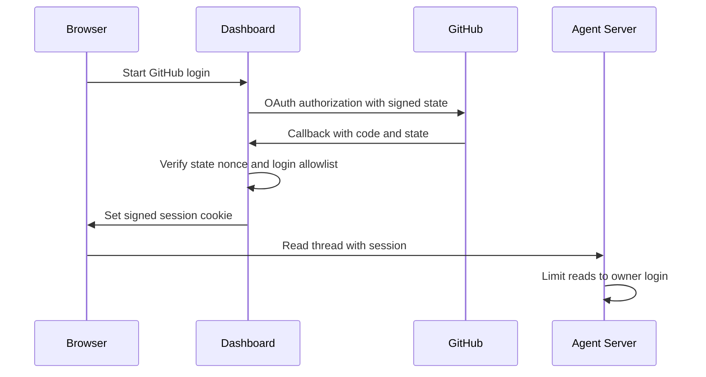
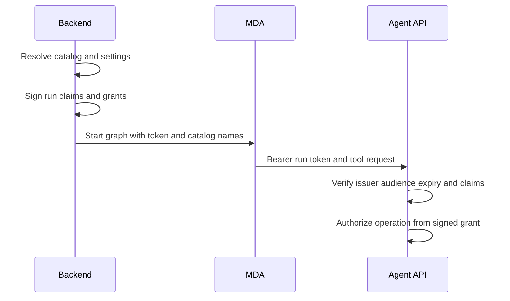

Open SWE has several identities, each with a deliberately different authority: a dashboard person, the backend service, a GitHub App installation, and a remotely hosted agent run. Configuration connects these identities, but a workspace repository binding is **routing metadata, not an independent GitHub credential boundary**. The deployment is designed for a team that already shares trust over the App installation and sandbox image; use separate deployments, App installations, and images for groups requiring repository isolation.

## Configuration is a declared contract

`openswe/config.py` is the central registry for environment values. Code reads `ENV.<NAME>` lazily, so secret hydration, key rotation, and test environment changes are observed after import; blank values are treated as unset. The registry records defaults, aliases/deprecations, and whether a value is secret rather than scattering direct `os.environ` reads.

At process startup, the FastAPI lifespan validates the login allowlist, sandbox setup, local model setup, MDA setup, and Slack setup *before* it seals local thread writes and migrates the database. In particular, a deployment must provide either `ALLOWED_GITHUB_ORGS` or `ALLOWED_GITHUB_USERS`; it refuses to start without a dashboard admission gate.

The important deployment inputs are:

| Boundary | Configuration | Operational consequence |
|---|---|---|
| Dashboard and browser | `DASHBOARD_JWT_SECRET`, `DASHBOARD_BASE_URL`, `DASHBOARD_API_BASE_URL`, `DASHBOARD_ALLOWED_ORIGINS` | Signs session and OAuth-state JWTs; pins redirects and credentialed CORS to known origins. Do not put `*` in allowed origins. |
| Stored secrets | `TOKEN_ENCRYPTION_KEY` | Fernet-encrypts stored OAuth and connection tokens. Supply a newest-first comma/newline-separated key list during rotation. |
| GitHub ingress and App identity | `GITHUB_WEBHOOK_SECRET`, App ID/private key/client credentials/installation ID, GitHub allowlists | Verifies webhook delivery and mints App installation tokens. App permissions and installed repositories define the maximum App authority. |
| Slack ingress | `SLACK_BOT_TOKEN`, `SLACK_SIGNING_SECRET`, app/user identifiers | Required Slack app values are checked at startup; signing secrets authenticate webhook traffic. |
| Remote agent runtime | `MDA_RUNTIME_URL`, optional `MDA_RUNTIME_API_KEY`, `REMOTE_RUNTIME_TOKEN_SECRET` | Every graph runs in MDA; a public non-local MDA URL must be HTTPS and run-token signing must be configured. |
| Agent Server exposure | `LANGGRAPH_AUTH_TYPE`, LangSmith authentication settings | On standalone deployments, `noop` leaves native LangGraph endpoints open to network callers; use `langsmith` or an equivalent private-network gateway. |

`MDA_RUNTIME_API_KEY` falls back to `LANGSMITH_API_KEY`. The MDA URL is required, must be absolute, and may use plain HTTP only for loopback hosts. `REMOTE_RUNTIME_TOKEN_SECRET` accepts multiple keys: the first signs new tokens and all configured keys verify them, allowing a rolling rotation. Treat all of these as deployment-owned secrets, not workspace settings.

## Dashboard admission, sessions, and API authority

Dashboard GitHub login is first constrained by the configured user/org gate. A successful login creates a seven-day HS256 session JWT with the login, optional email/avatar, and internal user ID. `DASHBOARD_JWT_SECRET` also signs OAuth state; state is short lived and is bound to a random browser-cookie nonce. The redirect target is accepted only when it is a safe relative dashboard path or its normalized origin is the dashboard origin or an explicit allowed origin. Login and API callback paths are rejected as targets.

The session principal can be GitHub-based or LangSmith-based. A LangSmith principal without a linked GitHub identity is intentionally limited to personal/profile, thread, project, bridge, skills, and connection operations; operations needing a GitHub account return 403. If a linked account changes, the principal is rejected and must sign in again. This is identity authorization, distinct from the GitHub token eventually selected for a run.

This shows the dashboard identity path and the separate Agent Server read filter.

The Agent Server recognizes two caller classes. The backend sends one of its LangSmith/LangGraph API keys in `x-api-key` and receives the internal `openswe:backend` permission. Dashboard sessions are converted to a principal after authorization. Non-backend callers can read/search only threads whose `owner_login` equals their identity; all mutations are backend-only and must pass through the dashboard API's higher-level thread rules. Therefore, placing the native API directly on the internet without Agent Server authentication is not equivalent to relying on dashboard cookies.

## Secrets at rest and rotation

Sensitive persisted values—including dashboard GitHub OAuth access/refresh tokens, Slack connection tokens, MCP headers/client secrets, and other token-store fields—are encrypted through `encrypt_token`. `MultiFernet` encrypts with the first configured key and attempts decryption with every configured key. Missing encryption key or an invalid ciphertext is fail-closed to an empty result (with a warning), rather than yielding plaintext.

Rotate by deploying `TOKEN_ENCRYPTION_KEY` with the new Fernet key first and existing keys after it, then re-save/re-encrypt records as appropriate before removing old keys. Losing every old key makes existing encrypted credentials unusable. This encryption protects storage; it does not reduce the authority granted by a decrypted credential to a running backend or sandbox.

## GitHub authority: App, person, and sandbox proxy

The GitHub App private key signs an App JWT, which is exchanged for an installation token. Calls can request a repository list and/or a permission map; the in-process cache key includes installation ID, repository identifiers/names, and normalized permissions, preventing reuse across those scopes. Tokens are valid for an hour and cached only until ten minutes before expiry.

For a run, credential selection follows thread ownership rather than workspace binding:

* **Public/system work** resolves to the workspace App installation token.
* **Private work** resolves only to the verified private thread owner's stored GitHub OAuth token; another requester cannot borrow it.
* A LangSmith Agent Workspace run is denied GitHub App credentials and has no GitHub repository access through this path.
* PR author selection is a related but separate decision: a shared user-owned public thread may name a participant as author, while private threads remain pinned to their owner and system threads use the App.

A workspace can select a repository, snapshot, integrations, and routing defaults, but it does not make an App token repository-safe for mutually untrusted users. In normal member-started sandbox work, the installed App's credentials can cover the installation. Repository selection, private-thread visibility, and workspace bindings do not reduce that authority; preloaded image source may be readable independently of later token narrowing. Restrict the App installation and sandbox images to material all deployment users may access, and separate deployments for distinct trust groups.

LangSmith sandbox GitHub access is injected through a proxy. The backend records the token expiry plus its repository and permission scopes for each thread. Near expiry (five minutes) it reconfigures the proxy with a fresh token; when expiry is unknown it refreshes after 50 minutes. Refresh preserves the recorded permission scope and intersects any later repository request with the recorded repository scope, so refresh does not widen access. If sandbox credential policy no longer permits GitHub, the record is removed instead.

GitHub webhook ingress is a separate boundary: `/webhooks/github` verifies `X-Hub-Signature-256` against `GITHUB_WEBHOOK_SECRET` before processing payloads, then drops repositories outside the configured allowlist. Signature validation authenticates the sender; repository and user/org rules determine whether an event is actionable.

## MDA run identity and tool authorization

Open SWE dispatches agent/reviewer graphs to Managed Deep Agents rather than giving MDA unconstrained backend context. Before a run starts, the backend resolves the run's tool catalog and settings, creates a `RemoteRun` containing the thread ID, graph/assistant, configuration, metadata, and an operation-grant ID, then signs it. The MDA context receives only the signed run token and a names-only tool catalog; subsequent tool-server calls return with the token as a bearer credential.

This flow keeps model-controlled tool arguments from choosing thread identity, settings, or authorization.

Run tokens use HS256 with issuer `open-swe`, audience `open-swe-remote-runtime`, required issued/expiry/subject claims, a 48-hour TTL, and 60 seconds of clock leeway. Verification tries every configured runtime key. The Agent API rejects a missing or invalid bearer token. For LangSmith-authenticated runs it additionally re-authorizes the `user:<id>` thread identity. Worker subagents receive a differently-audienced, one-worker grant tied to the coordinator run and request ID; it can be exchanged/verified for its narrowly intended worker flow rather than acting as a general run token.

## Operating and testing the boundaries

1. Give the deployment its own GitHub App and restrict its installation, permissions, and sandbox image content to the trusted population. Configure a nonempty GitHub login allowlist before startup.
2. Keep `DASHBOARD_JWT_SECRET`, `TOKEN_ENCRYPTION_KEY`, App private key/client secret, webhook secrets, runtime signing secret, provider keys, and MDA/LangSmith keys in a secret manager. Rotate encryption and runtime secrets using ordered multi-key values.
3. Expose the dashboard, callbacks, and webhooks at their configured public URLs. Permit only explicit dashboard origins; preserve HTTPS for non-local MDA endpoints. Protect standalone native LangGraph routes with `LANGGRAPH_AUTH_TYPE=langsmith` or a gateway.
4. Test the negative cases when changing these areas: external and callback redirect rejection; absent login allowlist startup failure; dashboard users reading only their own Agent Server threads and being unable to mutate them directly; invalid webhook signatures; private-thread credential borrowing rejection; run-token issuer/audience/expiry rejection; and proxy refresh retaining, never broadening, its recorded scopes.

Focused tests include redirect sanitization in `tests/dashboard/test_dashboard_oauth_redirect.py`, token repository-scope fail-closed parsing in `tests/github/test_token_scope.py`, and cache/reauth plus private-thread authorization behavior in `tests/auth/test_github_token_ttl.py`.

## Related pages

- [Backend control plane](/openwiki/architecture/backend-control-plane.md)
- [Runtime API contract](/openwiki/architecture/runtime-api-contract.md)
- [Dashboard and channels](/openwiki/integrations/dashboard-and-channels.md)
- [GitHub and MCP](/openwiki/integrations/github-and-mcp.md)
- [Local development and deployment](/openwiki/operations/local-development-and-deployment.md)
