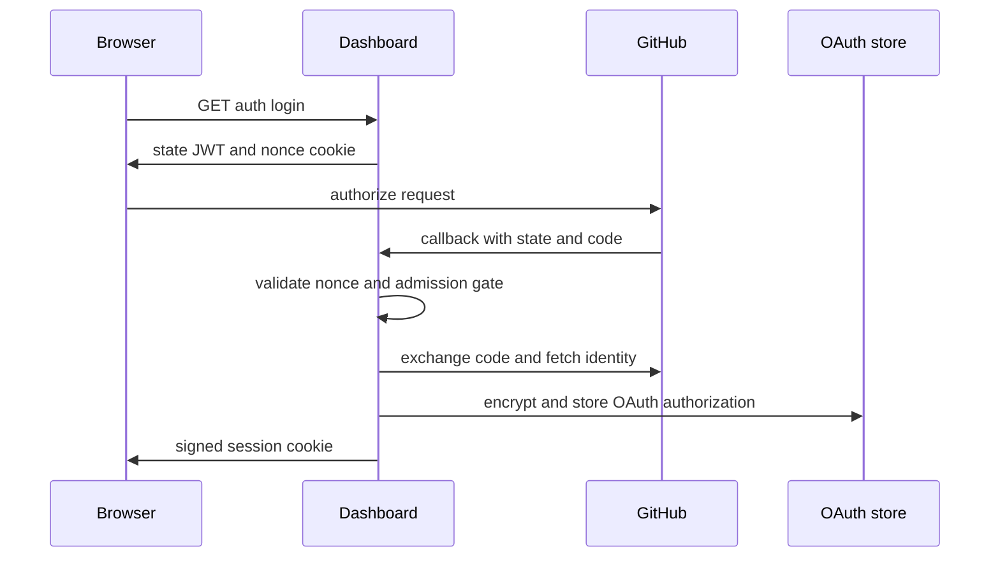

Open SWE separates **who may use the installation**, **who may access or mutate a thread**, **where work is routed**, and **which credential a run may use**. These are related decisions but not interchangeable: a workspace repository binding routes work and selects sandbox preparation; it does not by itself restrict the GitHub credential. Credential narrowing is an explicit token-scope decision.

## Authentication and dashboard admission

Dashboard users sign in through the GitHub App OAuth flow. `/dashboard/api/auth/login` creates a signed, short-lived OAuth `state` containing a hash of a browser nonce and a sanitized return URL; the nonce itself is placed in a state cookie. The callback validates the state/cookie binding before exchanging the code, identifies the GitHub user, applies the installation admission gate, stores the OAuth authorization, and issues the `osw_session` cookie. Session JWTs contain the GitHub login (`sub`), optional profile fields, a local user id, issuance, and a seven-day expiry; `DASHBOARD_JWT_SECRET` signs them.

The admission gate is deliberately independent of GitHub authentication. A login is allowed only when it is listed in `ALLOWED_GITHUB_USERS` or is an active member of an organization in `ALLOWED_GITHUB_ORGS`; organization membership is checked using the GitHub App and failures do not grant access. Production configuration must supply at least one of those allowlists. Dashboard mutating requests using the ambient session cookie are origin-checked against `DASHBOARD_BASE_URL` plus `DASHBOARD_ALLOWED_ORIGINS` (and the desktop app origin); an explicit bearer-only request is not subject to that CSRF check.

The desktop flow avoids handing a browser session directly to the loopback client. After browser login it returns a short-lived, PKCE-bound handoff code, and the desktop application redeems it with the verifier to receive a normal session. The code contains identity claims rather than a session and is signed, not encrypted.

This shows the browser-bound GitHub OAuth login and the resulting dashboard session; the OAuth access token is persisted separately from the session.

## Thread principals and authorization

The thread command API accepts three principal types: a dashboard person, a workspace API key, or a verified GitHub Actions OIDC workflow. A bearer token is first considered as an Open SWE API key and only then as a federated workflow token; otherwise a valid dashboard session supplies a person principal. A machine may create only a `system` thread, while a person may create `workspace` or `private` threads and needs administrator status for `system`. Machine principals can read or post only threads whose `started_by_id` exactly matches their own; this intentionally does not grant a workspace key access to every thread associated with its workspace.

The lower-level Agent Server has a narrower role. The backend authenticates to it with its LangSmith/LangGraph API key and gets `openswe:backend`, which may mutate resources. A dashboard session identity can only read/search threads filtered to its `owner_login`; direct mutation receives 403 and must go through the dashboard API, where Open SWE thread rules apply.

## Thread credential scope and GitHub identities

Saved thread metadata, not model-controlled run configuration, decides whether personal credentials are eligible:

- A **private** thread may resolve personal integrations only when the run's GitHub login equals the saved `owner_login`; a missing, mismatched, or unrecognizable owner/visibility fails closed. A system-owned private thread is invalid.
- A **public** thread never resolves a personal GitHub token for general GitHub access; it uses the GitHub App installation token. Lack of an App token is an error, not a fallback to a person.
- For pull-request authorship in a shared user-owned thread, the requester or an explicitly named participant may be used. The named login must already be recorded as a participant. Private threads remain pinned to their owner and system threads to the App; a background completion without an attributable participant cannot publish as a saved person.

On successful GitHub OAuth login, access and optional refresh tokens are stored in a dedicated `github_oauth_token` record, not the editable profile record. They are Fernet-encrypted under `TOKEN_ENCRYPTION_KEY`; configuration can list keys newest-first, encrypting with the first while attempting all keys for decryption. This permits rotation: deploy new and old keys together, re-encrypt active data, then remove the old key. Bad ciphertext or missing keys produces no token rather than a usable fallback. Access tokens near expiry are refreshed under a per-login guard; an unrecoverable refresh error removes the stale authorization so the next caller must re-authenticate.

## Workspace routing is not credential scope

A workspace names repositories that route work, select/preload its sandbox image, and bind an API key to a tenant. It is **not** automatically a GitHub access boundary. By default `workspace_token()` mints an installation token for all repositories available to the GitHub App, even when a workspace has a repository list.

Callers that actually need least privilege supply an explicit repository list. `repository_token()` resolves only listed names that the installation can access, then asks GitHub for an installation token narrowed to their repository ids; no resolved match means no credentials. Threads started from events or automation on a public (or unknown-visibility) repository record `github_token_repositories` and are narrowed to that repository. Private/internal workflow triggers retain installation-wide scope. Review flows can additionally request the read-only permission map.

For LangSmith sandboxes, this credential is configured in the sandbox GitHub proxy, not exposed as a model tool argument. The proxy token is minted alongside sandbox boot, is tracked by thread with its effective repository and permission scope, and is refreshed before expiration. A refresh request can only retain or reduce the recorded repository set, never widen it. The installation-wide discovery token used to look up repository ids stays server-side.

## Remote-runtime and worker trust boundary

Managed Deep Agents (MDA) owns the model loop, sandbox, checkpoints, and tool calls. When Open SWE dispatches a run, it signs a runtime JWT containing its thread id, assistant id, complete configurable data, and metadata. MDA sends that value as a bearer token for each typed Agent API call. The backend verifies HS256 signature, issuer, audience, required issuance/expiry/subject claims, and typed run claims; it accepts the first key for signing and each comma-separated configured key for verification, supporting signing-key rotation. Tokens live for 48 hours with 60 seconds of validation leeway, covering queueing and the platform's run lifetime.

The verified claims are the source for run and thread context. Tool arguments controlled by the model are not trusted to select a thread, run configuration, or credentials. An asynchronous subagent receives a separate worker grant bound to the coordinator run and the launching tool-call request id. That grant is valid only for the worker-grant audience; it can read its coordinator context and be exchanged for a new run token for the worker thread, not used as the coordinator's general runtime token.

## Managed tools: per-person provider grants

An instance administrator selects one curated LangSmith Managed Tools gateway; workspaces cannot override that selection. A gateway is available only to a private-thread owner who has connected LangSmith. The connection is resolved for each lookup so the current LangSmith access token is held in memory in request headers and refreshed as needed. Open SWE rejects use when the active private owner does not match the gateway login.

The gateway proxies provider calls under that person's LangSmith connections. Provider tokens, consent links, and the LangSmith token never reach the agent, a tool argument, or the sandbox. If LangSmith reports missing credentials, Open SWE exposes a user-facing connection flow; if the person is not connected or their token is unavailable, managed tools are skipped without dropping unrelated MCP tiers. `LMT_TENANT_ID`, when set, pins requests to a LangSmith tenant; otherwise the person's token selects its workspace.

## Workspace API keys and audit trail

Administrators mint workspace API keys through `/dashboard/api/admin/api-keys`; minting requires PostgreSQL, an existing workspace, an admin session tied to a real local user, and an expiry no more than 365 days out. The plaintext `osk_` secret is returned only in the creation response. Storage keeps only its SHA-256 digest and a six-character display suffix, plus workspace id, lifecycle timestamps, and creator. Authentication treats unknown, expired, and revoked keys alike; successful use updates `last_used_at` asynchronously. Revocation preserves its first timestamp and makes the key unusable.

Audit logging records selected dashboard mutations and selected tool mutations in an append-only PostgreSQL table. Entries bind the authenticated person, API key, or other actor plus verified workspace and thread context, operation outcome, request metadata, and resource UUIDs. It intentionally does **not** retain request payloads, tool arguments, or tool return values. Audit writes are best effort and time bounded, so an audit-store failure does not change the outcome of the protected request. Installation administrators can query up to 31 days per request and filter by operation, actor, API key, or workspace using a keyset cursor.

## Operations and change guidance

- Configure and protect `DASHBOARD_JWT_SECRET`, `TOKEN_ENCRYPTION_KEY`, `REMOTE_RUNTIME_TOKEN_SECRET`, GitHub App credentials, and the GitHub admission allowlist. The backend will not start its managed-runtime path without MDA connectivity and runtime-token signing material.
- Rotate encryption and remote-runtime signing keys by placing the new key first while retaining old verification/decryption keys, then retire old keys after active tokens and encrypted records have migrated.
- When adding a workspace or repository binding, decide separately whether the execution needs installation-wide GitHub access or must pass an explicit `repositories` scope. Do not infer scope from routing.
- When adding a remote Agent API endpoint, obtain context from verified runtime claims. Do not accept identity, credential selection, thread id, or run metadata through model-controlled tool arguments.
- Preserve the focused tests around personal-token refusal on public/mismatched/private-system threads, key secret one-time visibility and machine read isolation, Agent Server read-only user access, and encryption key rotation.

## Related pages

- [Managed runtime](/openwiki/architecture/managed-runtime.md)
- [Tools and safety](/openwiki/concepts/tools-and-safety.md)
- [GitHub and MCP integrations](/openwiki/integrations/github-and-mcp.md)
- [User surfaces](/openwiki/integrations/user-surfaces.md)
- [Configuration](/openwiki/operations/configuration.md)
