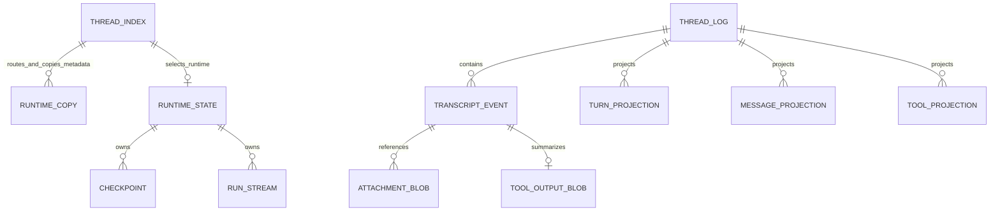

# Threads, Persistence, and Run State

A thread is Open SWE's durable conversation identity. A `thread_id` is reused for follow-ups, but the system deliberately separates the things associated with it: the runtime owns graph state, checkpoints, runs, and streams; PostgreSQL owns the searchable thread index and the dashboard transcript; and runtime metadata is copied where a run needs it. A run is an execution on a thread, not a new conversation.

This division is important operationally. A valid indexed thread can outlive local process memory, and a transcript can render without asking LangGraph; conversely, the index intentionally does not claim to contain conversation values or run history.

## Identity is a routing contract

`openswe/thread_ids.py` is the one place that derives deterministic IDs. Webhooks, dashboard paths, and reviewers independently calculate IDs from external identifiers; changing one of the key formats or derivation algorithms therefore strands live threads from their normal entrypoints.

| Purpose | Stable key / derivation |
| --- | --- |
| Slack location | URL-namespace UUIDv5 of `slack:{channel}:{timestamp}:{nonce}` |
| PR agent conversation | UUIDv5 of `{owner}/{repo}/pr/{pr_number}` |
| Autonomous reviewer | UUIDv5 of `{owner}/{repo}/pr/{pr_number}/reviewer` |
| Review scout | UUIDv5 of `{owner}/{repo}/pr/{pr_number}/review-scout` |
| Per-user PR chat | UUIDv5 of `{owner}/{repo}/pr/{pr_number}/chat/{login.lower()}` |
| Linear or GitHub issue | UUID-shaped value derived from the SHA-256 digest of the namespaced issue key |

The reviewer and review-scout namespaces are deliberately distinct from a PR agent conversation and from each other. For branches created by Open SWE, `thread_id_from_branch` recovers a UUID embedded in the branch name; callers can use that to continue the original agent conversation rather than derive a generic PR ID.

## Ownership boundaries

The PostgreSQL index and transcript share a `thread_id`, but are different records; checkpointed graph state remains at the selected runtime.

### PostgreSQL thread index: routing and discovery

`thread_index` is the Agent Server-compatible, PostgreSQL-backed directory. Its row records the natural `thread_id`, selected runtime (`local` or `mda`), JSONB metadata, last-known status (`idle`, `busy`, `interrupted`, or `error`), and timestamps. It provides metadata-containment search, status filtering, deterministic sorting, and pagination; it returns empty `values`, `interrupts`, and `config` because those belong to the runtime, not the index.

The `ThreadRouter` intercepts backend thread API calls so create, read, update, delete, search, and count use this index while preserving the LangGraph API shape for clients. Metadata patches merge key by key in PostgreSQL, then are copied to the runtime or runtimes that hold the thread so traces and runs have their needed context. A copy failure is logged but does not make the index unreadable. If an old local Agent Server thread is encountered before it is indexed, the router imports it on first use; a startup import also paginates legacy local threads and only replaces an index row when the runtime copy is newer.

A fresh thread begins `local`. On its first run or state write for an MDA-hosted graph, the router may claim it for Managed Deep Agents only if local state has no history. It marks the index runtime `mda`, stamps the runtime metadata marker, retains a local metadata copy, and creates the remote copy. Once local values or a non-idle state exist, the router keeps the thread local, preventing a checkpointed conversation from being moved away from its state.

### Runtime state: runs, checkpoints, and status

The selected runtime—this deployment's Agent Server for `local`, Managed Deep Agents for `mda`—owns LangGraph values, checkpoint history, run records, commands, and event streams. Both can hold metadata copies, but PostgreSQL is the source for thread listing and reads. The runtime's own status is authoritative after execution: starting a run marks the index `busy`; a completion webhook refreshes it, and a per-minute reconciler revisits rows still busy for more than one minute in case that notification was lost.

The configured checkpointer deletes dormant runtime checkpoints after `43200` minutes, sweeping every 60 minutes. Thus a thread's indexed metadata and transcript may remain while its resumable graph state has expired; do not promise indefinitely resumable execution from an index row alone.

## Durable dispatch and input continuity

All product surfaces should use `dispatch_agent_run`, which rejects ambiguous calls that combine a prebuilt input with raw content or identities, builds a structured input when needed, and delegates to `create_durable_run`. Dispatch defaults to `multitask_strategy="interrupt"` and `durability="async"`: a follow-up stops active work while preserving asynchronous step checkpoints, whereas background work may explicitly choose `enqueue`. Runs are resumable-stream enabled and created with the v3 stream marker, stream modes, and subgraph streaming, allowing the dashboard to attach later and replay tool and subagent events.

Before creating a run, dispatch ensures a supplied system title exists unless the caller says the thread was already titled. It adds or preserves an invocation ID in both configuration and metadata, records start time, and enriches run metadata with Slack channel and resolvable user information. A completion webhook is attached only when the completion secret exists and its configured URL is non-loopback, absolute HTTP(S); an invalid local or relative URL disables completion delivery rather than rejecting all run creation.

Run input adds new messages to existing graph state. `input_messages` serializes authored content into a validated, XML-escaped `<input-message>` envelope. Channel and system introductions are serialized as content-addressed `<dynamic-context>` messages and deduplicated by their hashes. Since summarized-away messages are no longer model-visible, only hashes visible after the summarization cutoff suppress reinjection; needed identity context can therefore return after compaction.

## Source context, participants, and metadata discipline

`SourceContext` is portable thread metadata describing where the conversation started: Slack location and reply details, Slack ask routes, Linear and GitHub issues, and PR number. It permits unknown fields and emits only set fields, enabling older and newer integration writers to enrich and round-trip context without injecting defaults. Parsing malformed historical metadata logs and returns an empty context instead of failing a run.

Thread metadata is appropriate for compact routing, authorization, ownership, title, source, workspace, and UI facts—not for transcript bodies or graph state. Thread creation requires a nonblank title. `ensure_titled_thread` can refresh a generated title but respects `title_locked`, which marks a human rename. At creation, the owner preference for tools in a sandbox is stamped onto metadata and thereafter treated as fixed.

## Transcript: PostgreSQL event log and read model

The dashboard transcript is a PostgreSQL event log, separate from LangGraph checkpoint history. `thread_event` is its source of truth; the `thread` row holds the per-thread head version plus transcript title, status, and a metadata mirror. Turn, message, tool-call, and checkpoint tables are projections for efficient snapshots, while attachment bytes and full tool output live in side tables. Events keep attachment metadata and a tool-output preview only, keeping replay payloads bounded.

Only `transcript.engine.append` writes the log. Under a per-thread PostgreSQL advisory lock, it assigns contiguous versions, deduplicates commands by `(thread_id, command_id)`, writes attachments and full tool output, updates projections and the head, and emits `pg_notify` in the same transaction. A retry receives the prior resulting version rather than a duplicate event. The first event must be `thread.created`; deletion cascades transcript-owned rows and explicitly deletes receipts, so recreation under the same ID is not blocked by stale idempotency records.

A subscriber reads rows by version rather than trusting notification payloads. PostgreSQL `LISTEN/NOTIFY` broadcasts the thread ID and head version after commit, while same-process publication only reduces latency. On reconnect, the listener republishes the current head (or a deletion marker), allowing subscribers to replay missed rows. Snapshot reads use a repeatable-read transaction and projections—not LangGraph—so the returned version, turns, messages, and tools are mutually consistent. Large replay gaps require a fresh snapshot rather than an unbounded event replay.

The transcript has its own lifecycle vocabulary: turns move through requested, running, completed, failed, or interrupted, while transcript thread state is `idle`, `running`, or `error`. Graph/index state uses different status values and must not be conflated with these UI projections. Middleware normally closes a turn; completion and cancellation helpers are an idempotent safety net for a dead process or cancelled run, and never close a newer turn merely because an old run reports late.

### Authorization mirror and failure mode

The transcript read path authorizes against the PostgreSQL metadata mirror so it never has to call LangGraph. Only authorization- and view-relevant keys—such as source, visibility, owner, category, schedule/trigger information, unlisted status, and title—are mirrored as `thread.meta_updated` events. Mirroring is best effort and logs failures rather than failing the original metadata update. That makes a mirror failure a security-relevant drift to investigate: a visibility change not mirrored could leave transcript access stale until repaired.

## Operating and changing this subsystem

- Keep deterministic ID formulas backward compatible. A new integration needs an explicit identity boundary and a stable derivation or stored mapping strategy.
- Use the thread API/router rather than directly treating a runtime as the directory. The router protects runtime placement and maintains the PostgreSQL index.
- Treat a `busy` index status as a cached lifecycle signal. The completion path and scheduled reconciliation exist because delivery and process lifetime are fallible.
- Use `create_durable_run` or `dispatch_agent_run` for externally triggered work so streaming, durability, invocation metadata, and completion behavior remain consistent.
- Test transcript changes with append idempotency, gapless per-thread ordering, projection rebuilds, snapshot/replay boundaries, attachment/tool-output separation, deletion, and authorization metadata flips. Test router changes with metadata-copy failure, legacy import, runtime-claim eligibility, and stale-busy reconciliation.

See [Remote Runtime and Threads](../architecture/remote-runtime-and-threads.md), [Workspaces and Access](./workspaces-and-access.md), [Dashboard UI](../integrations/dashboard-ui.md), [Invocation](../workflows/invocation.md), and [Follow-up Messages](../workflows/follow-up-messages.md).
