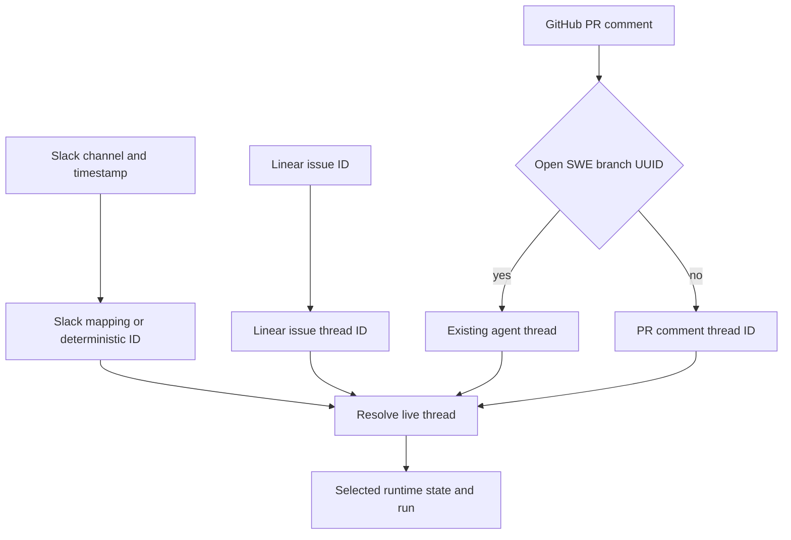

# Thread identities, access, and durable state

A thread is Open SWE's continuity boundary, not merely a chat label. Its ID routes later activity to one conversation; the selected runtime owns graph state, checkpoints, runs, and streams; PostgreSQL maintains searchable/indexed metadata, a message queue, and the dashboard transcript. A run adds work to a thread—it does not replace its history or state.

This division is important for every ingress. Slack, GitHub, Linear, the dashboard, local clients, and automation must select the existing thread when continuity is intended, then create a new run with an attributed input. They must not treat a PostgreSQL presentation record as runtime state, nor create a random ID for an existing external conversation.

<!-- openwiki: broken internal link [../workflows/follow-up-messages.md] file "../workflows/follow-up-messages.md" does not exist. Fix the href or restore the target, then delete this comment. -->
See [Thread routing, run state, and transcripts](../architecture/thread-runtime-and-transcript.md) for the runtime and event-log architecture, [Authentication, authorization, and credential boundaries](auth-and-security.md) for credential scope, and [Follow-ups, Interrupts, and Stop Control](../workflows/follow-up-messages.md) for controls while work is in flight.

## Identity is a durable routing contract

`openswe/thread_ids.py` is the single home for deterministic IDs. Its input strings and UUID namespaces are persisted contracts: independently executing webhooks, the dashboard, and review code re-derive an ID from external identifiers. Changing a formula makes live work unreachable through its ordinary entrypoint.

| Purpose | Derivation key | Algorithm |
| --- | --- | --- |
| Slack location | `slack:{channel}:{timestamp}:{nonce}` | URL-namespace UUIDv5 |
| PR comment not on an Open SWE branch | `{owner}/{repo}/pr/{pr_number}` | URL-namespace UUIDv5 |
| PR reviewer | `{owner}/{repo}/pr/{pr_number}/reviewer` | URL-namespace UUIDv5 |
| Review scout | `{owner}/{repo}/pr/{pr_number}/review-scout` | URL-namespace UUIDv5 |
| Per-user PR review chat | `{owner}/{repo}/pr/{pr_number}/chat/{login.lower()}` | URL-namespace UUIDv5 |
| Linear issue | `linear-issue:{issue_id}` | SHA-256-derived UUID |
| GitHub issue | `github-issue:{issue_id}` | SHA-256-derived UUID |
| successor for a legacy local thread | `thread:{thread_id}:mda` | URL-namespace UUIDv5 |

The reviewer and agent PR keys are intentionally distinct. A PR's reviewer thread cannot collide with the agent conversation, and a review chat is additionally isolated per login. For a GitHub PR comment, the handler prefers a supplied agent ID or a UUID recovered from an Open SWE branch name; only otherwise does it use the PR-comment ID. Linear routes each issue through its issue ID. Both flows call `index.live_thread_id`, which redirects new activity from a legacy local thread to its deterministic MDA successor.

*Caption: integration-specific identities converge only after live-thread routing, preserving a legacy thread's readable history while sending new work to its successor.*

### Slack location ownership and detachment

Slack location mapping is PostgreSQL-backed. `resolve_slack_thread_id` first reads the `(channel_id, thread_ts)` mapping. When it exists, it routes the mapped ID through `live_thread_id`; if that produces a successor, it atomically moves the location using `replacing`.

With no bound ID, resolution searches indexed threads for an exactly matching `source_context.slack_thread`. More than one match is an error rather than an arbitrary choice. Otherwise it binds that match, or the deterministic Slack ID. `bind_slack_thread_id` normalizes the location and rejects an existing mapping to a different thread unless that old ID was explicitly named as replaceable. This is the at-most-one binding invariant.

Detaching a location records a fresh `detach_nonce` rather than leaving an unqualified deterministic fallback. A later resolution therefore derives a new ID and cannot reattach to the retired conversation by accident.

## Ownership, visibility, principals, and participants

Thread type is explicit in a creation request, not inferred from the caller. A `Principal` is either a person, workspace API key, or verified GitHub Actions workflow:

- A person may create `workspace` or `private` threads; only an administrator may request a `system` thread.
- API-key and federated-workflow principals may create only `system` threads. Such a thread belongs to a workspace, is public, records `started_by_id` and `started_by_name`, and has no person owner or participant.
- A machine can read or post only to a thread whose `started_by_id` is exactly its own. A mismatch returns `404`, avoiding thread-ID existence disclosure.

For person-owned threads, `visibility: "private"` restricts reads to the immutable owner or an administrator; public surfaced sources are readable by signed-in users. Prompting, approvals, shell/files, and other dashboard actions are stricter: only the owner may drive a private thread or one connected to an owner's machine. A Slack-bot-started thread is dashboard read-only even for admins, because its Slack conversation is the steering surface. Pending session upload also blocks posting, and automation/admin threads require an admin sender.

Participants are discovery and attribution metadata, not a substitute for the owner rule. Login and email participant fields are key-per-person maps such as `{"octocat": true}` because PostgreSQL JSONB containment can match an object member; a list would require matching the entire set. Canonical participant-identity aliases preserve historical identities when a user identity is resolved or renamed.

## What is durable, and who owns it

The following stores intentionally overlap only where needed:

| Concern | Authoritative owner | Durable representation | Do not use it for |
| --- | --- | --- | --- |
| Graph values, checkpoints, run history, native streams, commands, run errors | Selected LangGraph runtime: MDA for new threads, local Agent Server for legacy ones | Runtime-owned thread state | Dashboard listing or transcript authorization |
| Thread discovery, metadata filters, selected runtime, last-known status | PostgreSQL `thread_index` | JSONB metadata plus timestamps and status | Graph values or checkpoint reads |
| Dashboard conversation rendering | PostgreSQL transcript event log and projections | Ordered `thread_event` rows and presentation tables | Runtime execution authority |
| Follow-ups for the next model call | PostgreSQL `thread_queued_message` | One row per queued payload | A replacement for platform run scheduling |

The index exposes an SDK-compatible thread shape, but intentionally returns empty `values`, `interrupts`, and `config`: those are compatibility fields, not replicas of runtime state. Its metadata patch merges keys. The index status (`idle`, `busy`, `interrupted`, or `error`) is a cached activity indication; transcript status is separately projected as `idle`, `running`, or `error`. Use the selected runtime for execution decisions and run errors.

A metadata write is small durable context, not an invitation to overwrite a conversation. Creation with `if_exists="do_nothing"` preserves an existing thread's metadata. System-generated titles can update only until a user sets `title_locked`. Thread-level model/repository settings are stored as the `agent_settings` snapshot, cached for five minutes; malformed settings become empty and ordinary read/write failures fail soft. This makes first-run model and repository decisions stable until an explicit rewrite, while sender identity and personal context remain per-message.

`RunConfig` is instead the per-run `configurable` transport contract. It permits unknown keys, emits only supplied fields, and iteratively drops invalid fields while retaining usable ones. It is therefore safe for multiple ingress and graph stages to enrich without destroying forward-compatible data, but it is not a replacement for durable thread metadata.

## Runs, status, and safe continuation

A new thread is indexed with a runtime selection; runtime copies of its metadata support tracing and execution. New activity targets MDA. A legacy `local` thread remains readable but takes no new activity: `live_thread_id` derives its MDA successor. `succeed()` creates that successor, copying predecessor metadata except runtime marker and stale run IDs, then records `succeeded_by` on the predecessor. This prevents one conversation's state from being split across incompatible runtimes while retaining a readable link to history.

Starting a run marks the index busy. Completion refreshes status by querying the selected runtime. Because completion delivery can fail, the reconciliation job runs every minute and rechecks threads busy for over one minute; failures are logged and retried on a later cycle. A stale busy row is thus an operational signal to inspect the owning runtime and completion path, not proof that graph execution continues.

The checkpointer itself is configured with `strategy: "delete"`, a 43,200-minute default TTL, and a 60-minute sweep. Durable graph state is therefore not permanent archival storage. Design a continuation assuming a dormant thread may retain metadata and transcript/index records while its runtime checkpoint is gone.

## Inputs and queued follow-ups

Every authored request is serialized as an escaped `<input-message>` envelope carrying a validated namespaced sender ID, surface, kind, optional channel, and structured data. Channel and system introductions are `<dynamic-context>` messages, hashed by canonical content and only injected when their hash is not already visible. Summarization hides messages before its cutoff, so `visible_dynamic_context_hashes` deliberately permits that hidden context to be introduced again.

The queue is for a message that must reach a run already in progress. Each `QueuedMessage` is an insert-only PostgreSQL row; a dashboard `queue_id` is unique per thread so a retried send does not enqueue twice. Rows are read FIFO by sequence. Insertion retains only the newest 100 messages and logs dropped oldest entries. Before each model call, queue middleware snapshots the rows, converts messages to structured input, then deletes only that snapshot after all conversion succeeds. A conversion failure leaves the rows for a later model call rather than silently losing them.

Use platform run multitasking for normal new turns and the queue for in-flight injection; do not mix their semantics casually. The queue carries messages into the current graph state, whereas a queued platform run waits for the thread to become idle.

## Transcript event contract

The dashboard transcript is an event-sourced read model. Event bodies are discriminated by `type`, reject unknown fields, and validate back into the model that wrote them. The stored envelope records `thread_id`, monotonically assigned version, event ID/type/schema version, optional run/turn/command IDs, actor kind, and timestamp. Event payloads are UI wire data, so attachment bytes are stored separately and events carry only attachment metadata; tool events similarly carry a bounded preview while full output is fetched separately.

Important lifecycle events include `thread.created`, key-merged `thread.meta_updated`, requested/started/queued/completed/failed/interrupted turns, streaming message fragments and their canonical completion, tool start/completion, and run notices. `message.completed` replaces accumulated stream fragments, allowing a missed fragment to self-heal. Consumers should treat the transcript as durable presentation and replay data, not as a checkpoint or authority for runtime status.

## Change checklist and focused tests

When changing this area:

- Preserve deterministic ID formulas and test routing for branch UUIDs, PR fallback, issue IDs, legacy successors, and Slack nonce detachment.
- Enforce access using the authenticated principal plus saved metadata. Never downgrade a machine ownership mismatch to workspace-wide access or let a public thread imply permission to use an owner's private machine.
- Keep execution state in the selected runtime. Index/transcript schema changes must not pretend to copy graph state.
- Preserve queue insert-only, per-thread deduplication, FIFO snapshot, and remove-after-build behavior. `tests/test_thread_ops.py` verifies retry de-duplication and queue preview/invalidation behavior.
- Exercise worker and system ownership boundaries, task membership, deterministic worker IDs, cancellation, and model inheritance in `tests/test_task_threads.py` when changing task-thread continuation.
