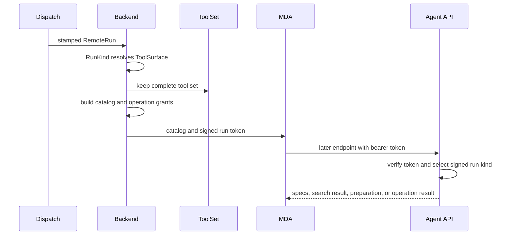

Open SWE uses one shared Managed Deep Agents (MDA) graph for multiple kinds of work, but does **not** make that graph a global authority over tools or settings. Before a run starts, the backend resolves a `ToolSurface` into a catalog using facts that are only available there: run kind, thread and workspace settings, sender access, credentials, integrations, and applicable policies. It then signs the resulting run settings into the run token. Subsequent runtime-to-backend calls authenticate with that token and reconstruct authority and settings from its verified claims—not from model-controlled tool arguments or fresh ambient settings.

This page focuses on the catalog boundary. For the process split, see [Managed runtime](/openwiki/architecture/managed-runtime.md); for request endpoints, see [Runtime API contract](/openwiki/architecture/runtime-api-contract.md); for security configuration, see [Security and configuration](/openwiki/concepts/security-and-configuration.md); and for MCP connection setup, see [GitHub and MCP integrations](/openwiki/integrations/github-and-mcp.md).

## Resolution is a start-time boundary

A `RunKind` owns the policy for a kind of work (agent, reviewer, or scout): it resolves tools, models, subagents, loop rules, credentials, files, skills, and run-specific behavior into a `ToolSurface`. `RunCatalog.of()` derives an unsettled run configuration from the dispatch-stamped `RemoteRun`, invokes that resolver, and prepares the surface before starting the remote run. A surface turns base tools and dynamic integrations into named tools, removes excluded names, and records integration names separately.

`RunCatalog.start()` performs two coupled start-time actions:

1. It persists the complete tool universe as a content-addressed `ToolSet` and puts its digest in immutable `RunSettings`.
2. It builds the MDA catalog and adds the thread sandbox, trace metadata, and an operation-specific grant for every catalogued operation.

The token contains the stamped thread/configuration plus these settings. It is signed with a bounded expiry; API middleware verifies it on every request, selects the graph by its signed assistant ID, and rejects missing or invalid bearer tokens. This design prevents a later call from elevating itself by naming another tool, thread, or settings value in its request body.

*Catalog facts are resolved once at start; later calls are constrained by the signed token.*

### Durable tool-set indirection

Tool specifications can be large, especially for integrations. Rather than copy them into every checkpoint and token, the backend canonicalizes tool specs (without grants) plus exclusions, hashes them, and stores them in `run_tool_sets`. A set is retained for three days, longer than a run token can live, and a scheduled purge removes sets that have not been started recently. The digest is therefore both a compact immutable reference and a lifecycle dependency: a missing kept set causes tool-spec lookup to fail rather than silently substituting current tools.

The run catalog contains the operations that should be initially visible, while the retained set contains every tool the run may call. Grants are added only when returning a catalogued spec, resolving a deferred name, or starting a listed operation. An operation call is accepted only if its grant validates for the signed run's thread, grant ID, and operation name. The backend also validates supplied arguments against the tool schema, applies shell guards, injects declared graph state/runtime dependencies, and turns exceptions into an error result (except cancellation, which ends the call).

## Tool surfaces: visible, code-only, deferred, and excluded

The catalog separates **authority** from **prompt exposure**:

- **Offered operations** are registered as schemas for model calls. The MDA runtime builds local proxies that call the backend operation endpoint.
- **Excluded tools** are not offered and are not searchable/resolvable from the retained set. They remain unavailable even if code guesses their name.
- **Code-only tools** are legitimate tools intentionally omitted from the model schema list to save context. They are exposed to the QuickJS code interpreter instead.
- **Also-from-code tools** remain directly offered to the model and are also callable from code, including eligible filesystem tools.
- **Deferred tools**, particularly withheld integrations, remain in the retained backend set. `search_tools` returns matching names, descriptions, schemas, and code names; code mode or a named tool call then resolves the specification by either normal or code name.

Search is intentionally bounded and deterministic: it tokenizes name, description, and parameter names, ranks eligible tools using BM25, excludes `search_tools` itself, and clamps the requested result count to 1–20. The backend never returns excluded tools. This avoids putting hundreds of integration schemas into each model context while preserving discovery and invocation for tools the run was authorized to use at start.

On the runtime side, `RunToolsMiddleware` loads catalogued specifications before use, offers only non-code-only tools to a model call, and routes a tool name to the local catalog or—when deferred search is enabled—to the backend resolver. Hidden tool names from loop planning are additionally removed for a specific model call. A model may recover from a truly unknown name through the graph's normal tool-node behavior; it does not obtain backend authority merely by asking for it.

### MCP and client-owned surfaces

There are two distinct MCP paths:

- Dynamic integration tools discovered by the backend are retained with the complete tool set. Selected integrations may be withheld from the initial catalog and recovered through deferred search.
- MCP servers specified in the catalog are connected by MDA itself. `RunTools` waits for this connection once per run; a user without a required connection grant is asked to grant it. The loaded MCP tools are merged with operation tools while avoiding names already taken. A resumed run that calls an MCP tool before its first model call reconnects before dispatching it.

The backend applies run-specific access filtering before it creates the surface: source and Slack constraints, workspace/admin access, client-tool replacement, bridge and sandbox capabilities, incident policy, task coordination, and feature gates can remove tools. In particular, a client-owned tool replaces a server tool with the same name so the catalog and operation endpoint agree on who executes it. MDA's own `task` and `eval` machinery is handled separately; coordinator runs use async worker tools rather than synchronous subagents.

Subagents are catalog data too. A subagent can inherit all offered parent tools or name an allowed subset; its description replaces the generic task-tool placeholder, and its catalog prompt and configured subagent model replace graph placeholders at call time. A catalog model-call limit is read by MDA middleware and ends a run when the cap is reached.

## Skills and prompt composition

Skills are capability-scoped instruction files, not mutable workspace files. The runtime requests the backend's skills for each run, caches that listing only for the run, presents it as a read-only file backend, and lets the skills middleware list the configured source labels in agent and subagent prompts. Reads, listing, globbing, and grep use the cached listing; write, edit, delete, and upload attempts are denied. Listing afresh per run is important because a checkpoint can outlive the permissions of the person for whom a prior run acted.

Prompt resources are packaged Markdown or Jinja templates. `prompt()` rejects absolute paths, traversal, unsuitable extensions, and substitutions for static Markdown; Jinja uses `StrictUndefined`. Tool descriptions can be rendered from `resources/prompts/tools/` and schema construction is warmed/cached to avoid repeated graph-assembly cost. Deployment context is prepended only for preview and staging.

For provider prompt caching, system prompt middleware orders reusable material from broadest to narrowest: graph instructions and common tool context, run prompt, workspace prompt, skills, then thread prompt. Anthropic requests mark the last run/workspace blocks as ephemeral cache breakpoints; other providers receive the same composition without those markers. This ordering improves prefix reuse without allowing a thread-specific instruction to be reused as a workspace-level prefix.

## Model selection, routing, and fallback

The dashboard publishes a finite supported-model inventory with supported reasoning efforts, image capability, context-window metadata, and whether a model can be a default. Workspace defaults provide main/subagent and routing defaults; thread settings can pin a prior choice and route models. The agent catalog resolves these with source-specific rules, validated per-thread overrides, explicit versus automatic selection, and optional adaptive routing. It persists resolved thread settings where appropriate, then captures the selected main/subagent models, routes, and routing rules in the surface and signed turn settings.

Model construction receives provider-specific kwargs plus a default token cap. Each `ModelSpec` records whether it can read images and includes a cross-provider fallback resolved from `LLM_FALLBACK_MODEL_ID` or the configured fallback mapping. If image input requires it, the catalog supplies a vision model fallback for text-only choices. Fable selections are gated at construction boundaries: when disabled for a workspace, they are replaced with a supported non-Fable Anthropic choice while preserving effort if possible. The runtime can request a route or model choice through the backend API, but the turn's entitlement and routing configuration originate in signed settings.

## Operations and safe changes

When changing this area, preserve these invariants:

1. **Resolve the catalog only at run start from backend-only facts.** Do not re-resolve permissions, integrations, or defaults from an arbitrary later runtime request.
2. **Use verified token claims for later calls.** The API middleware must authenticate first; operation names and arguments are inputs to a bounded, granted capability, not authority claims.
3. **Keep the complete retained set aligned with the catalog and resolver.** A tool omitted for context reasons must still be kept if deferred search/code invocation should reach it; excluded tools must be absent from search and resolution.
4. **Treat a tool grant as run- and operation-specific.** Never cache a grant across run IDs or attach one to an untrusted client-selected operation.
5. **Refresh skills per run and keep them read-only.** Do not let checkpoint state carry one actor's skill visibility into another actor's run.

Focused coverage is concentrated in `tests/reviewer/test_agent_api.py`: it verifies that integrations can be withheld yet searched/resolved by code name, exclusions cannot be resolved, catalog operations receive valid run grants, dynamic connection secrets are absent from the catalog, prompt deployment context is correct, and ungranted or cross-run grants fail. The same tests verify BM25 ordering and operation state injection/returned state updates. Add or update such tests when changing catalog membership, resolution, grants, or context exposure.
