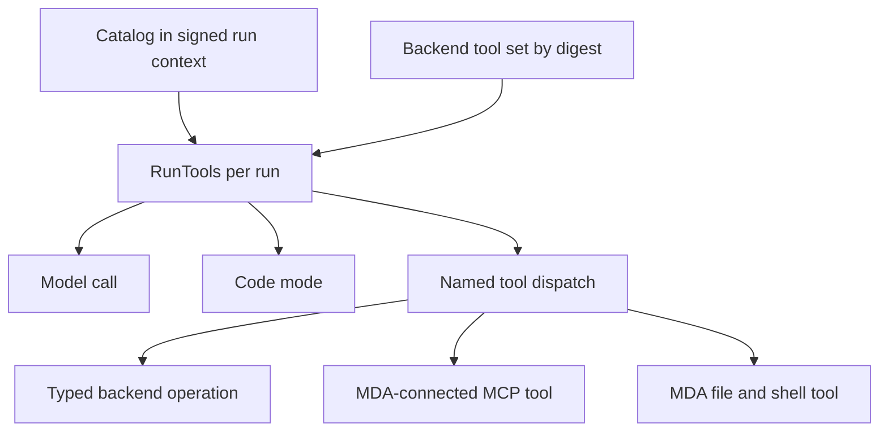
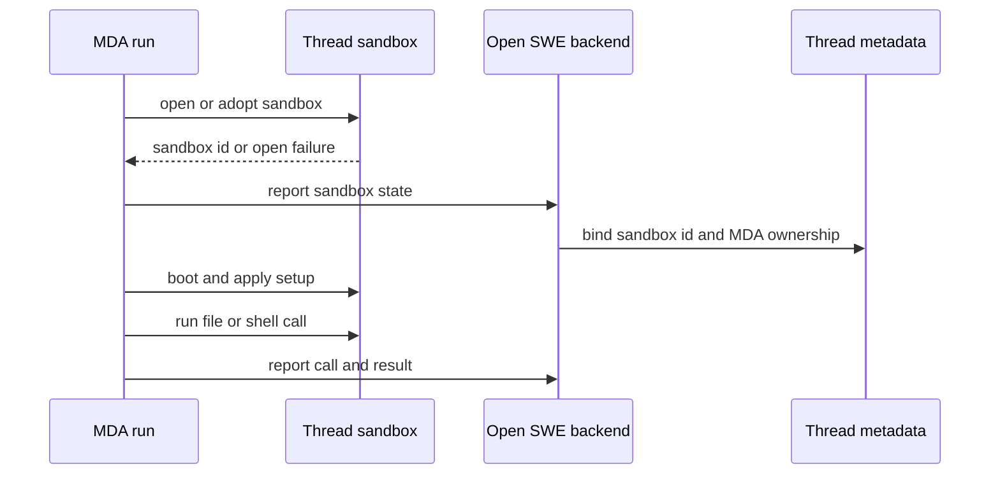

# Tool Catalog, Operations, and Sandbox Access

Open SWE has one MDA-owned graph shared by runs, rather than a backend-owned tool loop. MDA owns the model loop, checkpoints, tool-call middleware, and the thread sandbox. The backend is stateless at the runtime boundary: it provides typed `/agent-api` endpoint work based on the signed run token and request. Consequently, a tool is not merely a Python export: the run catalog determines its schema, visibility, credentials, and execution route.

## Catalog: a compact, per-run capability declaration

The backend stores each distinct `ToolSet` by a SHA-256 digest over canonical tool specifications and excluded names. It strips per-run grants before storage; a run token names that digest rather than copying potentially large integration schemas into its context. Sets are retained for three days and the hourly purge removes sets unused beyond that period. The catalog names the subset initially needed by a run; `tool_specs`, `search_tools`, and `resolve_tool` retrieve the rest on demand. Search ranks non-excluded tools with BM25 over name, description, and parameter names, and returns at most 20 matches.

`RunTools` turns catalog operation specs into structured MDA tools. It keeps direct operation tools, connects catalogued MCP servers once per run, and separates three presentations:

- **Offered tools** are added to each model call, except `code_only` tools, which avoid spending model context on rarely used schemas.
- **Code-mode tools** include code-only tools, explicitly allowed additional tools, and selected file tools. They use the same wrappers as a normal call, not an unguarded shortcut.
- **Hidden/excluded tools** are omitted from a model request but can still be dispatched by name when the catalog permits it. If `search_tools` is enabled, an unknown named call can resolve a backend tool lazily and cache the result for that run.

Subagents get the catalogued prompt and model and either the parent offered surface or their named subset. The built-in MDA `task` description is rewritten per run to describe its subagents. This enables a shared graph to have different tool, model, MCP, and subagent surfaces without registering each run's tools at graph construction.

This dispatch model keeps the graph static while the catalog controls the surface of each run.

## Three execution routes

### Backend operations

A catalog operation is a fine-grained, structured backend capability. The MDA wrapper supplies declared state fields (and conversation messages only when requested), the request ID, the token-derived grant, and connection credentials; the backend invokes the tool in graph context and returns a `ToolMessage` or state `Command`. Backend operations are the correct boundary for work requiring backend data or credentials, such as GitHub, database, or product actions.

A timeout or unavailable backend produces a tool error that explicitly says the action may or may not have occurred, so the model should inspect state before retrying. An operation reporting an unreachable sandbox ends through the sandbox failure path. Do not add broad phase endpoints, generic orchestration calls, or batch tools: design new tools as small structured primitives that code mode can compose. Put new run control flow in MDA middleware; use a named typed Endpoint for credential or data work.

### MDA-native files and shell

The native surface is `ls`, `read_file`, `write_file`, `edit_file`, `delete`, `glob`, `grep`, and `execute`. `FileToolsMiddleware` chooses the target for every call:

1. paths below catalogued skill sources are served by the runtime's read-only skills;
2. paths under catalogued backend paths go to backend remote files;
3. a run without an MDA sandbox uses remote files; otherwise the call reaches MDA's sandbox tool.

All routes are reported to the transcript. Configured checks are ordered as image-read validation, normalized tool-error conversion, then ancestor `AGENTS.md` injection for file reads. Calls that can change a checkout wait for sandbox setup and record git evidence. Sandbox commands use the requested timeout (or configured default) plus a 30-second grace period; a non-answer becomes an error result. Connection refusals that happen before a sandbox command starts retry with short jittered backoff.

When `shell_commands` guarding is enabled, likely push/PR commands are detected conservatively (`push`, `gh`, `pulls`, or deeply nested shells) and sent to the typed `check_shell` endpoint before execution. The backend guard can inspect the actual sandbox effect, require approval, deny the call with a model-visible error, or rewrite the command. The same guard model applies to backend operations that execute commands, avoiding a bypass through `background_execute` or code mode.

### MCP tools and dynamic integrations

MCP servers whose credentials live in MDA are connected from `mda/rt/mcp.py`, because the backend cannot read those connections. A run loads them once under a lock, retains only catalog-allowed tool names, and reads the credential again for each call. A missing user grant can pause for authorization; unavailable credentials or server failures become sanitized tool errors. The MDA transport requires HTTPS, validates that every resolved address is public, pins requests to the checked address, forbids redirects or origin changes, and sends the credential only to that origin.

Backend-owned integrations instead remain catalogued backend operations. This split is intentional: it preserves the credential owner and network boundary rather than treating all MCP tools as interchangeable. See [MCP and external services](../integrations/mcp-and-external-services.md) for connection configuration details.

## Thread sandbox lifecycle and ownership

MDA declares a sandbox selector for every run but creates one only when the catalog supplies a `SandboxSpec`. It maintains **one sandbox per thread**, even if later runs have different creation options; options apply only when creation or replacement occurs. As a run begins, MDA opens/adopts the sandbox without waiting for boot, reports its name, and the backend binds the thread metadata to it as MDA-owned before preparation. Setup continues while preparation and model execution proceed; the first filesystem call requiring it waits for boot.

This is the normal ownership and startup path; the first sandbox-dependent call is the boot synchronization point.

Transient sandbox-service failures retry for up to roughly 90 seconds. A missing MDA-bound sandbox is replaced and flagged as workspace loss. Other opening failures retain a redacted cause and surface as unreachable; the backend must not silently replace an unreachable working sandbox because it may contain the only uncommitted checkout. The backend can reconnect a known sandbox on any replica through its stable per-thread `SandboxBackendProxy`; cached connections are keyed by sandbox ID, not thread ID, to prevent use after a rebind.

`recreate_sandbox` is explicit. For an MDA-owned non-worker sandbox, the backend returns creation options and MDA replaces it, tells the backend to reconnect, and restarts setup. For a legacy backend-created cloud sandbox, the backend stops/detaches it and marks the thread for an MDA-created replacement on the next run. A task worker cannot recreate its coordinator's shared sandbox. A deleted legacy sandbox, or an unreachable read-only review sandbox whose checkout is re-derivable, may be handed to MDA; ordinary unreachable sandboxes are preserved and fail instead.

## Proxy, GitHub, and tool-channel boundaries

Sandbox egress is configured through a proxy, not by handing the model a GitHub token. For ordinary MDA sandboxes, the backend writes the proxy configuration when connecting and records the expiry and original repository/permission scope. Refresh preserves or narrows that scope and refreshes within five minutes of known token expiry (or after a 50-minute fallback TTL). Reviewer and review-scout sandboxes always use read-only GitHub permissions and are narrowed to the reviewed repository when known.

Where `MDA_GITHUB_PROXY_CONNECTION` can safely supply an installation-wide MDA connection, MDA instead writes the GitHub proxy rules before preparation and refreshes them before model/tool calls. It never takes this path for a repository- or permission-narrowed token, so it cannot overwrite a review sandbox's restricted proxy. MDA retries the initial proxy write while an idle host resumes; failure ends the run because neither side can safely assume workspace egress policy is installed. Replacements discard old dynamic proxy state and obtain configuration for the new sandbox.

The proxy may also inject a short-lived sandbox capability for `/dashboard/api/sandbox-tools`. That JWT binds a host thread and sandbox ID; the receiver verifies signature, audience, required claims, and that current thread metadata still names that sandbox. It can optionally expose a sandbox OpenAI endpoint when workspace settings allow it. This is a sandbox-to-associated-thread capability, not a general dashboard credential.

## Browser access is per thread

MDA browser middleware names one LangSmith browser per thread and drives its `mda` window. It reports the browser name at run start and reports that it was opened once browsing occurs; metadata keeps those facts separately so an early run report cannot erase an opened state. A person can open/adopt the same browser and window first. The dashboard obtains origin-scoped LangSmith view/act links and frames the window; deleting the browser also deletes its profile and signed-in sessions, after which MDA creates a fresh browser on next use.

## Safe extension and focused verification

When changing this area, preserve the ownership boundaries:

- Put scheduling, routing, lifecycle, and presentation control flow in `mda/rt` middleware. Put file/shell routing and checks in `mda/rt/file_tools.py`.
- Add a named, typed backend endpoint for backend-held credentials or data; do not add generic phases or backend-memory state. Persist cross-call state in MDA run state or PostgreSQL.
- Keep tools single-purpose and structured. Decide explicitly whether a capability belongs in model context, code mode, search, a backend operation, or an MDA-native/MCP route.
- Test behavioral boundaries rather than inventories: tool-set digest/search behavior, MCP discovery and failure sanitization, guarded shell refusal/rewrite, sandbox replacement/worker protection, proxy-scope preservation and reviewer read-only access, and browser metadata/link lifecycle are the high-value regressions.

Related: [Backend MDA runtime](../architecture/backend-mda-runtime.md), [Security and authorization](security-and-authorization.md), [MCP and external services](../integrations/mcp-and-external-services.md), and [PR delivery and review](../workflows/pr-delivery-and-review.md).
