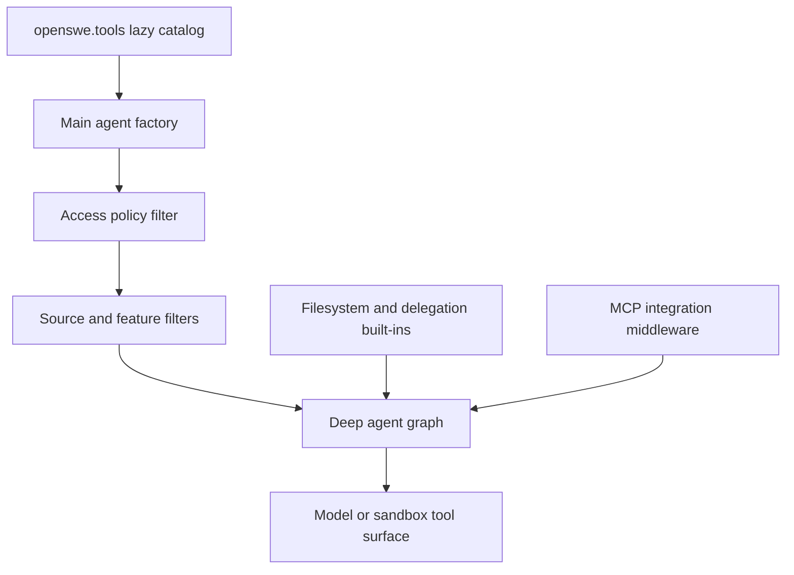
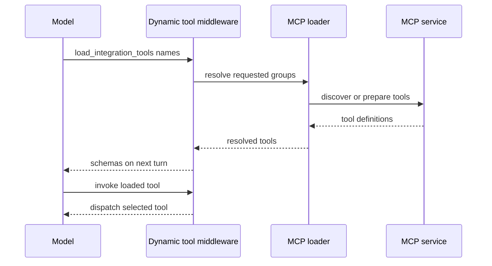

# Tool Surfaces and Capability Gating

Open SWE treats a tool implementation, its graph exposure, and authorization as separate controls. `openswe.tools` is a lazy import catalog, but a tool becomes usable only when a graph factory places it on a surface. The main agent then applies context-sensitive filtering and policy checks; sensitive tools re-evaluate access when called. This prevents an importable helper, stale run configuration, or a later change to thread membership from becoming a capability grant.

## From catalog to graph surface

`openswe.tools` maps public names to local or cross-package modules, lazily imports the requested attribute, and caches it in the package namespace. Its custom module type ensures a same-named submodule installed by `importlib` cannot mask the public export. The catalog is therefore an import boundary, not the agent's universal menu.

The main `build_agent` factory starts with a broad curated static list: web and background work, plan and user settings, thread and task coordination, PR and human-review operations, sandbox helpers, event and scheduling operations, Slack operations, user settings, and selected administrative tools. It calls `permitted` with resolved thread access before applying source and feature filters. Deep Agents also contributes filesystem and delegation tools; `ExcludeToolsMiddleware` filters the resulting model request after those injected tools exist.

This shows that catalog export, graph assembly, and invocation surface are distinct stages.

### Main-agent modes and filtering

The main surface is deliberately not constant:

- A run without a thread or without execution loading receives an empty, sandbox-less graph rather than the normal capabilities.
- `stop_summary` replaces the curated list with only `slack_read_thread_messages` and `slack_reply`, and uses the dedicated stop-summary exclusion set for injected tools.
- Slack tools are removed when trusted Slack context is absent; scheduled runs retain only channel listing and posting from the Slack group. Concierge DM runs exclude their own restricted set. Slack-dependent human-review and expedited-review tools also disappear when required configuration is unavailable.
- Client-provided tools replace same-named server tools. When the run prefers sandbox invocation, selected server tools are removed from the model surface and MCP tools may be offered through code mode instead.
- Task coordination conditionally contributes worker-management tools. Incident sessions can add their own tools and an automatic incident sweep removes its excluded operations. Review-guide sessions add walkthrough tools.

There is no current generic `PlanModeMiddleware` or `PLAN_MODE_EXCLUDED_TOOLS` module. Planning is instead represented by the review-scout graph: it exposes walkthrough-plan tools and human input, while `ExcludeToolsMiddleware` removes shell/search built-ins. The main graph's `save_plan` is an ordinary curated tool, not a global read-only execution mode.

## Specialist and remote surfaces

Factories intentionally use smaller surfaces for specialized work:

| Surface | Curated tools and controls |
| --- | --- |
| Main coding agent | Context-filtered static tools, Deep Agents built-ins, and optional MCP tools. |
| Reviewer | Review diff and finding lifecycle tools plus web access. Shell/search built-ins are excluded from its model surface. |
| Review scout | Walkthrough-plan chunking, hunk splitting/moving/describing, and human-input recording; shell/search built-ins are excluded. |
| Sandbox HTTP surface | Rebuilds the thread's real graph, catalogs its actual tools, and runs a selected call through that graph's `ToolNode`. |
| External Open SWE MCP caller | Includes only locally opted-in tools (admin-only entries for admins) plus caller-authorized instance, workspace, and user MCP connections. |

`ToolSurface.prepare` reads the graph's `tools` node, resolves dynamic integrations for authenticated sandbox discovery, and removes surface exclusions plus coordination-only tools. Its `run` validates that argument keys are declared in the tool schema, adds a selected integration name to state when necessary, and invokes a one-node graph using the original graph's state schema and tool node. Thus injected state, middleware, commands, streaming events, and tool error behavior remain consistent with an agent-driven call rather than being bypassed by a separate RPC implementation.

The sandbox endpoint authenticates a short capability rather than trusting a sandbox-supplied thread ID. It verifies an HS256 JWT audience and required `thread_id` and `sandbox_id` claims, confirms the persisted thread still names that sandbox, then loads the tool surface. Responses disable caching and referrers. Provisioning writes a tokenized endpoint URL with restrictive file permissions, or supplies an opaque proxy header rule for supported sandbox infrastructure.

## Declarative access policies

A tool can declare `@access(Policy(...))`, with a trusted place (`anywhere`, `private`, `admin_thread`, or `admin_surface`), actor requirement (`anyone`, `owner`, or `admin`), optional direct-user requirement, and an optional reduced result projection for a sole writer. `resolve_access` derives these facts from validated thread metadata and trusted runtime context. Invalid metadata, inaccessible metadata, private system threads, and incomplete Slack history fail closed.

The factory uses `permitted` to avoid binding unavailable policy-bearing tools. The decorator performs the more important second check on every call: an unauthorized call returns a structured refusal, while a sole-writer call returns only the policy's projection. Consequently, adding a participant during a run revokes a previously eligible private/admin tool instead of relying on the access snapshot taken during factory assembly. Direct user runs exclude scheduled, watch, and background-completion entry points; sole-writer determination additionally requires a personal public thread, one participant, no issue context, and—in Slack—a complete history attributable only to that user and the bot.

Administrators are evaluated from the actor identity, with a scheduled run requiring stored administrator authorization. `admin_thread` and `admin_surface` additionally require an admin-stamped private dashboard or Slack DM context. Tools still use `require_admin` where they require a local authorization boundary.

## Deferred MCP integration tools

The main factory concurrently loads MCP tools once credential scope is known, turns them into a `DynamicToolMiddleware` group, and reserves all static and Deep Agent names against collisions. At first the model sees only `load_integration_tools` and a catalog of names; actual schemas and the connection work are deferred until it asks for named tools. A direct call before loading receives a recoverable error. A successful load records `loaded_integration_tools`, so the schemas are available on the next model turn.

This is the deferred load and dispatch path for model-visible integrations.

The middleware rejects duplicate or reserved names, serializes group resolution with a per-group lock, and caches a completed resolution, including a failed one. Loader failures produce an empty group and a tool error telling the model to continue. For supported Anthropic and OpenAI Responses models, it inserts provider-native tool additions at the load-result position to retain prompt-cache locality; other models receive loaded schemas in the normal tool list. In sandbox-preferred code mode, the middleware can be non-model-visible: integrations are cataloged for the sandbox endpoint and callers are directed there instead of to the loader.

MCP runtime loading combines authorized sources in precedence order, with a later connection replacing an earlier connection with the same name. Discovery has a 30-second timeout and a stale-while-revalidate catalog keyed by source namespace, connection name, and revision. Discovery errors are redacted before reporting or caching. Every wrapped MCP invocation re-authorizes its source, re-resolves the connection, checks that namespace, URL, transport, enabled state, and tool allowlist have not changed, creates a fresh client-backed callable, and converts unexpected failures into a safe `ToolException`.

## Safe extension points

When adding a capability:

1. Implement and export the tool through `openswe/tools/__init__.py`; exporting it alone must not expose it to an agent.
2. Add it only to the graph factory and specialist surfaces that need it. Decide its behavior for stop-summary, Slack, client replacement, sandbox-preferred, incident, and task-worker paths.
3. Decorate tools that disclose or mutate scoped data with `@access`. Derive authority from `RunConfig` and persisted thread context, not model arguments; use a sole-writer projection when acknowledgement-only disclosure is appropriate. Keep tool-local admin checks for administrative effects.
4. For an integration, use an `IntegrationGroup`/MCP source with collision reservation and recoverable loading failure. Preserve source namespaces and enforce authorization again at invocation, because connection settings and grants can change after discovery.
5. Do not add a parallel sandbox executor. Extend the graph surface so sandbox and external callers retain the graph's `ToolNode`, injected state, middleware, and argument validation.
6. Add focused tests. `tests/middleware/test_dynamic_tools.py` covers deferred schemas, dispatch, collisions, failures, and provider-native additions; `tests/tools/test_access.py` covers policy resolution, sharing revocation, sole-writer redaction, and fail-closed Slack/thread cases.

## Related pages

- [Agent graph](../architecture/agent-graph.md) — graph construction and middleware ordering.
- [Reviewer and review scout](../architecture/reviewer-and-review-scout.md) — specialized review and planning graphs.
- [Observability and MCP](../integrations/observability-and-mcp.md) — connection configuration and observability.
- [PR creation](../workflows/pr-creation.md) — PR action controls.
- [Task coordination](../workflows/task-coordination.md) — worker tools and coordination lifecycle.
