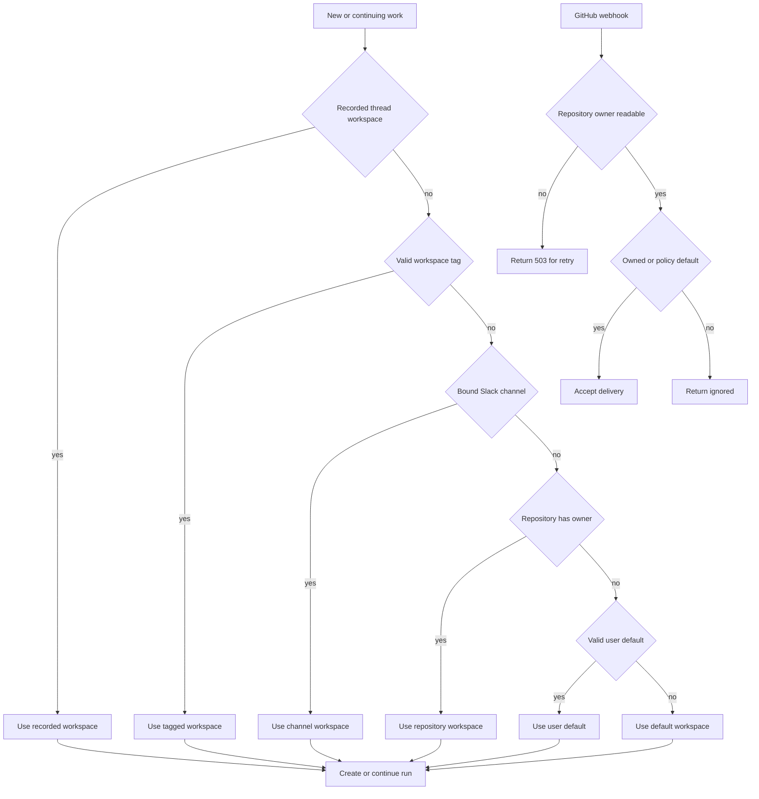

# Workspaces, Repository Routing, and Access

A workspace is the administrative and runtime scope that connects **where work arrived** with **how it runs**. It owns repository and Slack-channel bindings used to route new work, an agent prompt, sandbox/image definition and refresh state, workspace setting overrides, and related integrations. A repository preference determines routing and image preparation; it is **not** a repository authorization boundary. See also [sandbox lifecycle](../architecture/sandbox-lifecycle.md), [authentication and security](./auth-and-security.md), [dashboard UI](../integrations/dashboard-ui.md), [configuration](../operations/configuration.md), and [invocation](../workflows/invocation.md).

## Record, bindings, and ownership invariants

`WorkspaceStore` persists a workspace as a `workspace` row plus repository and Slack binding rows in PostgreSQL. The `default` workspace is the permanent fallback and cannot be deleted. A workspace slug is derived from its name and is the stable routing key; names can be changed without changing that key.

A workspace definition can contain:

- repository full names, normalized and de-duplicated case-insensitively;
- Slack channel IDs and a subset marked as *kitchen* channels, where untagged human messages may reach the agent;
- an optional prompt, setup and update scripts, base snapshot selection, VM resource limits, and non-secret sandbox create parameters;
- captured-snapshot and refresh progress/state, maintained separately from the definition.

Repository and Slack bindings are exclusive: a repository or channel can belong to only one workspace. The store prechecks conflicting bindings and the database unique constraints close races; dashboard create/update translates those conflicts to HTTP 409. A kitchen channel must first be bound to that workspace, and newly enabled kitchen channels must be internal channels that the Slack app has joined.

Repository-specific `may_start_threads` is separate from membership: it can be configured only for a repository already bound to the workspace. In particular, it is the trust gate used for federated GitHub Actions thread creation, rather than a way to broaden a workspace's repository set.

## Resolution and webhook admission

All entrypoints should use `resolve_workspace` rather than recreate routing logic. Existing thread context is deliberately sticky, so a later repository or channel reassignment does not move a continuing conversation.

This decision flow shows workspace selection for runs and the stricter routability decision made before a GitHub webhook is dispatched.

The first matching source wins, in this order:

1. The workspace recorded in existing thread metadata.
2. A valid opening-message workspace tag, including `/workspace:<slug>`; legacy `workspace:<slug>` and `env:<slug>` tags remain accepted by callers that parse them.
3. The owning workspace of the Slack channel.
4. The owning workspace of the repository.
5. The triggering user's valid `default_workspace` preference.
6. `default`.

Channel binding outranks repository ownership because any workspace may work with any accessible repository: a message in an OSS channel stays in that channel's workspace even if it names a repository preferred by an internal workspace. A tag outranks both. Invalid or nonexistent tags/defaults do not select a workspace.

Repository **routability** is a separate admission decision for GitHub webhooks. An owned repository is routable. An unowned repository is routed to `default` unless `OPEN_SWE_UNASSIGNED_REPO_WORKSPACE=ignore`, in which case the handler returns a successful ignored response. Values other than `ignore` behave as `default`.

Failure behavior intentionally differs by consequence:

- Routing a run fails soft: unreadable bindings/settings are logged and resolution uses `default`, because running there is preferable to refusing user work.
- GitHub webhook admission fails closed *for retry*: an unreadable repository-owner lookup raises `WorkspaceLookupError`; the webhook endpoint returns HTTP 503 so GitHub retries. It must not return “unowned” and a 200, which could permanently drop a real delivery.
- Kitchen-channel lookup failure is treated as disabled, retaining the safer requirement for a mention.

## Sandbox definition, snapshots, and refresh

A workspace supplies the sandbox configuration selected for a new thread: a ready snapshot ID when present, resource sizing, and validated provider create parameters. A non-default workspace may set `inherit_default_sandbox`; in that case sandbox resolution loads the `default` workspace's sandbox definition instead. If no ready workspace snapshot exists, creation falls back to the provider/base behavior.

Workspace setup is image construction, not run-time setup. The scripts run in a throwaway builder sandbox and are captured into a snapshot:

- A **full** refresh starts from `base_snapshot_id`, runs `setup_script` and then `update_script`, and captures only if every script succeeds. Each workspace has a deterministic, staggered daily cron when applicable; an admin can also start one.
- An **update** refresh starts from the workspace's current ready snapshot and runs only `update_script`. Creating a sandbox from a stale snapshot schedules this in the background; the requesting run does not wait and continues from the prior image.
- Scripts receive the bound repository names in `OPENSWE_WORKSPACE_REPOS`. This makes the repository bindings the intended preload set for setup/update scripts, not an access limit.

A refresh records its status, steps, timestamps, capped log, and active builder ID on the workspace. The record uses separate definition and state writes under locking, so a long-running refresh does not overwrite an administrator's definition edit. A failed or cancelled refresh preserves the previously ready snapshot, and a capture in progress continues to expose the prior ready ID; new sandboxes therefore do not fall back to a bare image merely because a rebuild is in flight. Builder sandboxes are stopped after completion for provider-side reclamation.

Operationally, a workspace with a setup script is initially saved before its first build is queued. If queueing that initial build fails, the API reports HTTP 502 but the workspace remains saved so an administrator can retry. Repository changes cannot be saved while a refresh is in flight and, after a successful edit, trigger a new full refresh. The refresh task exposes its per-workspace status and either a live builder trace or the settled log for dashboard polling.

## Settings scope

Settings use inheritance rather than copying a full configuration into each workspace:

1. Hardcoded/deployment defaults apply when the stored instance value is absent.
2. The instance settings record applies to every workspace.
3. A workspace record contains sparse overrides; an unset field inherits the instance value.
4. Callers that support them layer user profile choices and a thread's `configurable` values above the resolved workspace settings.

Settings include model and reasoning defaults, review controls and organization guidelines, gateway/Fable/routing feature flags, and default repositories, among others. The workspace settings API returns both effective settings and the sparse override set; replacing overrides with absent/null values restores inheritance. Cache entries are keyed by workspace and invalidated on writes so values do not leak between workspaces or wait for a TTL after a change.

Workspace settings control behavior and prompts, but they do not confer GitHub repository access. Likewise, a configured default repository is a run default, not an ownership binding.

## GitHub access boundary

Workspace bindings route work and identify image preloads, but normal coding sandboxes receive a GitHub App installation token that can reach every repository available to that installation. The installation-wide discovery token never leaves the server. This distinction is important when designing “public” workspaces: workspace separation alone is not a GitHub authorization partition.

Callers can explicitly narrow credentials by passing repository names. The server resolves repository IDs from stored records when current, otherwise lists installation repositories and records lookup results. If no requested repository is reachable, no token is granted; if token minting is expected but unavailable, the call fails rather than silently widening access. A non-default workspace slug must exist before its token is minted.

A thread-level repository scope is intersected with any caller-requested scope before a sandbox proxy is configured. That scope is retained when proxy credentials refresh, so a thread created for a public repository cannot later gain the installation token through refresh or a broader caller request. Refresh failure makes an existing managed sandbox unreachable rather than continuing with stale or enlarged access.

Workspace image builders deliberately use installation-wide access so setup scripts can prepare their workspace repositories. Sandbox create parameters reject secret-like keys and authorization headers; credentials are injected through the proxy instead. Scripts run under `bash -x`, so their captured logs can expose command-line secrets and are therefore an operationally sensitive admin surface.

## Administration and focused verification

The dashboard exposes admin-only workspace CRUD, per-workspace repository configuration, and refresh initiation. Signed-in users can retrieve workspace picker options; refresh-log excerpts are included only for admins. Creation/update validates slugs, repository/channel inputs, resource values, and sandbox parameters. Deleting a non-default workspace first deletes its automations, then bindings/record, refresh cron, and captured snapshot; retrying after a partial automation deletion is safe because the workspace is still present.

Focused tests cover the high-risk contracts rather than only data shape:

- `tests/github/test_github_workspace_routing.py` verifies `ignore` versus default routing for unowned webhook repositories and the HTTP 503 retry path when ownership cannot be read.
- `tests/slack/test_slack_workspace_routing.py` verifies that a bound channel outranks a named repository and that resolved workspace settings affect Slack behavior.
- `tests/sandbox/test_workspace_github_access.py` verifies installation-wide normal tokens, persistent repository narrowing through refresh, inability to widen thread scope, and refusal to mint access on failed workspace lookup.
- `tests/dashboard/test_workspace_settings_tiers.py` verifies workspace-only overrides, inheritance restoration, cache isolation/invalidation, and settings API behavior.
