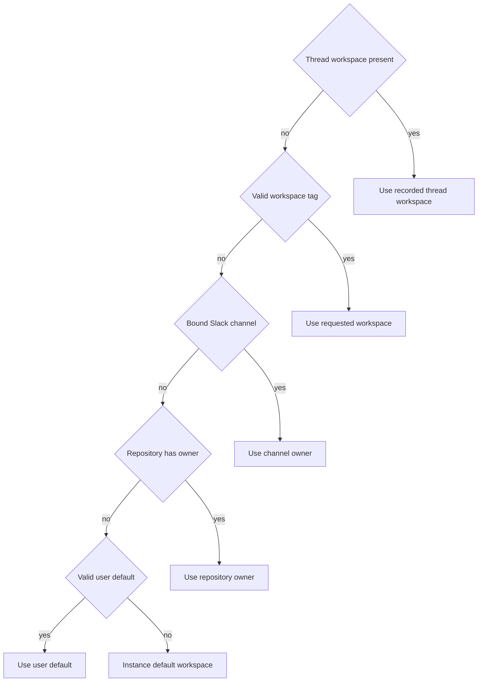
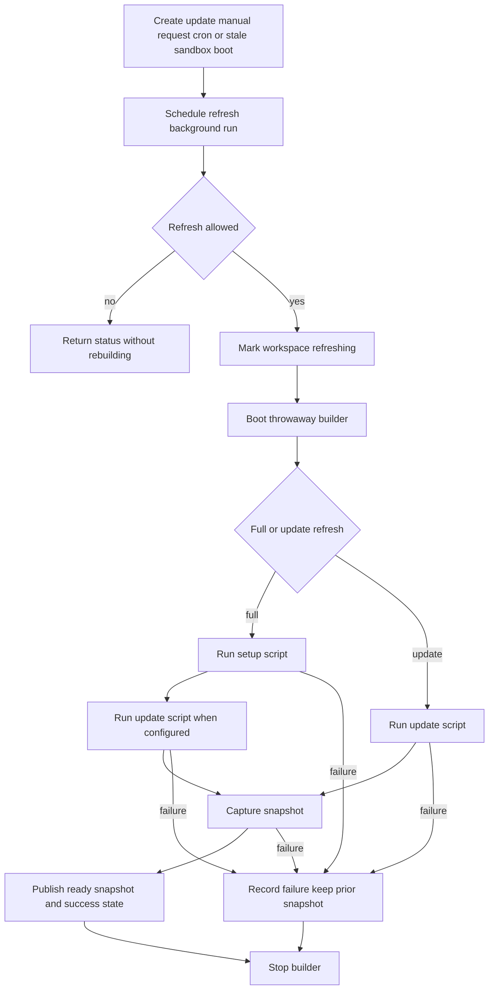

# Workspaces, repository routing, and snapshots

A workspace is the named execution-environment boundary for an Open SWE run. It collects a prompt, sandbox shape and creation parameters, optional build/update scripts and snapshots, repository and Slack-channel bindings, settings overrides, and workspace-scoped MCP connections. It is **not** a repository access boundary: repository bindings establish a preferred owner for routing, while a workspace selected by a Slack channel can still work with another repository.

The durable workspace record lives in PostgreSQL. The `default` workspace is the instance fallback and cannot be deleted. If a selected workspace disappears or cannot be loaded during sandbox creation, the system attempts to use `default`; if even that cannot be read, the run uses the provider base environment rather than failing solely because workspace data is unavailable. See [Sandbox lifecycle](../architecture/sandbox-lifecycle.md) for subsequent sandbox handling and [Configuration, profiles, prompts, and model selection](configuration-and-model-resolution.md) for the detailed settings and model rules.

## Ownership and state

A workspace has a stable slug, display name, instruction prompt, sandbox resource limits, `create_params`, scripts, snapshot metadata, and refresh progress. `WorkspaceCreate` defaults `inherit_default_sandbox` to true for a non-default workspace: such a workspace resolves the default workspace's sandbox definition rather than its own snapshot. The default workspace may not inherit from itself.

The store separates a workspace row from resource bindings:

- `workspace_repository` binds a repository and records `may_start_threads`, which defaults to false. A repository binding means the workspace may work with it; it does **not** grant a GitHub Actions workflow authority to start threads.
- `workspace_slack_channel` binds a channel. Its `kitchen` flag enables untagged human messages in that channel; kitchen channels must also be bound to the workspace, and dashboard writes verify that newly enabled channels are internal and joined by Open SWE.
- Database primary/unique keys make each repository and each Slack channel belong to exactly one workspace, including when administrators race to assign a binding. Conflicts are exposed as HTTP 409 rather than silently changing ownership.

Sandbox `create_params` are JSON-only, size-limited, and rejected when they contain secrets or authentication credentials. They are revalidated when read, so records written under older validation rules cannot later send unsafe parameters to the sandbox provider. The workspace picker intentionally withholds prompts and snapshot IDs; refresh-log excerpts are available only to admins because `bash -x` traces can include command-line credentials.

## Selecting a workspace

All inbound paths should call `resolve_workspace()` rather than implement their own guess. It returns both the selected slug and `resolved_by`, making routing provenance observable. Thread affinity wins even if the underlying record was later removed; loading the execution definition then performs the safe fallback described above.

*Caption: routing precedence is thread → valid `/workspace:<slug>` tag → Slack-channel owner → repository owner → valid user default → `default`.*

The tag and user default are accepted only if their slug currently exists. Channel ownership intentionally precedes repository ownership: a message posted to a workspace channel stays in that workspace, even if the referenced repository is preferentially bound elsewhere. For example, the Slack ask path first identifies a repository and then resolves with both repository, channel, and login; a dashboard composer supplies an explicit workspace as the tag input.

### Repository admission and lookup failure

Routing a run and deciding whether GitHub should accept a webhook have different failure policies:

- `OPEN_SWE_UNASSIGNED_REPO_WORKSPACE` governs an unowned GitHub repository. `default` (also the fallback for invalid values) accepts it for the default workspace; `ignore` rejects it. An owned repository is always routable.
- `repo_is_routable()` preserves a lookup failure as `WorkspaceLookupError`. The GitHub webhook route returns HTTP 503, so GitHub retries instead of permanently dropping a delivery whose owner could not be determined.
- Helpers that label or place work (`workspace_for_repo`, `workspace_for_slack_channel`, and `resolve_workspace`) log lookup failures and fail soft to unowned/default behavior. This favors executing a run in `default` over refusing work. Kitchen-channel lookup similarly fails closed to requiring a mention.

Bindings are queried live, so creates and updates are immediately visible to routing without an ownership-cache invalidation.

## Execution environment associated with the selected workspace

`SandboxCreateConfig.resolve()` loads the selected workspace unless a caller explicitly asks for a base source. If the workspace inherits the default sandbox, it loads the default record for sandbox data. A newly created sandbox uses `ready_snapshot_id` plus the workspace's resource limits and validated provider creation parameters; without a ready snapshot it starts from the provider base snapshot. Its GitHub proxy token is still minted for the run's workspace and narrowed repository/permission scope.

Workspace settings use a different but compatible ownership scope: effective values are **hard-coded defaults → instance settings record → non-null workspace overrides**. They include model defaults, review and feature flags, gateway policy, organization review guidelines, default repository, and a workspace-scoped Managed Tools gateway identifier. Settings lookup is deliberately fail-soft to hard-coded defaults; per-user profiles and the thread's `configurable` layer are applied by callers that honor them. Updating or deleting workspace settings invalidates the settings cache and workspace UI topic.

MCP connections are also tiered. Workspace connections are persisted under the workspace slug and administered through `/workspaces/{workspace}/mcps` endpoints. At agent construction, sources are loaded in instance, workspace, then user order; a later source replaces a same-named connection from an earlier source. A credentialed user can additionally receive the instance Managed Tools gateway after those tiers. This makes a workspace MCP connection shared policy for that environment, while personal connections remain user-scoped. See [Observability, Browser, and MCP Integrations](../integrations/observability-and-mcp.md) for connection credentials and provider behavior.

## Snapshot definition and refresh

A workspace snapshot is an immutable capture of a successful builder sandbox. `ready_snapshot_id` is present only for `ready` or `capturing` snapshot status. During a new capture, the previously ready ID remains usable until the new capture succeeds; this avoids sending concurrent runs back to a bare base image. A refresh tracks separate status, kind, run ID, steps, timestamps, capped log, error, and temporary builder ID, so a failed refresh can report failure while the last good snapshot remains ready.

There are two refresh kinds:

- **Full refresh** starts a throwaway builder from `base_snapshot_id`, runs `setup_script` and then `update_script` when configured, and captures only after every script exits zero. It is used for initial builds, manual rebuilds, repository-binding changes, and the daily job.
- **Update refresh** starts from the current ready snapshot, runs only `update_script`, then captures. It is the lazy convergence path for a stale image.

*Caption: refresh runs scripts before capture and publishes a new snapshot only after a complete success; the builder is stopped on either outcome.*

Refreshes are scheduled as background jobs; callers receive a run ID and poll state rather than waiting for a potentially long build. A scripted, non-inheriting workspace gets an idempotent daily cron staggered by slug between 03:00 and 05:59 UTC. Creation starts an initial full build, and changing its repositories starts another full build; failure to enqueue either returns HTTP 502 although the definition has already been saved. Manual `POST /workspaces/{slug}/refresh` requires a setup script and refuses a concurrent in-flight refresh.

A refresh marked `refreshing` is considered in flight for three hours; a stale marker does not block recovery indefinitely. A new sandbox boot notices a snapshot older than `UPDATE_INTERVAL_SECONDS` (one hour) and starts an update refresh in the background when no refresh is in flight and the prior attempt is sufficiently old. It does not wait: the current run boots the snapshot it found, may record that stale boot for a user warning, and later sandbox creations benefit when the update capture completes. Counting both successful and failed attempts prevents a broken update script from scheduling a builder for every new sandbox.

Refresh state is updated under a row lock using state-only columns, while definition edits use definition-only writes. Consequently a long-running refresh cannot overwrite a newer prompt or repository assignment, and an admin edit cannot restore stale refresh state. Builder IDs are exposed only while the builder is alive so a poll can tail the active script trace; settlement clears the ID, stores the capped final log/error, marks unfinished steps failed, and stops the builder. Only the LangSmith sandbox provider supports capture; other providers return an `unsupported` refresh status.

## Operating and changing workspaces safely

Administrators manage workspace definitions under `/workspaces`: create/list/read/update/delete, per-repository `may_start_threads`, and refresh. Creates and updates normalize the slug, validate bindings, audit mutations, and return 400 for invalid definitions or 409 for ownership races. Deletion first removes workspace automations, then deletes the record, refresh cron, and current snapshot; it also removes workspace settings so a future workspace with the same slug starts from instance settings. Workspace MCP mutations are separately admin-protected and audited.

When modifying this area, preserve these invariants:

1. Do not replace centralized precedence with caller-specific routing.
2. Preserve the distinction between an unowned repository and an unreadable ownership store—GitHub needs retryable failure, while run placement intentionally degrades to `default`.
3. Keep bindings globally unique and kitchen channels a subset of bound channels.
4. Never publish a partial build or discard the last known-good snapshot after a refresh failure.
5. Keep refresh state and workspace definition writes isolated, and do not persist sandbox credentials in `create_params` or expose refresh logs to non-admin picker users.

Focused coverage in `tests/workspaces/` verifies precedence and failure policy, database uniqueness, definition/state concurrency, initial and repository-change build requests, script ordering, capture gating, prior-snapshot retention, update refresh source selection, and builder progress cleanup.
