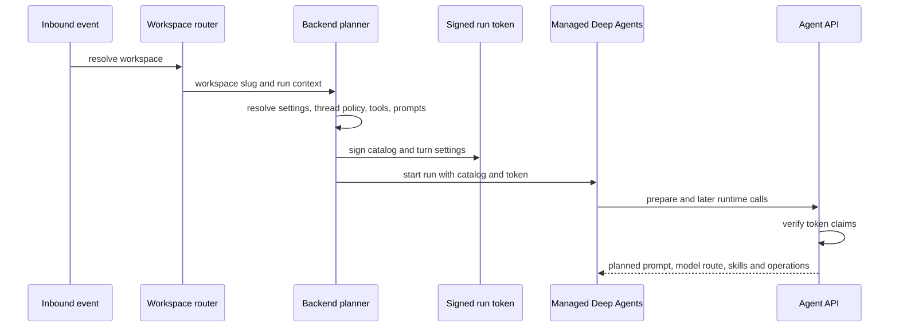

# Workspaces, models, and prompts

A run is not configured from its latest message. Open SWE first resolves the workspace and the authorized behavior surface, plans models, tools, prompts, and credentials on the backend, and sends that plan to Managed Deep Agents (MDA). The remotely executed loop can select only among the planned choices. Its later calls are authenticated by a signed run token, rather than accepting thread identity or policy from model-controlled tool arguments.

This page focuses on the configuration and policy path. See [identity, authorization, and credentials](/openwiki/concepts/identity-authorization-and-credentials.md) for credential scope, [tool catalog and operations](/openwiki/architecture/tool-catalog-and-operations.md) for tool grants, and [dashboard, desktop, and CLI](/openwiki/integrations/dashboard-desktop-and-cli.md) for client entry points.

## Workspace resolution and ownership

A workspace is a persisted definition: its prompt, repository and Slack bindings, sandbox scripts and resources, snapshot lifecycle fields, and sandbox creation parameters. Workspace creation/update validates the user-facing definition; in particular, sandbox create parameters must be valid bounded JSON and cannot contain secrets or authentication credentials. Workspace settings are a separate settings record, not fields on that definition.

Inbound routing has a single, deliberate precedence order:

1. the workspace already recorded on the thread;
2. a valid `/workspace:<slug>` opening-message tag;
3. the bound Slack channel;
4. the repository owner binding;
5. the sender's default workspace preference; and
6. the instance `default` workspace.

The channel precedes the repository because a repository can be used by multiple workspaces: a message in a workspace channel remains in that workspace. Bindings are live store reads, so changes take effect without routing-cache invalidation. An invalid or unknown user preference is ignored.

Routing distinguishes *unowned* from *unreadable*. Most resolution paths log a failed workspace lookup and run in `default`, favoring a response over a dropped run. `repo_is_routable`, used by the GitHub webhook path, instead propagates `WorkspaceLookupError`; under `OPEN_SWE_UNASSIGNED_REPO_WORKSPACE=ignore`, falsely treating an unreadable binding as unowned could permanently discard a delivery rather than let GitHub retry it. The environment accepts only `default` or `ignore` for this policy and defaults invalid values to `default`.

Workspace administration APIs require an admin session and are audit-wrapped. Creating a workspace with its own setup script starts an initial snapshot refresh; if that background build cannot be started, the workspace has been created but the API reports `502` so an administrator can retry. Kitchen channels are separately checked to be internal channels that the bot has joined.

## Settings and model selection

Workspace settings resolve as **hard-coded defaults → instance settings record → workspace override record**. A `None` workspace value inherits the tier below it. A failed settings-store read deliberately falls back to hard-coded settings so a database problem does not stop every webhook, agent, or reviewer run. The settings editor validates every configured `(model, reasoning effort)` pair against the supported model catalog; unsupported pairs are rejected, while stale selections resolve to a supported same-provider fallback where possible, then to the global default.

The model-relevant workspace controls include main and subagent defaults, fast/balanced/performance route pairs, a title model, adaptive routing, the LLM Gateway, and the Fable gate. Fable cannot be a default model; disabling Fable rewrites stored Fable defaults to a safe non-Fable fallback and the runtime gates every resolved model again before construction. Thus an old thread setting cannot bypass a newly disabled Fable policy.

User profiles do **not** currently provide model overrides: legacy profile model fields are retired and removed on read/write. Profiles still supply user-scoped preferences such as a workspace-specific default repository and draft-PR preference. This makes workspace settings and persisted thread settings the effective model-policy layers, instead of reviving a per-profile model escape hatch.

For an agent thread, planning starts from workspace defaults, then uses stored thread settings once they exist. Dashboard explicit selection disables adaptive routing. Dashboard auto selection can reset a previous decision; otherwise routing is pinned by the thread settings. A valid per-thread override can replace the resolved model/effort, and image input can temporarily switch a text-only choice to an image-capable fallback. Adaptive routing uses route choices planned from the workspace's fast/balanced/performance pairs; a user-requested model is accepted only from the offered catalog, with a compatible effort and image capability, and is persisted as a pinned opening choice.

This shows policy being planned before remote execution and recovered from verified claims, not from later model input.

### Gateway and runtime construction

`gateway_enabled` is tri-state: a workspace `true`/`false` wins, while `None` inherits `LANGSMITH_GATEWAY_ENABLED`; when that variable is unset, a configured dedicated `LANGSMITH_GATEWAY_API_KEY` enables the gateway by default. For supported providers, model construction routes to provider-specific LangSmith Gateway paths and authenticates with the gateway key or `LANGSMITH_API_KEY`. Unsupported providers or missing gateway credentials log a warning and call the provider directly rather than failing solely because gateway routing was requested.

The backend serializes `ModelSpec` objects and a `use_gateway` decision into the run catalog; it does not send provider credentials to MDA. MDA constructs and caches a model for each model/settings combination, applies default retries and timeout, enables provider-specific behavior (including OpenAI Responses settings and Anthropic streaming), and can switch to a planned vision model when the request contains an image. On model failure it tries the planned fallback unless the failure is a tool-pairing error; an MCP connection pause is propagated rather than masked by fallback.

## Prompt ownership, rendering, and cache boundaries

Model-facing prompt resources belong under `openswe/resources/prompts`. `openswe.prompts.prompt()` only loads Markdown resources there or renders a `.md.jinja` resource with strict undefined variables; absolute paths and `..` traversal are rejected. Tool descriptions also come from this resource tree. Keep prompt text there rather than embedding it in dashboard code, and treat dashboard settings **together with their authorized tools** as one behavior surface: a prompt change that assumes a capability is unsafe if the planner may withhold that tool, and a newly offered tool needs the corresponding model guidance.

The agent's system prompt is rendered on the first run of a thread and stored in graph state with `system_prompt_fixed`. It separates:

- a deployment-wide **shared** prompt;
- a **workspace** segment made from workspace instructions/repositories and, when enabled, published workspace memory; and
- a **thread** segment with the selected default repository, repository-specific instructions, artifact link, collaboration state, and authorization-dependent workspace guidance.

Later turns add dynamic user-context blocks—working environment, source guidance, and optionally recent thread context—only when their content hash is not already visible. They do not rerender the fixed system prompt. Repository-specific instructions are dashboard-managed PostgreSQL records, applied case-insensitively to the targeted repository and bounded to 32 KiB on update.

MDA's prompt middleware places stable pieces in cache-friendly order: graph/tool instructions, run system prompt, workspace prompt, skills, then thread prompt. For Anthropic it adds ephemeral cache breakpoints to the last two run/workspace blocks; OpenAI relies on longest-prefix caching. This ordering improves reuse but also makes ownership significant: workspace prompt changes apply to new threads or newly rendered state, not by silently rewriting existing thread policy.

## Stored skills

Skills are stored as virtual `SKILL.md` files. A skill has a validated lowercase-hyphenated name, nonempty description, and bounded instructions; its generated file contains YAML front matter plus the instructions. The store supports organization-wide skills and per-user skills. A run gets bundled and organization sources, plus user skills only when its resolved private credential scope permits a user login. Earlier source ordering gives precedence to later sources with the same skill name.

The backend lists every allowed skill file through the typed runtime API. The MDA `SkillFiles` backend fetches that list once on its first read for a run (and may start it ahead of time), exposes it to Deep Agents as read-only files, and rejects writes, edits, deletes, and uploads. The skills middleware derives sources from the active run catalog and refreshes the listing for every run. This prevents a checkpoint on a shared/public thread from retaining skills that were visible only to a prior user's run.

## Signed plan boundary

`RunSession.plan()` produces the remote catalog: model choices and gateway flag, offered/excluded operations and subagents, skill-source names, file checks, loop rules, and operation grants. `RunSession.settings()` captures the final resolved model and effort plus the `AgentTurnSettings` that preparation needs (identity references, title model, routing policy, selected route models, Fable state, requested-model availability, bridge state, and tool-discovery status).

Dispatch signs these settings into an HS256 JWT using `REMOTE_RUNTIME_TOKEN_SECRET`. The token has issuer, audience, issued/expiry time, thread subject, assistant id, configuration, metadata, settings, and optionally an operation-grant id. The remote runtime presents it as a bearer token on every tool-server call. Verification checks issuer, audience, required claims, signature, and expiry; malformed claims are rejected. Key rotation is supported by accepting a comma-separated key list (the first signs; all verify), and a token normally lasts 48 hours.

This is the critical invariant: preparation reads the signed decision that started the run, while later tool/API calls do not trust model-supplied thread/configuration arguments to redefine identity, model policy, or tool grants. Individual operation grants are HMAC-derived from the thread, grant id, and operation name, binding a call to the catalog authorization for that run.

## Operational guidance and tests

- Configure provider keys for direct calls, or configure `LANGSMITH_GATEWAY_API_KEY`/`LANGSMITH_GATEWAY_ENABLED` for gateway routing. `LLM_MODEL_ID` and `LLM_REASONING_EFFORT` determine the deployment fallback and must be a supported pair.
- Configure `REMOTE_RUNTIME_TOKEN_SECRET` before using MDA remote calls; it is required for signing/verifying run tokens. Rotate by supplying comma-separated keys with the new signing key first.
- Use dashboard workspace APIs for workspace bindings, sandbox definition, and tiered settings; only admins can modify workspace records/settings. Workspace refresh uses setup/update scripts and publishes snapshots separately from prompt/model settings.
- When changing a model option, update its effort and image-capability rules and test stale/fallback behavior. When changing route or handoff behavior, test persisted thread settings and rejected unavailable/incompatible requests.

Focused tests include `tests/workspaces/test_routing.py`, which asserts precedence, live binding updates, unassigned-repository policy, and the GitHub fail-closed distinction; `tests/models/test_model_fallback_resolution.py`, which covers provider fallback and settings validation; and `tests/models/test_agent_subagent_models.py`, which verifies workspace defaults prevail over retired profile model choices and that the Fable gate remains effective.

For deployment configuration and runtime topology, see [development and deployment](/openwiki/operations/development-and-deployment.md).
