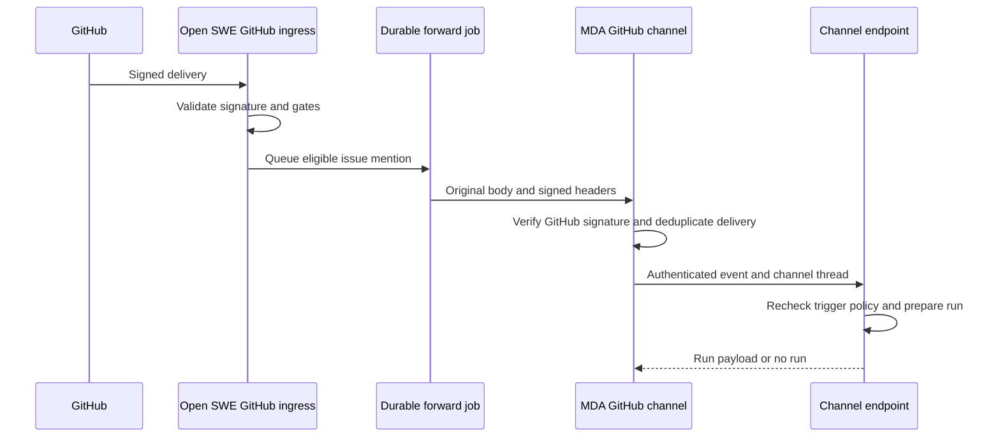
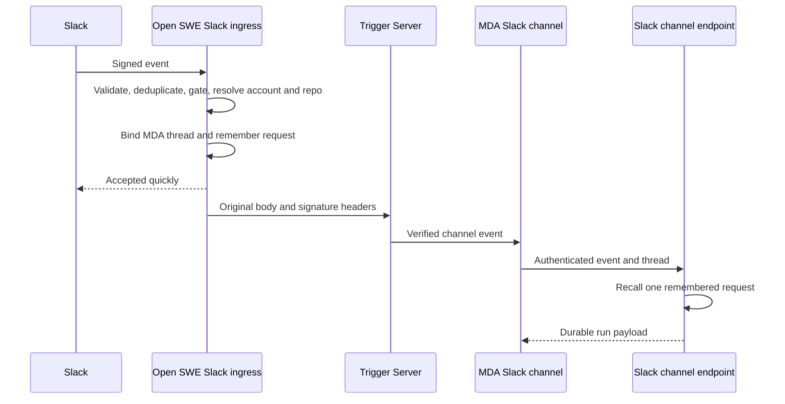

Open SWE receives provider webhooks at its backend, but an MDA channel owns the conversation when that channel is selected. That distinction is an invariant, not merely a delivery optimization: the owner starts runs and posts replies, stops, and failures in its conversation. The backend performs provider-facing validation and policy gates, prepares trusted run payloads, and exposes authenticated channel endpoints; it must not independently post or start a run in an MDA-owned thread.

The FastAPI application mounts the GitHub ingress and GitHub channel endpoint, Slack ingress and Slack channel endpoint, and Linear channel endpoint. Channel endpoints require a Standard Webhooks signature made with `MDA_SERVICE_SECRET`; without that secret every call is refused. MDA is expected to have already verified the provider delivery before calling the backend endpoint.

## Inbound trust, logging, and routing gates

Validation and routing occur *before* run initiation. A delivery may be recorded or trigger limited side effects without being eligible to start an agent turn.

| Provider | Public/backend entrypoint | Trust and deduplication | Routing decision |
| --- | --- | --- | --- |
| GitHub | `POST /webhooks/github` | Checks `X-Hub-Signature-256` over the raw body, records an `EventLog` entry with GitHub delivery ID and references. | Rejects unsupported events, unroutable repositories, unsupported actions, unallowlisted repositories, unregistered comment authors, missing mentions, and public-repository organization-gate failures before the relevant work is queued. |
| Slack | `POST /webhooks/slack` | Checks Slack timestamp/signature before parsing. It records the envelope and rejects previously seen event IDs; later request claiming prevents duplicate turn work. | Rejects malformed/irrelevant events, ineligible or externally shared channels, disallowed bots, and messages that are neither a supported mention/DM nor another explicitly supported surface. Temporary channel-verification uncertainty returns `503` so Slack can redeliver. |
| Linear | MDA receives the provider webhook; `POST /linear/channel/events` is backend ingress from MDA | MDA validates Linear signature and age. Backend authenticates MDA, bounds payload size, validates event key/thread UUID, and uses `EventLog.record_once` keyed by delivery ID. | Issue create/update are automation events, comments start nothing, and only valid agent-session events can become session turns. |

GitHub additionally treats workspace ownership as a safety gate. If ownership lookup is temporarily unavailable it returns `503`, rather than silently discarding work; if a repository is known not to be assigned to a workspace it returns an ignored result. GitHub webhook handling also invalidates PR UI state, clears repository cache after installation changes, and wakes the native merge queue for relevant events.

This shows the issue-mention handoff: original signed material remains available to the MDA channel while the backend remains the policy and run-preparation authority.

## GitHub: split issue conversations from repository and PR operations

### Issue mentions belong to the GitHub channel

For a supported `issues` action (opened, edited, or reopened) Open SWE only considers title/body edits and requires an Open SWE mention. For `issue_comment` it requires a supported action, a registered sender, and a mention; comments on pull requests are deliberately excluded. Eligible issue events are forwarded to MDA's GitHub channel, which owns the issue conversation and calls `POST /github/channel/events` to ask whether it should start a run.

The forward preserves the raw GitHub body byte-for-byte and forwards only `X-Hub-Signature-256`, `X-GitHub-Event`, `X-GitHub-Delivery`, and `Content-Type`. It is queued under a delivery-specific job key, avoiding loss on backend restart and coalescing redelivery while pending. Forwarding tries up to four times for transport errors, `429`, and `5xx`, honoring a bounded `Retry-After`; it does not retry other `4xx` responses or redirects. MDA deduplicates by delivery ID, so a lost response does not start work twice. If delivery ultimately fails or is refused, Open SWE attempts a `confused` reaction on the originating issue/comment so the requester sees the failure.

The channel endpoint accepts only the expected issue event keys and requires the event key's action to match the payload. It repeats the material eligibility checks—issue rather than PR, allowlist/workspace routing, supported action and substantive edit, registered commenter, mention, and public-repository organization gate. This defense means an authenticated channel call cannot bypass the webhook's intended trigger policy. An interrupted MDA thread receives an informational input but no run; otherwise the backend prepares a durable `agent` run tagged `channel: github`, with the GitHub delivery ID and optional completion webhook, then marks the channel thread busy.

### PRs, reviews, CI, and automations remain backend operations

The same GitHub ingress still operates outside issue conversations:

- Pull-request comments and review comments/reviews can invoke the backend PR-comment path; an untagged comment on an agent-opened PR is a special supported continuation. Replies to review findings are handled separately.
- Pull-request lifecycle events update agent-thread PR state. Synchronization withdraws superseded approvals, notifies review guidance, and processes PR synchronization; close and agent-state actions settle human reviews.
- When enabled for the repository and admitted by the public-repository organization gate, qualifying PR actions schedule automatic review. Push events can evaluate reviewer watches. The reviewer fetches PR metadata and validates base/head SHAs, uses a successor reviewer thread, records PR/watch and optional Slack-thread metadata, posts a review-started comment, and dispatches a `reviewer` run.
- CI events, GitHub issue-open events, and eligible PR-open/close events can launch scheduled automations. Merge-queue wakeups are best-effort for relevant push/PR events, while the minute job recovers missed wakeups.

This division is important when extending GitHub behavior: do not route PR conversation replies through the issue channel merely because they share `issue_comment`; the payload's `issue.pull_request` boundary selects the backend PR path.

## Slack: gate first, then bind ownership

Slack's public route responds promptly and sends lengthy work to background tasks. Before a conversation is handed to MDA, it has already verified Slack's signature, filtered event type, validated channel eligibility, resolved bot/mention/DM semantics, checked account linkage, resolved repository context, and claimed the event. A link-needed response is posted before ownership is claimed, so an unlinked user does not create an MDA conversation.

MDA can start only plain-message or file-share turns from a person’s normal channel mention or DM. It does **not** start code-channel sessions, concierge DMs, kitchen-channel untagged work, bot-originated messages, breakouts, edits, or unsupported Slack subtypes. For a new eligible Slack root message, the backend derives a deterministic UUIDv5 from app, team, channel, and root timestamp; atomically binds that Slack thread; indexes it as an MDA `slack` channel thread with initially private/provisional visibility; and remembers the already-gated request plus its resolved repository. Subsequent eligible messages in the same owned Slack thread follow that owner.

This shows the handoff boundary: the backend retains the gated request until the channel asks for that exact message, while the channel owns the visible conversation.

Only Slack’s signature, timestamp, and content type are forwarded to Trigger Server; retry headers are intentionally omitted because they would cause Trigger Server to drop the request. The forward retries server failures up to five times only while the original signature remains within its 300-second acceptance window. A new conversation whose channel has not started can be taken back atomically if Trigger Server refuses it: ownership metadata is cleared and the backend processes the remembered request itself. Once the channel has started, a failed handoff is reported as a Slack processing error instead—never processed again by a competing owner. A minute sweep reports requests that remain unclaimed after 90 seconds; pending entries expire after ten minutes. Recall is single-take, except that an MDA retry with the same webhook ID may replay its request for five minutes.

At `POST /slack/channel/events`, the backend accepts only `mention`, `directMessage`, or `message` channel events and a valid UUID thread/message timestamp. It recalls the remembered request using MDA's `webhook-id`; unknown or already-taken-by-another-call messages start nothing. It prepares the same Slack run input/configuration the local path would use, translates it for the MDA runtime, attaches `channel: slack` and trigger timestamp metadata, optionally adds the completion webhook, and marks the thread busy only after preparation succeeds. A preparation failure is posted to the Slack thread by the Slack service.

## Linear: session turns, not general issue conversation

Linear's MDA channel owns each Linear agent session and its replies, Stop, and failure reporting. The backend accepts the channel callback only after MDA service authentication. `Issue.create` and `Issue.update` are logged once and schedule Linear automations; `Comment.create` starts no run. For `AgentSessionEvent.created` and `.prompted`, malformed session payloads or sessions without an issue return a user-visible decline. An interrupted session returns the informational “would act” input without creating a run.

A valid session turn is authorized and prepared at the backend boundary:

1. The author is identified from the Linear session/activity and must map by email to an Open SWE user with a current GitHub account link. Otherwise the channel receives a decline asking them to sign in.
2. Repository selection prefers an explicit repository in the turn, then the existing thread repository, then an issue repository reference, then the author/workspace default and finally the workspace default. The selected repository must be allowlisted; otherwise the session is declined.
3. The backend resolves workspace, constructs issue and author context, optionally fetches referenced images and selects a vision-capable model override, adopts/indexes the thread as `channel: linear`, and writes agent-thread metadata including source context.
4. It creates a durable `agent` run configuration, translates it for the MDA runtime, filters metadata to keys MDA permits, includes the completion webhook when configured, and only then marks the thread busy.

Each agent session is its own channel thread, even for the same Linear issue. That isolates session histories while allowing a turn to retain its thread’s selected repository and workspace.

## Ownership, lifecycle, and safe extension

All three channel endpoints construct a backend-owned durable configuration and runtime payload rather than accepting an arbitrary run configuration from the provider/channel. Run metadata names the channel; thread adoption indexes an MDA-runtime thread and mirrors metadata locally without creating the provider-owned MDA conversation. `channel_run_starting` is deliberately last, avoiding a permanently busy thread if preparation fails; the completion webhook or reconcile job settles busy state.

The thread router enforces the ownership boundary after initiation as well. Reads remain possible, but writes to a channel-owned thread are sent through MDA’s trusted-backend channel ingress; copies and crons are refused, and writes that cannot obtain the channel capability are refused. This lets dashboard actions such as interrupt/cancel remain directed to the owning conversation without allowing the backend to take over its posting surface.

When adding a channel or event type:

1. Verify the provider request before parsing/dispatch, record a delivery identity, and make retry/deduplication behavior explicit.
2. Put authorization, workspace/repository routing, account-link checks, and trigger semantics ahead of any thread claim or run preparation.
3. Define one conversation owner and persist enough handoff state to make retries idempotent; background workers should deliver events to that owner, not post independently.
4. Prepare runs through `prepare_durable_run` and the MDA runtime payload path, mark ownership metadata, attach the completion webhook as appropriate, and set busy status only after the response is ready.
5. Specify the visible failure outcome. A failed forward must either be safely taken back before the channel starts or reported by the existing owner—never silently dropped or double-run.

## Focused verification

The GitHub channel tests cover raw-body/header preservation, durable delivery-keyed forwarding, retry/rate-limit/refusal behavior, issue-versus-PR-comment routing, and reaction on a lost delivery. Slack MDA tests cover gating before claim, deterministic thread handoff, restricted forwarded headers, backend fallback before a channel starts, ownership continuity, remembered-request replay, and lost-request reporting. These are the most valuable regression tests for changes to ingress or ownership: they check the no-duplicate/no-silent-loss invariants rather than only handler return values.
