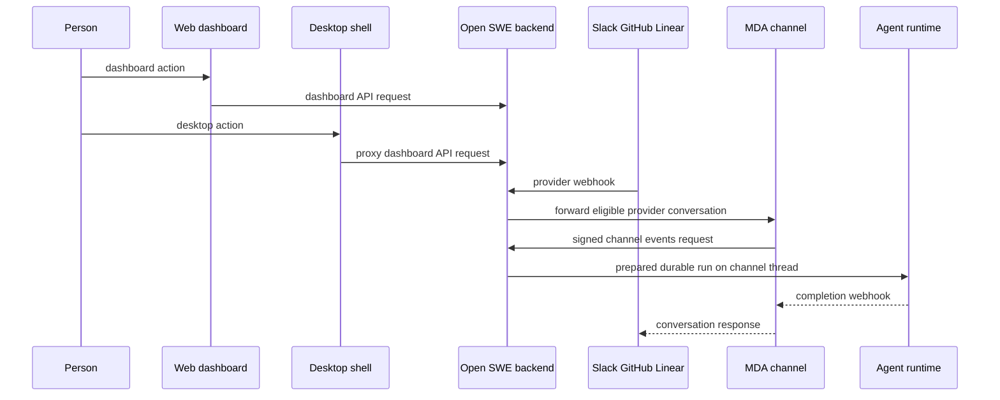

# Dashboard, Desktop, and Conversation Channels

Open SWE has one backend-facing dashboard API and several ways to enter a conversation. The web dashboard is a React/TanStack application normally served from the backend origin; the Electron shell loads that same UI under `open-swe://app` and proxies its dashboard API calls to the selected backend. Slack, GitHub issues, and Linear are provider ingress surfaces whose channel deployment owns the provider conversation and its agent thread, while the Open SWE backend remains the policy and run-preparation authority.

For thread execution and run lifecycle details, see [Thread runtime](/openwiki/architecture/thread-runtime.md). For user identity, session, and authorization policy, see [Security and authorization](/openwiki/concepts/security-and-authorization.md). For invocation semantics and follow-ups, see [Invocation and follow-ups](/openwiki/workflows/invocation-follow-ups.md).

## Surface topology and thread ownership

This diagram shows the ownership boundary: the backend receives and gates ingress, MDA owns an eligible provider conversation's thread, and the backend supplies the prepared run that executes on that thread.

### Backend composition and route families

`create_app()` installs the dashboard aggregate router at `/dashboard/api`, the provider webhook routes, and the MDA-facing channel routers. It permits credentialed CORS only for configured origins plus `open-swe://app`; `DASHBOARD_ALLOWED_ORIGINS` must not contain `*`. The dashboard router applies same-origin checks to mutations and aggregates dashboard domains including authentication, profiles, workspaces, repositories, threads, Slack settings, and the UI invalidation stream.

The backend can serve a built dashboard from the same origin. Its catch-all intentionally leaves API, webhook, thread, runtime, and documentation prefixes to their owners; browser navigation gets the application shell while hashed assets are immutable. In development, `DASHBOARD_DEV_SERVER_URL` replaces the static build with a same-origin reverse proxy to Vite. This arrangement keeps cookie-bearing `/dashboard/api/*` calls relative rather than requiring browser-side cross-origin configuration.

The standalone deployed dashboard server uses `DASHBOARD_API_URL` for its upstream. Its proxy preserves methods, streamed request bodies, redirects, ordinary headers, and separate `Set-Cookie` lines while removing hop-by-hop and decoded-body framing headers. There is deliberately no default upstream, so a misconfigured non-production dashboard cannot silently front production.

## React dashboard behavior

The UI hydrates server-rendered web pages but creates a fresh React root when `window.openSweDesktop` is present. It uses a TanStack Router with a shared React Query client, route-level error UI, scroll restoration, and intent preloading. Dashboard data is cached briefly by default and is also kept on a periodic expiry/refetch cycle for data that must not remain indefinitely in-browser.

### Mutations: optimistic only when truthful

For a user-initiated mutation, prefer an optimistic cache update when the intended outcome is immediately representable and cannot mislead the user. Cancel affected reads first, retain enough previous state to roll back on failure, and invalidate/refetch on settlement. The repository-instruction removal flow is the representative pattern: it removes the item and selection locally, restores both on error, and refetches afterward.

Do **not** use optimism for operations whose acceptance, authorization, asynchronous work, or resulting state cannot safely be predicted; use pending state and refetch instead. The shared mutation cache reports failures through the error-reporting/toast path by default. A mutation may set `silent` only when its component deliberately renders an inline, actionable failure; this avoids duplicate error reporting rather than hiding an error.

Before changing dashboard UI behavior, follow `ui/AGENTS.md` and `ui/DESIGN.md`: use the installed Macaw component and token packages, retain specialized Monaco/Lexical/Pierre/Sonner integrations, and verify accessible, narrow-width, light/dark, loading, and error states.

## UI invalidation: committed changes, not pushed data

Dashboard queries declare the invalidation topics they consume. The browser opens an authenticated SSE stream at `/dashboard/api/ui-invalidations`, subscribing with a repeated `t=<age seconds>.<topic>` value. The server authorizes every requested whole or keyed topic for the current session; it returns a `hello` frame with missed invalidations and denied topics, sends `invalidated` frames containing topic names only, and emits an `alive` heartbeat every 15 seconds. A client refetches matching React Query entries rather than accepting data carried in an event.

Writes record an outbox row and issue PostgreSQL `NOTIFY` in the same transaction, so live listeners are notified only after commit. The outbox also permits replay after a connection or replica gap; it retains rows for one day. The hub subscribes local streams before replaying, closing the race between registration and replay, and adds a safety margin when reconnecting. If replay fails, the API marks every subscribed topic stale, preferring extra refetches over stale UI. If the hub cannot start, pages still work and local actions refetch, but they do not hear changes made elsewhere.

Keyed topics publish both a general topic and the record-specific topic. Topics that could reveal private resource changes—such as threads, pull requests, and incidents—authorize requested keys before a session can hear them; topic frames disclose no payload.

On the client, browser tabs elect a Web Locks leader. Only the leader owns the `EventSource`; other tabs contribute their observed-query interests through `BroadcastChannel` and each invalidates its own query cache. The leader opens a replacement stream before closing the old one when subscriptions change, treats malformed frames or 45 seconds of silence as failure, and reconnects with capped exponential backoff. Queries also retain ordinary stale-time behavior as a fallback.

## Desktop shell

The experimental Electron application is a native host, not a dashboard bundle. It registers the secure `open-swe://` scheme, downloads the UI selected by the connected backend's `/desktop-ui.json`, and serves it locally. The descriptor must name the supported bridge protocol, a SHA-256, and an exact GitHub-release archive URL; the shell verifies the checksum, validates archive paths, stages files, and atomically changes `current.json`. A cached complete snapshot starts immediately while a refresh runs in the background, so a failed, interrupted, incompatible, or corrupt update leaves the earlier UI usable. A first launch with neither cache nor connectivity shows a retryable load failure.

Each backend URL has its own local UI cache. The renderer uses native IPC for desktop-only capabilities, while Electron proxies `/dashboard/api/*` to the selected backend so the renderer neither receives a server-side LangSmith key nor calls raw LangGraph routes directly. Desktop uses the same GitHub-login dashboard session as web; `open-swe://app` is explicitly permitted by backend CORS. The backend offers temporary alternate environments through `/dashboard/api/desktop/environments`, parsed from `OPENSWE_ALTERNATIVE_ENVS` as `name:url` values.

A **This Mac** task remains an ordinary backend thread, but a local bridge polls for execution and file-transfer work and runs it in the selected local checkout. It is therefore visible on web and other computers, but can continue only while its originating desktop bridge is reachable. This is an operational boundary, not a filesystem sandbox: commands use the login-shell environment after secret-shaped variables are removed except `GITHUB_TOKEN` and `GH_TOKEN`.

## Provider ingress and MDA channels

### Shared channel contract

MDA verifies the provider delivery, creates or locates the provider conversation's thread, and invokes the backend endpoint configured as its channel event handler. The backend endpoints are protected by Standard Webhooks verification with `MDA_SERVICE_SECRET`; an absent secret denies every call. They validate event shape and thread UUID, apply Open SWE policy, prepare a signed durable run with channel metadata, rewrite its runtime payload for the MDA thread, include the configured completion webhook when present, and mark the channel run as starting.

MDA calls `/mda/resolve-user` before channel runs to map a verified sender to an Open SWE user. Slack identity mapping requires both the linked Slack user and team; GitHub accepts only an actor of type `User` and maps by numeric GitHub ID; Linear requires a user-type sender with email. Unknown, unverified, bot, app, or mapping-error cases return `null`, leaving the channel principal in effect. This keeps one linked person aligned across dashboard and channel runs without treating a Slack identifier from another workspace as the same person.

### Slack

Slack continues to call Open SWE at `/webhooks/slack`. After Slack signature verification and the normal backend gating, only a plain-message/file-share mention or direct-message conversation that MDA can start is claimed for the MDA channel. Code channels, concierge DMs, kitchen channels, bot-originated messages, breakout flows, and unsupported subtypes remain on the backend intake because their conversation model or context needs backend-specific handling.

For a claimed conversation, Open SWE deterministically derives an MDA thread ID from app, team, channel, and root timestamp; binds the Slack root to it; initializes provisional private visibility; records the gated request; and forwards the original body plus only Slack-signature-relevant headers to Trigger Server. MDA's Slack channel then calls `POST /slack/channel/events` with its thread and a `webhook-id`. The backend recalls the one remembered request for that message and call ID, prepares the run, and returns it. Replays using the same call ID can retrieve the request again, whereas competing calls cannot; remembered requests expire. If forwarding never completes or MDA never asks, the backend takes the request back and reports an error, so a forwarded message is not silently lost or processed twice.

### GitHub issues

`POST /webhooks/github` verifies `X-Hub-Signature-256`, records the delivery, invalidates a referenced pull-request topic, and checks workspace routing. Issue opens, qualifying title/body edits, and qualifying issue comments that mention Open SWE are forwarded to the MDA GitHub channel; pull-request comments remain on the backend's own intake. The ingress route rejects unsupported actions, unallowlisted or unroutable repositories, unregistered commenters, missing mentions, and public-repository organization-gate failures. A transient workspace ownership lookup error returns `503` so GitHub retries rather than dropping work.

The channel calls `POST /github/channel/events`. The endpoint accepts only its enumerated issue and issue-comment keys, re-applies the run-start gate, and starts a prepared durable run on MDA's supplied thread. An interrupted thread starts no run; it receives only an informational input so the provider can reflect that Open SWE would act after the interrupt resolves.

### Linear

The MDA Linear channel verifies Linear's signature and delivery age, then calls `POST /linear/channel/events`. The backend accepts only supported issue, comment, and agent-session event keys, requires a valid UUID thread and delivery ID, bounds serialized payload size, and records each delivery once. Issue create/update events schedule Linear automations; ordinary issue and comment events start no agent run. A parsed agent-session turn prepares and returns a run on the session's channel thread, or returns a structured decline when it cannot run. As with GitHub, an interrupted session thread receives an informational input and starts nothing.

## Operations and focused verification

* Set explicit `DASHBOARD_ALLOWED_ORIGINS`; wildcard origins are rejected with credentialed CORS. Supply `DASHBOARD_API_URL` to a separately deployed dashboard server. A backend may serve the built dashboard itself or proxy a Vite server with `DASHBOARD_DEV_SERVER_URL`.
* MDA channels require a shared `MDA_SERVICE_SECRET`; provider ingress also requires each provider's signing configuration. Treat the MDA endpoints as backend-internal authenticated integration boundaries, not public user APIs.
* PostgreSQL enables multi-replica invalidation delivery and replay. Without it, the invalidation hub is disabled; UI actions and normal query freshness still provide fallback behavior.
* Test dashboard changes with the dashboard thread, UI, CSRF, OAuth, desktop-connect, and invalidation-related suites. Test channel changes with Slack forwarding/channel mapping and MDA user-resolution tests, plus GitHub/Linear webhook or channel tests matching the changed policy. In particular, preserve tests for signature rejection, workspace routing/retry behavior, idempotent replay, interrupted threads, and Slack takeover failure.
